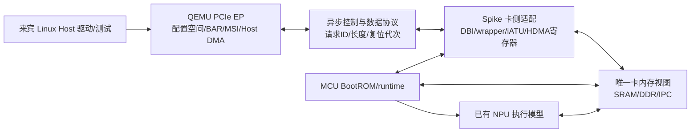

# EMU 参考 demo 转软件仿真可行性分析

日期：2026-10-27。性质：内部平台静态分析与实施建议；本轮没有移植或执行新 demo，没有改变第一阶段的运行与验收结论。

## 1. 结论

**可以用于开发所需的软件仿真代码，最直接的用途是实现第二阶段的 PCIe EP、地址转换、固件加载和 HDMA 功能模型；但当前上传内容不足以直接移植出“真实工具链包 → 生产 runtime → NPU 执行”的完整闭环。**

当前包的主体是 MCU BootROM/裸机 PCIe 驱动及测试片段。应保留其中的软件流程作为被测程序，在 QEMU/Spike 中补上它所访问的硬件行为，而不是把驱动中的寄存器写入函数直接复制为设备模型。工具链生成的命令包、生产 runtime 的解析与调度代码仍需单独提供。

建议立即将这些资料用于第二阶段接口对齐和单卡最小实验。优先跑通 BAR2 → SRAM/IPC 的固件下载，再实现 HDMA 双向 Host IOVA DMA，最后接生产 runtime 和真实命令包。第一阶段的假包闭环继续作为回归基线。

## 2. 本轮实际审查的资料

- `simulator/pcie-demo`：29 个文件，含 11 个 C 文件、17 个头文件和 1 个资料位置说明；未包含 Makefile/CMake、链接脚本、启动汇编、ELF/bin、Host Linux 驱动、启动脚本或参考日志。
- `T100 MEMMAP_Pre95V3.xlsx`：检查地址表、版本记录及相关页签；后文以 `address_map` 的 Excel 原始行号定位。
- `hs_pcie_x8_wrap_reg.docx`、`pd_hs_sub_wrap_reg.docx`：提取正文和表格文字，重点检查 PCIe wrapper 的控制/状态、复位及中断条目。
- `hs_pcie_phy_wrap_reg.xlsx`：提取页签内容，检查 PHY 配置相关条目。功能版只需覆盖实际使用范围。
- `DWC_pcie_ctl_reference_6.40a.pdf`：共 18719 页，本轮读取目录/书签及选定寄存器页，没有逐页审查。重点为 §3.2.57 iATU、§3.2.59 HDMA，页码采用 PDF 页序/对应页脚，如 3988—4004 页。
- `zc_simulator` 的总体方案、第一阶段接口决策与验收报告，以及现有 EP、桥接程序和 Spike 地址定义。

以下“未发现”指本次上传目录及所检查路径，不代表这些组件在其他 SDK 中不存在。

## 3. demo 实际做了什么

### 3.1 当前可见的启动主线

```text
main.c:main
  → 时钟、复位、efuse/strap、UART、HSM 等初始化
  → test_main（上传包中只有默认返回 0 的 weak 实现）
  → load_firmware
  → BOOT_LOAD_PCIE_EP 分支
  → boot_interface_init_pcie_ep
  → unified_pcie_ep_init → pcie_ep_init
      → BISR、wrapper/PHY 控制、版本/iATU 探测
      → link up、等待 Host 分配 BAR2
      → 配置 SRAM 和 IPC 两个 inbound 窗口
  → boot_load_pcie_ep
      → 轮询 IPC FW 命令，取得固件地址
      → 读取 firmware_header_t，检查类型/大小/加载地址
  → 后续校验与 jump_firmware
```

依据：`src/main.c:175/243/305`、`src/load_firmware.c:48/431/813`、`src/pcie/pcie_ep.c:756/872`。

**这条 PCIe 加载分支本身没有启动 HDMA。** 当前是 Host 先把固件放到可见存储区，再通过 IPC 通知 MCU。不能把“存在 dw_hdma.c”解释为“固件已通过 HDMA 加载”。如果仍按总体方案要求使用 HDMA，需要另行接入该流程。

### 3.2 包内的独立测试能力

| 内容 | 已有代码 | 当前边界 |
| --- | --- | --- |
| inbound | BAR2 地址匹配；另有 BAR ID 匹配测试 | 启动主线启用 SRAM/IPC 地址匹配；其他测试是未调用的 static 函数 |
| outbound | MCU 经本地 PCIe aperture 访问 Host 地址，读写固定 magic | 依赖 Host 提供有效 PCIe 地址和可访问内存 |
| HDMA | non-LLM 寄存器模式、LLM 链表模式；写通道 0、读通道 1 的 16 字节往返 | 测试未接入主线；没有提供对应 Host 程序和通过日志 |
| 中断 | MSI 生成代码、MSI-X 设置片段 | INTx 返回不支持；MSI 有未初始化字段/TODO；MSI-X raise 路径未实现 |
| RC | RC 初始化、配置访问和 NVMe 相关调用 | 当前 Q35 Host + 卡 EP 架构优先使用 EP，RC/NVMe 不在最小迁移范围 |
| IPC | INIT/PING/FW 和 READY/ACK 轮询 | 是启动控制协议，没有 NPU 算子、图、描述符队列或工具链命令解析 |

这里的 HDMA **LLM 指链表传输模式（Linked List Mode）**，不代表大语言模型或工具链业务负载。

## 4. 能复用什么，需要写什么

| 原内容 | 软件仿真中的用途 | 适配方式 |
| --- | --- | --- |
| `unified_pcie_regs.h`、`dw_hdma.h`、地址表 | 寄存器、字段和描述符的对照依据 | 核对 IP 集成参数、读写属性、复位值与地址冲突后采用，不能整份无审查照搬 |
| `dw_pcie.c` 的 iATU 配置/探测 | MCU 端被测驱动与访问序列 | 保留驱动逻辑，模型实现探测掩码、窗口数量、使能读回和转换效果 |
| `pcie_ep.c` 的 SRAM/IPC inbound 流程 | 第二阶段最先落地的真实接口实验 | 将 BAR 命中转入唯一的卡内存/寄存器后端，MCU 与 Host 读取同一份状态 |
| `dw_hdma.c` | 驱动侧寄存器提交和描述符构造参考 | 新写 HDMA 功能模型：取描述符、搬运、错误、STOP/ABORT、清状态及复位取消 |
| `pcie_ipc.c`、`load_firmware.c` | 启动握手、固件头解析、加载入口 | 先修清地址/握手疑点，再适配到 Spike；不能替代生产 runtime |
| `pcie_common.c` 的 BISR/PHY/link | BootROM 执行所需的外围寄存器行为 | 功能模式实现受控制的状态推进，不做模拟电气训练；错误/超时仍可观察 |
| `main.c` | 完整 BootROM 流程参考 | 依赖过多，最小实验优先抽取 PCIe 启动路径；完整 BootROM 兼容需补 SDK/外设 |
| 现有 Spike Tensor/scheduler、常驻执行器 | 实际 NPU 动作执行 | 继续复用，生产 runtime 的包解析入口另行接入 |
| 第一阶段 QEMU/socket 桥 | 拓扑、进程隔离、非阻塞事件处理经验 | 现有固定 160 字节协议须扩展为有类型、长度、request ID、复位代次的控制/数据协议 |

`unified_driver_common.h:266—295` 是 volatile 物理地址解引用。在 Spike 上运行 MCU 程序时，可以保留这种访问方式，但必须在 Spike 总线提供对应设备；把同一源码编译成宿主进程直接调用会访问无效宿主地址，需要专门的 MMIO 抽象。

## 5. 已能对齐的地址与仍未冻结的配置

| 对象 | demo 依据/地址 | 手册或现有 simu 对照 |
| --- | --- | --- |
| PCIe0 wrapper | `0x20280000` | MEMMAP `address_map` 第 193 行一致 |
| PCIe0 DBI | `0x21000000` | 第 207 行给出 `0x21000000..0x21ffffff` 控制器区间 |
| DBI2 | `0x21100000` | demo 按 DBI + 1 MiB 定义，需确认本项目集成解码 |
| unroll iATU | `0x21300000` | demo 按 DBI + `0x300000` 定义 |
| HDMA | `0x21380000` | demo 按 DBI + `0x380000` 定义；不能仅凭通用 DWC 手册确定项目绝对基址 |
| PHY wrapper | `0x20282000` | 第 195 行一致 |
| MCU SRAM | `0x40000000..0x401fffff`，2 MiB | 第 213 行一致；现有 Spike 将该段纳入实验 DDR0，不等同于已建模真实 MCU SRAM |
| IPC window | `0x18103000..0x18103fff` | 第 114 行标记为 SCU；具体 IPC 字段语义来自 demo，需要确认寄存器归属 |
| IPC 四寄存器 | `0x18103180 + chip_id*0x1000`，偏移 `0/4/8/c` | INIT/PING/FW 协议由 `pcie_ipc.h` 定义；单卡先只使用 chip 0 |
| MCU outbound aperture | `0x18000000000` | 第 236 行一致；它不是 Host GPA/IOVA |

当前 `pcie_ep_config_fw_inbound_atu()` 的有效映射是：

```text
Host 分配的 BAR2 基址 B
  B + 0x000000 .. B + 0x1fffff → die local 0x40000000 .. 0x401fffff
  B + 0x200000 .. B + 0x200fff → die local 0x18103000 .. 0x18103fff
```

所以 chip 0 的 IPC 四寄存器对应 Host `BAR2 + 0x200180/184/188/18c`。这需要 BAR2 至少覆盖 `0x201000` 字节；若两窗口保持在同一标准 BAR，按二次幂分配的最小尺寸是 **4 MiB**。这只是由当前代码推出的最小实验配置，**不是已确认硬件 BAR2 大小**。

当前第一阶段 BAR0 只有 64 KiB，不能满足该布局；八卡仅做过 64 KiB BAR 的资源实验，也不能证明真实大 BAR 布局可枚举。包内 BAR4 注释提到 32 GiB，但本次未找到它在启动主线中的 sizing 配置与验证依据，应先取得真实配置空间 dump/DBI2 掩码。八卡若每卡采用 32 GiB BAR，仅此项地址窗口就达 256 GiB，需要重做 64 位 BAR/桥窗口/固件资源分配验证；地址空间预留不意味着必须分配等量宿主 RAM。

另外，demo 的 iATU 声明范围 `+0x300000`、大小 1 MiB，与 HDMA `+0x380000` 的声明范围存在包含/重叠。建模时须明确有效子区间、窗口数量和空洞，不能把整个范围当普通可读写寄存器数组。

## 6. 移植前必须处理的具体问题

### 6.1 完成状态与等待行为

1. `pcie_ep.c:118—178` 把“曾非零、随后 ch_stat=0”当完成；DWC 6.40a §3.2.59.17（3997 页）定义 `0=RESERVED、1=RUNNING、2=ABORTED、3=STOPPED`。应去掉该未经手册支持的成功回退，结合 STOP/ABORT、STOPPED 及数据校验制定完成契约。代码中 `ch_stat==3` 的调试回退默认关闭，不能据此认为状态解释已正确。
2. `dw_hdma.c:279` 等待 `ch_stat != 0` 无超时；non-LLM 也有无界轮询，且返回 `void`，ABORT 不能直接传回上层。需要有界等待、明确返回码；功能模型若瞬间完成，也必须允许驱动观察合法最终状态。
3. `dw_hdma_v0_core_start()` 读回 doorbell，而同文件 non-LLM 路径注释明确写 doorbell 不可读。模型需按手册实现读写属性，不能靠“写什么读回什么”支撑测试。
4. `pcie_ep_init()` 未见 `pcie_hdma_base` 赋值；全局 `g_dwc_pcie` 初值为零，直接启用现有 HDMA 测试会使用错误寄存器地址。测试函数目前也没有调用入口，必须先接入。

### 6.2 启动与 IPC 协议

1. `pcie_ipc_master_send_fw()`（`pcie_ipc.c:171`）复制到 `dst_fw_addr=0x20000000+chip*1MiB`，发送的却是源 `fw_addr`；接收端随后直接解引用发送地址。缺少地址别名/共享视图说明时，这不能证明接收方读到复制后的内容；该目标地址也不同于新 BAR2 SRAM 窗口。需明确发送的是接收端可见地址，并逐字节验证。
2. `pcie_ipc_master_ping_chip()` 等待并清除 `PING_READY`，随后 `master_send_fw()` 又等待同一前置状态。按当前源码串联这两项 API，未见重新置位来源，存在超时疑点；需要明确状态机，不能把这些 API 直接串起来当已跑通流程。
3. `0x18103180/184` 在固件 IPC 中是 COMMAND/STATUS，在 `pcie_ep_wait_host_target_addr()` 中又被用作 Host 地址 low/high。它们是不同测试语境，不能同时使用同一槽位；应明确模式切换或划分独立寄存器。
4. `PCIE_IPC_MAX_CHIPS=4`、每 chip `+0x1000` 与当前仅 4 KiB IPC inbound 窗口不匹配；chip 1 起已超出此窗口。这里的 chip/die 编号不能直接当 QEMU 的八卡实例号。
5. FW_READY 由收命令函数写出，早于 `boot_load_pcie_ep()` 的固件检查及 `jump_firmware()`。它只说明握手接收，不能作为 runtime 已启动或 NPU 已完成的证据，需增加或取得正式的 runtime-ready 机制。

### 6.3 地址、配置与中断

1. `t100.h:188` 将 PCIe1 控制器也写为 `0x21000000`，MEMMAP 第 208 行为 `0x22000000`；PCIe1 数据入口宏 `0x20800000000` 与第 237 行窗口起点 `0x20000000000` 不同。前者是明确冲突，后者需确认是否有意选择窗口内偏移；单卡 PCIe0 可先避开，但扩展前必须定案。
2. `dw_pcie_disable_atu()`（`pcie_ep.c:436`）忽略方向、始终清 inbound；outbound unmap 调用它会清错方向。
3. `dw_pcie_ep_conf_read/write()`（386/400 行）参数是 32 位数据，实际使用 byte DBI helper。需明确 API 本意和访问宽度，避免配置字段截断。
4. MSI 所需 `msi_cap/msi_mem_phys` 在 EP 主线未见初始化，INTx/MSI-X 的现有缺口也不能靠现阶段 INTx 实验覆盖。应按 Host 驱动实际要求补能力与通知路径；本地 HDMA 中断、对 Host 的 MSI、runtime 完成通知要分别建模。
5. 固件校验应检查完整区间 `load_addr + size` 的溢出、尾端、保留区和 entry 合法性；只检查起点和单独 size 不足。移植时还须用实际链接 map 避免覆盖当前 `0x40000000` 的 MCU 常驻程序。
6. `mem_map.h` 的 `CONFIG_SOC_QEMU` 是另一套 `0xa0000000` 布局，不能因为 Host 使用 QEMU 就选它。MCU 运行在 Spike，配置应按目标卡内地址和 SDK 定义选择。

这些是静态审查发现，不代表已在 EMU 或软件仿真上复现故障；也不应通过模拟错误寄存器行为来让原测试表面通过。

## 7. 推荐的模型分工



QEMU 负责 PCIe Host 可见行为及 requester/IOMMU 集成；Spike 提供 MCU 访问的 SoC 地址设备。iATU/HDMA 控制状态必须各有唯一所有者，通过协议同步，不维护互不关联的两套寄存器。图中将 MCU 可见寄存器放在卡侧是推荐分工，实际 HDMA 执行调度位置可以调整，但搬运只能执行一次。

现有 `simu_bridge.py` 只能转发固定 160 字节请求和固定形式响应，无法承载任意 MMIO、内存访问、DMA 和异步事件。可保留其进程隔离方式，新增协议能力和卡内存访问入口。QEMU 的 MMIO 回调不得同步等待 FIFO/Spike。

特别需要明确：MCU 的同步 load 如何等待后端响应、Host BAR 读取如何获得一致数据、两端同时访问 IPC 如何排序。可评估受控共享内存与异步更新，但必须覆盖原有较宽实验内存区间的分派，不能用地址别名意外覆盖 NPU 数据。仅在 socket 中增加操作码，还不能自动解决这些执行与一致性问题。

地址路径至少区分以下三类：

- Host → BAR → inbound iATU → die local：使用 Linux 实际分配的 BAR，支持解码关闭和重定位。
- MCU CPU outbound → outbound iATU → Host IOVA；HDMA 的 Host 侧地址按其 ATU_BYPASS 配置决定是否先过设备 iATU。两者访问 Host 内存时都必须保留 requester 对应的 IOMMU 检查。
- Peer 请求 → 受限 peer BAR 路由 → 目标 inbound iATU → 目标 local：留待第三阶段实现与隔离验证。

**HDMA CONTROL1 bit9 的 ATU_BYPASS（手册 3989 页）仅绕过设备 iATU，不表示绕过 Host IOMMU，也不自动实现 P2P。** `dw_hdma.c` 的 `0x202/0x203` 已设置该位，HDMA 测试的 Host 地址应按实际 PCIe 总线地址/来宾 DMA API 返回的 IOVA 解释，不能替换成宿主指针或来宾任意 GPA。

## 8. 具体实施顺序与通过条件

| 步骤 | 最小实施内容 | 验收证据 |
| --- | --- | --- |
| 0. 冻结资料 | 源码哈希、EMU 构建配置、链接 map、PCI 配置 dump、BAR/iATU 参数；确定上述疑点处理方式 | 同版本接口对照表；未知项明确标记 |
| 1. 最小 MCU 构建 | 抽取 PCIe EP/IPC 所需代码，补 startup/linker/timer/cache/log 适配，避免完整 BootROM 外设依赖 | ELF/反汇编、内存布局、Spike 实际启动日志 |
| 2. BAR2 固件路径 | QEMU BAR2 + 卡侧 DBI/iATU 探测 + SRAM/IPC 一致视图；Host 写小固件并通知 MCU | 下载字节全量校验、固件头解析、实际跳转后的 ready 标志、重复下载/复位行为 |
| 3. HDMA non-LLM | 初始化基址，Host 用 DMA API 分配并提供 IOVA，先 16 字节双向，再覆盖长度/边界 | 内容一致；未映射/只读/越界失败；STOP/ABORT/清状态及超时有据可查 |
| 4. HDMA LLM 与加载 | 实现描述符取数、CB/TCB/LLP、终止/非法链及复位取消，再接固件/数据加载 | 非连续描述符、错误地址、在途复位；HDMA 下载后实际 runtime-ready |
| 5. 真实工具链包 | 接 Host 提交格式、常驻 runtime 解析与已有 NPU 执行，保留正式完成语义 | 连续两包以上无重启；逐包 trace；NPU 真实结果与参考一致；非法包不执行 |
| 6. 扩双卡/八卡 | 按原方案逐阶段实现 peer 路由、隔离和并发，重做真实 BAR 资源实验 | IOMMU 与 P2P 并存；最终 56 有向卡对及八卡业务回归 |

拟新增代码职责可以具体分为：QEMU 真实接口 EP、Spike PCIe MMIO 设备、iATU 窗口状态、HDMA 通道执行器、卡内存访问适配、Linux DMA 测试驱动、MCU 最小启动工程、端到端回归脚本。这些是后续开发项，本轮没有创建对应实现。

每一步均延续第一阶段的非阻塞 QEMU 事件处理、请求归属及复位隔离原则。先保留实验 EP 独立运行入口，真实接口模型通过同类回归后再迁移主路径，避免同时更换传输协议、加载方式与 NPU 执行入口而无法定位差异。

## 9. 新资料关闭了哪些缺口

| 第一阶段待办 | 本次更新后的判断 | 仍需内容 |
| --- | --- | --- |
| PCIe 寄存器/BAR/ATU/HDMA 资料 | 已取得一批可开发参考，不能再笼统标为全部未提供 | 项目集成参数、BAR sizing、配置 dump、复位/中断协议及地址冲突定案 |
| VPS/ZeBu 参考 demo | 已取得 MCU BootROM/PCIe 源码片段 | 完整可构建工程、Host 配套程序、实际启动步骤和成功日志 |
| 真实工具链包 | 当前包没有关闭这一缺口 | 最小实际包字节、生成版本、格式、参数依赖、目标动作及结果样本 |
| 生产 MCU runtime | 当前包没有关闭这一缺口 | 常驻 runtime 源码/镜像、解析入口、调度/完成/错误协议和 MCU ISA/SDK |
| Host 驱动与 DMA | 当前目录未提供 | Linux probe/BAR/MSI/DMA 路径；无法取得时可先写明确标记的最小测试驱动 |
| P2P、八卡、NPU Host DMA | 没有新增实现证据 | 按第三/四阶段落实；HDMA 和 NPU DMA 是不同发动机，不能相互替代验收 |

第一阶段文档是 2026-10-26 的历史状态，本报告补充 2026-10-27 新资料到位后的判断，不追改历史验收记录。

**下一项最值得做的工作：以当前源码为依据，建立“BAR2 下载小固件 → MCU 解析并启动 → ready 回传”的单卡实验，同时冻结真实 BAR/iATU/IPC 契约。** 这能最快将新资料转成可运行的软件仿真能力；工具链包和生产 runtime 继续作为后续业务闭环的独立接入依赖。

## 10. 代码与方案索引

- [总体方案](内部PCIe互联平台分阶段实现方案.md)
- [第一阶段接口决策](第一阶段接口决策与待办清单.md)
- [第一阶段验收报告](第一阶段QEMU接入复现与验收报告.md)
- [当前实验 EP](../hw/misc/zc-pcie-sim.c)
- [当前实验桥接](stage1/simu_bridge.py)
- [MCU PCIe EP 参考](../../simulator/pcie-demo/src/pcie/pcie_ep.c)
- [iATU/DBI 驱动参考](../../simulator/pcie-demo/src/pcie/dw_pcie.c)
- [HDMA 驱动参考](../../simulator/pcie-demo/src/pcie/dw_hdma.c)
- [IPC 参考](../../simulator/pcie-demo/src/pcie_ipc.c)
- [固件加载参考](../../simulator/pcie-demo/src/load_firmware.c)
- [现有 Spike 地址定义](../../simulator/riscv-isa-sim/smart/sm_regs.h)
- [寄存器资料目录](../../simulator/寄存器手册)
