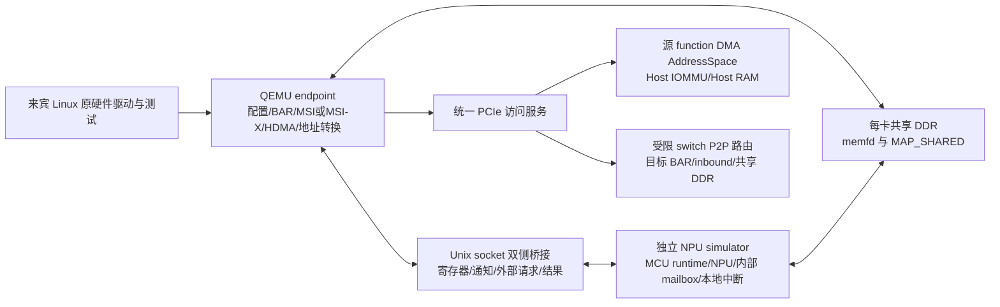

# EMU 参考 demo 转软件仿真可行性分析

日期：2026-10-27。修订依据：[PCIE Switch 集群功能仿真器](PCIE%20Switch集群功能仿真器.md)。性质：内部平台静态分析与实施建议；本轮更新项目范围与实施路径，没有移植或执行新 demo，也没有改变第一阶段的历史验收结论。

## 1. 结论与项目目的

**EMU demo 可以作为 PCIe/HDMA 功能建模和驱动访问序列的参考，但项目开发主线应当是复用现有单 die 软件，补上多卡 PCIe 联合仿真能力。** 按最新架构，单 die runtime、BSP、MCU/NPU 内部驱动、mailbox、本地 DMA 和启动代码已与硬件对齐，作为软件基线整体复用；无需将 BootROM demo 改造成另一套 runtime。

平台的用途是在软件环境中运行硬件平台对应的 Host 驱动和现有设备任务，验证配置访问、任务下发、HDMA/NPU DMA 数据搬运、Host IOMMU、跨卡 P2P、完成通知、错误和复位。目标拓扑为一个 Host/RC、一个 switch、八个 endpoint；每个 endpoint 连接一个独立 NPU simulator 进程，首期每卡启用一个 MCU 和一个 NPU，配置记录实际创建及启用核数。

任务沿用现有 mailbox/队列及参数协议，大块数据走 HDMA 或 NPU DMA。不新建工具链业务包 ABI，不开发 CCL、collective、通信算法或完整算子库。MCU/NPU 镜像按现有 firmware 配置和 dispatcher 从固定入口启动，实际执行初始化并发布 ready；真实 ROM、Host 下载固件及完整冷启动链不属于首期范围。

因此，**先实现共享 DDR、双侧桥接、真实 EP/mailbox 与常驻任务，再通过统一 PCIe 访问服务分别打通 HDMA 和 NPU DMA 的 Host 路径，最后扩展双卡 P2P 和八卡回归。** BAR2 下载小固件、完整 BootROM 移植仅作为后续可选实验，不再作为当前第一步。

### 1.1 与此前分析的关系

此前“上传目录没有生产 runtime/真实工具链包”的结论是对该目录文件的观察；最新架构已明确这些单 die 软件能力作为既有基线复用，不能据此要求重新开发或重复交付整套 SDK。实施时定位现有代码、镜像、配置和任务用例，并保存版本及运行证据即可。架构声明软件基线可复用，不等于 QEMU 联合路径已经验收。

第 3、5、6 节保留对 EMU 参考代码的静态发现。BootROM/FW IPC 相关问题只在实际复用该路径时处理；真实运行期驱动使用的寄存器、HDMA、中断、地址转换问题需要优先核对。

## 2. 本轮实际审查的资料

- [PCIE Switch 集群功能仿真器](PCIE%20Switch集群功能仿真器.md)：本次修订的项目目的、首期范围、软件复用和模型分工依据。以下源码/手册条目沿用前轮静态审查记录，本次未重新执行 demo。
- `simulator/pcie-demo`：29 个文件，含 11 个 C 文件、17 个头文件和 1 个资料位置说明；未包含 Makefile/CMake、链接脚本、启动汇编、ELF/bin、Host Linux 驱动、启动脚本或参考日志。
- `T100 MEMMAP_Pre95V3.xlsx`：检查地址表、版本记录及相关页签；后文以 `address_map` 的 Excel 原始行号定位。
- `hs_pcie_x8_wrap_reg.docx`、`pd_hs_sub_wrap_reg.docx`：提取正文和表格文字，重点检查 PCIe wrapper 的控制/状态、复位及中断条目。
- `hs_pcie_phy_wrap_reg.xlsx`：提取页签内容，检查 PHY 配置相关条目。功能版只需覆盖实际使用范围。
- `DWC_pcie_ctl_reference_6.40a.pdf`：共 18719 页，本轮读取目录/书签及选定寄存器页，没有逐页审查。重点为 §3.2.57 iATU、§3.2.59 HDMA，页码采用 PDF 页序/对应页脚，如 3988—4004 页。
- `zc_simulator` 的总体方案、第一阶段接口决策与验收报告，以及现有 EP、桥接程序和 Spike 地址定义。

以下“未发现”指本次上传目录及所检查路径，不代表这些组件在其他 SDK 中不存在。

## 3. demo 实际做了什么

### 3.1 当前可见的启动主线

```text
main.c:main
  → 时钟、复位、efuse/strap、UART、HSM 等初始化
  → test_main（上传包中只有默认返回 0 的 weak 实现）
  → load_firmware
  → BOOT_LOAD_PCIE_EP 分支
  → boot_interface_init_pcie_ep
  → unified_pcie_ep_init → pcie_ep_init
      → BISR、wrapper/PHY 控制、版本/iATU 探测
      → link up、等待 Host 分配 BAR2
      → 配置 SRAM 和 IPC 两个 inbound 窗口
  → boot_load_pcie_ep
      → 轮询 IPC FW 命令，取得固件地址
      → 读取 firmware_header_t，检查类型/大小/加载地址
  → 后续校验与 jump_firmware
```

依据：`src/main.c:175/243/305`、`src/load_firmware.c:48/431/813`、`src/pcie/pcie_ep.c:756/872`。

**这条 PCIe 加载分支本身没有启动 HDMA。** 当前是 Host 先把固件放到可见存储区，再通过 IPC 通知 MCU。不能把“存在 dw_hdma.c”解释为“固件已通过 HDMA 加载”。最新架构不要求首期通过 HDMA 下载固件；HDMA 用于运行期数据搬运，固件加载能力可以后续独立接入。

### 3.2 包内的独立测试能力

| 内容 | 已有代码 | 当前边界 |
| --- | --- | --- |
| inbound | BAR2 地址匹配；另有 BAR ID 匹配测试 | 启动主线启用 SRAM/IPC 地址匹配；其他测试是未调用的 static 函数 |
| outbound | MCU 经本地 PCIe aperture 访问 Host 地址，读写固定 magic | 依赖 Host 提供有效 PCIe 地址和可访问内存 |
| HDMA | non-LLM 寄存器模式、LLM 链表模式；写通道 0、读通道 1 的 16 字节往返 | 测试未接入主线；没有提供对应 Host 程序和通过日志 |
| 中断 | MSI 生成代码、MSI-X 设置片段 | INTx 返回不支持；MSI 有未初始化字段/TODO；MSI-X raise 路径未实现 |
| RC | RC 初始化、配置访问和 NVMe 相关调用 | 当前 Q35 Host + 卡 EP 架构优先使用 EP，RC/NVMe 不在最小迁移范围 |
| IPC | INIT/PING/FW 和 READY/ACK 轮询 | 是启动控制协议，没有 NPU 算子、图、描述符队列或工具链命令解析 |

这里的 HDMA **LLM 指链表传输模式（Linked List Mode）**，不代表大语言模型或工具链业务负载。

## 4. 能复用什么，需要写什么

| 内容 | 项目用途 | 适配边界 |
| --- | --- | --- |
| 现有单 die runtime、BSP、内部驱动、MCU/NPU 启动代码 | 首期软件基线 | 沿用现有镜像和入口，不重新设计 runtime 或任务协议；记录平台适配差异 |
| 现有 mailbox、NPU 指令/本地 DMA、Tensor/scheduler | 任务接收、内部调度与实际执行 | 保留语义与本地路径，在 NPU DMA 实际访存处增加外部地址分流和异步结果回传 |
| `unified_pcie_regs.h`、`dw_hdma.h`、地址表 | 寄存器和描述符对照 | 以目标 IP 综合配置及实际驱动为准，核对读写属性、复位值、基址、有效窗口 |
| `dw_pcie.c` 的 iATU 探测/配置 | 设备侧访问序列参考 | QEMU 实现权威转换状态，卡侧 MMIO 代理访问；探测必须反映真实掩码与窗口数量 |
| `dw_hdma.c` 和 `pcie_ep.c` 的搬运测试 | HDMA 通道、描述符和完成行为参考 | 在 QEMU endpoint 内新增 HDMA 状态机；首个真实驱动闭环即支持驱动实际使用的模式，不固定要求 non-LLM 先于 LLM |
| `pcie_ep.c` 的 SRAM/IPC inbound 流程 | 可选加载实验、窗口配置参考 | 不据此推定正式运行期 mailbox 的位置和格式；Host BAR 与 MCU 访问沿用现有 mailbox 状态 |
| `pcie_ipc.c`、`load_firmware.c`、`main.c` | BootROM/FW 加载参考 | 不在首期关键路径；不把 INIT/PING/FW 协议升级为业务提交协议 |
| `pcie_common.c` 的 PHY/BISR/link | 实际驱动触及的初始化寄存器参考 | 仅实现首期软件必需行为；完整 ROM/电气训练不作为门槛 |
| 第一阶段 QEMU/socket 桥 | 非阻塞事件与进程隔离经验 | 固定 160 字节假包协议升级为内部控制/访问协议；大块设备 DDR 使用共享映射 |

`unified_driver_common.h:266—295` 是 volatile 物理地址解引用。MCU 软件保留这一方式，Spike 在对应 SoC 地址注册代理设备，将 PCIe/HDMA/转换寄存器请求转交 QEMU；不把这些裸地址当宿主进程指针。

新增工作集中于 QEMU EP/HDMA/转换/P2P、双侧桥接、共享 DDR、NPU 外部 DMA 适配、生命周期和联合回归。已有软件中的任务字段、内部 DMA 驱动和 mailbox 处理直接复用。

## 5. 已能对齐的地址与仍未冻结的配置

| 对象 | demo 依据/地址 | 手册或现有 simu 对照 |
| --- | --- | --- |
| PCIe0 wrapper | `0x20280000` | MEMMAP `address_map` 第 193 行一致 |
| PCIe0 DBI | `0x21000000` | 第 207 行给出 `0x21000000..0x21ffffff` 控制器区间 |
| DBI2 | `0x21100000` | demo 按 DBI + 1 MiB 定义，需确认本项目集成解码 |
| unroll iATU | `0x21300000` | demo 按 DBI + `0x300000` 定义 |
| HDMA | `0x21380000` | demo 按 DBI + `0x380000` 定义；不能仅凭通用 DWC 手册确定项目绝对基址 |
| PHY wrapper | `0x20282000` | 第 195 行一致 |
| MCU SRAM | `0x40000000..0x401fffff`，2 MiB | 第 213 行一致；现有 Spike 将该段纳入实验 DDR0，不等同于已建模真实 MCU SRAM |
| IPC window | `0x18103000..0x18103fff` | 第 114 行标记为 SCU；具体 IPC 字段语义来自 demo，需要确认寄存器归属 |
| IPC 四寄存器 | `0x18103180 + chip_id*0x1000`，偏移 `0/4/8/c` | INIT/PING/FW 协议由 `pcie_ipc.h` 定义；单卡先只使用 chip 0 |
| MCU outbound aperture | `0x18000000000` | 第 236 行一致；它不是 Host GPA/IOVA |

以下是 BootROM demo 的窗口推导，用于理解参考代码；正式首期 BAR/mailbox/DDR 布局按硬件平台运行期驱动冻结，不以此推导替代。

当前 `pcie_ep_config_fw_inbound_atu()` 的有效映射是：

```text
Host 分配的 BAR2 基址 B
  B + 0x000000 .. B + 0x1fffff → die local 0x40000000 .. 0x401fffff
  B + 0x200000 .. B + 0x200fff → die local 0x18103000 .. 0x18103fff
```

所以 chip 0 的 IPC 四寄存器对应 Host `BAR2 + 0x200180/184/188/18c`。这需要 BAR2 至少覆盖 `0x201000` 字节；若两窗口保持在同一标准 BAR，按二次幂分配的最小尺寸是 **4 MiB**。这只是由当前代码推出的最小实验配置，**不是已确认硬件 BAR2 大小**。

当前第一阶段 BAR0 只有 64 KiB，不能满足该布局；八卡仅做过 64 KiB BAR 的资源实验，也不能证明真实大 BAR 布局可枚举。包内 BAR4 注释提到 32 GiB，但本次未找到它在启动主线中的 sizing 配置与验证依据，应先取得真实配置空间 dump/DBI2 掩码。八卡若每卡采用 32 GiB BAR，仅此项地址窗口就达 256 GiB，需要重做 64 位 BAR/桥窗口/固件资源分配验证；地址空间预留不意味着必须分配等量宿主 RAM。

另外，demo 的 iATU 声明范围 `+0x300000`、大小 1 MiB，与 HDMA `+0x380000` 的声明范围存在包含/重叠。建模时须明确有效子区间、窗口数量和空洞，不能把整个范围当普通可读写寄存器数组。

## 6. 参考代码疑点与处理优先级

以下问题只在所选驱动/路径使用相关代码时成为实施项。优先处理运行期 HDMA、转换和中断；§6.2 的固件启动握手及 §6.3 的固件校验属于可选 BootROM 路径，不阻塞固定入口启动。不要根据片段中的疑点推断已对齐的单 die 软件整体不可用。

### 6.1 完成状态与等待行为

1. `pcie_ep.c:118—178` 把“曾非零、随后 ch_stat=0”当完成；DWC 6.40a §3.2.59.17（3997 页）定义 `0=RESERVED、1=RUNNING、2=ABORTED、3=STOPPED`。应去掉该未经手册支持的成功回退，结合 STOP/ABORT、STOPPED 及数据校验制定完成契约。代码中 `ch_stat==3` 的调试回退默认关闭，不能据此认为状态解释已正确。
2. `dw_hdma.c:279` 等待 `ch_stat != 0` 无超时；non-LLM 也有无界轮询，且返回 `void`，ABORT 不能直接传回上层。需要有界等待、明确返回码；功能模型若瞬间完成，也必须允许驱动观察合法最终状态。
3. `dw_hdma_v0_core_start()` 读回 doorbell，而同文件 non-LLM 路径注释明确写 doorbell 不可读。模型需按手册实现读写属性，不能靠“写什么读回什么”支撑测试。
4. `pcie_ep_init()` 未见 `pcie_hdma_base` 赋值；全局 `g_dwc_pcie` 初值为零，直接启用现有 HDMA 测试会使用错误寄存器地址。测试函数目前也没有调用入口，必须先接入。

### 6.2 启动与 IPC 协议

1. `pcie_ipc_master_send_fw()`（`pcie_ipc.c:171`）复制到 `dst_fw_addr=0x20000000+chip*1MiB`，发送的却是源 `fw_addr`；接收端随后直接解引用发送地址。缺少地址别名/共享视图说明时，这不能证明接收方读到复制后的内容；该目标地址也不同于新 BAR2 SRAM 窗口。需明确发送的是接收端可见地址，并逐字节验证。
2. `pcie_ipc_master_ping_chip()` 等待并清除 `PING_READY`，随后 `master_send_fw()` 又等待同一前置状态。按当前源码串联这两项 API，未见重新置位来源，存在超时疑点；需要明确状态机，不能把这些 API 直接串起来当已跑通流程。
3. `0x18103180/184` 在固件 IPC 中是 COMMAND/STATUS，在 `pcie_ep_wait_host_target_addr()` 中又被用作 Host 地址 low/high。它们是不同测试语境，不能同时使用同一槽位；应明确模式切换或划分独立寄存器。
4. `PCIE_IPC_MAX_CHIPS=4`、每 chip `+0x1000` 与当前仅 4 KiB IPC inbound 窗口不匹配；chip 1 起已超出此窗口。这里的 chip/die 编号不能直接当 QEMU 的八卡实例号。
5. FW_READY 由收命令函数写出，早于 `boot_load_pcie_ep()` 的固件检查及 `jump_firmware()`。它只说明握手接收，不能作为 runtime 已启动或 NPU 已完成的证据，需增加或取得正式的 runtime-ready 机制。

### 6.3 地址、配置与中断

1. `t100.h:188` 将 PCIe1 控制器也写为 `0x21000000`，MEMMAP 第 208 行为 `0x22000000`；PCIe1 数据入口宏 `0x20800000000` 与第 237 行窗口起点 `0x20000000000` 不同。前者是明确冲突，后者需确认是否有意选择窗口内偏移；单卡 PCIe0 可先避开，但扩展前必须定案。
2. `dw_pcie_disable_atu()`（`pcie_ep.c:436`）忽略方向、始终清 inbound；outbound unmap 调用它会清错方向。
3. `dw_pcie_ep_conf_read/write()`（386/400 行）参数是 32 位数据，实际使用 byte DBI helper。需明确 API 本意和访问宽度，避免配置字段截断。
4. MSI 所需 `msi_cap/msi_mem_phys` 在 EP 主线未见初始化，INTx/MSI-X 的现有缺口也不能靠现阶段 INTx 实验覆盖。应按 Host 驱动实际要求补能力与通知路径；本地 HDMA 中断、对 Host 的 MSI、runtime 完成通知要分别建模。
5. 固件校验应检查完整区间 `load_addr + size` 的溢出、尾端、保留区和 entry 合法性；只检查起点和单独 size 不足。移植时还须用实际链接 map 避免覆盖当前 `0x40000000` 的 MCU 常驻程序。
6. `mem_map.h` 的 `CONFIG_SOC_QEMU` 是另一套 `0xa0000000` 布局，不能因为 Host 使用 QEMU 就选它。MCU 运行在 Spike，配置应按目标卡内地址和 SDK 定义选择。

这些是静态审查发现，不代表已在 EMU 或软件仿真上复现故障；也不应通过模拟错误寄存器行为来让原测试表面通过。

## 7. 按最新架构确定的模型分工



### 7.1 状态与数据归属

一个 QEMU 管理八个 endpoint，分别连接八个后端进程，以隔离现有模型的全局状态。PCIe BDF/card ID 和后端 chip/die/core ID 分开管理。

QEMU 持有 PCIe、HDMA 和地址转换的权威状态；后端仅代理 MCU 对这些寄存器的访问。后端持有 MCU/NPU、内部 mailbox、本地中断状态，Host 通过 BAR/桥接访问同一份 mailbox。HDMA 完成/错误经桥接触发 MCU 本地中断；MCU 通过硬件控制路径触发 Host MSI/MSI-X。两类通知的 pending/mask/ack 分开维护。

每卡对外 DDR 由 QEMU 与对应后端通过 memfd/MAP_SHARED 等机制共享，BAR、HDMA、NPU DMA、P2P 在权限允许范围访问同一份数据。容量可配置；L1、MCU SRAM 默认保留现有本地模型，HDMA 可达范围由硬件决定，不默认共享所有本地存储。

### 7.2 桥接、可见性与生命周期

`simu_bridge.py` 的固定假包转发不能直接承担上述职责，需要扩展寄存器代理、mailbox 通知、HDMA 本地中断、Host MSI 控制、NPU 外部读写/响应，以及初始化/reset/退出/断连。内部消息包含设备、request ID、会话和复位代次；关联原任务 ID，但不改变业务 ABI。

QEMU MMIO 回调不得同步阻塞等待后端。对后端持有的 mailbox，需明确采用 QEMU 可同步读取的一致访问视图及异步通知机制，并核对 side effect、pending/mask/ack；普通消息缓存不能冒充权威寄存器。MCU 等待寄存器/外部访问响应时，两侧消息泵及中断处理仍需推进，避免相互等待。

共享映射只解决数据唯一性，还须按既有协议实现“数据/描述符发布 → 通知 → 执行 → 数据落地可见 → 完成状态 → 中断”。跨引擎依赖由软件显式同步；DMA 搬运只能执行一次，不能在 QEMU 和后端重复复制。

reset 区分 channel/function/核/全卡范围：停止相关新请求，取消或排空旧访问，确认旧请求不再写内存，再重置并重新初始化。仅丢弃旧响应不足以阻止旧写入；会话、代次与共享句柄生命周期一并管理。

### 7.3 两类 DMA 及地址路径

NPU DMA 在原实际访存处区分本 die、本卡其他 die、PCIe outbound 窗口和非法地址。命中本地继续原路径，外部请求经过出口转换后送 QEMU；保持原指令/描述符、busy、依赖/fence、完成和错误处理。不能把所有本地未命中地址都当 PCIe；512 GiB 槽位及地址宽度按实际地图和描述符能力验证。

HDMA 由 QEMU 通道/描述符状态机执行；两引擎独立提交和完成，共用 PCIe 访问服务。同一 function 使用同一 requester 身份。NPU 外部 DMA 不需要启动 HDMA 通道。

- Host CPU → BAR → inbound/window → 目标寄存器或设备内存。
- NPU DMA 的设备侧窗口地址 → outbound/ATE → Host IOVA → 源 endpoint DMA AddressSpace → Host IOMMU → Host RAM。
- NPU DMA 的设备侧窗口地址 → outbound/ATE → peer 当前 BAR → switch 功能路由 → 目标 BAR/inbound → 目标 DDR；读结果返回源 NPU DMA 的本地目标。
- HDMA 按描述符地址域和 ATU_BYPASS 配置进入 Host/P2P 路径，已转换地址不重复转换。

ATE 泛指设备侧地址转换表，名称及布局按目标 SoC/IP。P2P 不过 Host IOMMU，不经 Host staging；检查拓扑、桥窗口、源 Bus Master、目标 Memory Space、权限、边界、P2P enable 和设备状态。BAR 变化后重新校验映射，P2P 禁用返回错误。

**HDMA CONTROL1 bit9 的 ATU_BYPASS（手册 3989 页）仅绕过设备 iATU，不表示绕过 Host IOMMU。** `dw_hdma.c` 的 `0x202/0x203` 已设置该位；Host 地址按真实驱动下发的 IOVA 解释，不能用宿主指针或任意 GPA 替代。

## 8. 调整后的实施顺序与通过条件

本表与[分阶段实现方案](内部PCIe互联平台分阶段实现方案.md)的 P0—P4 对齐。步骤是开发计划，不表示已有实现。

| 步骤 | 最小实施内容 | 通过条件 |
| --- | --- | --- |
| P0 基线与接口 | 定位已对齐 runtime/BSP/驱动/镜像/任务；固定 QEMU、IP、Host 平台、BAR、转换与中断接口 | 单 die 原有本地任务回归；版本清单和真实驱动接口表；无重复 SDK 交付要求 |
| P1a 共享与桥接 | 单 endpoint/单后端、共享 DDR、寄存器代理、mailbox、事件和生命周期 | 双方观察同一 DDR 数据；控制访问不阻塞；会话/复位代次隔离 |
| P1b 常驻软件闭环 | 按现有 firmware 配置/dispatcher 启动一个 MCU 和一个 NPU，复用 Host mailbox 与 MSI/MSI-X | 初始化在核上执行并发布 ready；原驱动 probe；连续任务后返回服务循环，后端不退出 |
| P2 公共访问服务 | Host IOMMU 地址空间、请求归属和失败回传 | 非恒等 IOVA、跨页、权限、未映射与撤销；错误归属源设备 |
| P2-H HDMA Host 分支 | endpoint HDMA 模型，支持实际驱动使用的描述符模式/通道/地址宽度 | 双向内容、真实描述符、STOP/ABORT、mask/ack、停止/复位和 MCU 本地通知 |
| P2-N NPU DMA Host 分支 | 原 DMA 实际访存接出口转换和外部请求/结果 | 不启动 HDMA 也能读写 Host；保留 busy/fence；失败不报成功 |
| P2-M 混合任务 | 两引擎接既有 runtime 任务与完成通知 | HDMA/HDMA、NPU/NPU、HDMA/NPU、NPU/HDMA 四种输入输出组合；数据先可见再发完成 |
| P3 双卡 P2P | 动态 peer BAR、受限路由、目标 inbound、读响应返回 | 两类引擎按实际能力分别读写；与 Host DMA 并存；禁用/重定位/越界/重配置/reset 明确失败 |
| P4 八卡交付 | 一个 QEMU、八个独立后端；自动生成拓扑与启动配置 | 56 个有向卡对、八卡 Host DMA/隔离/并发及故障恢复；原驱动/任务联合回归 |

P2-H 与 P2-N 在公共服务具备后可分别开发，不形成“先实现 HDMA、再实现 NPU DMA”的强制依赖。人员有限时分项串行落实，但首个真实驱动闭环必须支持其真实模式，不能仅凭 16 字节 demo 测试宣布完成。

新增代码职责为 QEMU EP/HDMA/转换/PCIe 访问服务/P2P、双侧桥接、共享 DDR 后端、NPU 外部 DMA 适配和联合回归。MCU/NPU 现有内部驱动与任务程序作为基线；启动差异集中在适配层。第一阶段假包保留独立回归入口，不作为最终软件兼容证据。

## 9. 当前输入与仍需对齐的事项

按最新架构，单 die 软件整体复用，增量输入收敛为三组；已有代码中包含的内容不重复索取。

| 输入组 | 已有依据 | 增量确认及关闭条件 |
| --- | --- | --- |
| Host/PCIe 硬件接口 | EMU PCIe/HDMA 片段、MEMMAP 和寄存器手册 | 锁定真实 Host 驱动/CPU 环境、IP 综合配置、BAR/内部地图、HDMA 地址路径、MSI/MSI-X 控制和复位范围；保存配置 dump 与驱动构建参数 |
| 单 die 启动与运行协议 | 架构明确 runtime/BSP/内部驱动/启动代码已对齐可复用 | 定位工作区版本、镜像/入口/配置、mailbox 字段和完成路径，提供一项现有可重复任务；已有参数机制传入外部地址，不新增 NPU DMA 驱动 |
| 联合验证样例 | 现有单 die 示例、第一阶段实验记录 | 确定输入输出、DMA 合法能力/边界、错误预期和参考结果；按模型/后端/guest 真实驱动三层形成覆盖报告 |

本次架构输入关闭了“需要重新寻找或开发生产 runtime”的方案假设，但未提供联合运行通过证据；源码目录观察和实际版本定位仍分别记录。第 6 节疑点应与真实被用到的驱动版本核对，避免将历史 demo 的调试路径变成正式模型契约。

第一阶段文档保持 2026-10-26 的历史事实。当前下一步是 **P0 软件基线定位和接口冻结 → P1 单卡共享 DDR/桥接/固定入口 ready/mailbox 闭环**。BAR2 固件下载与完整 BootROM 作为后续可选实验，不阻挡首期；性能与多 die 扩展独立验收。

## 10. 代码与方案索引

- [项目架构与范围](PCIE%20Switch集群功能仿真器.md)

- [总体方案](内部PCIe互联平台分阶段实现方案.md)
- [第一阶段接口决策](第一阶段接口决策与待办清单.md)
- [第一阶段验收报告](第一阶段QEMU接入复现与验收报告.md)
- [当前实验 EP](../hw/misc/zc-pcie-sim.c)
- [当前实验桥接](stage1/simu_bridge.py)
- [MCU PCIe EP 参考](../../simulator/pcie-demo/src/pcie/pcie_ep.c)
- [iATU/DBI 驱动参考](../../simulator/pcie-demo/src/pcie/dw_pcie.c)
- [HDMA 驱动参考](../../simulator/pcie-demo/src/pcie/dw_hdma.c)
- [IPC 参考](../../simulator/pcie-demo/src/pcie_ipc.c)
- [固件加载参考](../../simulator/pcie-demo/src/load_firmware.c)
- [现有 Spike 地址定义](../../simulator/riscv-isa-sim/smart/sm_regs.h)
- [寄存器资料目录](../../simulator/寄存器手册)
