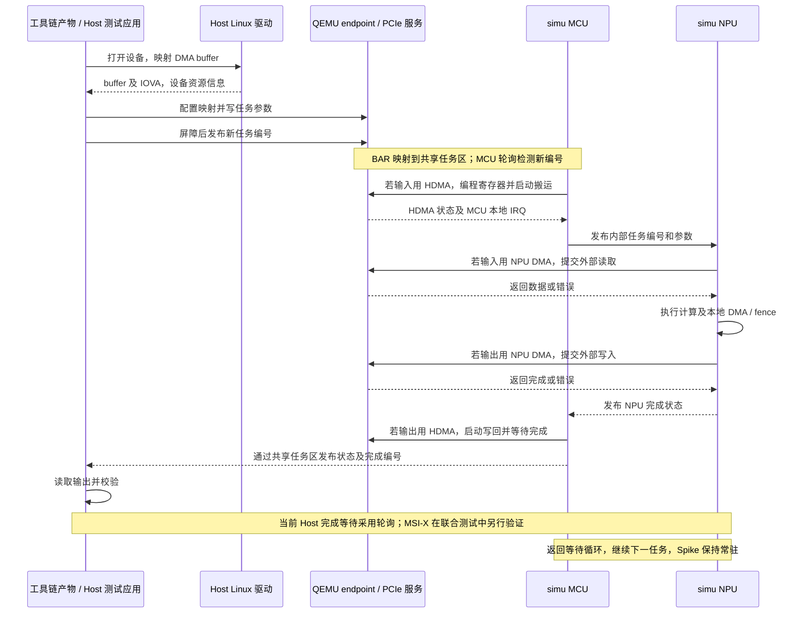

# P0—P4 工具链任务执行流程与交互分工

P0–P5 的最新使用命令、工具链多卡互访接入方法和功能范围，见 [功能使用手册与工具链多卡互访指南](P0-P5功能使用手册与工具链多卡互访指南.md)。本文保留 P0–P4 的流程说明。

本文说明当前已经实现并验证的执行通路。一个 QEMU 承载 Host Linux、RC、一个 switch 和八个 endpoint；每卡连接独立常驻 simu/Spike，当前每卡启用一个 MCU、一个 NPU。

工具链负责生成程序、数据及参数，Host 应用/驱动负责提交；QEMU 负责 PCIe 和外部搬运；simu 负责实际执行 MCU/NPU 软件和指令。普通任务完成后继续处理下一任务，不重复启动 Spike。

## 1. 总体执行流程

图中的“工具链/Host 提交端”在当前验收中由已有任务产物、适配的 host-demo 驱动和集成测试程序承担。最终工具链程序尚未完成直接联合验收；图中现有通路已经运行，不表示工具链全部文件格式或多队列接口已接入。


方向	谁发起	用什么地址	经过什么	终点
Host 访问设备	Host CPU	BAR 地址（MMIO）	RC / PCIe 配置映射	设备寄存器/共享任务区
设备访问 Host 内存	设备（NPU/HDMA）	IOVA	IOMMU 翻译 + 权限检查	Host RAM
所以：
Host 访问设备用的是 BAR，不是 IOVA。
设备访问 Host 用的是 IOVA，IOMMU 是这条路径上的翻译/检查组件，不是地址本身。

MCU ──编程──► HDMA 引擎 ──搬运──► Host RAM / peer DDR
 ▲                                    │
 └──────── 本地 IRQ（完成/错误）◄─────┘
MCU 发起 HDMA 后不能一直空转等，需要"搬运完成"的通知才能继续；
这个通知如果走 PCIe 到 Host 再回来，绕一大圈且 Host 无关；
所以在设备内部用本地 IRQ/事件通知 MCU 即可。

┌─────────────────────── simu 进程（设备侧） ───────────────────────┐
│  MCU ◄──本地 IRQ── HDMA 引擎                                      │
│   │                                                               │
│   └──发布完成状态──► 共享任务区（Host 可读）                       │
└──────────────────────────────┬────────────────────────────────────┘
                               │ QEMU 维护完成状态
                               ▼
                    PCIe 中断投递（MSI-X）
                               │
                               ▼
                        Host 驱动中断处理
设备内部 IRQ 是"体内神经"，PCIe 中断投递是"对外电话"。 前者让设备内单元协同，后者让 Host 知道任务完成。

轮询（polling）	反复检查状态位"完成了吗？"	接收方主动	你每隔 5 分钟去门口看快递到没到
中断（interrupt）	平时做自己的事，事件来了被打断去处理	事件方主动	快递员按门铃，你被打断去开门

```mermaid
flowchart TD
    subgraph T[工具链与 Host 提交端]
        T1[准备程序、输入数据、参数及预期结果]
        T2[Host Linux 驱动发现设备并建立 DMA buffer]
        T3[读取实际 BAR 和 IOVA，准备地址映射]
        T4[写任务参数，最后发布任务编号]
        T5[等待完成，检查状态与输出]
    end
    subgraph Q[QEMU]
        Q1[创建 RC(Root Complex（根复合体），是 PCIe 体系结构中的核心组件)、IOMMU、switch 和八个 endpoint]
        Q2[与每卡服务建立会话，共享 DDR 和 mailbox]
        Q3[提供 BAR、寄存器、HDMA 和地址转换]
        Q4[执行 Host IOMMU 或 switch P2P 访问]
        Q5[维护完成状态与 PCIe 中断投递]
    end
    subgraph S[simu：每卡一个常驻 Spike]
        S1[加载已配置的 firmware 和 MCU/NPU 程序]
        S2[核上初始化，发布 ready]
        S3[MCU 检测任务，准备输入搬运并调度 NPU]
        S4[NPU 执行 DMA 和任务程序]
        S5[MCU 完成输出搬运，发布完成状态]
        S6[返回任务等待循环，保留原进程]
    end
    Q1 --> Q2 --> S1 --> S2
    Q1 --> T2
    T1 --> T3
    T2 --> T3
    S2 --> T3
    T3 --> Q3
    Q3 --> T4 --> S3 --> S4 --> S5
    S3 -->|HDMA 寄存器访问| Q3
    S4 -->|NPU 外部 DMA 请求| Q4
    Q3 -->|HDMA 搬运| Q4
    Q4 -->|读数据或完成、错误| S3
    Q4 -->|读数据或完成、错误| S4
    S5 --> Q5 --> T5
    S5 --> S6 --> S3
    T5 -->|下一任务| T4
```

启动服务、连接共享内存和加载初始程序属于平台启动工作，不是工具链每次下发任务都要做的步骤。当前 MCU/NPU 集成服务通过共享状态轮询等待任务；“等待”不代表已验证操作系统级进程挂起或每个 hart 都执行 WFI。

## 2. 关键交互节点：三方分别做什么

| 节点 | 工具链 / Host 应用与驱动 | QEMU | simu |
| --- | --- | --- | --- |
| ① 平台启动与设备发现 | Host 驱动 probe、申请 DMA buffer、映射 BAR；应用找到对应设备节点 | 枚举设备，提供三组 BAR、桥窗口和 MSI-X；为每卡建立独立会话/共享内存 | 加载配置指定的软件，实际执行初始化并发布 ready |
| ② 准备任务 | 工具链生成程序/数据/参数；提交端放置输入和输出区，选择卡与 DMA 模式 | 提供 BAR 和共享内存访问，不解析算子或替工具链编译程序 | 提供既有执行模型；当前集成服务识别其测试任务参数 |
| ③ 准备地址 | 驱动取得 DMA API 返回的 IOVA；提交端按实际 BAR 配置 peer 目标和转换表 | 保持 requester 身份、IOMMU、outbound/inbound 和 BAR 权威状态 | NPU 使用设备侧外部窗口；MCU 通过代理操作同一份 PCIe/HDMA 寄存器 |
| ④ 提交任务 | 当前程序先写模式、长度、源/目标及任务参数，执行屏障后最后写任务编号 | 让 BAR 访问到达对应共享任务区；不创建新 Spike 执行单个任务 | MCU 轮询发现新编号，按模式搬入输入，再发布内部任务编号给 NPU |
| ⑤ 执行与搬运 | 保持 buffer/映射有效，不提前复用仍在执行的输入输出 | HDMA 状态机执行搬运；处理 NPU 外部访问，返回读数据或错误 | 执行原 NPU 指令/DMA/fence 和计算；本地访存留在现有模型内 |
| ⑥ 完成与取结果 | 当前测试轮询任务完成编号和状态，校验输出；另检查驱动 IRQ 计数 | 执行外部写回和中断投递，维护 HDMA 状态及错误归属 | NPU 将结果/状态交回 MCU，MCU 按模式完成写回，再发布任务完成 |
| ⑦ 连续任务 | 准备下一任务并发布新编号 | 保持连接和设备状态 | MCU/NPU 回到服务循环，沿用原 Spike PID |
| ⑧ 故障恢复 | 检查错误，等待设备重新 ready 后再提交；不把失败任务当成功 | 校验会话/复位代次，取消旧请求，阻止旧写入污染和晚到响应误投递 | 服务回收故障后端并按需要重新初始化；故障恢复可能替换 PID，普通任务不会 |

这里的“Host”是运行在 QEMU 来宾 Linux 内的应用和驱动；simu 和 QEMU 是宿主上的独立进程。工具链编译程序可预先在宿主完成，执行时由来宾提交端使用其产物。

## 3. 一次任务的实际交互顺序

以 P4 Linux 已验证路径为例：



当前集成服务位于 [runtime.c](p2/runtime/runtime.c)，Host 提交/等待示例位于 [guest-cluster.c](p4/guest-cluster.c) 的 `submit()` / `finish()`。共享任务编号和参数用于现有集成测试，不应直接认作最终工具链的正式队列 ABI。MCU/NPU 确实在 simu 内执行代码；集成测试服务复用了模型和外部通路，但不等于已经验收任意生产 runtime 任务。

## 4. 数据到底经过哪里

| 数据路径 | 实际经过的模块 | 三方最关键的工作 |
| --- | --- | --- |
| NPU DMA 读写 Host | simu NPU → 设备 outbound → QEMU 源 endpoint 的 DMA AddressSpace → Host IOMMU → Host RAM | Host 提供有效 IOVA；QEMU 转换和检查权限；simu 等待读数据/完成并传播错误。无需启动 HDMA |
| HDMA 读写 Host | simu MCU 编程 HDMA → QEMU HDMA → Host IOMMU → Host RAM | MCU 实际提交通道；QEMU 执行搬运和 IRQ；Host 保持映射有效 |
| NPU DMA 或 HDMA 访问 peer | 源引擎 → 源端地址处理 → switch 功能路由 → 目标 BAR/inbound → 目标共享 DDR | Host 使用实际 peer BAR；QEMU 检查路由/窗口/状态；simu 使用返回的数据或错误。HDMA 已是最终 PCIe 地址时不重复转换 |
| NPU 本地 DMA/计算 | simu 内的 NPU、L1/DDR 及本地模型 | 工具链提供程序/参数；simu 实际执行；本地数据路径不要求绕行 QEMU PCIe 服务 |

QEMU 与相应 simu 共享同一份设备 DDR backing。peer 路径不经 Host IOMMU，也不先搬到来宾 Host buffer 中转；这里仍然是功能软件仿真，不是完整 TLP/credit/带宽竞争模型。

四种已验证模式中，输入和输出引擎可独立选择：

| 当前 mode | 输入搬运 | 输出搬运 |
| --- | --- | --- |
| 1 | NPU DMA | NPU DMA |
| 2 | HDMA | HDMA |
| 3 | HDMA | NPU DMA |
| 4 | NPU DMA | HDMA |

## 5. 八卡任务怎样执行

八个 endpoint 各连接自己的服务、Spike 和共享 DDR。当前全卡对测试分七轮，每轮八张卡同时提交，目标按 `target=(source+shift)%8` 选择，`shift=1…7`，覆盖全部 56 个有向卡对；四种 DMA 模式分别验证。

当前每卡集成服务同一时刻处理一个任务，不能把“八卡并发”理解成“每卡多队列已经实现”。源卡完成 peer 写只表示数据到达目标内存，不自动表示目标 MCU/NPU 已消费或执行该数据；需要消费时由软件协调提交目标任务。

## 6. 对应 P0—P4 的成果及阅读入口

| 阶段 | 对这条流程的贡献 |
| --- | --- |
| P0 | 固定已有软件/构建/任务基线，定位接口和适配点 |
| P1 | 会话、FD 传递、共享 DDR/mailbox、ready、常驻执行及断连恢复 |
| P2 | HDMA 与 NPU 外部 DMA、Host IOMMU、四组合任务、本地 IRQ/文件 IPC 功能通路 |
| P3 | 双卡 switch P2P、目标 inbound、动态 BAR 与在途恢复 |
| P4 | 八卡启动、56 卡对、并发、隔离和原 demo 驱动联合验收 |

- [P4 启动说明](p4/README.md)：构建、Linux 联合测试和常驻 qtest 平台入口。`launch.py` 启动 qtest 平台，Linux 驱动流程用 `run_linux.py`。
- [八卡实际验收记录](p4/P4执行与验收记录.md)：1964 项八卡检查、15 项 Linux 检查及历史回归。
- [平台启动和资源配置代码](p4/cluster_platform.py)、[八卡模型测试](p4/run_cluster.py)：共享内存、后端生命周期、地址与并发任务。

对接工具链时，首先拿一个真实任务样例，确认其 Host 提交方式如何对应第 ②—④ 节的任务入口，再复用已打通的执行和 DMA 通路。runtime 或适配存在缺口，由仿真开发在现有 simulator 源码中补齐；无需工具链另行提供一套 runtime。
