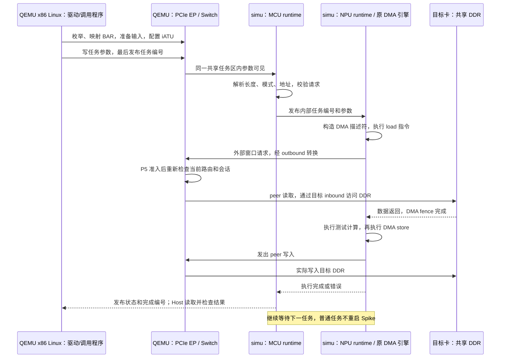

# P0–P5 功能使用手册与工具链多卡互访指南

首次克隆 QEMU 仓库的使用者，请先按 [克隆后构建与运行简易指南](克隆后构建与运行简易指南.md) 安装依赖、构建并运行。

本文面向当前工作区的内部软件仿真平台，整理截至 P5 的使用方式。所有宿主命令均在克隆得到的 QEMU 仓库根目录执行。

## 一、工具链同事的需求：x86 驱动下发请求，simu 执行内部 DMA 实现多卡互访

### 1. 当前能做什么

已打通：**QEMU x86 Linux 中的 Host 驱动/调用程序提交任务 → simu 内 MCU 接收参数并协调 NPU runtime → 执行内部 DMA 指令 → 经 QEMU PCIe Switch 访问目标卡内存 → 返回完成或错误。** 支持双卡和八卡；普通任务连续执行时，每卡复用同一个常驻 Spike。

现有代码的职责如下，接入时按实际运行位置区分：

| 组件 | 代码位置 | 工作 |
| --- | --- | --- |
| x86 Linux Host 驱动 | `zc_simulator/desktop/share/driver/ssv_test_driver.c`；适配补丁 `zc_simulator/p1/host-demo.patch` | PCI 枚举、设备绑定、coherent DMA buffer、mmap、MSI-X |
| Host 任务提交示例 | [guest-cluster.c](p4/guest-cluster.c)；P5 包装为 [guest-communication.c](p5/guest-communication.c) | 获取每卡资源，配置地址转换，写任务参数，等待并校验结果 |
| 设备侧参考 demo | 历史设备侧 demo（不作为当前交付依赖） | 提供设备侧 HDMA、iATU、IPC 的代码依据；不是 x86 Linux 内核模块 |
| simu 集成 runtime | [runtime.c](tools/p5/runtime/runtime.c) | MCU 接收请求；NPU 构造描述符，执行 DMA load/store 和测试计算 |
| 内部指令 | [dma.S](p2/runtime/dma.S)、[execute.S](p2/runtime/execute.S) | 原 NPU DMA 指令、增强 fence、Tensor 指令 |
| QEMU 设备 | `qemu/hw/misc/zc-pcie-p1.c` 及 `zc-pcie-p2*`、`zc-pcie-p3*`、`zc-pcie-p5*` | BAR、HDMA、iATU、Host IOMMU、peer 路由、完成通知和复位 |

当前是“适配后的 Host 驱动 + 本项目任务入口 + 集成 runtime”的完整功能链路。未将 `pcie-demo` 的完整 BootROM/固件原样加载执行；任务区也是本项目明确实现的软件接口。没有更多外部资料这一点不影响使用当前接口。

### 2. 最快使用：直接运行 Linux 双卡/八卡链路

先按 [克隆后构建与运行简易指南](克隆后构建与运行简易指南.md) 配置依赖并构建本项目 QEMU。所有命令均在 QEMU 仓库根目录执行，无需同级 simulator、experiments 或 Tensor 数据仓库。默认使用本仓库 `simu/current` 发布包：

```bash
# 双卡：建议首次联调先运行这一条
python3 zc_simulator/p5/run_linux.py --cards 2

# 八卡：全卡对覆盖
python3 zc_simulator/p5/run_linux.py --cards 8
```

脚本自动完成以下工作：

1. 默认校验本仓库发布包，为每卡启动独立 service。显式 `--runtime source` 才从仓库内源码重建 runtime 和来宾测试。
2. 使用包内适配后的 `host-demo` 内核模块及来宾测试程序 initramfs（显式源码模式会重建双卡/八卡测试镜像）。
3. 启动 QEMU x86 Linux、PCIe Switch、2/8 个 endpoint、Intel IOMMU 和 P5 fabric 服务。
4. Linux 加载驱动，获取实际 BAR 和每卡 DMA buffer；等待各卡 simu runtime ready。
5. 下发 Host 内存任务、四种 DMA 组合的 peer 任务，再执行文件 IPC 和 C 通信队列测试。
6. 校验数据、完成状态、中断及常驻 Spike 次数，来宾关机后回收整个实验。

**这两条是自动执行并退出的 Linux 联合实验入口，不会停留在交互式 shell。** 不需要另外手动启动 Spike，也不要同时手动启动同一批服务。

终端最后打印 `Evidence: <目录>`。查看该目录：

| 文件/内容 | 如何判断 |
| --- | --- |
| `results.json` | `passed=true` 且 `checks` 全部为 true |
| `linux.log` | 有 `P5_BASE_PASS`、三轮 `P5_ASYNC_ROUND`、`P5_C_LIBRARY_PASS`、`P4_GUEST_EXIT=0` |
| `qemu-command.json` | 本轮真实 QEMU 启动参数，可用于复现资源与拓扑配置 |
| `bundle.json` | 源码/预编译模式、实际包路径和载荷摘要；`simu/` 中保留内核及来宾镜像 |
| `backend.json`、`inputs/` | 本轮后端配置、firmware 配置和 MCU/NPU 镜像 |
| `serviceN.log`、`serviceN/` | 第 N 卡服务和 Spike 的启动、任务、退出记录 |
| `fabric-config.json`、`live-fabric.json` | P5 虚拟链路配置和准入/事务统计 |

八卡基础链路包含 32 个 Host 任务、224 个 peer 任务（56 有向卡对 × 4 模式）、8 个文件 IPC 测试，随后追加三轮异步通信测试。双卡按实际卡数缩减。历史通过结果见 [P5 执行与验收记录](p5/P5执行与验收记录.md)；实际运行以新生成的结果为准。

### 3. 请求在三方之间怎样走



图示为 mode 1 的 NPU 输入/NPU 输出路径。mode 2–4 可将某一侧换成 MCU 驱动的 HDMA。普通任务服务目前轮询共享任务标志；HDMA 支持本地中断。**常驻等待不等于已经实现 WFI/零 CPU 占用休眠。**

### 4. 如何替换成自己的 Host 请求

现成对接模板是 [guest-cluster.c](p4/guest-cluster.c) 的初始化、`submit()` 和 `finish()`。默认 runner 使用发布包中的测试二进制；修改示例源码后必须显式执行 `python3 zc_simulator/p5/run_linux.py --runtime source --cards 2`，才会生成 `p4-base.c` 并重新编译。`guest-communication.c` 在基础任务测试后追加通信队列测试。

Host 侧顺序：

1. 使用适配驱动绑定设备；通过 sysfs 获取实际 BAR，不硬编码 Linux 分配的总线地址。
2. 映射任务服务区、payload 区和 coherent buffer；等待 BAR0 `+8` 为 1。
3. 配置目标卡 inbound，将 peer payload 总线地址映射到其本地 DDR；配置源卡 outbound，将设备外部窗口映射到目标 peer 地址。
4. 准备数据和参数，执行内存屏障，最后写新的非零任务编号。
5. 等待完成编号相等后读取状态；成功才使用输出，错误或超时不得当作成功。
6. 使用下一任务编号继续提交。当前每卡 runtime 任务入口同时只承载一个执行中的任务，不覆盖尚未完成的参数。

服务区基址为 **本卡 BAR4 + `0x10000000`**。下表均是相对服务区基址的字节偏移，使用 32 位对齐访问：

| 偏移 | 字段 | Host 用法 |
| --- | --- | --- |
| `0x100` | 任务编号 | 参数全部写完并屏障后，最后写入；非零、递增 |
| `0x104` | mode | 1–4 为外部搬运四组合；5 为 P5 本地任务 |
| `0x108` | 输入长度 | 当前 1…65536 字节；Tensor 固定输入长度 `0x9200` |
| `0x10c/0x110` | src 低/高 32 位 | Host IOVA 或 peer 总线地址；mode 5 使用本地 DDR 地址 |
| `0x114/0x118` | dst 低/高 32 位 | Host IOVA 或 peer 总线地址；mode 5 使用本地 DDR 地址 |
| `0x11c` | Tensor 开关 | 0：XOR 测试；1：现有 Tensor 程序 |
| `0x180` 起 | Tensor 参数 | 固定 128 字节；仅 Tensor 任务使用 |
| `0x02c` | 最终完成编号 | 等于本次任务编号后读取状态/结果 |
| `0x020` | 任务状态 | 0 成功；非零为错误，见下文 |

服务区在 simu 内对应 DDR1 `0x4100100000`。Host 使用 BAR 总线窗口，runtime 使用设备本地地址；两者访问同一 backing。

| mode | 输入搬运 | 输出搬运 | 可验证的任务 |
| --- | --- | --- | --- |
| 1 | NPU DMA load | NPU DMA store | 完整内部 DMA 指令链路；最贴近本次需求 |
| 2 | MCU HDMA read | MCU HDMA write | 设备侧驱动控制 HDMA，NPU 处理本地数据 |
| 3 | MCU HDMA read | NPU DMA store | HDMA 输入、内部指令输出 |
| 4 | NPU DMA load | MCU HDMA write | 内部指令输入、HDMA 输出 |
| 5 | 本地 DDR 输入 | 本地 DDR 输出 | P5 文件上传后运行预置程序 |

以卡 A 执行、卡 B 提供输入和接收输出为例，现有测试这样调用：

```c
/* 前提：已沿用示例完成枚举、映射、目标 inbound 和数据准备。
 * peer(B) = B 的实际 BAR4 基址 + 0x20000000。
 */
atu(A, peer(B));
submit(A, 1, peer(B), peer(B) + 0x10000, N);
finish(A);
/* 检查 B 的输出窗口。默认测试输出应为输入逐字节 XOR 0x5a。 */
```

`atu()`、`submit()`、`finish()` 是示例内部函数，不是内核 ioctl 名称。当前 mode 1–4 用于验证“外部读 → NPU 处理 → 外部写”；默认处理是 XOR `0x5a`，也可走已有固定 Tensor 测试。**不能把此示例直接当成无变换的 memcpy 命令。** 纯复制可使用第五部分的 HDMA 通信接口；若业务要求由 NPU 内部指令执行纯复制，需要将相应 NPU 测试处理替换为复制逻辑。

错误状态：1 参数错误，2 HDMA 输入失败，3 HDMA 输出失败，4 NPU 输入 DMA 错误，5 NPU 输出 DMA 错误，6 mode 5 本地地址非法。明确交易失败可在同进程清错后重试；断连/复位/超时导致会话失效时走平台恢复流程。跨页失败可能保留已完成前缀，不提供原子回滚，不应自动重放非幂等任务。

### 5. 三方需要做的工作

| 一方 | 实际工作 |
| --- | --- |
| 工具链 Host 侧 | 在 x86 Linux 中调用驱动、准备有效 buffer、配置/使用 peer 地址、提交任务、等待完成、获取错误；对结果做业务校验 |
| simu 侧驱动/runtime | 解释任务、准备本地数据与 DMA 描述符、执行内部指令、等待 DMA/fence、发布状态；当前集成 runtime 已提供这条路径 |
| QEMU/platform | 建立拓扑和 BAR、启动并监督常驻后端、共享 DDR、完成 iATU/IOMMU/peer 路由、真实搬运和中断、异常取消与恢复 |

若直接使用本项目任务接口，可以现在就开展联合运行。若要运行工具链修改后的程序，将其接到上述入口并重新编译来宾测试或 runtime 即可；现有参考代码不会自动翻译任意新二进制/任意私有任务格式。

## 二、只克隆 QEMU 的准备与构建

安装系统依赖、Python 3.12 和配置 QEMU 的完整步骤见 [简易指南](克隆后构建与运行简易指南.md)。日常运行不编译 Spike，也不需要 RISC-V 工具链。

```bash
ninja -C build -j4 qemu-system-x86_64
python3 zc_simulator/p5/run_linux.py --prepare-only
python3 zc_simulator/p5/run_linux.py --cards 2
python3 zc_simulator/p5/run_linux.py --cards 8
```

QEMU 必须来自当前仓库，不能使用系统普通 QEMU。runner 显式从本仓库 `pc-bios/` 加载 ROM，克隆目录名无需为 qemu。`auto` 与 `prebuilt` 均使用已发布包，不根据同级目录自动切换构建流程。

## 三、本仓库交付的运行入口

| 功能 | 命令 |
| --- | --- |
| 协议、队列、包校验 | `python3 zc_simulator/p5/test_fabric.py` |
| Gen3/4/5 虚拟链路解析校准 | `python3 zc_simulator/p5/run_calibration.py` |
| 固定 Tensor 任务及回读 | `python3 zc_simulator/p5/run_tasks.py` |
| IRQ 与可恢复错误 | `python3 zc_simulator/p5/run_irq_errors.py` |
| fabric 断连和 FLR 恢复 | `python3 zc_simulator/p5/run_faults.py` |
| 两卡通信 | `python3 zc_simulator/p5/run_communication.py --cards 2` |
| 八卡通信 | `python3 zc_simulator/p5/run_communication.py --cards 8` |
| 两卡/八卡 Linux 驱动与通信 | `python3 zc_simulator/p5/run_linux.py --cards 2` 或 `--cards 8` |
| 上述 P5 交付检查全集 | `python3 zc_simulator/p5/run_all.py --skip-build` |

`run_all.py` 验证当前独立交付范围，不再调用需要历史工作区的 P0–P4 源码门禁，也不将这些历史门禁标为已通过。P0–P4 的能力已累积在 P5 运行包中；旧阶段脚本/报告保留用于研发追溯，不是新克隆的操作步骤。

所有证据保存在各入口打印的 `Evidence:` 目录。Linux 测试成功要求 `linux_exit`、`guest_all_tasks`、IOMMU、BAR、每卡常驻 Spike 检查均通过。协议模型的虚拟时间不是实机性能。

## 四、修改源码及重建

| 开发内容 | 仓库内位置 |
| --- | --- |
| QEMU endpoint、DMA、访问代理 | `hw/misc/zc-pcie-*` |
| Ubuntu 适配驱动 | `zc_simulator/desktop/share/driver/` |
| Host 命令行应用、原始驱动 | `zc_simulator/host-demo/` |
| MCU/NPU P5 runtime | `zc_simulator/tools/p5/runtime/` |
| 服务/协议 | `zc_simulator/tools/p1/` |
| fabric、软件通信和 C 头文件 | `zc_simulator/tools/p5/` |
| 基础来宾与通信测试 | `zc_simulator/p4/guest-cluster.c`、`zc_simulator/p5/guest-communication.c` |
| 固定 Tensor 回归输入 | `zc_simulator/p5/fixtures/tensor/` |

修改 QEMU 后重新执行 ninja。修改集成 runtime 或来宾测试后，安装支持 `rv64gcv` 的 RISC-V 裸机 GCC，并执行：

```bash
export PATH=/你的RISC-V工具链/bin:$PATH
python3 zc_simulator/p5/run_linux.py --runtime source --cards 2
```

Makefile 默认前缀为 `riscv64-unknown-elf-`。此模式只重建本仓库 MCU/NPU、来宾测试及 Python 服务副本，复用已发布的 Spike、firmware、Linux 内核和匹配的来宾驱动。它不会凭空重建完整 Spike 模型，也不要求外部源码库。生成新版本运行包并切换本地 `simu/current`；发布变更时需另行更新版本包和 Git 忽略白名单，不能只提交一个指向本地忽略目录的 current 链接。

默认 `run_linux.py` 不会重新编译你改过的来宾 C 或 MCU 源码。不要在后台仍使用某个运行包时修改包内文件。

## 五、桌面、交互终端和指定卡任务

完整环境准备见 [desktop/README.md](desktop/README.md)，来宾内逐步操作见 [操作教程](desktop/操作教程.md)。Ubuntu 镜像和常见工具由使用者下载或安装，磁盘、凭据与日志为本地生成数据，不提交到 Git。

```bash
python3 zc_simulator/desktop/prepare.py
python3 zc_simulator/desktop/desktop.py --cards 8
# 另开终端：
python3 zc_simulator/desktop/terminal.py
```

首次启动需联网安装 XFCE、xrdp 和内核头文件。准备完成后，来宾执行 `sudo /opt/t100/guest-cluster`；自定义 Host 任务按操作教程编译 `my-task.c` 并用首个参数选卡。Host 应用入口 `python3 zc_simulator/desktop/host_demo.py` 从本仓库取源码，不进入其他项目。

MCU/NPU 独立程序编译和发布包运行方法见 [MCU 编译教程](desktop/MCU编译教程.md)、[指定设备说明](desktop/指定设备与MCU-NPU运行说明.md)。桌面尚无按卡热加载任意 MCU/NPU 程序的统一入口；现有 `--cards` 只控制卡数量。

## 六、故障定位

`linux_exit FAIL` 只表示 QEMU 非零退出。当前 runner 会打印退出码与 linux.log 尾部，完整日志在证据目录。依次检查：

- `error while loading shared libraries`：按简易指南安装对应 SONAME 的系统包。
- BIOS/ROM 不存在：确认 `pc-bios/` 完整，使用当前 runner 的显式 `-L` 参数。
- `zc-pcie-p1 is not a valid device`：当前 QEMU 未由此仓库构建或构建过旧。
- 后端未 ready：检查同目录 `service*.log` 和 service 子目录中的 Spike 日志。
- 校验清单不匹配：恢复 Git 中完整运行包，不要在发布包内直接覆盖单个文件。

本次验证范围见 [独立交付验证记录](独立QEMU交付验证记录.md)；原始工作区流程已归档到 [历史开发入口](P0-P5历史工作区开发入口.md)，不作为新克隆依赖。
