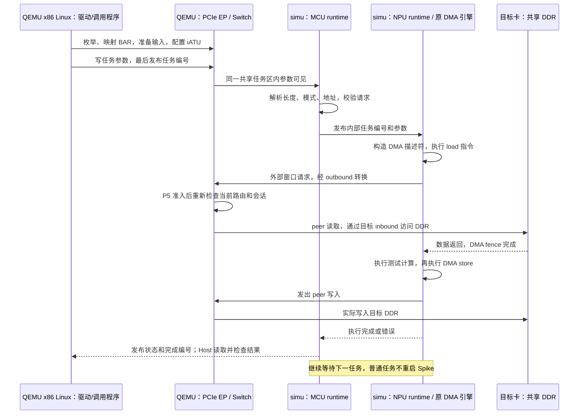

# P0–P5 功能使用手册与工具链多卡互访指南

本文面向当前工作区的内部软件仿真平台，整理截至 P5 的使用方式。所有宿主命令均从以下目录执行：

```bash
cd /workspace/GIT/pcie_qemu
```

## 一、工具链同事的需求：x86 驱动下发请求，simu 执行内部 DMA 实现多卡互访

### 1. 当前能做什么

已打通：**QEMU x86 Linux 中的 Host 驱动/调用程序提交任务 → simu 内 MCU 接收参数并协调 NPU runtime → 执行内部 DMA 指令 → 经 QEMU PCIe Switch 访问目标卡内存 → 返回完成或错误。** 支持双卡和八卡；普通任务连续执行时，每卡复用同一个常驻 Spike。

现有代码的职责如下，接入时按实际运行位置区分：

| 组件 | 代码位置 | 工作 |
| --- | --- | --- |
| x86 Linux Host 驱动 | `simulator/host-demo/ssv_test_driver.c`；适配补丁 `qemu/zc_simulator/p1/host-demo.patch` | PCI 枚举、设备绑定、coherent DMA buffer、mmap、MSI-X |
| Host 任务提交示例 | [guest-cluster.c](p4/guest-cluster.c)；P5 包装为 [guest-communication.c](p5/guest-communication.c) | 获取每卡资源，配置地址转换，写任务参数，等待并校验结果 |
| 设备侧参考 demo | `simulator/pcie-demo/src/pcie/`、`src/pcie_ipc.c` | 提供设备侧 HDMA、iATU、IPC 的代码依据；不是 x86 Linux 内核模块 |
| simu 集成 runtime | [runtime.c](../../simulator/tools/p5/runtime/runtime.c) | MCU 接收请求；NPU 构造描述符，执行 DMA load/store 和测试计算 |
| 内部指令 | [dma.S](p2/runtime/dma.S)、[execute.S](p2/runtime/execute.S) | 原 NPU DMA 指令、增强 fence、Tensor 指令 |
| QEMU 设备 | `qemu/hw/misc/zc-pcie-p1.c` 及 `zc-pcie-p2*`、`zc-pcie-p3*`、`zc-pcie-p5*` | BAR、HDMA、iATU、Host IOMMU、peer 路由、完成通知和复位 |

当前是“适配后的 Host 驱动 + 本项目任务入口 + 集成 runtime”的完整功能链路。未将 `pcie-demo` 的完整 BootROM/固件原样加载执行；任务区也是本项目明确实现的软件接口。没有更多外部资料这一点不影响使用当前接口。

### 2. 最快使用：直接运行 Linux 双卡/八卡链路

首次开发使用先按第二部分确认环境、完成构建。`run_linux.py` 有 simu 源码时自动编译并生成 `simu/` 运行包，无源码时使用已有运行包；二进制交付方法见 [运行包说明](simu/README.md)。然后执行：

```bash
# 双卡：建议首次联调先运行这一条
python3 qemu/zc_simulator/p5/run_linux.py --cards 2

# 八卡：全卡对覆盖
python3 qemu/zc_simulator/p5/run_linux.py --cards 8
```

脚本自动完成以下工作：

1. 源码模式编译并打包，或预编译模式校验已有包；为每卡启动独立 service。
2. 使用包内适配后的 `host-demo` 内核模块及来宾测试程序 initramfs（源码模式会重建双卡/八卡镜像）。
3. 启动 QEMU x86 Linux、PCIe Switch、2/8 个 endpoint、Intel IOMMU 和 P5 fabric 服务。
4. Linux 加载驱动，获取实际 BAR 和每卡 DMA buffer；等待各卡 simu runtime ready。
5. 下发 Host 内存任务、四种 DMA 组合的 peer 任务，再执行文件 IPC 和 C 通信队列测试。
6. 校验数据、完成状态、中断及常驻 Spike 次数，来宾关机后回收整个实验。

**这两条是自动执行并退出的 Linux 联合实验入口，不会停留在交互式 shell。** 不需要另外手动启动 Spike，也不要同时手动启动同一批服务。

终端最后打印 `Evidence: <目录>`。查看该目录：

| 文件/内容 | 如何判断 |
| --- | --- |
| `results.json` | `passed=true` 且 `checks` 全部为 true |
| `linux.log` | 有 `P5_BASE_PASS`、三轮 `P5_ASYNC_ROUND`、`P5_C_LIBRARY_PASS`、`P4_GUEST_EXIT=0` |
| `qemu-command.json` | 本轮真实 QEMU 启动参数，可用于复现资源与拓扑配置 |
| `bundle.json` | 源码/预编译模式、实际包路径和载荷摘要；`simu/` 中保留内核及来宾镜像 |
| `backend.json`、`inputs/` | 本轮后端配置、firmware 配置和 MCU/NPU 镜像 |
| `serviceN.log`、`serviceN/` | 第 N 卡服务和 Spike 的启动、任务、退出记录 |
| `fabric-config.json`、`live-fabric.json` | P5 虚拟链路配置和准入/事务统计 |

八卡基础链路包含 32 个 Host 任务、224 个 peer 任务（56 有向卡对 × 4 模式）、8 个文件 IPC 测试，随后追加三轮异步通信测试。双卡按实际卡数缩减。历史通过结果见 [P5 执行与验收记录](p5/P5执行与验收记录.md)；实际运行以新生成的结果为准。

### 3. 请求在三方之间怎样走



图示为 mode 1 的 NPU 输入/NPU 输出路径。mode 2–4 可将某一侧换成 MCU 驱动的 HDMA。普通任务服务目前轮询共享任务标志；HDMA 支持本地中断。**常驻等待不等于已经实现 WFI/零 CPU 占用休眠。**

### 4. 如何替换成自己的 Host 请求

现成对接模板是 [guest-cluster.c](p4/guest-cluster.c) 的初始化、`submit()` 和 `finish()`。P5 Linux runner 会生成可指定卡数的 `p4-base.c` 并编译它；修改示例源码后重新运行上述脚本即可验证。`guest-communication.c` 在基础任务测试后追加通信队列测试。

Host 侧顺序：

1. 使用适配驱动绑定设备；通过 sysfs 获取实际 BAR，不硬编码 Linux 分配的总线地址。
2. 映射任务服务区、payload 区和 coherent buffer；等待 BAR0 `+8` 为 1。
3. 配置目标卡 inbound，将 peer payload 总线地址映射到其本地 DDR；配置源卡 outbound，将设备外部窗口映射到目标 peer 地址。
4. 准备数据和参数，执行内存屏障，最后写新的非零任务编号。
5. 等待完成编号相等后读取状态；成功才使用输出，错误或超时不得当作成功。
6. 使用下一任务编号继续提交。当前每卡 runtime 任务入口同时只承载一个执行中的任务，不覆盖尚未完成的参数。

服务区基址为 **本卡 BAR4 + `0x10000000`**。下表均是相对服务区基址的字节偏移，使用 32 位对齐访问：

| 偏移 | 字段 | Host 用法 |
| --- | --- | --- |
| `0x100` | 任务编号 | 参数全部写完并屏障后，最后写入；非零、递增 |
| `0x104` | mode | 1–4 为外部搬运四组合；5 为 P5 本地任务 |
| `0x108` | 输入长度 | 当前 1…65536 字节；Tensor 固定输入长度 `0x9200` |
| `0x10c/0x110` | src 低/高 32 位 | Host IOVA 或 peer 总线地址；mode 5 使用本地 DDR 地址 |
| `0x114/0x118` | dst 低/高 32 位 | Host IOVA 或 peer 总线地址；mode 5 使用本地 DDR 地址 |
| `0x11c` | Tensor 开关 | 0：XOR 测试；1：现有 Tensor 程序 |
| `0x180` 起 | Tensor 参数 | 固定 128 字节；仅 Tensor 任务使用 |
| `0x02c` | 最终完成编号 | 等于本次任务编号后读取状态/结果 |
| `0x020` | 任务状态 | 0 成功；非零为错误，见下文 |

服务区在 simu 内对应 DDR1 `0x4100100000`。Host 使用 BAR 总线窗口，runtime 使用设备本地地址；两者访问同一 backing。

| mode | 输入搬运 | 输出搬运 | 可验证的任务 |
| --- | --- | --- | --- |
| 1 | NPU DMA load | NPU DMA store | 完整内部 DMA 指令链路；最贴近本次需求 |
| 2 | MCU HDMA read | MCU HDMA write | 设备侧驱动控制 HDMA，NPU 处理本地数据 |
| 3 | MCU HDMA read | NPU DMA store | HDMA 输入、内部指令输出 |
| 4 | NPU DMA load | MCU HDMA write | 内部指令输入、HDMA 输出 |
| 5 | 本地 DDR 输入 | 本地 DDR 输出 | P5 文件上传后运行预置程序 |

以卡 A 执行、卡 B 提供输入和接收输出为例，现有测试这样调用：

```c
/* 前提：已沿用示例完成枚举、映射、目标 inbound 和数据准备。
 * peer(B) = B 的实际 BAR4 基址 + 0x20000000。
 */
atu(A, peer(B));
submit(A, 1, peer(B), peer(B) + 0x10000, N);
finish(A);
/* 检查 B 的输出窗口。默认测试输出应为输入逐字节 XOR 0x5a。 */
```

`atu()`、`submit()`、`finish()` 是示例内部函数，不是内核 ioctl 名称。当前 mode 1–4 用于验证“外部读 → NPU 处理 → 外部写”；默认处理是 XOR `0x5a`，也可走已有固定 Tensor 测试。**不能把此示例直接当成无变换的 memcpy 命令。** 纯复制可使用第五部分的 HDMA 通信接口；若业务要求由 NPU 内部指令执行纯复制，需要将相应 NPU 测试处理替换为复制逻辑。

错误状态：1 参数错误，2 HDMA 输入失败，3 HDMA 输出失败，4 NPU 输入 DMA 错误，5 NPU 输出 DMA 错误，6 mode 5 本地地址非法。明确交易失败可在同进程清错后重试；断连/复位/超时导致会话失效时走平台恢复流程。跨页失败可能保留已完成前缀，不提供原子回滚，不应自动重放非幂等任务。

### 5. 三方需要做的工作

| 一方 | 实际工作 |
| --- | --- |
| 工具链 Host 侧 | 在 x86 Linux 中调用驱动、准备有效 buffer、配置/使用 peer 地址、提交任务、等待完成、获取错误；对结果做业务校验 |
| simu 侧驱动/runtime | 解释任务、准备本地数据与 DMA 描述符、执行内部指令、等待 DMA/fence、发布状态；当前集成 runtime 已提供这条路径 |
| QEMU/platform | 建立拓扑和 BAR、启动并监督常驻后端、共享 DDR、完成 iATU/IOMMU/peer 路由、真实搬运和中断、异常取消与恢复 |

若直接使用本项目任务接口，可以现在就开展联合运行。若要运行工具链修改后的程序，将其接到上述入口并重新编译来宾测试或 runtime 即可；现有参考代码不会自动翻译任意新二进制/任意私有任务格式。

## 二、运行准备和统一构建

### 1. 环境与固定输入

当前脚本面向已有工作区和 Linux 宿主，依赖 Python 3、numpy、GNU C/C++、make、ninja、dtc、Boost 开发库和 RISC-V 裸机工具链。默认 RISC-V 前缀为 `/data/nuclei/gcc/bin/riscv64-unknown-elf-`。

以下文件/目录必须存在：

| 输入 | 用途 |
| --- | --- |
| `qemu/build/`、`simulator/riscv-isa-sim/build/` | 已配置的 QEMU、Spike 构建目录 |
| `experiments/qemu_stage1/assets/vmlinuz-lts` | 固定来宾 Linux 内核 |
| `experiments/qemu_stage1/rootfs/` | BusyBox 基础文件系统 |
| `simulator/riscv-tests/firmware.riscv` | simu 原 firmware |
| `simulator/riscv-tests/packet_runtime_test/tensor-args.bin` | 固定 Tensor 参数 |
| `moe_bf16_sint4_33x29x34_fix/data/` | Tensor 输入数据 |
| `experiments/single_die_packet/run-20261027T100512-648188Z/moe/data/result_l1_spike.bin` | P4/P5 固定 standalone 参考输出 |

新环境恢复方法见 [第一阶段报告](第一阶段QEMU接入复现与验收报告.md) 和 [单 die 指南](单die信息包执行闭环实施指南.md)。已有脚本会校验固定输入，不能随意用同名文件替换。Host 模块首次构建需要下载固定 SHA256 的 Alpine headers/依赖包，缓存在 P1 evidence 中，不安装到宿主系统。

### 2. 更新源码后的构建

```bash
ninja -C qemu/build qemu-system-x86_64
make -C simulator/riscv-isa-sim/build -j8 spike
make -C simulator/riscv-tests firmware.riscv
make -C qemu/zc_simulator/p2/runtime
make -C simulator/tools/p5/runtime
```

以上要求构建目录已配置。`run_linux.py` 在源码模式会编译 Spike、firmware、runtime 和 Host 模块；在预编译模式直接使用 `simu/` 包，两种模式均不替你重建 QEMU。P5 `run_all.py` 默认重建 QEMU 和 P5 runtime，同样不能代替修改 Spike 源码后的显式重建。验收过程中不要编辑输入或重新链接正在运行的二进制。

## 三、P0–P5 全功能入口

阶段是能力累积；日常使用优先选 P5 或对应专项，无需每次先跑一遍 P0。

| 阶段 | 已实现能力及能完成的任务 | 使用入口 |
| --- | --- | --- |
| P0 | 软件/输入/工具版本冻结；单 die dispatch、MoE、mailbox、IRQ、连续任务/非法请求/STOP、standalone 基线复现 | `python3 qemu/zc_simulator/p0/run_p0.py --jobs 16` |
| P1 | 单卡共享 DDR/mailbox、BAR、真实 Tensor、MSI-X；会话协商、SCM_RIGHTS FD 传递、配置身份校验、常驻服务、超时/断连/reset 恢复 | `python3 qemu/zc_simulator/p1/run_full.py` |
| P2 | 单卡 HDMA 与 NPU 外部 DMA、四组合、Host IOVA/VT-d、inbound/outbound、MCU IRQ、可恢复错误、文件 IPC、在途故障 | `python3 qemu/zc_simulator/p2/run_all.py` |
| P3 | 双卡 Switch P2P、两引擎 peer 读写、路由/权限/映射变化与故障取消 | `python3 qemu/zc_simulator/p3/run_all.py` |
| P4 | 一 RC/Switch 八卡、56 有向卡对、八卡任务并发、Host requester 隔离、故障卡影响集隔离、Linux 实际 BAR 分配、资源统计 | `python3 qemu/zc_simulator/p4/run_all.py` |
| P5 | 文件任务包与本地 Tensor 执行、自研软件通信队列、双/八卡 Linux 通信、IRQ/错误专项、可选 FLR、事务/credit/仲裁/虚拟链路模型 | `python3 qemu/zc_simulator/p5/run_all.py` |

P1–P5 统一入口可用 `--skip-build` 复用最新构建。完整 P5 门禁运行本阶段专项，并逐层运行 P4→P3→P2→P1；P0 的独立重建基线需要单独运行。各旧 README 中明确标注“历史”的待办不代表当前最新状态，最新出口以各阶段闭环记录及 P5 记录为准。

专项选择：

| 想验证什么 | 命令 |
| --- | --- |
| 单卡共享内存/Tensor/原 Host 驱动 | `python3 qemu/zc_simulator/p1/run_p1.py --host-demo` |
| P1 协议、FD、内存和生命周期完整矩阵 | `python3 qemu/zc_simulator/p1/run_full.py --skip-build` |
| 单卡 HDMA、iATU、IOMMU | `python3 qemu/zc_simulator/p2/run_hdma.py` |
| MCU/NPU 实际运行、四 DMA 组合 | `python3 qemu/zc_simulator/p2/run_spike.py` |
| 单卡 Linux 联合实验 | `python3 qemu/zc_simulator/p2/run_linux.py` |
| 双卡 P2P 和路由故障 | `python3 qemu/zc_simulator/p3/run_p3.py` |
| 八卡并发、Tensor、故障隔离、资源记录 | `python3 qemu/zc_simulator/p4/run_cluster.py` |
| 原 P4 Linux 八卡链路 | `python3 qemu/zc_simulator/p4/run_linux.py` |
| P5 双/八卡实际通信 | `python3 qemu/zc_simulator/p5/run_communication.py --cards 2` 或 `--cards 8` |
| P5 Linux 中 Host 驱动 + runtime + 通信队列 | `python3 qemu/zc_simulator/p5/run_linux.py --cards 2` 或 `--cards 8` |
| 文件任务包、预置 Tensor 和回读 | `python3 qemu/zc_simulator/p5/run_tasks.py` |
| IRQ mask/pending/清除、NPU 可恢复错误 | `python3 qemu/zc_simulator/p5/run_irq_errors.py` |
| fabric 断连、禁止旧写入、恢复 | `python3 qemu/zc_simulator/p5/run_faults.py` |
| 事务、队列、任务包校验 | `python3 qemu/zc_simulator/p5/test_fabric.py` |
| 虚拟链路理论校准、仲裁和重复性 | `python3 qemu/zc_simulator/p5/run_calibration.py` |

## 四、拓扑、地址和常驻调试

### 1. 地址与资源

| 项目 | 当前配置及用法 |
| --- | --- |
| BAR0 | 4 MiB、64 位 non-prefetchable；诊断、MSI-X、iATU/HDMA 调试镜像 |
| BAR2 | 32 MiB、64 位 non-prefetchable；P2 下使用启用的 inbound 映射 |
| BAR4 | 32 GiB、64 位 prefetchable；服务区、mailbox、文件 IPC、inbound payload |
| 每卡 DDR0/DDR1 | 独立 1 GiB/256 GiB 稀疏 backing；虚拟跨度不等于全部驻留 RAM |
| 每卡 runtime | MCU hart 1、NPU hart 16；firmware hart 0；不将全部已创建 hart 视为已启用算力 |
| peer payload | 实际 BAR4 + `0x20000000`；示例 inbound 映射至目标 DDR0 `0x20010000`，长度 128 KiB |
| 任务区 | 实际 BAR4 + `0x10000000` |
| mailbox | 实际 BAR4 + `0x18019000` |
| 文件 IPC | 实际 BAR4 + `0x18103180` |
| MCU iATU/HDMA | `0x21300000` / `0x21380000`；Host BAR0 镜像 `+0x300000` / `+0x380000` |
| NPU 外部设备窗口 | `[0x18000000000, 0x20000000000)`，必须经过启用的 outbound 转换 |

设备本地地址、PCIe bus 地址、Host IOVA 是三种不同地址。Host IOVA 经源 function 的实际 IOMMU；peer 总线地址经 Switch/目标 inbound，数据不通过 Host staging 中转。Linux 示例从实际 resource 获取 BAR；qtest 的手工 BAR 计划不能直接套到 Linux。

### 2. 持续运行的 qtest 调试平台

```bash
python3 qemu/zc_simulator/p4/launch.py --cards 2 --work /tmp/zc-two-live
# 或八卡
python3 qemu/zc_simulator/p4/launch.py --cards 8 --work /tmp/zc-eight-live
```

`--work` 使用新目录。ready 后输出 QMP/qtest socket 和各卡 PID，客户端可经标准 QMP/qtest 调试。Ctrl-C/TERM 回收服务和后端；`--duration 10` 可限定 ready 后的运行秒数。`--cards` 支持 1、2、8。

```bash
python3 qemu/zc_simulator/p4/launch.py --cards 8 --work /tmp/zc-eight-plan --generate-only
```

`--generate-only` 输出拓扑 JSON，不启动进程。该常驻入口使用 P4 默认 runtime，不开启 P5 fabric，**也不启动 x86 Linux**。需要 Linux 驱动的任务使用第一部分入口；当前没有与 `launch.py` 等价的“交互式 Linux + P5 常驻 CLI”。

独立后端服务接口为：

```bash
python3 simulator/tools/p1/service.py \
  --socket /tmp/zc-card0.sock \
  --config /absolute/path/backend.json \
  --work /absolute/path/backend-logs --card 0
```

`backend.json` 应使用 runner 生成的有效配置，含绝对路径和输入哈希。服务本身不创建完整平台；QEMU 必须用相同 card/config 摘要连接并传入 FD。多卡需要独立 socket/card ID。协议、FD 和恢复细节见 [服务说明](../../simulator/tools/p1/README.md)。

## 五、通信接口：纯搬运和软件多队列

### 1. 两类入口的区别

第一部分的 runtime 任务通过 MCU/NPU 执行内部指令。P5 另提供 **Host 直接驱动 HDMA 的通信接口**，用于纯数据搬运、队列和压力测试；这条路径不能单独证明执行过 NPU 指令。

| 接口 | 如何使用 | 能完成的任务 |
| --- | --- | --- |
| Python `Communication` | `simulator/tools/p5/communication.py`，配合 [DMAAdapter](p5/backend.py) 和平台对象；参考 [run_communication.py](p5/run_communication.py) | `send/read/wait/barrier/reset`；peer/Host 读写、多软件队列、票据、满队列/接收区冲突、错误传播 |
| C `zc_comm.h` | 在来宾 C 程序包含该头文件；参考 [guest-communication.c](p5/guest-communication.c) | 8 槽有界队列、异步提交/progress、完成/ABORT、满队列、reset |

Python 接口 `target=-1` 表示 Host，使用前必须给 adapter 配置实际 Host IOVA/GPA 测试映射。peer offset/length 限于示例 128 KiB payload 窗口。示例适合按现有 adapter 接口扩展测试，不是安装到任意机器即可使用的通用通信包。

C 调用顺序是 `zc_queue_init()` → `zc_submit()` → 循环 `zc_progress()` → 检查 request state；失败或取消使用 `zc_queue_reset()`。提交后必须持续 progress，并自行设置有界等待；请求指针指向环形槽，复用槽前应取走结果，在途 buffer 必须保持有效。示例用 HDMA pair 1/2 的 write 通道，避开 runtime 使用的 pair 0。

软件队列建立在现有 HDMA 通道上，不是额外硬件生产多队列 ABI。多个 Host 调用者必须协调任务区及通道所有权，不能同时覆盖同一卡 runtime 参数或争用相同 HDMA 通道。

## 六、文件 IPC、任务包和程序执行

```bash
python3 qemu/zc_simulator/p5/run_tasks.py
```

该入口自动生成任务包，通过 demo 文件 IPC 上传，在八卡 runtime 的 mode 5 执行现有 Tensor，再回读比较结果。生成的 `task/` 包含：

| 文件 | 内容 |
| --- | --- |
| `task.json` | schema、成员文件名和 SHA256 |
| `program.S` | 预置 Tensor 程序的身份/源码 |
| `input.bin` | 由现有 act/weight/scale/index 组合的输入 |
| `parameters.bin` | 固定 Tensor 参数 |
| `expected.bin` | 既有 standalone 模型参考输出 |

`tasks.py` 校验路径、哈希和参数格式。当前执行预置程序，不支持把任意 `program.S` 换成新程序后动态编译/加载；固定 Tensor 输出也不是独立数学 golden。

文件传输使用 BAR4 `+0x18103180`：地址低/高 `+0/+4`，长度低/高 `+8/+12`，trigger `+0x10`，CRC32 低/高 `+0x14/+0x18`。地址是 DMA 可达的 Host IOVA。

- 上传：填地址、长度、CRC，最后写 trigger=`0x5a5aa5a5`。
- 完成：trigger 清 0 表示成功；`0x80000000|code` 表示失败。
- 回读：填接收地址，写 trigger=`0x72736c74`，接收 `[done,u32长度,payload]`；done=`0x646f6e65`。
- 单次文件上限 `2MiB-8`；没有生产级文件分片上传协议。
- 上传后 mode 5 可使用本地文件 buffer `0x4000400000` 作为输入/输出；Tensor 输入 `0x9200` 字节、输出 33792 字节。

P2 文件专项验证原文回环；P5 任务专项进一步验证“上传 → 实际 Tensor → 结果回读”。CRC、空文件、非法地址都有失败和重试测试。完整 BootROM 冷启动/FW 任意加载不是该命令的能力。

## 七、中断、错误、隔离和复位

| 能力 | 使用/检查方法 | 语义 |
| --- | --- | --- |
| Host MSI-X | Linux 原驱动获取中断，示例检查 `irq_count` | 结果状态先发布，再通知 Host |
| MCU 本地 HDMA IRQ | runtime ISR；`run_irq_errors.py` | pending、mask、使能、W1C；当前软件 IRQ 号 60 |
| NPU 可恢复 DMA 错误 | `0x21381000 + hart*4` 诊断区，写 0 清除 | runtime 检查错误，明确失败可同进程继续；软件诊断区不是已证实硬件 CSR |
| 通道/队列停止 | 清 channel enable；`zc_queue_reset()` | 停止其自有通道，排队项返回取消/错误 |
| function reset/FLR | P5 endpoint `p5-flr=on`；通信专项注入 | 停止在途任务，回收目标后端后重建；恢复该 function BAR/command/iATU 后再提交 |
| 无关卡隔离 | P4 `p4-isolation=on`，P5 继承 | 普通请求只关联源/目标变化，无关卡故障不替换其后端 |
| 断连/超时 | `run_faults.py`，P1–P4 历史矩阵 | 撤销 ready、停止旧交易、回收后恢复；无静默绕过/旧请求重放 |

FLR/故障恢复可以重建受影响 Spike，这是恢复流程；普通任务不重建。linked descriptor chain 保留全 fabric 保守取消边界；没有独立单 hart 架构复位能力。复位后重新初始化资源，不继续使用旧任务票据和旧 session。

## 八、可选事务、流控和虚拟性能模型

该部分用于通信行为分析，第一部分功能联调可先关注任务完成和数据正确性。

```bash
python3 simulator/tools/p5/run_model.py \
  --config simulator/tools/p5/profiles/gen4-eight.json \
  --requests simulator/tools/p5/profiles/requests.json \
  --out /tmp/p5-model.json

python3 qemu/zc_simulator/p5/test_fabric.py
python3 qemu/zc_simulator/p5/run_calibration.py
```

| 可配置/观察项 | 当前内容 |
| --- | --- |
| 事务 | MemWr/MemRd、CfgRd/CfgWr、Message、CplD/Cpl；tag、分片 Completion、MPS/MRRS/4 KiB |
| 流控 | 每方向 Posted/Non-Posted/Completion H/D credit，有限接收占用、延迟返还和阻塞 |
| 仲裁 | RR、固定优先级、WRR |
| 链路 | Gen3/4/5、lane、latency、共享 Host 上行、peer 路径 |
| 顺序 | strict、pci_relaxed、delayed 的已定义模型行为 |
| 统计 | packet/request trace、端口字节数、利用率、stall、占用和延迟 |

修改配置时复制 profile JSON 到新路径，再用 `--config` 指定。P5 联仿脚本会从 `gen4-eight.json` 生成当前卡数配置并传入 fabric service；联仿选择其他 profile 需调整 `P5Platform.start_fabric()` 的配置来源，当前 CLI 没有统一的 profile 切换参数。

QEMU 使用非阻塞准入：等待 grant 时可继续处理其他事件，grant 后重新检查当前路由和映射，再实际搬运。配置与模型输出用于功能/理论分析；`physical_hardware_calibrated=false`，CPU 与 PCIe 不共用周期时间轴，不能当作物理带宽/时延实测，也不是完整 LTSSM/DLLP/LCRC/replay 仿真。

## 九、完整验收、日志与问题定位

### 1. 一次完整门禁

```bash
# 使用第二部分已更新的 QEMU/Spike/firmware
python3 qemu/zc_simulator/p5/run_all.py --skip-build
```

最终检查 `p5/evidence/all-*/results.json` 中 `p5_full_exit=true`、`manifest_unchanged=true`。入口涵盖 P5 专项及 P4→P3→P2→P1；历史已通过的 P5 共有 397 项本阶段测试/检查。若只执行某个专项，其 `passed=true` 只代表该专项。

同一工作区已有完整通过且全部 manifest 文件仍一致的 P4 证据时，可使用：

```bash
python3 qemu/zc_simulator/p5/run_all.py --skip-build \
  --p4-evidence /absolute/path/to/p4/evidence/all-时间戳
```

脚本逐项核对历史摘要，变化即拒绝复用；结果记录 reused。证据目录被 ignore，不随普通 git push 自动交付。验收报告引用历史结果，不代表在文档编写时重新运行过测试。

### 2. 常见问题

| 现象 | 优先检查 |
| --- | --- |
| runtime 不 ready | `backend.json` 哈希/路径、`inputs/firmware.cfg`、对应 service/Spike 日志；确认源码变更后已重建 |
| Linux 找不到卡/驱动节点 | `linux.log`、Host 模块构建日志、VID:DID、BAR/桥窗口和驱动 probe |
| DMA ABORT/错误状态 | channel status、iATU、Bus Master、Host IOVA 权限、peer 域/目标 ready；查看 `p2_host` trace |
| 读到旧结果 | 任务编号、最终完成字段、内存屏障、buffer 生命周期；错误后不要使用旧完成内容 |
| fabric 断连后不搬运 | 这是明确失败行为；恢复服务并按已验证的 function reset 流程重新建立状态 |
| socket 路径已存在 | 确认旧实验已退出，优先换新 work/socket；不能删除仍被活跃进程使用的资源 |
| 新环境缺 kernel/rootfs/Tensor 参考 | 按第二部分恢复已有固定基线，不能把缺文件当作任务运行成功 |

当前可交付任务包括：单卡 Host DMA、双/八卡 peer 读写、simu 内部指令驱动的多卡任务、已有 Tensor 的文件任务闭环、软件队列通信，以及错误/恢复和理论事务分析。任意生产编译产物动态加载、完整原始固件启动、CCL collective、全核业务和物理性能精度不在这些入口的已验证范围内。
