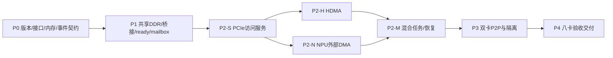
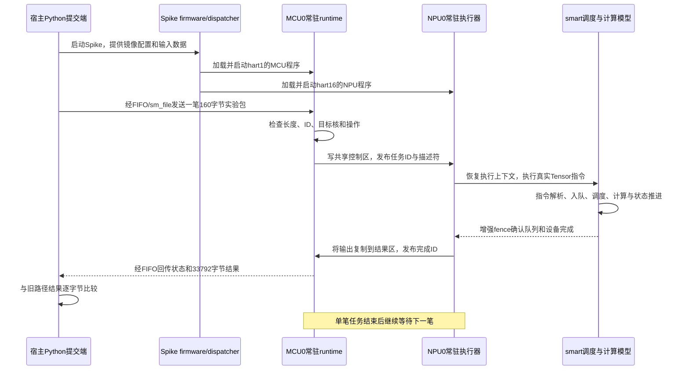

# P0 阶段准入评估与 P 阶段开发方案

> 2026-10-27 Host demo 增量：已收到 `simulator/host-demo`（Linux PCI驱动和应用）。P0基线/设计完成结论保留，Host侧参考更新为该demo；新增设备ID `16c3:abcd`、2MiB coherent DMA、MSI-X、BAR2/BAR4文件传输契约。旧文中“无独立Host驱动/仅stage1测试端”描述已由此补齐；demo尚未在来宾联合验收。接口细节、源码问题及P1/P2调整见 [Host-demo接入影响评估](p0/Host-demo接入影响评估.md)。

日期：2026-10-27。范围：内部功能联合仿真。依据：[项目架构](PCIE%20Switch集群功能仿真器.md)、[总体分阶段方案](内部PCIe互联平台分阶段实现方案.md)、[单 die 调试指南](单die信息包执行闭环实施指南.md)、[首轮执行记录](单die信息包闭环首轮执行报告.md)，以及当前工作区代码和本轮回归。本文保留准入调查及后续计划，并按用户最新澄清收敛 P0：simu 内部 runtime 已与硬件对齐，直接复用；PCIe 参考以现有 Zebu demo/寄存器手册为准。P0 基线与适配设计已完成，进入 P1；不表示 PCIe 全功能已实现。最新结论见第 11 节。

## 1. 评估结论

**P0 已按当前项目范围收敛完成，可以进入 P1 PCIe 接入开发。simu 内部 runtime 已完成硬件对齐，作为既有基线复用；不要求提供额外的“正式 runtime 镜像”或 QEMU 磁盘镜像。**

判断依据包括用户确认的 runtime 状态、当前 runtime hart/dispatcher/mailbox/ECLIC/计算模型实现，以及本轮实际重跑通过的单 die 用例。`smart` 是 simu 核心，但运行链还涉及 `riscv/` 的 CPU/MMU/中断/内存设备、`spike_main/` 的创建入口、`riscv-tests/firmware/` 和 runtime 测试程序，不能只冻结 `smart` 目录。

**P0 出口按“可复现软件基线 + PCIe 适配设计”关闭。** 已完成隔离重建、回归、代码定位、状态归属与适配设计。现有 `pcie-demo` 是 Zebu 版卡侧参考，第一阶段实验 EP 是已完成的 QEMU 连接基线；BAR/HDMA/转换/通知的剩余实现及逐项核对进入 P1/P2。不存在的独立 Host 驱动不再列作 P0 前置依赖。

| 判断项 | 当前状态 | 对开发的影响 |
| --- | --- | --- |
| P0 状态 | 已完成当前范围 | 复用现有成果进入 P1 |
| runtime 与单 die 能力 | 已有实现、调试记录，本轮关键路径回归通过 | 复用已有软件，不重写 runtime/内部驱动 |
| P0 出口 | 基线与设计完成 | 后续按 P1/P2 实现及验收 PCIe 能力 |
| P1 PCIe 接入 | 可立即开发 | 从 stage1、Zebu demo 与手册落实；未定义项显式记录软件配置 |
| 真实驱动兼容/Host DMA/P2P/八卡联合验收 | 未由现有证据证明 | 分别进入 P1—P4；不是本次准入结论 |

## 2. 软件基线与证据可信范围

### 2.1 代码版本及本轮方式

| 对象 | 本次定位 |
| --- | --- |
| simulator 仓库 HEAD | `7fc540e9c157e690b59e7a6759532c3c5b42636a` |
| QEMU 仓库 HEAD | `60018a9bfd7364d824ad095d8857db44a2422e35` |
| Spike | `simulator/riscv-isa-sim/build/spike` |
| firmware | `simulator/riscv-tests/firmware.riscv` |
| 默认模型模式 | `sm_func_mode=true`，`sm_perf_mode=false`，`sm_mid_perf_mode=false`，`sm_use_die_top=false` |
| runtime 开关 | simulator `--runtime-func` 与 firmware cfg 的 `runtime_func:1` 同时开启 |
| 编译工具 | 现有用例使用 `/data/nuclei/gcc/bin/riscv64-unknown-elf-*` |

本轮使用现有本地 Spike/firmware/standalone 测试二进制；假包工程执行增量 make，没有重新全量构建 Spike 或 firmware。双 MCU 用例在独立副本中重新汇编/链接其测试 bin。已记录二进制及关键源码哈希，**不能仅凭现有二进制运行成功证明每份产物与当前源码完全对应**；可重复构建验证放在 P0-01。

截至评估时，QEMU 工作区存在原需求文件删除/更名及新增总结文档，保留用户改动，不恢复旧文件。锁定基线时同时归档工作区差异，不只记 HEAD。

### 2.2 本轮实际验证

| 检查 | 结果 | 能证明的范围 |
| --- | --- | --- |
| dispatch | 退出 0，finish marker 正确 | 本地启动/dispatcher 基线可运行 |
| 原 MoE 功能路径 | 退出 0，输出 33792 字节 | 真实 NPU 模型可执行；新输出哈希与旧实验相同 |
| MCU0→NPU3→MCU0 mailbox | 退出 0，完整 16 字节与预期一致 | mailbox/ECLIC 双向通知及数据正确 |
| MCU0+MCU1→NPU0 IRQ | 退出 0，结果及完成计数 2 正确 | 两个 pending IRQ 可被处理；不代表中断嵌套或持续任务服务 |
| 假包常驻执行 | 同一 Spike 完成 A/B/C 三次 Tensor 动作，五笔非法请求拒绝，STOP 退出 | MCU 接收/校验、NPU 真执行及真实完成；MCU/NPU 之间使用共享 DDR 轮询 |
| SoC NoC、MIF adapter、reorder | 三项均退出 0 | 对应 standalone 资源与事务模型回归 |
| 四核单 die normal / retry-stress | 两项退出 0，remote=56、DDR=50 | standalone 四核互联及 retry 正确；不是四核 runtime 业务验收 |

三次 Tensor 输出 SHA256 均为 `37121ee2cd6afaed02f18587ed683d6fb5d5c4a6cd3b078f682a77891fe7e015`，与本轮旧路径逐字节一致。MoE 对 golden 仍有 1122 个有效元素中 322 个 BF16 编码不同、最大绝对误差 1.0；数值容差未批准。本轮可以判定路径等价，不能宣称 golden 数值验收通过。这不阻止 P0，后续搬运用例优先用可逐字节判定的数据。

本轮未重跑 QEMU 阶段验收；历史 QEMU/Linux/实验 EP 的证据见[第一阶段报告](第一阶段QEMU接入复现与验收报告.md)。八个实验小 BAR 枚举和 CPU MMIO 提交不能作为真实大 BAR、HDMA 或八卡业务已实现的依据。

### 2.3 runtime 状态与旧文档表述

用户已确认 runtime 开发调试完成，最新架构也要求复用现有单 die 软件。旧指南中“未发现本地 Spike”“runtime 入口待确认”等是早期检查记录，不适合作为当前准入结论。

本轮能直接复现的任务样例之一是 `packet_runtime_test/runtime.c`，其源码明确标为最小实验 runtime，使用 160 字节假包、固定 Tensor 参数和单 outstanding。mailbox 中断能力另由 `runtime_test` 验证。二者均通过，仍不能拼接解释为正式 Host mailbox 任务及生产驱动已经联合跑通。

“镜像/入口配置”在旧表述中指 MCU/NPU 裸机程序、加载地址和 firmware cfg，不是 QEMU 磁盘镜像。当前无需另外提供一套此类交付物：simu 内部 runtime/驱动/指令模型按用户确认直接复用，P0 回归使用现有 firmware、dispatcher 和实验任务配置。`packet_runtime_test` 继续作为接入测试夹具，不把它等同于全部已对齐 runtime，也不据此要求重做 runtime。

PCIe 侧以 `simulator/pcie-demo` 的 Zebu 版本和寄存器手册为参考，来宾侧复用 stage1 测试程序及已验证环境。后续如获得独立 Host 驱动，再做兼容性验证，不阻塞当前 P0/P1。

## 3. 核心代码核对与适配位置

以下路径相对于工作区；文件链接在文末索引。表中“新增”是后续计划，本轮未实现。

| 能力 | 已定位实现 | 判断及后续适配 |
| --- | --- | --- |
| runtime 创建 | `spike_main/spike.cc` 的 runtime IDs；`smart/sm_main.cc` 构建模型 | `--runtime-func` 创建 firmware hart0、MCU hart1/2、NPU hart16..19；不能用 `pc_num:2` 推断只创建两核 |
| 核配置 | `sm_main.cc` 的 `hardware_npu_cores`、`sm_regs.h` | 当前模型保留四个物理 NPU 对象，联合配置先 dispatch MCU0/NPU0；记录“创建四 NPU、业务启用一 NPU” |
| 镜像/入口 | `riscv-tests/firmware/firmware.c`、`smart/sm_dispatch.cc` | 复用 cfg 加载、PC/寄存器设置及 activated cores；hart0 是加载职责，hart1 是 runtime MCU |
| mailbox | `riscv/mbox.cc`、`devices.h`，在 `sm_main.cc` 注册 | bank 状态由后端持有；Host BAR 必须访问同一语义及 W1C/SEND/INTEN，不能另建一套独立状态 |
| 本地 ECLIC | `riscv/processor.cc`、`mmu.cc` | 每 hart 私有状态，经本地窗口访问；复用 pending/向量/屏蔽机制，不用 Host MSI 代替 |
| NPU 入队/执行 | `smart/sm_insns.cc`、`sm_schedule.cc`、`sm_npu.cc` | 复用原 ISA/描述符/调度；外部结果必须参与原完成判断 |
| fence/完成 | `sm_fence.cc::call_fence`、`sm_npu.cc::update_status` | 当前依赖队列与设备 idle；外部访问在途时不得提前变 idle |
| 功能 DMA 数据 | `sm_npu_dma_t::run` → `run_dma_ls_desc/run_dma_cp_desc` → `sm_box` | 当前同步功能访存和 busy 回调需要适配外部等待；不能仅调用 HDMA 冒充 NPU DMA |
| 实际内存访问 | `smart/sm_box.cc` 中 `read_mat/write_mat/read_conv` 等经 `simif->mmio_load/store` | 是候选数据接入层；被 Tensor/其他算子共用，修改要按引擎/地址域限制，不全局改变所有访存 |
| DDR backing | `spike_main/spike.cc::make_mems`、`riscv/devices.cc::mem_t::contents` | 当前 `calloc` 稀疏页为进程私有，尚不是 memfd/MAP_SHARED；P1 新增共享内存实现并替换选定 DDR 范围 |
| 带宽/时序模型 | `smart/mid_perf`、`sm_main.cc::tick` | 本轮功能路径与 standalone 性能模型是两类证据；首期继续功能优先，不宣称链路性能 |
| 外部连接 | 当前 `stage1/simu_bridge.py`、`smart/sm_file.cc` | 只是实验 socket→FIFO/同步文件桥；最终连接需事件泵、寄存器代理、DMA 结果和复位协议 |

### 3.1 已有 mailbox 契约

- 基址 `0x18019000`，6 bank，stride `0x68`，每 bank 8 channel。
- bank0/1 → MCU0/1；bank2..5 → NPU0..3。
- INTSTATUS `+0x00` 写 1 清，INTEN `+0x04`；DATA0 `+0x08+ch*0x0c`、DATA1 `+0x0c+ch*0x0c`、SEND `+0x10+ch*0x0c`。
- 非零 SEND 锁存 pending；有效源为 `pending && enable`。NPU IRQ=`19+(7-ch)`，MCU 默认=`137+(7-ch)`，MCU 起始号可配置。
- MCU ECLIC 本地窗口 `0x20000`，NPU 为 `0x09020000`；ISR 按既有顺序清 mailbox 源和 ECLIC pending。

这些是当前代码的内部接口，**Host BAR 偏移及 Host→MCU 使用哪一 channel 仍需按原驱动确认**。不能把 EMU BootROM 的 `0x18103180` FW IPC 当此 mailbox 的同义地址。`mbox.cc` 当前目标路由显式使用 `trans_hartid(0,0,...)`，八个独立单 die 进程可以各自复用；不据此声称单进程多 die mailbox 已支持。

### 3.2 NPU 外部 DMA 的三个重点

1. `sm_box.cc::sm_get_dma_ls_box` 在默认模式把描述符地址加 `sm_ddr_base_addr`，全局地址模式又走 remap。P0 必须追清字段位宽、偏移/绝对地址及出口窗口的解码位置，避免加 DDR base 后才误判外部地址或转换两次。
2. `sm_box` 有返回 bool 的读写接口，但部分上层调用没有处理返回值；`sm_npu_dma_t::run` 的功能动作先同步执行，再设置 Busy、调用 `Ddr->request` 清 Busy。异步 PCIe 不能在这条路径“提交即成功”，需要保存操作状态/结果，外部访问完成后才能解除 busy/fence，失败贯通原引擎。
3. `sm_box` 同时服务计算和 DMA，布局、stride、gather、padding 等原语义要保留。P2 从真实驱动所需的一类合法原 DMA 用例开始，再按实际能力扩覆盖；不能把现有复杂 DMA 简化为不等价的整段 memcpy。

## 4. P0 准入与出口清单（按当前范围收敛）

| 项目 | 准入评估 | P0 出口要求 |
| --- | --- | --- |
| 软件和工具可获取 | 已满足，二进制/源码/工具在本地 | 固定版本、差异、命令、哈希及可重复构建方式 |
| 单 die 可运行 | 已满足，见本轮回归 | 复用既有软件，固定实验样例及输入输出判定（已完成） |
| runtime/MCU/NPU 执行 | 已满足基础路径，按已完成基线复用 | 一 MCU/一业务 NPU 实验连续任务/停止已验证；PCIe ready 接入列 P1 |
| mailbox/中断 | 内部已实现并测试 | 内部语义与归属已明确；Host BAR/通知按参考在 P1 实现验证 |
| HDMA/转换资料 | demo/手册可获取，已有静态疑点记录 | 采用现有 Zebu demo/手册；HDMA/转换实现及剩余字段核对归 P2 |
| 存储归属 | 已定位私有稀疏 DDR 实现 | 共享范围、基址/偏移、容量、生命周期及所有访问者视图设计定稿 |
| 两侧执行调度 | 有实验桥经验 | 同步寄存器读如何实现、事件泵/线程所有权/超时/reset契约定稿 |
| 宿主与guest环境 | 有QEMU历史基线 | 复用 stage1 x86 Q35/Linux/用户态测试；独立驱动兼容不作 P0 门槛 |
| 性能、八卡、P2P | P0无需实现 | 列清后续验收方法，禁止提前宣称支持 |

**P0 退出标准（已满足）：** 现有单 die 软件能够从源码重建并回归；第一阶段 QEMU 连接成果可复用；PCIe 参考来源、内部接口及适配位置明确；共享 DDR/控制面/生命周期设计和 P1/P2 验收矩阵可实施。未实现的 PCIe 功能逐项转入后续阶段，不要求其先实现再关闭 P0。硬件未定义字段须在对应实现前记录选用配置及边界，不能据 P0 完成宣称硬件兼容验收通过。

## 5. P0 工作包与收敛对应

| 编号 | 开发任务 | 产物 | 验证/完成条件 |
| --- | --- | --- | --- |
| P0-01 | 固定两仓库 HEAD/差异、工具链/QEMU/firmware/模型配置；建立可重复构建记录 | `p0` 基线清单、哈希、命令与日志 | 增量/隔离构建和运行结果可追溯；不要求全目录清理，不把旧产物当新构建 |
| P0-02 | 复用既有 runtime/任务测试源文件、现有入口与加载地址，记录已创建/已启用核数 | 单卡启动配置表、软件调用链与已知差异 | MCU0/NPU0实际初始化；连续任务不退出；实验样例与正式基线区分 |
| P0-03 | 从现有Zebu demo/寄存器手册核对配置空间、BAR、HDMA、ATE/iATU、mailbox、中断/reset | 运行期接口对照表：字段/来源/行为/测试/状态 | 模型可据以实现；同寄存器仅一所有者；无未标记的猜测硬编码 |
| P0-04 | 从 `make_mems/mem_t/sm_box` 追DDR backing及地址解码，拟共享访问范围和FD管理 | 共享DDR设计和地址映射表 | 覆盖MCU/NPU/固件加载/BAR/HDMA/P2P，保留本地L1/SRAM；无双副本 |
| P0-05 | 确定socket控制协议、后端事件泵、QEMU寄存器/后端mailbox权威状态、同步读方案 | 消息/状态归属/生命周期设计 | QEMU MMIO不阻塞，后端等结果时仍可收消息；规定reset确认与旧写终止 |
| P0-06 | 固定P1/P2最小任务、原DMA指令/描述符和错误用例 | 验收矩阵、预期数据与trace字段 | Host/HDMA/NPU路径分别有覆盖；NPU DMA不依赖HDMA启动 |
| P0-07 | 核对全部出口，形成进入P1/P2的逐项结论 | P0验收记录与未关闭项 | 区分可开工、受限实验、真实兼容三个状态，不用计划替代实现 |

执行依赖为 01→02；03可在版本明确后开展；04/05基于代码和接口设计；06汇总测试输入；07统一评审。一个人按此顺序收敛即可，不必同时实现 EP、runtime、全量性能模型。

上述工作包按第 11 节与 P0 执行记录收敛：软件基线已验证，接口/内存/事件设计已形成；表中 PCIe ready、BAR、HDMA/转换等运行行为由 P1/P2 实现验收。不再索取另一套 runtime 镜像或将独立 Host 驱动列为前置。

## 6. P1—P4 阶段实施方案

### P1：单卡基础连接与常驻任务

输入：P0基线、运行期接口与共享/控制设计。目标：在现有 stage1 基线上，一个 PCIe EP 连接一个独立后端，Host 通过接入的 mailbox 驱动 MCU/NPU 持续运行；接口依据 Zebu demo/手册落实。

工作包：

1. P1-01 共享DDR：在内存构造点为指定DDR注册共享 backing，QEMU映射同一FD；所有加载/CPU访问/box访存使用同一数据，原本地范围不变。容量可配置，限制合法共享范围。
2. P1-02 双侧桥接：建立会话、设备ID、版本/能力、request ID、代次、超时/断连；后端事件在模型调度所有者上下文生效，不从socket线程直接修改hart/mailbox。
3. P1-03 真实EP基础：配置空间、BAR/Bus Master、源function身份、所需MSI或MSI-X；QEMU持有PCIe/HDMA/转换状态，MCU侧代理访问。HDMA未完成前不伪造其成功。
4. P1-04 Host mailbox：BAR访问映射到现有 `mailbox_t` 语义，测试DATA→SEND、INTEN、pending、W1C以及early SEND；明确同步BAR读与后端权威状态的访问视图，避免两份状态冲突。
5. P1-05 固定入口启动：沿用firmware/dispatcher，实际核初始化发布ready；两笔以上既有任务后回服务循环，生命周期停止才写dispatcher退出。逐任务通知不得结束整个进程。
6. P1-06 基础恢复：后端断连、启动失败/ready超时、空闲reset后重新初始化，阻止旧事件影响新会话。

出口：既有来宾测试端可枚举/访问设备，配置/BAR、ready、mailbox/Host中断、连续任务通过；共享DDR数据在固件、CPU、计算和Host视图中一致。本地指令/DMA/mailbox基线保持通过。真实ROM/Host下载固件不作门槛。

### P2：公共访问服务与两引擎 Host DMA

输入：P1基础及P0冻结的实际引擎协议。公共服务先建立，HDMA和NPU DMA各分支独立实现，按人员安排先后，不相互作为必需前置。

| 分支 | 实施内容 | 验收 |
| --- | --- | --- |
| P2-S 公共服务 | 源function/requester，设备出口到Host IOVA，跨页/长度/权限处理，错误归属与trace | 非恒等IOVA、未映射、只读写入、跨页、撤销及失效同步；不能用宿主指针绕IOMMU |
| P2-H HDMA | QEMU内通道/真实描述符模式、SAR/DAR/LLP/CB等实际配置、数据访问、本地完成/错误中断、停止/reset | 原驱动实际模式而非仅16字节demo；STOP/ABORT/清状态；数据先可见再通知 |
| P2-N NPU DMA | 追原描述符到box地址；出口范围分流、异步操作状态和数据/错误回传；外部在途影响busy/fence | 不启动HDMA完成Host读写；本地DMA不退化；失败不报成功，结果不丢布局/stride |
| P2-M 混合任务 | 用既有任务/参数运行HDMA→HDMA、NPU→NPU、HDMA→NPU、NPU→HDMA四种输入输出 | 跨引擎软件依赖正确，最终数据/完成/MSI顺序可查 |
| P2-R 在途恢复 | 停止接收，排空/取消请求，确认旧写终止，再reset/换代/重建 | 不仅丢旧响应，旧DMA也不能继续改数据；恢复后可再执行 |

HDMA和NPU DMA属于同一function时共用requester身份；HDMA ATU_BYPASS只绕设备侧转换，不绕Host IOMMU。故障细节按硬件定义上报，内部诊断不随意增加驱动可见寄存器。

出口：两引擎Host双向及fault/权限/撤销、四组合、在途reset/断连恢复全部通过；全量内容校验，task/DMA/IPC日志关联明确。

### P3：双卡 P2P 与 Host IOMMU 并存

增加第二独立后端/DDR/EP，实现动态peer BAR、桥窗口/目标解码/inbound的受限路由。分别通过HDMA和NPU DMA的实际支持模式测试A→B、B→A、read/write、双向并发及读响应回源本地目标。

同时运行Host IOVA与peer请求：Host经过IOMMU，peer不经过Host IOMMU、不经Host staging；禁用P2P明确失败。覆盖BAR移动/禁用、越界、转换表更新、目标reset、源reset和断连，使用映射版本/会话/代次避免误投递与旧写污染。

出口：数据与路径正确、失败可归属、无重复完成或永久等待；Host隔离未被P2P旁路破坏。搬运完成与目标runtime消费分别定义。

### P4：八卡功能交付

自动配置一个QEMU、八个EP/后端和共享DDR；每卡dispatch MCU0/NPU0，保留模型完整性并记录实际创建数。根据真实BAR大小重做资源分配，不沿用八个64KiB实验BAR的结论。

按两类引擎实际能力分别验证56个有向卡对、八卡并发Host DMA、P2P/Host混合、通用all-to-all搬运、多请求/中断/内存隔离及单卡故障恢复。外部通信库如已具备可作工作负载，不开发CCL/collective/算子库来替代互联平台任务。

交付构建基线与补丁、双侧适配、原驱动配置、单/双/八卡脚本、测试数据/程序、trace、覆盖报告和限制。固定输入建议连续三次正确性通过；报告宿主资源成本，不当作PCIe硬件时延。TLP/tag/credit/backpressure/带宽/延迟及多die扩展仍后续独立验收。

## 7. 开发依赖、首个里程碑与变更边界



**P0-01—07 已形成当前范围的基线与设计，下一里程碑为 P1 PCIe 接入。** 其代码出口为：共享 DDR 两侧同数据、固定入口软件ready、真实mailbox一次任务及再次任务；在该里程碑前不铺开八卡或性能模型。

| 层次 | 允许的主要增量 | 应保留的基线 |
| --- | --- | --- |
| QEMU | 新EP、HDMA/转换/PCIe服务/P2P与生命周期 | QEMU原Host/RC/IOMMU能力，实验EP独立回归入口 |
| simulator入口/riscv设备 | 共享内存构造、PCIeMMIO代理、消息泵/事件、mailbox外部接入 | 现有hart/CPU/ECLIC/本地内存和固件加载语义 |
| smart | 外部DMA地址分类/状态/回传，busy/fence联动及必要观测 | 原指令、描述符、功能计算、布局及本地DMA；不绕过真实模型 |
| runtime/任务软件 | 启动平台适配和按既有参数传外部地址 | 已调试runtime、内部驱动、mailbox/完成协议 |
| 工程与回归 | 基线manifest、构建/配置生成、结果校验/trace | 旧基线作为对照，数值问题独立记录 |

## 8. 验证记录与复现入口

本轮结果与哈希快照已随文档保存：

- [评估摘要](p0/evidence/summary.json)、[源码与测试产物哈希](p0/evidence/source-and-tests-sha256.json)。
- [基线结果](p0/evidence/baseline-results.json)、[基线产物哈希](p0/evidence/baseline-manifest.json)。
- [假包结果](p0/evidence/mock-results.json)、[假包产物与配置哈希](p0/evidence/mock-manifest.json)。
- [中断及standalone测试清单](p0/evidence/assessment-results.json)、[双MCU日志](p0/evidence/dual-mcu-irq.log)、[四核正常日志](p0/evidence/single-die.log)、[retry日志](p0/evidence/single-die-retry.log)。

原始运行目录：

- `experiments/single_die_packet/run-20261027T071016-595623Z`。
- `experiments/single_die_packet/mock-1793085029660108862`。
- `experiments/p0_assessment/run-20261027T071104Z`。

目录名中的时间使用UTC；本轮运行约为2026-10-27北京时间15:10—15:11。`p0/evidence/` 已加入 ignore，快照和原始输出/大二进制仅在本地保留，不因提交文档自动归档。

现有基线复现命令如下；各脚本保存独立输出，需具备工具链、numpy、输入文件及已构建本地Spike/firmware：

```bash
cd /workspace/GIT/pcie_qemu
python3 experiments/single_die_packet/run_baselines.py
python3 simulator/riscv-tests/packet_runtime_test/run_mock.py
```

standalone回归可在 `simulator/riscv-isa-sim/smart/mid_perf/tests` 运行 `make -f Makefile.die check`；本轮直接执行已有五个测试命令，未重新make。双MCU测试本轮在独立副本运行原 `run.sh`，显式提供本地 `SPIKE_BIN`、`FIRMWARE_BIN`，避免覆盖case原输出；完整命令见测试清单。

## 9. 源码索引

- [smart 创建与推进](../../simulator/riscv-isa-sim/smart/sm_main.cc)、[地址与hart常量](../../simulator/riscv-isa-sim/smart/sm_regs.h)、[dispatcher](../../simulator/riscv-isa-sim/smart/sm_dispatch.cc)。
- [mailbox实现](../../simulator/riscv-isa-sim/riscv/mbox.cc)、[设备/内存类型](../../simulator/riscv-isa-sim/riscv/devices.h)、[CPU/ECLIC](../../simulator/riscv-isa-sim/riscv/processor.cc)、[MMU](../../simulator/riscv-isa-sim/riscv/mmu.cc)。
- [内存构造入口](../../simulator/riscv-isa-sim/spike_main/spike.cc)、[稀疏内存实现](../../simulator/riscv-isa-sim/riscv/devices.cc)。
- [DMA功能执行](../../simulator/riscv-isa-sim/smart/sm_ref_dma.cc)、[box访存与地址构造](../../simulator/riscv-isa-sim/smart/sm_box.cc)、[设备执行与busy](../../simulator/riscv-isa-sim/smart/sm_npu.cc)、[调度](../../simulator/riscv-isa-sim/smart/sm_schedule.cc)、[fence](../../simulator/riscv-isa-sim/smart/sm_fence.cc)。
- [firmware](../../simulator/riscv-tests/firmware/firmware.c)、[runtime测试说明](../../simulator/riscv-tests/runtime_test/README.md)、[假包实验说明](../../simulator/riscv-tests/packet_runtime_test/实验收包执行说明.md)。
- [EMU参考及疑点](EMU参考demo转软件仿真可行性分析.md)、[第一阶段历史验收](第一阶段QEMU接入复现与验收报告.md)。

## 10. 当前项目直观说明：P0 做了什么，任务怎样运行

### 10.1 当前处于什么位置

项目已经具备可运行的单 die 软件执行基础：MCU 能运行 runtime，NPU 能执行真实指令与计算模型，内部 mailbox/中断和调度路径有代码及测试。此前还通过实验 EP 将 QEMU 来宾 Linux 的请求送到单 die，证明这两套仿真能够连接起来。

本轮 P0 准入工作是在这套基础上核对代码、重跑关键用例、整理版本与证据，并找出后续接真实 PCIe 接口需要修改的位置。**P0 基线与适配设计已经完成，PCIe 实现进入 P1/P2。** 接下来的重点是把已运行的软件与真实硬件接口对应起来，再实现共享 DDR、寄存器桥接和外部 DMA。

| 本轮已做的事 | 带来的具体认识 | 当前完成程度 |
| --- | --- | --- |
| 找到 runtime hart、固件加载和 dispatcher | 知道由谁加载程序、从哪里启动 MCU/NPU | 已核对入口并重建/回归；复用既有软件，无额外镜像交付要求 |
| 核对 mailbox/ECLIC，并重跑双向及双 MCU 中断测试 | MCU/NPU 内部通知可以复用；明确 pending、使能和清除位置 | 内部路径通过；Host BAR 如何接入仍需对齐 |
| 重跑常驻假包 Tensor 用例 | 同一进程可以接多笔请求、实际计算、回结果，并拒绝非法请求 | 三次计算与旧路径逐字节一致；正式任务 ABI 与该假包分别管理 |
| 重跑单 die standalone 回归 | 现有 NoC/MIF/reorder/四核模型可作为保留基线 | 对应用例通过；不等于四核都已运行 runtime 业务 |
| 检查内存与 DMA 代码 | 找到私有 DDR backing、原 DMA 访存和 busy/fence 的适配点 | 已定位风险；共享 DDR 和外部 DMA 尚待开发 |
| 整理阶段与验收条件 | 明确先单卡、再 DMA、再双卡、最后八卡 | 形成 P0—P4 方案；后续阶段按运行证据验收 |

本轮没有重新开发 runtime，也没有实现新的 HDMA/P2P 功能。P0 最终要交付的是一套可复现的软件基线和足以实施的接口/适配设计；P1 开始将这些设计落实为联合运行代码。

### 10.2 先分清运行中的三个角色

| 角色 | 实际是什么 | 在流程中做什么 |
| --- | --- | --- |
| 运行仿真的宿主机 | 当前 Linux 工作区和启动脚本所在机器 | 启动 QEMU/Spike、提供测试文件、记录结果 |
| QEMU 来宾 Host | QEMU 模拟的 CPU/Linux，运行设备驱动与应用 | 枚举设备、通过 PCIe 提交任务、映射 Host 内存、接收完成中断 |
| 卡侧后端 | 独立 Spike/NPU simulator 进程 | 模拟 MCU/NPU、运行 runtime/任务服务、执行指令与计算、维护设备内存和内部通知 |

本地单 die 测试中的 Python 提交端直接运行在宿主机，没有经过 QEMU 来宾。此前 QEMU 实验则从来宾提交请求。两者都能到达同一类 NPU 执行路径，但使用的传输入口不同。

MCU 和 NPU 的分工也可以直接理解为：MCU runtime 负责接收任务、准备和协调执行、处理完成；NPU 常驻服务负责接到任务后执行指令、搬运和计算。模拟器中的 C++ 模型提供这些指令和硬件行为的实际执行机制。

### 10.3 当前本地测试：一笔任务如何完成

以下是本轮实际重跑的假包实验流程。它用于验证单 die 执行基础；MCU/NPU 之间使用设备内共享控制区轮询，mailbox 中断由另一组用例独立验证。



对应代码从 `run_mock.py` 进入 MCU `runtime.c`，由 NPU 侧 `runtime.c/execute.S` 发出指令，再进入 `sm_insns.cc → sm_schedule.cc → sm_npu.cc`。这里确实执行了 NPU 模型，收到请求或入队都不会直接当作计算完成。

A、B、C 是同一实例中的三笔正常任务，中间插入五笔非法请求；非法请求返回错误，不增加执行次数。最后测试脚本显式发送 STOP，程序才通过 dispatcher 结束。持续服务能力与“最后为了结束测试主动停止”是两个不同动作。

本流程中的“共享控制区/DDR”是同一个 Spike 进程内 MCU 与 NPU 都能访问的模拟设备内存，**当前没有因此实现 QEMU 与 Spike 两个进程之间的共享 DDR**。这项跨进程数据共享由 P1 接入。

### 10.4 此前 QEMU 实验接通了哪一段

此前第一阶段已验证过下面的实验链路，本轮沿用其历史证据，未重新运行：

```text
QEMU 来宾 Linux 用户态测试程序
 → 写实验 EP 的 BAR0 暂存区并敲 doorbell
 → QEMU EP 经非阻塞 Unix socket 发出160字节假包
 → Python桥接转入 FIFO/sm_file
 → MCU实验runtime → NPU真实Tensor执行 → 等待完成
 → 结果沿桥接返回QEMU
 → EP置done/INTx，来宾读取结果并ACK
```

这证明“来宾软件 → QEMU设备 → 独立simu → 实际计算 → 来宾取结果”可以闭环。该路径使用实验 BAR、假包、FIFO和INTx；尚未覆盖真实硬件驱动的BAR/mailbox/MSI协议，也未通过HDMA或NPU外部DMA访问Host内存。因而，P1/P2要在已验证连接可行的基础上接入真实接口和数据路径。

### 10.5 首期目标：任务与数据怎样分别流动

首期复用 stage1 来宾测试端和既有 runtime，PCIe 接口按 Zebu demo/手册实现，启动沿用固定入口；任务参数通过原 mailbox/队列传递，大块数据按工作负载选择 HDMA 或 NPU DMA。

```text
启动：建立桥接及共享DDR → 加载既有MCU/NPU镜像
     → 核上初始化 → 发布ready → 等待任务

任务：来宾测试/后续驱动 → PCIe BAR/mailbox
     → 桥接 → MCU runtime → 内部mailbox/调度 → NPU任务服务

数据方案A：Host内存 ⇄ PCIe HDMA ⇄ 共享设备DDR ⇄ NPU本地DMA/计算
数据方案B：Host内存 ⇄ Host IOMMU/PCIe/出口转换 ⇄ NPU指令DMA/计算
         两类引擎还可以分别负责输入和输出。

完成：NPU/DMA真实结束 → MCU按原协议处理
     → 确认输出对Host可见 → 发布完成 → PCIe MSI/MSI-X
     → 来宾测试端读取状态和结果 → MCU/NPU继续等下一任务
```

方案A由HDMA承担Host与设备DDR之间的搬运；方案B由NPU指令DMA直接访问Host，不需要启动HDMA通道。两者访问Host时都保留Host IOMMU检查。扩到双卡后，peer访问经源端转换、switch功能路由和目标BAR/inbound到达目标DDR，不经过Host staging；扩到八卡时复制卡实例并验证隔离和并发。

对应当前开发进度：**单 die 执行和实验连接已有基础；P0基线与设计已收敛，P1接通共享内存与常驻任务，P2补两类Host DMA，P3接双卡P2P，P4完成八卡回归。** 每一步都保留已有NPU/runtime行为，并用新的端到端证据确认新增能力。

## 11. P0 收敛结论与后续交接（2026-10-27）

P0 从准入调查进入实际实施。本轮新增[统一构建与回归入口](p0/run_p0.py)，已从空目录构建 Spike、firmware、dispatch、实验 MCU/NPU 程序及 standalone 测试并完成回归。此前“现有二进制与当前源码对应关系尚未通过重建证明”的风险，已在本轮所测 simulator 配置内关闭；QEMU/真实驱动联合构建仍待后续阶段。

交付入口：

- [P0使用说明](p0/README.md)：单条命令执行、工具依赖、日志/manifest及验收边界。
- [启动与接口契约](p0/启动与接口契约.json)：实验镜像、入口、核数、mailbox字段、DDR范围及真实接口缺失项。
- [P1适配设计与验收矩阵](p0/P1适配设计与验收矩阵.md)：共享DDR、同步寄存器访问、消息/线程、reset旧写终止、P1/P2验收输入与判据。
- [P0执行与验收记录](p0/P0执行与验收记录.md)：P0-01—07逐项状态及本轮实际证据。

**当前结论：P0 按现有项目范围完成，进入 P1 PCIe 接入。** 三笔真实 Tensor 执行、五笔非法拒绝、双向/双 MCU mailbox 及 standalone 五项均通过。simu 内部 runtime 按已完成硬件对齐的现状复用；不再要求额外正式镜像、QEMU 磁盘镜像或独立 Host 驱动。PCIe 参考限定为现有 Zebu demo/手册，来宾测试与连接复用 stage1。

第一阶段已完成实验 EP 与 simu 的任务适配闭环，尚未实现 Zebu 寄存器兼容的完整 PCIe 模型。P1 承接共享 DDR、寄存器/mailbox/ready/中断接入；P2 承接 HDMA、转换与 NPU 外部 DMA；P3/P4 仍为双卡/八卡验收。字段核对随对应实现进行，未知项显式记录，不将后续工作重新提升为 P0 阻塞。

从使用者角度，现在运行P0脚本就能自动完成“编译 → 启动MCU/NPU → 连续提交任务 → 原NPU模型执行 → 返回结果 → 自动比对与留档”。QEMU与后端共享DDR、真实Host mailbox和外部DMA尚待P1/P2实现；本轮已经为这些改造确定位置、归属、流程和验收方式。
