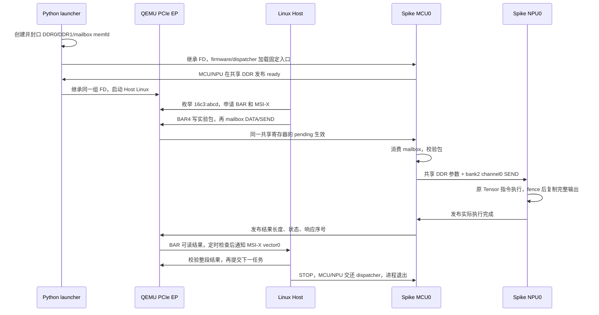

# P1 单卡共享内存接入实验

2026-10-27。当前已实现并验证 **P1-A：共享 DDR + Host mailbox + 软件 ready + 连续真实 Tensor 任务 + MSI-X + 基础复位**。完整 P1 尚未关闭：原设计的 socket 会话/能力协商、通用控制服务和协议错误矩阵仍待 P1-B。状态和运行证据见 [P1 执行与验收记录](P1执行与验收记录.md)。

## 运行

在工作区根目录执行：

```bash
python3 qemu/zc_simulator/p1/run_p1.py --host-demo
python3 qemu/zc_simulator/p1/run_faults.py
```

第一条构建 Spike、QEMU、firmware、实验 MCU/NPU 程序、来宾测试程序和 Host demo 的适配副本，再运行 Linux 与 qtest。已有最新构建时可以加 `--skip-build` 跳过 Spike/QEMU/firmware；实验 runtime 和来宾测试仍重建。省略 `--host-demo` 可以单独运行 BAR/mailbox 任务链路。第二条依赖上述构建，验证异常、双 function backing 隔离和共享 mailbox 的原 ECLIC 用例。

依赖已有 stage1 的固定 Linux 内核、BusyBox rootfs、QEMU 构建目录，及单 die baseline 目录中 SHA256 为 `37121ee2cd6afaed02f18587ed683d6fb5d5c4a6cd3b078f682a77891fe7e015` 的 33792 字节输出。缺失时先按 [stage1 报告](../第一阶段QEMU接入复现与验收报告.md) 和 [单 die 指南](../单die信息包执行闭环实施指南.md) 恢复；脚本不会自动接受另一份参考结果。默认 RISC-V 工具路径为 `/data/nuclei/gcc/bin/riscv64-unknown-elf-`。`--host-demo` 首次运行需联网下载固定 SHA256 的来宾 headers 和构建依赖 APK，只解压到 evidence，不安装宿主包。

产物位于忽略的 `p1/evidence/run-*`、`faults-*`；失败也保留日志。源码适配补丁 `host-demo.patch` 纳入版本管理，`simulator/host-demo` 原文件保持不变。运行记录采用 UTC 时间/时间戳。

## 任务实际怎样运行



这不是在 Host 上代算结果。NPU 使用原 Tensor 指令和 simu 模型，三次执行都有实际执行计数和整段字节比较。`runtime/` 是独立的接入测试夹具，复用既有 firmware/dispatcher 与指令，**不替换已经对齐硬件的业务 runtime，也不代表工具链正式任务 ABI**。MCU/NPU 任务服务目前轮询 mailbox pending，NPU 完成由共享 DDR 轮询；另用原 ECLIC 用例验证共享 mailbox 的真实中断行为。

## 本轮实现契约

| 项目 | 当前实验配置 |
| --- | --- |
| EP | 新类型 `zc-pcie-p1`，VID:DID `16c3:abcd`，保留 stage1 `zc-pcie-sim` |
| BAR0 | 64KiB；诊断、32 MSI-X table/PBA；32 位对齐访问 |
| BAR2 | 4MiB；前 2MiB → DDR0 offset `0x20000000`，对应设备地址 `0x40000000`；其余明确报不支持 |
| BAR4 | 512MiB，64 位 prefetchable；下表中的共享控制区和 mailbox；未覆盖地址明确报不支持 |
| DDR0 | 设备基址 `0x20000000`，跨度 1GiB，独立稀疏 memfd |
| DDR1 | 设备基址 `0x4000000000`，跨度 256GiB，独立稀疏 memfd |
| mailbox | 独立 4KiB memfd，前 `6*0x68` 字节是原 6 bank/8 channel 寄存器 |
| 同步方式 | 小端宿主、进程间无锁 u32 原子；DATA/SEND 与完成发布的 release/acquire；周期调度刷新 ECLIC |
| 生命周期 | launcher 启动/监督后端；epoch 变化令旧后端在模型调度边界退出 75；回收后才能清理和重建 |

BAR 大小根据 Host demo 最大访问偏移推导为可容纳窗口的标准大小；BAR0、BAR4 属性及具体窗口映射是**内部软件 profile**，不据此声明真实芯片 BAR 布局已验收。BAR2 的固件字节在共享 DDR backing 中承载，不表示 SoC SRAM 物理建模已经完成。

| BAR4 offset | 实验功能 |
| --- | --- |
| `0x10000000..0x1000ffff` | DDR1 设备地址 `0x4100100000` 的 64KiB 服务区 |
| 服务区 `+0x100..+0xfff` | Host 可写实验任务包；状态、结果由后端写，Host 只读 |
| 服务区 `+0x1000` | 33792 字节结果 |
| `0x18019000..+6*0x68` | 同一份 mailbox，STATUS W1C、INTEN、DATA0/1、SEND |
| `0x18103180` 所在文件传输 IPC | 未实现；例如 trigger 写入置 BAR0 error=3，不伪造 done |

BAR0 u32：`+0` magic=`0x5a435031`，`+4` profile version=1，`+8` 软件 ready，`+12` error（写 0 清除），`+16` 通知计数，`+20` epoch，`+24` 最后响应序号，`+32` 写 vector index 进行测试 IRQ 注入。MSI-X table 位于 `+0x2000`，PBA 位于 `+0x3000`。这些诊断字段是内部实验接口。

mailbox 共享页 `+0x400` 为请求 epoch、`+0x404` 为 launcher 确认 epoch、`+0x408` 为后端 alive。它们不暴露为原 mailbox 寄存器。QEMU 只有在 epoch 匹配、后端 alive、MCU/NPU 都发布 ready 时接受输入；后端退出由 launcher 清 alive，QEMU 撤销 ready。reset 后先等待旧进程退出、监督线程结束，再复用 backing。当前验证空闲 reset，不承诺有 DMA 在途时的复位。

## 与原 P0 设计的差异及后续

原设计约定 QEMU 创建 FD，通过 Unix `SOCK_SEQPACKET/SCM_RIGHTS` 握手。当前 P1-A 由**可信 launcher** 创建并封口 FD，继承给两个子进程；它也负责 ready 超时和进程监督。共享数据和寄存器唯一性已经落地，但不能将这种进程编排等同于协议协商验收。QEMU 不能单独用任意 FD 启动后就自动找到/重启一个后端；运行入口仍是实验/验收 runner。

P1-B 要补：通用会话/能力与配置摘要协商、card/session/request 身份、FD 传输/校验、非阻塞模型消息泵、断连及协议错误矩阵、可持续运行的 reset/restart 服务。接口不兼容必须明确拒绝；不因当前使用继承 FD 而静默删除原 P1-02 要求。P1-A 的共享存储与模型线程归属可继续复用。

P2 再实现 Host file IPC、HDMA、iATU/ATE、function DMA AddressSpace/IOVA 访问和 NPU 外部 DMA。现有 Host demo 的 `list-devices`、coherent mmap 与 MSI-X 已验证；`fw-load/img-load/file-load/get-result` 不属于本次通过项。Host IOMMU 已启用且设备有 group，并不表示 EP 已完成 DMA/IOMMU 权限验收。八卡、P2P、热拔插、迁移和性能精度均不在本轮范围。
