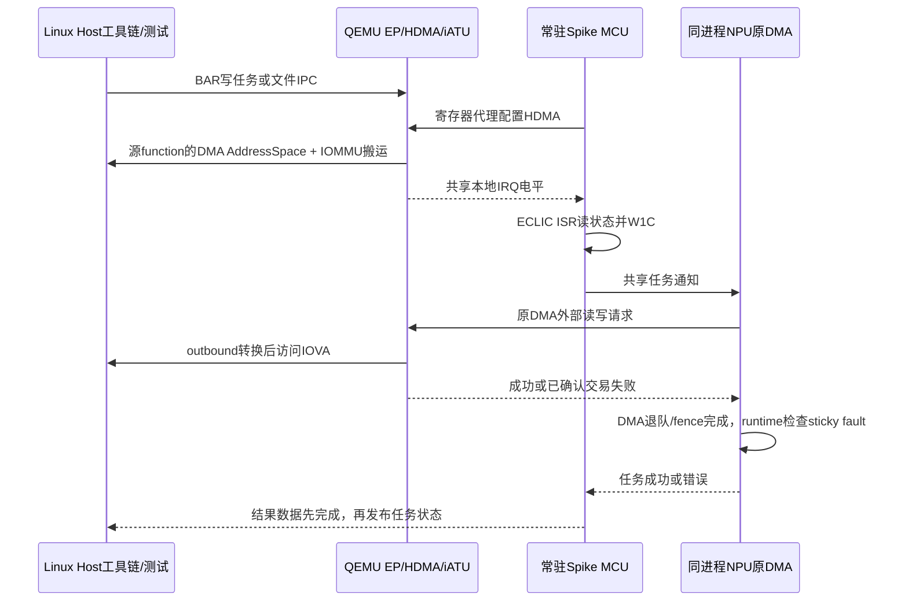

# P2 扩展实现：本地中断、可恢复 DMA、inbound 与文件 IPC

日期：2026-10-28。本文接续首轮 P2；旧报告中的“未实现”描述是当时状态，以本次验收结果为准。所有代码为本项目内部功能仿真实验。

## 本次实现与边界

| 项目 | 本次行为 | 保留边界 |
| --- | --- | --- |
| MCU 本地 IRQ | HDMA STOP/ABORT 经 LSIE/LAIE、STOP_MASK/ABORT_MASK 聚合为电平，W1C 撤销；模型线程写 MCU0 ECLIC，runtime 执行真实 ISR | IRQ 60 为内部仿真配置，尚未取得芯片集成的物理 IRQ 编号；不冒充硬件中断号已确认 |
| NPU 可恢复错误 | QEMU 返回交易失败后释放代理槽，原 DMA 执行边界捕获专用异常，记录每 hart sticky fault，失败描述符退队、fence 可退出；runtime 返回失败并允许下一任务 | 状态为实验诊断 ABI，尚非硬件通道级 error CSR；只覆盖原纯功能 DMA 路径，mid_perf/monitor 不在范围 |
| inbound/iATU | 32 入/32 出 region；入站 BAR/address match、64 位目标、function 0 match、优先级、动态 BAR、DDR/控制器/IPC 别名、停用/溢出/非法目标拒绝；转换重配取消 HDMA | 实现 Memory 类型单 PF 子集；不含 VF、CFG/IO/MSG/Atomic、ATS、invert/fuzzy 等全部 DWC 特性。BAR0 诊断镜像和 P1 mailbox/service 窗口仍为保留软件接口 |
| 文件 IPC | MCU 消费原 host-demo 的 IOVA/size/trigger/CRC32；HDMA 真正搬运文件，校验后缓存；get-result 搬运头和原文件内容，最后单独写 done | 本轮是文件传输/回读闭环，未根据未知的生产文件格式调度 Tensor；不宣称生产工具链任务解析已适配 |
| 故障矩阵 | 两 DMA 引擎读写权限、撤销/未映射、跨页部分失败、BME、转换停用/重配、重试与同 PID；既有 reset/epoch 和完整 P1 回归 | 尚未覆盖每个引擎的全部断连/FLR/并发 reset 竞争排列 |

## 手册和源码依据

`simulator/寄存器手册/DWC_pcie_ctl_reference_6.40a.pdf` 中 HDMA_INT_SETUP（表 3-2345，页 7521–7523）确认 LAIE bit6、LSIE bit4、ABORT_MASK bit2、STOP_MASK bit0；IATU_REGION_CTRL_2_OFF_INBOUND（表 3-2252，页 7335 起）确认 REGION_EN bit31、MATCH_MODE bit30、FUNC_NUM_MATCH_EN bit19、BAR_NUM bits10:8。MCU 的全芯片 IRQ 接线不由 DWC IP 手册定义。

寄存器布局及编程顺序同时核对 `pcie-demo/src/pcie/unified_pcie_regs.h`、`dw_pcie.c`、`dw_hdma.h`；文件协议核对 `host-demo/ssv_test_app.c`。手册/原 demo 未修改。

## 任务运行流程



MCU HDMA 等待 ISR 使用有界软件循环；超时先清 channel enable 停止旧搬运，再返回错误。当前 MCU 不支持的 `rdcycle` 不用于此保护。

普通任务与已确认的 PCIe 交易故障不重启 Spike。启动阶段允许 MCU 寄存器轮询，外部数据搬运仍需 ready；reset/STOP/断连时拒绝旧槽请求。epoch 改变、代理超时、断连仍终止后端，由生命周期服务回收后恢复；不能将未知是否完成的交易当作可安全重试。跨页失败保留已完成字节，禁止将部分结果当完整成功；不提供回滚。

## 新增内部接口

共享 mailbox 页保留区：`0x430` 为 MCU local IRQ ID（60），`0x434` 为聚合电平，`0x438` 为模型最近采样电平；`0x440..0x4bf` 为 32 个 hart 的 sticky DMA fault。QEMU 只通过原子共享字发布电平，ECLIC 仅在模型线程更新。

MCU/NPU 通过内部诊断寄存器 `0x21381000 + hartid*4` 读 sticky fault，写 0 清除；Host BAR0 镜像为 `+0x381000`。该区不是硬件手册中新增的真实 CSR。功能 DMA 捕获的是专用 `p2_dma_fault`，不会吞掉原有算法错误或传输超时。

入站寄存器位于 `0x21300000 + region*0x200 + 0x100`，出站仍为 `+region*0x200`。Host 诊断镜像为 BAR0 `+0x300000`。BAR2 的 P2 访问改走实际已启用的 inbound region；P2 关闭时维持 P1 固定窗口。BAR4 除保留软件窗口外的访问走 inbound。地址模式采用当前 BAR PCI 地址，不缓存启动时 BDF/BAR；最低编号匹配优先。跨 4GiB region 使用 CTRL1.INCREASE_REGION_SIZE bit13 和 upper limit。

文件 IPC 使用 Host BAR4 `+0x18103180` 和 MCU `0x18103180` 的同一组寄存器：地址 0/4、长度 8/12、trigger 0x10、CRC32 0x14/18。Host 写入在 busy 时拒绝，MCU 发布结束状态。load magic `0x5a5aa5a5`，result magic `0x72736c74`；成功 trigger 清 0，实验错误状态为 `0x80000000|code`（1 长度/格式、2 HDMA、3 CRC、4 无有效文件）。CRC32 使用 reflected polynomial `0xedb88320`，高 32 位必须 0。

当前单次文件大小上限为 `2MiB-8`，不含生产分片协议。get-result 在已知 Host demo 的 2MiB 接收缓冲假设下，先写 `[magic=0,size,payload]`，再单独写头 magic `0x646f6e65`；若传输失败不发布 done。新文件失败会清除旧文件有效性，禁止回读旧结果。回读 payload 为上传原文。FW/ROM 冷启动继续单列。

## 复现与关闭标准

在工作区根目录构建并执行：

```bash
ninja -C qemu/build qemu-system-x86_64
make -C simulator/riscv-isa-sim/build -j8 spike
python3 qemu/zc_simulator/p2/run_all.py --skip-build
```

验收期间保持二进制不重建。统一门禁包含 HDMA/inbound/IRQ、真实 MCU/NPU/文件 IPC、Linux coherent IOVA 与真实 MSI-X、完整 P1。证据和最终计数见 [P2执行与验收记录](P2执行与验收记录.md)。`p2_extended_functional_pass` 只代表该功能配置通过，完整 `p2_full_exit` 继续要求物理 IRQ、硬件错误 ABI、生产任务及剩余矩阵分别关闭，不能由关联测试推断。
