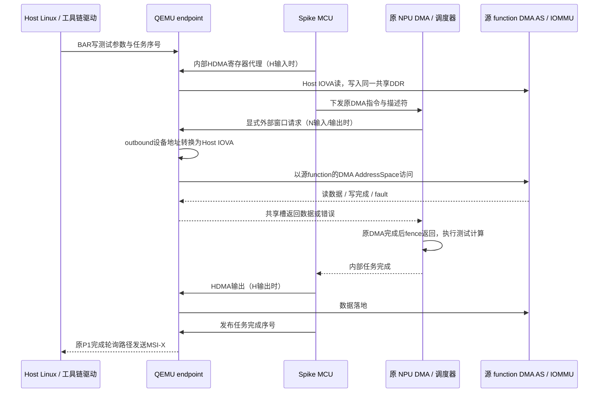

> 2026-10-28 扩展实现已增加本地 IRQ、可恢复 DMA、inbound 和文件 IPC。当前行为及接口以 [P2扩展实现说明](P2扩展实现说明.md) 为准；下文首轮限制保留作为实现沿革。

# P2 接口与运行流程

## 1. 状态归属与地址域

QEMU endpoint是 iATU、HDMA通道和PCIe访问的唯一权威。Spike仍持有既有MCU/NPU模型、L1、任务调度及内部完成状态；两进程访问P1已实现的同一DDR backing。普通任务均复用一个常驻Spike。

测试计算为NPU程序在L1对输入逐字节XOR `0x5a`，不是Python代算；DMA搬运由原NPU指令或QEMU HDMA执行。测试期望由Host独立比较整段数据。当前不据此宣称真实Tensor业务任务已完成P2验收。

| 地址 | 含义与处理 |
| --- | --- |
| 设备DDR0 `[0x20000000,+1GiB)` / DDR1 `[0x4000000000,+256GiB)` | HDMA本地侧；必须整笔位于合法backing |
| NPU描述符全局地址 | 保留原48位字段及现有PA/相对地址模式；测试沿用默认相对DDR1方式表达设备外部地址 |
| 外部设备窗口 `[0x18000000000,0x20000000000)` | 仅通过enabled outbound iATU转换；禁止本地未命中自动逃逸 |
| Host IOVA | 源function `pci_dma_rw()`进入该function DMA AddressSpace和QEMU IOMMU，绝不解释为宿主指针或直接GPA |
| Host访问属性 | `memory=true`，明确拒绝MMIO/self-BAR递归；本轮只支持Host RAM，不支持peer BAR路由 |

每个Host transaction按IOVA页边界拆分，成功后才记录该页实际字节。跨页失败可能已经写入前面成功页，不能将整个请求宣称原子回滚；测试明确验证失败页未写。`ATU_BYPASS`只绕过设备outbound转换，仍经过源function/IOMMU。Bus Master关闭、溢出、非法本地范围及MemTx fault明确失败。

## 2. HDMA 功能子集

依据：`simulator/pcie-demo/src/pcie/dw_hdma.h/.c` 和 `pcie_ep.c`。Configuration HTML是综合配置说明，确认8个write和8个read通道、32个outbound/32个inbound region；它本身不是完整逐寄存器databook。本轮实现32个outbound region，inbound保留待办。

MCU基址`0x21380000`；调试BAR0镜像`+0x380000`。每通道对步长`0x200`，write偏移0、read偏移`0x100`，共8对，访问只支持32位对齐。

| 偏移 | 行为 |
| --- | --- |
| `0x00` | channel enable；清0取消该通道，之后无旧搬运继续写入 |
| `0x04` | 写1提交doorbell，读0；disabled/not-ready/busy/非法配置进入ABORT |
| `0x10/14` | 64位本地linked-list pointer |
| `0x18` | consumer cycle，使用bit1与描述符CB比较 |
| `0x1c` | transfer size；运行时读回剩余字节 |
| `0x20/24`、`0x28/2c` | 64位SAR/DAR；运行时私有游标推进，不承诺所有IP自动回写语义 |
| `0x34` | `0x202`为demo直接模式、`0x203`为demo链表模式；bit9 bypass，bit1 memory；其他位明确不支持 |
| `0x38` | 仅支持function0；非零拒绝，不借用其他function requester |
| `0x80` | 本模型idle初始0、running1、stopped3；不据此声明完整IP状态机兼容 |
| `0x84`、`0x8c` | STOP bit0、ABORT bit2；`int_clear`按W1C清除 |
| `0x88` | 保存int_setup；尚未连接MCU本地IRQ，也未实现remote MSI编程语义，不作为中断兼容通过项 |

链表数据元素24字节：`control/u32,size/u32,SAR/u64,DAR/u64`；link元素使用同槽前16字节。支持CB检查、LLP跳转和link TCB切换consumer cycle；按给定demo的单描述符约定，data TCB终止本次链表。描述符只从本地共享DDR读取，不经过Host IOMMU；最多遍历4096个元素，每tick至多取一个link，避免坏链表卡住QEMU。中断扩展descriptor位目前拒绝，完整硬件cycle/停机/通知语义仍需逐项补齐。

每个QEMU实时tick，每个busy通道至多搬运一个IOVA页；MMIO提交只写状态，不同步等待后端。映射寄存器重配取消在途HDMA，后续新请求按新表访问。当前支持的outbound region字段为unroll `index*0x200+{0,4,8,c,10,14,18,20}`，CTRL1仅memory/function0，CTRL2 bit31使能，最低index先匹配；其他模式不据存储值宣称支持。

## 3. 共享访问槽

复用mailbox共享页保留区；原6bank寄存器和`0x400..408`生命周期字段不变，不映射到Host的原硬件mailbox范围。

| 页内偏移 | 字段 |
| --- | --- |
| `0x500` | u32状态：0空闲、1已提交、2完成；release/acquire发布 |
| `0x504` | u32 epoch，QEMU只接受当前代次 |
| `0x508` | u32操作：1外部读、2外部写、3控制器读、4控制器写 |
| `0x50c/510` | u64设备地址，分低/高u32 |
| `0x514` | u32长度，1..2048；控制器必须aligned4 |
| `0x518` | u32结果：0成功、1失败；结果及payload先写，最后发布状态2 |
| `0x51c` | u32保留，必须0 |
| `0x520/524` | u64后端递增序号，用于诊断；本轮不提供跨进程并发队列/重试去重协议 |
| `0x600..dff` | 最多2048字节请求/响应payload |

`p2_pcie_t`用互斥量串行化调用，模型线程有界等待响应（5秒），每次检查epoch。所有访存在模型原线程完成；不跨线程直接更改hart/ECLIC。`sim_t::addr_to_mem()`对代理页返回空，强制MCU走MMIO，避免DDR0范围重叠时被快速RAM路径绕过。

NPU原DMA的实际访存经`sm_box`→`simif`→`sim_t::mmio_load/store()`；因此保留原指令解码、队列和增强fence，只有显式外部窗口被代理。多个旧DMA调用者忽略`mmio_*`的bool结果，本轮遇到代理失败或超时会抛异常，终止该后端，服务撤销alive/ready并回收；不会假装DMA成功或继续发布完成。**这是会话级fail-fast，不是已实现通道级错误返回/继续执行。** 本轮只验收既有纯功能模式，性能/mid_perf不在覆盖范围。

## 4. 生命周期与可观测性

QEMU tick先推进会话、更新alive/epoch，再处理代理槽和HDMA。首轮实现中非ready时拒绝/取消工作；reset先停止本function所有HDMA并拒绝待处理槽，再进入既有QUIESCE→reap→RESET→START流程，清空通道/转换配置。模型线程若在同步请求中，被服务终止和回收后才能清空共享页。普通任务不重启Spike，reset/故障恢复可以重建。

`p2-trace=on`记录JSON：card/session/epoch、devfn、engine（hdma_read/hdma_write/model_proxy）、request、device_addr、iova、length、write、path、mapping_version、MemTxResult。路径为`host_dma_as`，不表示绕过IOMMU；实际fault及页表由QEMU IOMMU日志和测试核对。尚未把core/task ID和HDMA channel ID完整接入每笔trace，这是后续补齐项。

本轮只验证function reset、channel enable清除、会话失败导致的取消；独立FLR、NPU正在读写时的全部竞争窗口、每引擎全部错误矩阵不能从这些测试外推。Host文件IPC寄存器`0x18103180`与BootROM FW命令协议继续保持未实现/明确拒绝，不复用内部mailbox去伪造消费成功。
