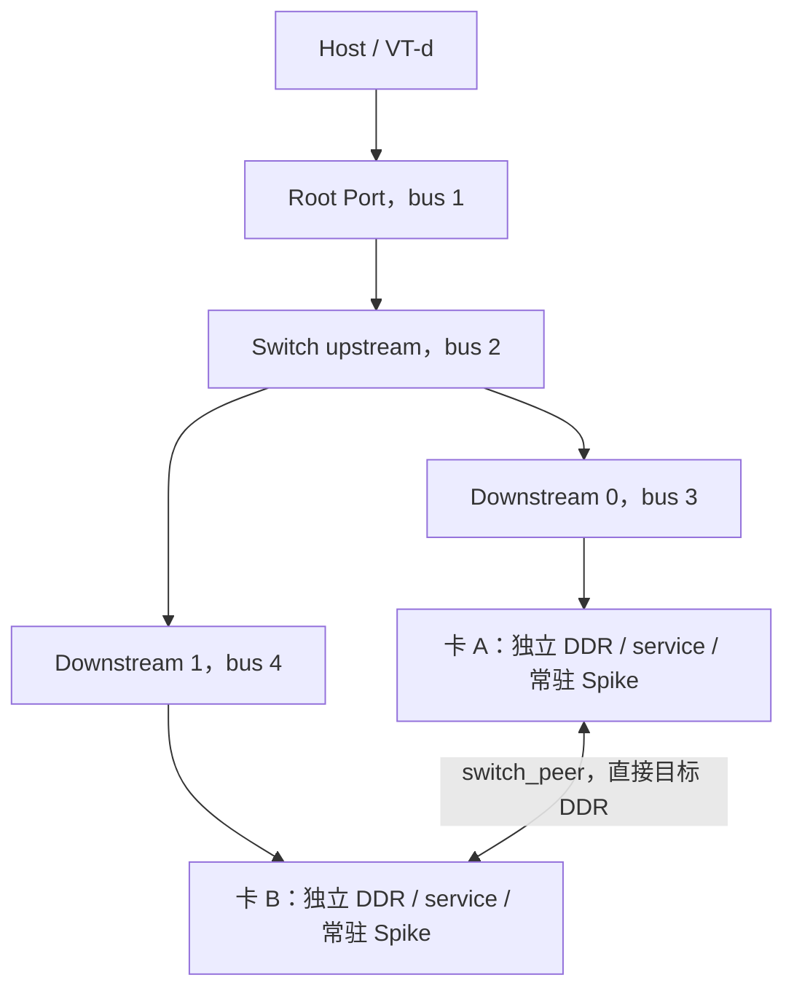

# P3 双卡 P2P 功能仿真

**当前状态：P3 双卡软件功能已闭环；428 项专项及完整 P2/P1 回归通过。**

P3 在已有 P1 常驻会话、P2 两类 DMA 的基础上，增加两张独立卡之间的 switch 本地 DDR 路由。实现属于内部软件功能 profile，参数和诊断寄存器不宣称是物理芯片 ABI。

## 运行

从工作区根目录执行：

```bash
ninja -C qemu/build qemu-system-x86_64
python3 qemu/zc_simulator/p3/run_all.py --skip-build
```

单独开发双卡专项可运行 `python3 qemu/zc_simulator/p3/run_p3.py`。专项 `passed=true` 只表示该组通过；完整出口由统一入口同时检查双卡专项、完整 P2（含完整 P1）和构建/源码摘要一致性后设置。验收期间不要重新链接 QEMU/Spike。

生成目录 `evidence/` 已 ignore，包括两份服务日志、QEMU trace、启动命令、配置摘要和 JSON 检查结果。正式结果见 [P3执行与验收记录](P3执行与验收记录.md)。

## 接口与启动约定

每卡仍使用 `zc-pcie-p1,p2=on`，新增：

| 参数/接口 | 含义 |
| --- | --- |
| `p3=on` | 启用显式 peer 地址域与 switch 路由；必须同时启用 P2 |
| `card-id=N` | P3 卡 ID 必须唯一，每卡对应一个独立 service 和 Spike |
| `peer-base=0x1000000000` | 默认 peer 地址域起点，64 GiB |
| `peer-size=0x1000000000` | 默认域长 64 GiB，末地址不含 128 GiB |
| `p3-allow=on/off` | 启动时 P2P 许可，源和目标均须许可 |
| BAR0 `0x381084` | 内部软件 profile 的运行时 P2P 许可，32 位读写，0/1；每次写入推进映射代次 |
| BAR0 `0x381080` | 延用 qtest 专用暂停点，只用于确定性故障注入 |
| BAR0 `0x381088` | qtest 专用：已固定路由的 NPU 集成任务编号，未固定为 0；不用于产品软件 |

peer 地址域必须由启动配置从 Host IOVA 池中预留出来，两卡使用一致配置，所有 peer BAR4 均应完整位于此域内。域内未匹配、失效、自己卡或不允许的 peer 请求直接失败，不尝试 Host DMA。域外请求仍走源 PF 的 `pci_dma_rw()` 和 IOMMU。本轮通过 BAR4 提供 DDR payload；BAR0/2 不作为 P2P 寄存器访问入口。

每个 endpoint 原有三个 64 位 BAR 的属性和大小不变：BAR0 4 MiB non-prefetchable、BAR2 32 MiB non-prefetchable、BAR4 32 GiB prefetchable。测试脚本作为最小 BIOS 配置桥与 BAR0/BAR4，BAR2 未分配；这不能代替 Linux 对双卡原驱动的资源分配验收。

## 双卡拓扑与地址



| 项目 | A | B |
| --- | --- | --- |
| BDF | `03:00.0` | `04:00.0` |
| BAR0 | `0xe0000000` | `0xe0400000` |
| BAR4 | `0x1000000000` | `0x1800000000` |
| peer payload bus 地址 | BAR4 + `0x20000000` | BAR4 + `0x20000000` |
| inbound 本地目标 | DDR0 `0x20010000` 起，128 KiB | 同地址，独立 backing |
| NPU device 地址 | `0x18000000000` 经本卡 outbound 指向 B payload | 同地址，经本卡 outbound 指向 A payload |

两个 downstream 的 memory/prefetch 窗口分别覆盖各自卡资源，互不重叠；父级聚合窗口覆盖两卡。peer 沿源端上行到共同非根总线，再沿目标下游窗口路由，不检查未经过的 Host 上游窗口。ACS、ATS、PASID、TLP ordering、真实链路带宽/延迟均未建模。

## 任务运行流程

1. QEMU 为每卡创建独立 DDR0、DDR1、mailbox memfd，向对应常驻 service 协商并通过 SCM_RIGHTS 传递 FD；每个 service 启动一个常驻 Spike。
2. 每个 Spike 内部 MCU/NPU runtime ready 后，Host 配置桥、BAR、目标 inbound 和源 outbound。普通任务不启动新进程。
3. Host 把数据放到 peer 的 payload 窗口，向源卡任务区提交编号、引擎组合、长度和地址。
4. MCU HDMA 使用现有通道；原 NPU DMA 仍通过模型队列和 mailbox 代理，不替换模型数值执行。两者都进入源卡统一事务入口。
5. Host IOVA 进入源卡 DMA AddressSpace；peer 地址进入功能 switch 路由，验证同一根域及共同非根 PCI 总线、桥窗口、BME/MSE、许可、ready、当前 BAR、目标路由下游窗口和首个匹配 inbound。只允许目标 DDR，控制器、IPC、service、mailbox 不可用作 peer payload。
6. 每个成功事务直接读写目标 backing；读响应回到源引擎。经 QEMU 栈上暂存事务数据不等于通过 Guest Host RAM staging，没有另造一份“peer DDR”。
7. 原 IRQ/模型 fence/任务完成链路返回结果；trace 的 `switch_peer` 与 `host_dma_as` 分开记录。
8. 映射/会话/代次变化使旧请求失败。正常任务继续使用原进程；reset 或断连才由服务回收并替换受影响后端。

## 实现与边界

- `hw/misc/zc-pcie-p3-route.h`：设备线程下的 endpoint 路由、桥/范围/状态检查、直接目标 DDR 事务及 fabric 签名。
- `zc-pcie-p1.c`：P3 配置、注册与退出清理；系统 MemoryListener 记录映射 commit，桥窗口短暂关闭再恢复也会改变代次。此策略保守：无关内存拓扑变更也可能使在途 P3 请求失败，调用方重新提交。
- `zc-pcie-p2-engine.h`：HDMA 在 doorbell 时固定路由；NPU 在集成任务首次外部请求时固定路由，跨块保持到下一任务编号。此任务关联复用 P2 集成 runtime 的 `control[64]`，尚不是生产工具链通用多队列任务标识协议。任一 fabric 变化使旧请求失败，不自动重放已写入的前缀。
- NPU 同步代理和 HDMA 都按有限块推进；不支持 peer MMIO、跨卡原子、硬件级有序性或周期精度。
- `p2_host` trace 给出源会话/代次、引擎、父请求、通道、地址域和结果；`p3_route` 通过源卡与 request 关联目标会话/代次/映射版本。未提供的 hart/task 元数据仍保留 null，不能据此推断多 hart 并发任务兼容。

P3 软件出口不等于生产 runtime/双卡驱动全场景兼容，也不等于 P4 八卡验收。P2 已记录的物理 IRQ、NPU 错误 CSR、生产文件 ABI、独立数学 golden、FLR 等兼容差异继续保留。
