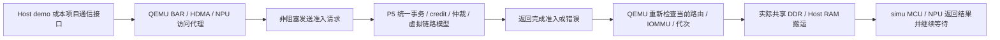

# P5：demo 任务、通信接口与 PCIe 事务模型

工具链联调用法及 P0–P5 全功能入口见 [功能使用手册与工具链多卡互访指南](../P0-P5功能使用手册与工具链多卡互访指南.md)，第一部分说明 x86 驱动提交到 simu 内部 DMA 的实际使用步骤。

P5 以现有 `pcie-demo`、`host-demo`、simulator 和任务数据为全部输入。通信接口、测试和 runtime 增量由本项目开发，不再等待工具链提供额外任务协议或通信库。本目录用于内部软件仿真实验。最终软件门禁已通过：`p5_full_exit=true`，397 项 P5 测试/检查及完整历史回归通过，77 项摘要一致。

## Linux 二进制交付

`run_linux.py` 现在自动检测 simu 源码：有源码则编译并更新 `../simu/`，无源码则从已有包运行。包同时携带内核/来宾镜像，交付时无需 simulator/experiments 目录。用 `--prepare-only` 仅生成包，用 `--runtime prebuilt` 强制复用。当前已发布运行包已纳入 Git，克隆即可取得；以后新生成版本发布时需同时提交包目录和 `current` 链接。详见 [运行包说明](../simu/README.md)。其他历史验收入口保留原有依赖。

## 运行

从工作区根目录运行完整验收：

```bash
python3 qemu/zc_simulator/p5/run_all.py
```

已完成构建时可加 `--skip-build`。如同一工作区已完整通过 P4 且其 manifest 内所有源码/产物仍逐项匹配，可用 `--p4-evidence <已通过的P4证据目录>` 复用该历史回归；脚本会重新验证摘要，任何变化都拒绝复用。统一入口运行协议/队列测试、解析模型校准、八卡任务包、IRQ/错误、断连恢复、双卡/八卡真实通信、双卡/八卡 Linux 驱动及 C 通信库，最后运行完整 P4→P3→P2→P1。只有各层通过且源码/产物摘要一致才设置 `p5_full_exit=true`。生成文件在 `p5/evidence/`，已 ignore。

分别复现：

```bash
python3 qemu/zc_simulator/p5/run_tasks.py
python3 qemu/zc_simulator/p5/run_communication.py --cards 2
python3 qemu/zc_simulator/p5/run_communication.py --cards 8
python3 qemu/zc_simulator/p5/run_linux.py --cards 8
python3 qemu/zc_simulator/p5/run_irq_errors.py
python3 qemu/zc_simulator/p5/run_faults.py
python3 qemu/zc_simulator/p5/test_fabric.py
python3 qemu/zc_simulator/p5/run_calibration.py
```

独立事务模型可使用配置文件：

```bash
python3 simulator/tools/p5/run_model.py \
  --config simulator/tools/p5/profiles/gen4-eight.json \
  --requests simulator/tools/p5/profiles/requests.json \
  --out /tmp/p5-model.json
```

## 三方执行流程



`P5Platform` 启动八个常驻后端和一个 `fabric_service.py`，给每个 EP 配置 `p5-fabric-socket`。QEMU 为 16 个 HDMA 通道及 NPU 代理分别维护待准入槽，发送固定帧后返回事件循环；后续 tick 收到 grant 才执行实际内存操作。pending 期间仍可处理 MMIO、其他通道和 reset。服务断连必须报错，不能绕过模型成功搬运；恢复后通过 function reset 重新连接。

准入帧关联 token、槽号、源卡、目标卡、地址、长度、读写、session 和 epoch。槽清理后晚到 grant 不匹配新 token，不会重放旧请求。NPU 跨页访问保存已确认前缀，避免等待 grant 时重复搬运前页。服务只模拟访问时间/资源，数据及地址权限仍由 QEMU/原模型实际执行。

## 通信接口

实现位于 simulator：

- `tools/p5/communication.py`：`send()`、`read()`、`wait()`、`barrier()`、`reset()`；多软件队列 FIFO、深度限制、全局 ticket、接收区重叠检测和错误传播。
- `tools/p5/zc_comm.h`：供 Host C 程序使用的有界环形队列；通过现有 HDMA 通道寄存器提交，支持异步 progress、完成/错误、满队列和 reset。
- [backend.py](backend.py)：把 Python 通信片段转成真实 HDMA 操作，经过实际 peer 或 Host IOMMU 路径，不用 Host staging 冒充 P2P。
- [guest-communication.c](guest-communication.c)：适配原 host-demo 驱动后的 Linux 调用示例，覆盖双卡/八卡、两软件队列和三轮全卡对通信。

这些是本项目实现的软件接口。软件多队列通过现有通道执行，不宣称发现了原 demo 未定义的硬件生产多队列 ABI。调用者须保持在途 buffer 有效，并在依赖操作前 wait/barrier。P5 自研基础通信不要求实现 NCCL、AllReduce 等 collective。

## demo 文件任务及 runtime

`run_tasks.py` 从现有 Tensor 程序、输入、参数及固定参考生成可复现任务目录：`task.json`、`program.S`、`input.bin`、`parameters.bin`、`expected.bin`。`tasks.py` 校验版本、成员 SHA256、文件路径边界与参数长度。

文件通过现有 demo 的 `0x5a5aa5a5` 文件传输通知和 CRC 搬入；新增 simu runtime 的 mode 5 将本地文件 buffer 作为输入，实际调用原 NPU Tensor 程序，完成后以 `0x72736c74` 结果请求取回。返回头沿用 `done` 和长度字段。错误 CRC、空文件、非法本地地址均有明确状态，合法任务可在同一 Spike 中继续执行。

runtime 在 `simulator/tools/p5/runtime/`，复用 P2 已验证的启动、DMA 和 Tensor 汇编，保持 mode 1—4 兼容。P4 的默认 runtime 不变；平台类仅新增可选 `runtime_dir` 参数。任务包是本项目利用现有素材生成的执行约定，不冒称新取得的生产编译器文件格式；`program.S` 标识目前预置的 Tensor 程序，本包不支持任意新程序动态链接/加载。结果比较沿用固定 standalone 模型参考，不作为独立数学 golden 认证。

## IRQ、错误与复位

HDMA 的 pending/mask/中断使能和 W1C 依据已有 demo 寄存器；MCU 本地中断使用现有软件线号 60。NPU 错误沿用每 hart 的软件诊断区 `0x21381000 + hart*4`，非零表示失败，写 0 清除；原 DMA busy/fence 和错误返回由 simu 执行。

新增可选 `p5-flr=on`，通过标准 PCIe capability 宣告并实现 function-level reset，复用现有 QUIESCE→回收→RESET→重新启动服务机制。QEMU 通用设备复位会清除该 function 的 BAR/command，调用端恢复该卡配置后再配置 ATU。测试检查单卡后端替换、无关卡 PID 保持、在途旧写入停止、reset 后再次执行 runtime。

通信队列 reset 停止其自有通道并取消排队项；系统 reset、runtime crash 和后端断连继续复用 P1—P4。没有将队列 reset 或 FLR 声称为单 hart 架构复位。IRQ 60、诊断区及 P5 FLR 是明确的软件仿真能力，并非新增的物理芯片兼容性证明；本轮无额外硬件资料依赖。

## 协议、流控和性能口径

`fabric.py` 实现 MemWr/MemRd、CfgRd/CfgWr、Message、CplD/Cpl；读 tag 直到 split Completion 全部返回才能复用，检查 requester/tag/父请求；Memory Write 和 Message 不生成虚构 PCIe Completion。MPS/MRRS 和 4 KiB 边界控制分片，支持 strict/pci_relaxed/delayed 的已定义模型顺序。

每条方向独立的链路具有 P/NP/Cpl Header/Data credit。Data credit 单位 16 B，有限接收资源占用直到返还；不足时排队并记录 credit stall。支持 RR、固定优先级、WRR，Host 上行由各卡共享，peer 经源上行和目标下行。不同端口支持 Gen3/4/5、lane、latency、credit、仲裁和阻塞时间配置。报告区分软件等待队列长度与 credit 限制的在途接收占用。

模型使用整数纳秒、128b/130b 编码及显式 **24 B 软件 framing 开销**，按链路序列化、传播、返还和仲裁事件推进。输出 packet/request trace、端口字节数、利用率、credit stall、等待时间、最大在途占用、请求平均/最大延迟及 credit 余额。

校准依据独立的整数有理公式和已知单包往返/共享上行服务量，不依赖外部采样。**此处是软件协议/链路模型的理论校准，`physical_hardware_calibrated=false`。** 未建立统一的 CPU 指令周期与 PCIe 虚拟时间轴，也未宣称 cycle-accurate、完整 LTSSM/DLLP/LCRC/replay 或物理芯片带宽精度。

QEMU 实时日志 `p2_host` 记录实际搬运成功/失败；`live-fabric.json` 记录 DMA 准入规划和资源时间。QEMU 在完整准入片段获批后提交内存操作，而非逐 TLP 在虚拟时间点修改内存，因此不能把所有已准入字节直接当成已提交字节。通信库层的任务调度统计与 QEMU 统一准入统计是两个观察层，时间不能相加。相同模型输入可重复，实时联仿的入队批次受宿主调度影响，不保证 trace 时间逐字一致。

验收结果及逐项覆盖见 [P5 执行与验收记录](P5执行与验收记录.md)、[P5 需求覆盖](P5需求覆盖与接口基线.md)。
