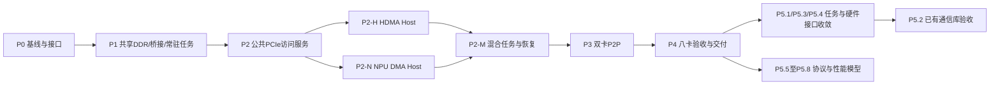

> 计划修订：P0—P4 已完成软件功能基线；新增正式 **P5：原始需求补齐与联合验收**，统一承担真实任务/队列、通信库、硬件 IRQ/错误/复位以及 PCIe 协议与性能模型。P5 未完成前，不宣告项目全部需求完成。外部输入清单及提供时点见第 8.1 节；可选多 die/冷启动扩展调整为 P6。

> 2026-10-28 最新结论：P4 八卡软件功能闭环完成（`p4_full_exit=true`，40 项摘要一致）。已实现八卡自动配置、八个独立常驻后端、完整三组 BAR、四组合全 56 卡对、八卡 Host/peer/Tensor、24 组在途故障隔离及恢复。八卡专项 1964 项、Linux 八卡专项 15 项及完整 P3/P2/P1 回归全部通过；生产硬件兼容性与后续性能模型仍单列。实现和证据见 [P4执行与验收记录](p4/P4执行与验收记录.md)，启动方式见 [P4 README](p4/README.md)。

> P3 历史闭环结论：P3 双卡软件功能闭环完成（`p3_full_exit=true`）。两类引擎双向 P2P、真实 Tensor、Host IOMMU/peer 并存、在途重配及断连/reset 恢复共 428 项通过；完整 P2/P1 回归通过，34 项源码/产物摘要一致。证据见 [P3执行与验收记录](p3/P3执行与验收记录.md)，启动与运行流程见 [P3 README](p3/README.md)。P4 八卡已由本文顶部最新结论覆盖，生产硬件兼容性继续单列；下文此前状态保留为历史。

> 最新结论：P2 单卡软件功能已闭环（`p2_full_exit=true`），可以进入 P3。本轮补齐原 Tensor 四组合和两引擎读写在途 reset/断连矩阵，完整 P1 回归通过；硬件兼容性差异仍单列。验收范围与证据见 [P2闭环验收记录](p2/P2闭环验收记录.md)。下文此前未关闭状态保留为历史。

> 2026-10-28 P2扩展：已补 MCU 本地中断软件接线、NPU 可恢复交易错误、32 region inbound Memory 子集与 MCU 文件 IPC 消费者，并扩展故障重试矩阵。物理 IRQ 编号、硬件通道错误 ABI、生产 Tensor 文件解析及全部竞争矩阵仍单列，详细状态见 [P2扩展实现说明](p2/P2扩展实现说明.md)。

# 内部 PCIe 互联平台分阶段实现方案

> 2026-10-28 P2首轮实现：已新增function绑定的Host访问服务、HDMA子集、MCU寄存器代理、原NPU外部DMA及四组合/Linux驱动联合测试。完整P2尚未关闭，后续按本地IRQ、可恢复NPU错误、inbound/文件IPC及扩展矩阵顺序推进。代码入口与同批证据见 [P2执行与验收](p2/P2执行与验收记录.md)。

> 最新实现：三个BAR已对齐为64位，大小4MiB/32MiB/32GiB，前两个non-prefetchable、最后一个prefetchable。当前代码与旧实验profile不同；最新运行配置、P2准备项和证据见 [BAR对齐与P2准备](p1/P2开发前准备与BAR对齐验收.md)。下文旧大小及“尚未修改”描述仅保留为历史。

> 2026-10-28 BAR补充确认：用户提供硬件为三个64位BAR，BAR0=4MiB/non-prefetchable、BAR2=32MiB/non-prefetchable、BAR4=32GiB/prefetchable。当前代码仍是原P1实验布局，硬件profile尚未修改/复验；后续调整与历史启动panic说明见 [BAR属性确认](p1/BAR硬件属性确认与接入调整.md)。

> 2026-10-28 最新状态：P1会话服务、SCM_RIGHTS、配置/身份校验、超时与断连/reset恢复已实现；完整P1按单卡软件功能profile v1通过统一出口。详见 [P1闭环验收记录](p1/P1闭环验收记录.md)。下文P1-A“尚未关闭”及待实施描述保留为历史记录，以最新闭环记录为准。

> 2026-10-27 实施进度：P0 基线/设计已完成，P1-A 单卡共享内存接入已运行通过：Host → BAR/mailbox → MCU/NPU 原 Tensor → 共享结果，并验证 Host demo 驱动/应用发现、coherent mmap、MSI-X 和空闲 reset。完整 P1 仍需 P1-B 会话协议及通用恢复服务；P2 外部 DMA 未实现。详见 [P1 运行与验收](p1/P1执行与验收记录.md)，其中第 5 节列出剩余开发顺序。

> 2026-10-27 Host demo 增量：已收到 `simulator/host-demo`（Linux PCI驱动和应用）。P0基线/设计完成结论保留，Host侧参考更新为该demo；新增设备ID `16c3:abcd`、2MiB coherent DMA、MSI-X、BAR2/BAR4文件传输契约。旧文中“无独立Host驱动/仅stage1测试端”描述已由此补齐；demo尚未在来宾联合验收。接口细节、源码问题及P1/P2调整见 [Host-demo接入影响评估](p0/Host-demo接入影响评估.md)。

更新日期：2026-10-27。用途：内部联合仿真开发、任务拆分和验收。本文及后续 AI 辅助实验产物不用于 QEMU 上游贡献，遵循 [QEMU 内容来源政策](../docs/devel/code-provenance.rst)。

当前代码准入结论与本轮重跑证据见 [P0 阶段准入评估与 P 阶段开发方案](P0阶段准入评估与P阶段开发方案.md)：runtime 已完成硬件对齐；P0 可复现基线与适配设计已收敛完成，进入 P1 PCIe 接入。现有 Zebu `pcie-demo`/寄存器手册是 PCIe 参考，复用 stage1 来宾环境及接入成果，不等待额外 runtime 镜像或独立 Host 驱动。

## 1. 项目目的与依据

构建一个 Host/Root Complex、一个 PCIe switch、八个 NPU PCIe device 的功能仿真平台，让硬件平台对应的 Host Linux 驱动与现有 MCU runtime/NPU 任务在软件环境中联合运行，验证任务下发、数据搬运、地址隔离、跨卡访问、通知、错误和复位。平台用于驱动及设备软件联调，提供后续协议与性能模型的功能基线。

当前范围与架构以 [PCIE Switch 集群功能仿真器](PCIE%20Switch集群功能仿真器.md) 为准；[EMU demo 可行性分析](EMU参考demo转软件仿真可行性分析.md)补充已有源码/手册的利用方式和静态疑点。[群内对话技术总结](群内对话技术总结.md)及[工具链组需求清单](工具链组需求清单pci-switch-8card-simulator-requirements.md)保留需求来源，冲突处服从新架构。寄存器与协议的具体行为仍以锁定版本的真实软件和硬件资料为准。

### 1.1 本次明确的范围调整

| 旧方案中的要求或候选项 | 当前执行口径 |
| --- | --- |
| 首版每 die 四个 NPU 全部启用、八卡共 32 核 | 首期每卡一个 MCU、一个 NPU；明确实际创建和启用核数，保留已有单 die 模型及本地功能回归 |
| 进程组织、socket、共享内存后续决策 | 一个 QEMU、八个 endpoint、八个独立后端；Unix socket 控制/外部请求 + 每卡共享 DDR |
| HDMA/转换模型位置待定 | QEMU endpoint 持有 PCIe/HDMA/地址转换权威状态，后端代理 MCU 访问 |
| 先做 Host 下载固件/完整启动 | 沿用 firmware 配置和 dispatcher，固定入口实际初始化并发布 ready；真实 ROM、Host 下载固件、完整冷启动链不属首期 |
| 等待或新建生产 runtime、工具链包解析/单动作接口 | 单 die runtime/BSP/内部驱动/任务机制作为已对齐基线复用，不新增业务 ABI 或重写内部驱动 |
| HDMA 完成后再开展 NPU 外部 DMA | 两引擎共用 PCIe 访问服务，各自独立提交/完成；Host 分支可分别开发 |

新架构声明单 die 软件可复用，不等于真实 Host 驱动与 QEMU 联合仿真已经验收。第一阶段假包实验的结果及限制保持原记录，不追改为新架构已实现。

## 2. 首期交付边界

| 项目 | 首期要求与边界 |
| --- | --- |
| Host | 优先匹配实际 CPU 架构、Linux 和驱动环境；x86_64 Q35/TCG + intel-iommu 可用于初期验证，KVM 非门槛 |
| 拓扑与进程 | 一个 RC、一个 switch、八下行端口/EP；每卡一 die、独立 simulator 后端 |
| 运行软件 | 原硬件 Host 驱动；每卡一个 MCU 运行常驻 runtime、一个 NPU 运行常驻任务服务；任务结束不退出后端 |
| 任务协议 | 沿用既有 mailbox/通知/队列、参数和完成协议；工具链生成的任务按原接口提交，不自建 160 字节正式 ABI |
| DMA | Synopsys HDMA 与 NPU 指令 DMA；独立执行，共用访问服务，覆盖 Host、peer 和混合输入输出 |
| 地址 | 本 die、本卡其他 die、PCIe outbound 和非法地址明确分流；设备侧转换与 Host IOMMU 分级；P2P 不过 Host IOMMU，不经 staging |
| 内存 | 每卡对外 DDR 一份共享数据；容量可配置；L1、MCU SRAM 默认沿用本地模型，可达范围按硬件 |
| 通知 | 内部 mailbox/本地中断与 Host MSI/MSI-X 按硬件分别维护；pending/mask/ack 和完成可见性正确 |
| 错误与恢复 | 原请求收到地址/权限/IOMMU/描述符/断连错误；按通道、function、核、整卡区分复位范围 |
| 不包含 | CCL、collective、通信算法、完整算子库实现；真实 ROM/Host 下载固件/完整冷启动；完整 TLP、credit 与性能精度 |

已有通信软件可以作为外部工作负载运行；首期平台验收不以新开发通信库为前提。完整 ROM 加载、多 die 扩展、协议与性能均为独立后续工作。

## 3. 架构、状态归属与运行契约

### 3.1 联合架构

```text
一个 QEMU 进程
 ├─ Host CPU / Linux / 原硬件驱动 / 测试程序
 ├─ Root Complex / Host IOMMU / Host RAM
 └─ Root Port → Switch upstream → 八个 downstream
     └─ Endpoint i（i=0..7）
         ├─ 配置空间 / BAR / MSI或MSI-X
         ├─ Synopsys HDMA 功能状态机 / inbound-outbound转换
         ├─ 统一 PCIe 访问服务 / P2P 功能路由
         └─ 桥接入口
             ↕ Unix socket：控制、寄存器、通知、外部访问及结果
             ↕ 每卡共享 DDR：memfd/MAP_SHARED 等
           独立 NPU simulator 进程 i
             ├─ 适配桥接 / MCU 的 PCIe MMIO 代理
             ├─ MCU：现有 runtime
             ├─ NPU：现有常驻任务服务、指令 DMA
             └─ 内部 mailbox / 本地中断 / L1与MCU SRAM等
```

QEMU root port、xio3130 upstream/downstream 组合表达一个 switch 的功能拓扑；在锁定版本上用 guest `lspci` 和 monitor 验证端口、BAR、桥窗口。它不自动提供目标 TLP/credit/性能模型。

每卡独立进程隔离既有模型全局状态。PCIe BDF、平台 card ID、后端 chip/die/core ID 分开配置，不把 demo 的四 chip IPC 编号当八卡编号。

### 3.2 唯一状态所有者

| 状态/模块 | 权威持有者 | 其他访问者如何接入 |
| --- | --- | --- |
| PCIe 配置、BAR、MSI/MSI-X、HDMA 通道与地址转换 | QEMU 对应 endpoint | MCU 内部 MMIO 经后端代理；Host BAR 若映射同一控制器，访问同一状态 |
| MCU/NPU 执行、内部 mailbox、本地中断 | 对应后端 | Host BAR 经适配访问相同 mailbox，通知通过桥接投递 |
| 对外设备 DDR | 每卡一份共享 backing | Host BAR、HDMA、NPU DMA、P2P 在合法范围内访问同一数据 |
| L1、MCU SRAM及其他本地状态 | 原单 die 模型 | 按硬件可达范围提供访问；不默认全部共享或暴露给 PCIe |
| Host DMA 映射与 IOMMU | guest 驱动/QEMU IOMMU | 使用源 endpoint 的 DMA AddressSpace，不自建脱离 guest 的页表 |
| 请求、会话、代次 | 双侧适配按契约维护 | 连接 request ID 关联原任务、DMA 引擎和请求；旧代次不能改变新状态 |

### 3.3 固定入口启动与连续任务

```text
建立连接/共享 DDR → 现有 firmware 配置加载 MCU/NPU 镜像
 → dispatcher 从固定入口启动
 → MCU/NPU 实际执行初始化、发布 ready
 → Host 通过既有 mailbox 下任务 → MCU runtime → NPU 任务服务
 → NPU/DMA 真正完成 → MCU 发布完成/触发 Host MSI或MSI-X
 → MCU/NPU 回到等待循环，继续处理下一任务
```

ready 必须由核上软件发布，不能由 QEMU 在连接建立时伪造。配置加载的是既有软件和常驻任务服务，不通过“每包重启后端或加载整个业务程序”替代运行期提交。任务粒度、描述符生成和程序执行方式沿用已有协议，仿真侧不重新设计编译器/runtime 动作接口。

Host mailbox 传任务参数或描述符地址，大块数据走 DMA。NPU→MCU、HDMA→MCU 是内部通知，Device→Host 使用硬件要求的 MSI/MSI-X；数据落地且满足可见性后，才发布完成和发中断。搬运成功不表示目标 runtime 已消费，消费同步使用已有硬件通知或 Host 协调。

### 3.4 桥接与一致性

内部连接协议覆盖版本/能力、设备标识、启动/ready/reset/退出、寄存器访问、mailbox/中断、NPU 外部读写/读响应/错误，以及请求 ID、会话、复位代次、地址域、长度与状态。保留原业务任务协议；内部标签用于检查与 trace，不要求原驱动发送硬件不存在的字段。

QEMU MMIO 回调不得阻塞等待 socket/FIFO。QEMU 状态由事件上下文更新；后端等待访问响应时仍能处理消息和中断。Host BAR 对后端 mailbox 的同步读语义须有一致访问视图及明确 side effect，不得用未同步缓存或阻塞 RPC 冒充寄存器访问。P1 必须评审这条路径，验证双向等待不死锁。

共享 DDR 从首期采用，不等待复制开销成为瓶颈。定义映射范围、容量、句柄归属及关闭/重建时序；同步保证“数据/描述符先发布、再通知，结果先可见、再完成”。跨 DMA 引擎的依赖由既有软件显式同步，避免 QEMU/后端重复执行外部复制。

## 4. 两类 DMA 与地址路径

### 4.1 引擎职责

HDMA 位于 QEMU endpoint，按目标 IP/综合配置/真实驱动实现初始化、描述符获取、通道执行、停止、完成、错误、本地中断与复位。首个真实驱动闭环支持其实际描述符模式、地址宽度和通道配置；`pci_dma_read/write` 只承担底层访问，不替代 HDMA 状态机。

NPU DMA 保留原指令和描述符，在实际访存入口增加外部适配。命中 PCIe outbound 窗口才产生外部请求，本地请求走原模型；读数据/写完成/错误返回原引擎，贯通 busy、依赖/fence 和完成路径。不启动 HDMA 通道也必须能完成 Host/P2P 访问，两引擎属于同一 function 时采用同一 requester。

### 4.2 地址域与转换

| 地址域 | 含义及约束 |
| --- | --- |
| DEVICE_LOCAL / 本卡内部地址 | 本 die 或本卡其他 die 的合法地址；卡内走现有路由，跨卡统一走 PCIe |
| DEVICE_OUTBOUND | 指令/描述符可表达的设备出口窗口地址，经 outbound/ATE 转换 |
| HOST_IOVA | guest DMA API 为源设备建立的映射地址 |
| HOST_GPA | IOMMU 输出的 guest 物理地址，不是宿主指针 |
| PEER_BAR | 目标卡当前 PCIe BAR 总线地址及偏移，随分配/重定位更新 |

ATE 泛指设备侧转换表，实际名称与布局以 SoC/IP 为准。512 GiB 地址槽的解码及指令/描述符位宽需核实，不把本地未命中自动当 PCIe。重叠窗口的优先级、权限、边界与未命中结果必须冻结。

1. Host CPU MMIO → BAR decode → inbound/window → 设备寄存器/DDR。
2. NPU DMA 设备出口地址 → outbound/ATE → Host IOVA → switch/RC → 源 endpoint DMA AddressSpace → Host IOMMU 权限及转换 → Host RAM。
3. NPU DMA 设备出口地址 → outbound/ATE → peer 当前 BAR → switch P2P 功能路由 → 目标 BAR/inbound → 目标 DDR。读结果回源引擎指定的本地目标。
4. HDMA 按描述符地址域及集成接入位置决定是否经过设备侧转换，再进入 Host/P2P 公共服务；最终 PCIe 地址不重复转换。ATU_BYPASS 只绕过设备 iATU，不绕过 Host IOMMU。

### 4.3 P2P 与 IOMMU 并存

`pci_dma_*` 使用源设备 DMA 地址空间，不能假设传入 peer BAR 就自动实现 IOMMU 旁路。实现受限 P2P 服务，按当前拓扑、BAR 和桥窗口定位目标，检查源 Bus Master、目标 Memory Space、P2P enable、权限、边界和设备状态。

Host 分支经过 IOMMU；peer 分支不经过 Host IOMMU，也不经过 Host staging，禁用时返回错误，不静默改走 staging。BAR 重定位/禁用、窗口和转换表变化后重新校验；非法 peer 地址不得落入任意 Host GPA。

同时开启 IOMMU，验证非恒等 IOVA、跨页、domain 隔离、未映射、权限及映射撤销；无 peer IOVA 映射时合法 P2P 仍成功。撤销前在途请求按硬件契约处理，撤销及必要失效同步后的新请求必须失败。

### 4.4 错误与复位

地址错误、IOMMU fault、非法描述符、P2P 禁用、runtime 异常、断连和超时返回原请求，不能被吞掉或变为成功。区分 channel/function/核/整卡 reset：停止接收相关新请求，取消或排空旧访问，确认旧请求不再修改内存，再重置状态并重新初始化。

晚到响应按会话/代次丢弃，但这不替代停止旧写入；共享句柄按同一生命周期管理。失败的部分进度只报告可确认完成的字节，内部诊断仅在硬件定义了接口时暴露给驱动。

## 5. 分阶段实施与验收

阶段按 P0—P6 编排：P0—P4 为已完成的软件功能基线；P5 为原始需求补齐与联合验收，当前未完成；P6 为可选多 die/冷启动扩展。原第五阶段扩展移至 P6，原第六阶段协议与性能工作合并进 P5。此前 P4-C1—C4 条目统一纳入 P5，不再保留独立的“后续待完成”分组。

完成状态分开记录：P0—P4 软件功能基线已通过；生产软件接入、目标硬件接口兼容性尚未全部验收；协议/性能模型尚未完成。`p4_full_exit=true` 仅代表已冻结的软件功能 profile，不代表原始需求全量完成。下列兼容性工作不能只因资料暂缺而从计划中删除，缺少的输入逐项登记；已有代码/手册可确认的部分继续实现。

### 第一阶段 / P0：接口和软件基线冻结

历史记录：2026-10-26 假包、最小 MCU runtime、实验 BAR/INTx 的技术验证已完成，见[第一阶段验收报告](第一阶段QEMU接入复现与验收报告.md)。该实验未实现真实 ATU/HDMA/Host DMA；不能把它作为最新架构的软件兼容验收。

P0 工作已按当前范围收敛，以下为已执行的基线与设计工作；PCIe 细节落实随 P1/P2 实现继续：

1. 固定 QEMU commit、machine、guest kernel、工具链、stage1 已验证的 Q35/Linux/用户态测试环境及 simulator 版本。
2. 复用已有 runtime/BSP/内部驱动、现有 firmware 配置、dispatcher 入口和任务测试夹具，保存本地启动/指令/DMA/mailbox 回归。
3. 核对目标 Synopsys IP 及综合配置、BAR 大小/属性、内部地址地图、HDMA 描述符和出口路径、mailbox/MSI/MSI-X 控制、复位范围。
4. 固定进程映射、状态归属、共享 DDR、外部请求协议、同步/超时/恢复与 trace 契约。
5. 将 EMU 片段中的疑点与实际使用版本核对；BootROM/FW IPC 的非首期问题单列，不阻塞运行期建模。

交付：版本/接口对照表、既有单 die 运行证据、任务与结果样本、地址和状态归属设计、差异待办。通过条件已满足：基线可构建/可启动、现有任务可复现、关键适配位置和设计足以开发。simu 内部 runtime 按已对齐现状复用；不要求另交镜像。完整 PCIe 寄存器兼容性在 P1/P2 验收。

### 第二阶段 / P1—P2：单卡真实软件联合闭环

**P1 基础连接与常驻任务：**

1. 实现一个 EP、真实配置/BAR/Bus Master/所需 MSI或MSI-X，连接一个独立后端。
2. 接入每卡共享 DDR，保留本地内存；实现 MCU MMIO 代理、mailbox BAR 访问与两向通知，验证 QEMU 不阻塞及访问一致性。
3. 沿用固定入口启动一个 MCU/NPU，软件实际发布 ready；现有来宾测试端下发任务；后续获得独立 Host 驱动再补兼容验证，MCU/NPU 结束后继续服务。
4. 实现基础断连/超时/会话/复位流程，回归本地 NPU 指令、DMA 和内部交互。

P1 交付与门槛：现有来宾测试端枚举/访问设备、按 Zebu 参考/手册接入 BAR/mailbox、ready、中断及连续两次以上任务通过；共享数据无副本串扰。启动加载沿用既有方式，无需 ROM/Host 下载固件。

**P2 访问服务和两类 DMA：**

1. 建立公共 PCIe Host 访问服务，保留源 function requester，使用 guest DMA API 的 IOVA 与 QEMU IOMMU。
2. P2-H：实现 endpoint HDMA 通道/描述符/停止/错误/本地通知，支持真实驱动使用的模式与地址宽度。
3. P2-N：在 NPU 原 DMA 访存处接外部窗口转换/请求/结果，保留 busy、fence 和失败处理；不启动 HDMA 即可独立 Host 双向访问。
4. 分别完成两引擎 IOVA、跨页、权限、撤销和复位回归；再验证四种输入输出组合：HDMA/HDMA、NPU DMA/NPU DMA、HDMA/NPU DMA、NPU DMA/HDMA。
5. 校验实际 NPU 任务结果、完成状态与 Host MSI/MSI-X，确认数据可见先于完成通知。

P2-H/P2-N 共用基础设施后可分别开发，无“HDMA 先完成”的强制依赖。交付：单卡实现、构建/启动配置、真实驱动联合回归、引擎及请求 trace、差异清单。通过条件：上述正常/故障用例均通过；只跑 CPU BAR 或 16 字节 demo 不等于真实 DMA 闭环完成。

### 第三阶段 / P3：双卡 P2P 与隔离

**2026-10-28 执行结果：下列软件功能步骤已完成，完整 P3 门禁通过。** 实现、边界、复现和证据见 [P3 README](p3/README.md) 与 [验收记录](p3/P3执行与验收记录.md)。目标下游窗口独立分配；卡间请求只经过共同 switch 以下路由，不绕经 Host IOMMU 或 staging。

1. 增加第二 endpoint/后端和共享 DDR，接软件下发的动态 peer BAR 与转换表。
2. 实现 switch 功能路由及目标 inbound，检查拓扑、窗口、解码、权限和设备状态。
3. 按两引擎实际能力分别验证 A→B、B→A、read/write、双向并发、读响应和边界。
4. 同时发 Host IOVA 与 peer 请求，证明 Host IOMMU 与 P2P 无 staging 路径并存。
5. 覆盖 P2P 禁用、BAR 重定位/禁用、窗口越界/重配置、源/目标 reset 与断连，防止旧请求继续写目标。

交付：双卡启动配置、路由/地址设计、混合访问与恢复回归。通过条件：数据、源/目标/引擎/代次归属正确，Host fault 可追溯，P2P trace 无 Host IOMMU/staging，失败明确且无重复完成/永久等待。

### 第四阶段 / P4：八卡首期功能交付

**2026-10-28 执行结果：下列首期软件功能步骤已完成，统一门禁通过。** 八卡常驻后端、四组合全 56 对、原驱动八卡任务和在途隔离已验收；linked 动态多目标仍采用全 fabric 保守取消，外部通信库/生产多队列 ABI 不计作已验收。交付入口与逐项覆盖见 [P4 README](p4/README.md)、[需求覆盖与交付清单](p4/P4需求覆盖与交付清单.md)。

1. 自动生成八端口拓扑、BAR/桥窗口、BDF、后端 ID、共享内存和 socket；按真实 BAR 尺寸重新验资源分配。
2. 一个 QEMU 启动八个独立后端，每卡一个 MCU、一个 NPU，发布各卡 ready；清单记录创建/启用核数及卡内存容量。
3. 两类 DMA 按实际支持能力分别覆盖全部 56 个有向卡对、双向和八卡并发 Host DMA/P2P、通用 all-to-all 搬运；不要求实现 collective 算法。
4. 覆盖 domain 隔离、多请求归属、通道/设备 reset、runtime 异常、断连和恢复，检查其他卡不受无关状态污染。
5. 运行原 Host 驱动和既有任务的联合回归；外部通信库仅在已有软件及约定场景具备时接入，覆盖状态单独记录。
6. 固定构建/启动/回归入口，归档 trace、版本、种子、结果；测宿主内存/CPU/运行耗时作为容量成本。

交付：完整 QEMU 源码基线/补丁、后端适配、驱动构建配置、单/双/八卡脚本、共用测试程序、trace、需求覆盖报告、已知差异。通过条件：第 6 节首期矩阵通过，实际驱动/任务已验收；某软件场景未验收必须明示，不用流量发生器代替兼容性结论。

### 第五阶段 / P5：原始需求补齐与联合验收（未完成）

本阶段是正式开发和验收阶段，补齐原始需求与 P4 已验能力之间的差距，包含八个工作包。仿真侧负责代码实现、接入和回归；软件/硬件团队提供既有软件及接口事实，具体缺口见第 8.1 节。沿用现有 runtime 和业务协议；“生产 ABI 对齐”指识别并支持现有接口，不是要求仿真组设计新 ABI 或重写工具链。

| 工作包与状态 | 开发任务及修改位置 | 输入与可先做的工作 | 关闭标准 |
| --- | --- | --- | --- |
| P5.1 现有工具链任务/队列接入（未验收） | 核对 host-demo、pcie-demo、runtime 的任务提交/完成路径；列明现有集成夹具与实际软件的差异；按真实任务文件、mailbox、队列、doorbell、完成/错误协议适配 guest 测试端及必要桥接 | 先审计工作区已有源码/样例；其中不能确认的字段、队列深度及并发语义登记缺口，由工具链/runtime 方确认版本及样例。不预设真实软件一定使用多队列 | 未改写的真实工具链输出经实际软件路径在单/双/八卡运行，结果及通知正确；如支持多队列，验证并发、队列隔离、回绕/满队列、错误归属和恢复；若实际不支持，记录依据，不虚构多队列能力 |
| P5.2 已有通信库接入（未验收） | 配置实际通信库的构建、运行和设备发现，适配其依赖的平台接口；先双卡 send/recv 或库实际支持的最小场景，再八卡场景，保留日志与数据校验 | 确认已有库/版本、启动命令、依赖及期望结果；当前 DMA/P2P 测试只证明底层通路。未取得可运行库时登记依赖，先完成平台接口对照 | 约定的真实库用例实际完成，数据、同步、超时及恢复符合其契约；不以搬运发生器代替，不要求仿真组新开发 CCL/collective |
| P5.3 IRQ 与错误寄存器兼容（部分功能已实现，硬件语义未确认） | 核对 MCU IRQ 编号、路由、mask/pending/ack，NPU 错误 CSR 的地址、位域、清除和中断行为；修正 QEMU/后端适配并增加原软件访问回归 | 现有软件已实现本地 IRQ 和错误回传；当前 IRQ 60/诊断状态不直接作为硬件标准。先从手册和已有内部驱动提取证据，仍无定义的项明确待确认 | 锁定版本的硬件/驱动接口表逐项对应代码；真实软件能处理完成及可恢复错误，无丢中断、重复通知和错误成功化，内部诊断不冒充硬件 CSR |
| P5.4 分级复位与在途隔离（部分完成） | 区分通道停止/复位、function、hart、全卡及服务重连；实现目标实际支持的控制入口、状态清理及重初始化；审计 linked 多目标请求的影响范围 | 已验证通道停止、系统 reset、断连/crash 后后端恢复；单 PF FLR、单 hart reset 未获真实 ABI，不能凭空实现。先整理硬件支持矩阵和现有取消/排空路径；NPU 代理超时当前按整后端恢复 | 对硬件实际支持的每种复位执行读写在途矩阵，旧写入停止、无重复完成、无关请求按契约保持、恢复后可再提交；确认不支持的能力记录证据并不对外宣告。linked 模式需明确验证其保守取消范围是否满足真实软件要求 |

执行顺序：先核对 P5.1/P5.3/P5.4 的已有源码和接口证据，再按单卡→双卡→八卡逐项实现和验收；P5.2 在其依赖的软件接口可用后接入。仅有外部输入缺口的子项保持“待确认/未验收”，不阻塞其他独立工作，也不改写为已完成。每包交付接口对照、实现差异、可复现命令、正常/故障证据和未关闭项；simulator 源码发生改动时同步新增其 docs 记录。

#### P5.5—P5.8：PCIe 协议、流控与性能

基于统一 PCIe 访问服务，依次扩展 TLP 分片、tag/read completion、MPS/MRRS、协议 ordering、credit/buffer/backpressure、仲裁和共享链路带宽/延迟，再校准错误及性能指标。posted write 不虚构 PCIe Completion，DMA 完成与协议 completion 区分。

以下四包与 P5.1—P5.4 同属 P5，当前均未完成。协议、流控和参数化链路模型可基于已有功能服务先行开发；硬件性能精度验收须在 P5.8 开始前取得参考和容差。

| 工作包 | 主要任务 | 关闭标准 |
| --- | --- | --- |
| P5.5 事务与读响应 | TLP 分片、MPS/MRRS、requester/tag、read completion 匹配、UR/timeout、合法 ordering；独立于现有 IPC request ID | 不误投递、不重复完成；边界/乱序/超时用例符合协议；posted write 不生成虚构 Completion |
| P5.6 流控与仲裁 | Posted/Non-Posted/Completion buffer、Header/Data credit、返还、backpressure；端口仲裁及拥塞恢复 | credit/buffer 守恒，无溢出或永久等待；支持并验证约定的 RR/固定优先级/WRR 策略 |
| P5.7 链路与统计 | 独立端口 generation/lane/latency 配置、协议开销、共享上行/下行带宽竞争、仿真时间调度 | 输出链路利用率、buffer occupancy、credit stall、事务延迟；不以 socket 或墙钟吞吐替代 |
| P5.8 校准与原需求验收 | 冻结参考数据/理论模型、配置、误差容限，逐项映射工具链原始需求第 3—13 节 | 在约定精度下通过单流/竞争/拥塞/恢复场景，固定配置输入结果可重复；P1—P4 功能回归保持通过 |

通过条件：原功能回归保持通过，credit 守恒、恢复不死锁，结果可重复；时延/带宽与约定参考及容差一致。首期事件时间、socket 吞吐和 QEMU 墙钟耗时不作为真实 PCIe 性能。

#### P5 执行顺序与阶段出口

1. **P5 入口核查**：逐项填写第 8.1 节资料状态，先从现有源码/手册提取可确认接口，形成“需求→接口证据→代码位置→测试→结果”对照表。涉及外部确认的项在相应开发前提出，不等整阶段开发结束。
2. **任务和硬件接口**：执行 P5.1、P5.3、P5.4，按单卡、双卡、八卡验证；P5.2 在实际库及其依赖接口可用后执行。
3. **协议和性能**：按 P5.5→P5.6→P5.7→P5.8 实现；这条路径不依赖通信库或多 die，功能测试也不依赖物理硬件性能采样。
4. **联合出口**：重跑 P1—P4 和新增 P5 专项，对工具链原始清单第 3—13 节及群内最新决策逐项给出结果；区分被新决策取代的要求、可选项及仍需验收项，不能用旧假设降低要求。

**P5 关闭标准**：八个工作包的约定用例通过；真实软件任务及通信库场景有实际结果，硬件 IRQ/错误/复位能力有版本证据；协议流控测试与性能模型校准通过；完整原始需求覆盖表、输入清单、已知限制和复现入口归档。资料缺失或必需用例未通过时，P5 保持未完成，不因 P4 已通过而关闭；不适用项须有硬件定义或需求确认依据。仿真组不新增通信算法或业务 ABI。

阶段产物：`p5/` 下的设计、输入清单、需求覆盖表、运行/回归入口及验收记录，QEMU/后端必要增量及 simulator 变更文档。本次为规划修订，尚未创建这些实现或宣称 P5 验收通过。

### 第六阶段 / P6：可选单卡多 die 与启动扩展

多 die 沿用卡内模型，先单卡扩 die/核数和内部路由，再扩多卡；跨卡始终走 PCIe。八卡六十四 die/每 die 四核是扩展目标，需冻结实际配置、场景与资源预算后独立验收。

真实 ROM、Host 下载固件和完整冷启动链作为独立可选工作包，依据已确认引导协议接入并验证；不与多 die 互为依赖。P6 不作为 P5 开发或验收的前置条件。

## 6. 首期验收矩阵

| 用例 | 阶段 | 必需证据 |
| --- | --- | --- |
| 单/双/八卡配置、枚举、BAR/桥窗口、原驱动 probe | P1/P3/P4 | 拓扑、配置 dump、资源和软件版本 |
| 固定入口初始化、ready、mailbox、Host MSI/MSI-X、连续任务 | P1/P4 | 核上日志、任务/通知/ack trace、后端持续运行 |
| 原指令、本地 DMA、mailbox和核间交互 | P0—P4 | 既有单 die 支持配置的回归；首期联合配置每卡启用一个 NPU |
| HDMA Host 双向、真实描述符/通道/停止/错误 | P2-H | 全量数据、通道状态、STOP/ABORT、MCU 本地通知 |
| NPU DMA 独立 Host 双向，不启动 HDMA | P2-N | 原指令/描述符、外部请求、busy/fence、读数据和错误归属 |
| 非恒等 IOVA、domain 隔离、跨页、未映射、权限及撤销 | P2/P3/P4 | 源 requester、转换、真实 IOMMU fault 日志及请求结果 |
| 四种 DMA 输入输出组合、完成可见性 | P2/P4 | 实际任务结果，数据→状态→中断顺序及跨引擎同步 |
| 两类引擎 P2P read/write、双向、56 有向卡对 | P3/P4 | 按能力分别列覆盖，源/目标/路由/数据，无 Host staging |
| P2P 禁用、BAR 移动/禁用、窗口越界、转换重配 | P3/P4 | 明确失败、无 Host 误访问、无旧映射误投递 |
| 并发、通道停止/系统 reset、runtime异常、断连/恢复 | P1—P4 已验范围 | 无重复完成、无旧写入污染，恢复后可再执行任务；不据此宣告单 PF/单 hart reset 通过 |
| 真实硬件支持的分级复位入口及语义 | P5.4 未关闭 | function/hart/通道能力逐项核实并验证在途隔离；不支持项有明确依据 |
| 原驱动与既有任务集成、固定输入重复运行 | P4 | 模型测试/后端回归/guest 集成三层证据；建议至少连续三次正确性通过 |

长度、对齐、跨边界和并发数量按目标 DMA/IP 实际能力及错误定义设置。纯实验假包、INTx pending 轮询、无 DMA 的 IOMMU 归组或八个空 EP 枚举，均不能替代对应真实接口验收。

Trace 关联 run/task/DMA/request/session ID，记录源 card/die/core/引擎、目标、转换前后地址、长度、路径、状态、错误、映射版本和复位代次。区分本地、Host IOMMU、P2P、Host staging；部分进度只记录可证实字节，首期时间戳用于诊断。

## 7. 项目开发步骤总结

下表覆盖已完成的软件功能基线及后续工作；详细范围和门槛见第 5、6 节。先单卡验证共有基础，再做两类 DMA、扩卡，继续软件/硬件兼容性收敛与协议性能开发。

| 顺序/工作包 | 主要修改与产物 | 前置依赖 | 完成标志 |
| --- | --- | --- | --- |
| 1 / P0 基线定位（已完成） | QEMU/来宾测试/后端版本、现有入口/任务及单 die 回归清单 | 既有已对齐软件 | 原任务可复现，版本可追溯 |
| 2 / P0 接口与设计收敛（已完成） | 来源/适配点/状态归属/内存与事件设计 | 现有 Zebu demo、手册、simu 与 stage1 | 可进入 P1；PCIe 未定义字段在对应实现中记录配置与边界 |
| 3 / P1a 共享与桥接 | memfd共享 DDR、socket消息、寄存器代理、会话/代次/事件处理 | 1、2 | 两侧同数据、消息可推进、同步读及通知不死锁 |
| 4 / P1b EP与常驻任务 | 配置/BAR/MSI或MSI-X、mailbox、固定入口启动、ready、原任务 | 3 | 来宾测试端可访问，连续任务，后端不退出 |
| 5 / P2 公共访问服务 | requester/IOMMU/地址分流/外部响应/错误归属 | 3、4及已冻结转换契约 | 非恒等 IOVA和 fault/隔离测试可用 |
| 6H / P2-H HDMA | QEMU通道/描述符/搬运/停止/中断/reset | 5 | 原驱动实际模式及双向/故障通过 |
| 6N / P2-N NPU外部DMA | 后端实际访存入口、窗口转换、busy/fence/结果回传 | 5；不依赖6H | 不启动 HDMA 的 Host 双向及失败通过 |
| 7 / P2-M 任务组合 | 四种输入输出组合、完成状态/MSI顺序、单卡恢复 | 6H、6N | 数据与完成正确，旧请求不污染 |
| 8 / P3 双卡 | peer路由、目标inbound、动态BAR、响应与故障 | 7 | 双向读写，两引擎能力覆盖，IOMMU/P2P并存 |
| 9 / P4 八卡 | 自动配置/启动、八后端、56卡对、并发隔离/恢复 | 8 | 首期矩阵通过、原驱动任务验收 |
| 10 / P4 交付归档 | 构建/启动/回归脚本、trace、覆盖报告、差异与资源成本 | 9 | 按清单可重复复现，未验收项明确 |
| 11 / P5.1 真实任务/队列 | 既有生产协议对照、提交/完成适配、真实工具链输出回归 | 10；实际软件契约与样例 | 真实任务在单/双/八卡通过；多队列按实际能力验证 |
| 12 / P5.3/P5.4 硬件接口收敛 | IRQ/错误 CSR、复位能力矩阵、适配及在途恢复 | 10；锁定版本资料；可与 11 独立推进 | 硬件接口逐项有证据，功能替代项不冒充硬件语义 |
| 13 / P5.2 通信库联合验收 | 已有库构建/平台对接、双卡至八卡用例 | 实际可运行库及其依赖的 11/12 接口 | 真实库约定场景通过，差异可追溯 |
| 14 / P5.5—P5.8 协议与性能 | P5.5—P5.8、原始需求全量覆盖表 | 已有访问服务；精度验收依赖参考/容差，不依赖多 die | 协议流控测试及性能校准通过，保持功能回归 |
| 可选 / P6 扩展 | 多 die/多核、ROM/Host 下载固件与冷启动分别实施 | 对应拓扑/引导契约与资源预算 | 各自冻结场景验收，不阻塞 11—14 |



一人投入时按上述工作包逐项落实，6H/6N 是独立分支，按依赖与调试便利选择先后，不同时铺开全部功能。任务拆分由代码职责决定，不要求新增 runtime、CCL 或算子开发。暂不据此承诺日历工期；先记录每包实际耗时及外部等待，再估算后续工作。

## 8. 团队分工与外部输入

仿真团队负责 QEMU EP/HDMA/转换/公共访问/P2P、双侧桥接、共享 DDR、NPU 外部 DMA 适配与联合回归。runtime 团队确认现有 mailbox 字段和完成路径并提供可复用任务；NPU 外部地址通过既有参数传入，不另写内部 DMA 驱动。

增量输入收敛为三组，已有代码中已包含的内容不重复交付：

| 输入组 | 最小内容 | 关闭条件 |
| --- | --- | --- |
| Host/PCIe 接口 | Host平台/真实驱动构建、IP版本和综合配置、BAR/内部地址、HDMA出口、中断/reset | 锁定版本接口表和配置 dump，可以实现驱动实际访问 |
| 单 die 软件与启动 | 已有runtime/BSP/镜像/入口/配置定位，mailbox任务/完成路径 | 固定入口启动与现有任务运行证据，平台差异集中在适配层 |
| 联合验证样例 | 既有任务输入/输出/参数、DMA合法能力/错误预期 | 模型/后端/guest三层用例及参考结果可重复 |

启动平台差异不应改变运行期硬件 ABI。测试驱动可辅助早期调试，最终仍以硬件平台对应驱动和既有任务验证兼容性。

### 8.1 P5 外部资料与确认清单（开发前核查）

已具备并优先复用：`simulator/host-demo` 驱动/应用、`simulator/pcie-demo` Zebu 参考、`simulator/寄存器手册`、已对齐的 `simulator/riscv-isa-sim/smart` runtime/模型，以及 P0—P4 的构建、任务和验收证据。**不再要求额外 QEMU 镜像或重新交付单 die runtime**。以下“未确认”表示现有验收没有足够证据，不能直接断言工作区不存在对应定义。

| 编号 / 提供方 | 需要的具体资料或确认 | 当前已有内容与缺口 | 提出/确认时点及影响 |
| --- | --- | --- | --- |
| E1 / 工具链、runtime 对接方 | 确认现有 host-demo 是否就是目标提交路径；提供一个实际工具链生成的完整任务包、提交命令、预期结果/参考日志；指出解析/提交代码位置和版本 | 已有 demo 和集成 Tensor 夹具；尚未证明其覆盖最终工具链的任务文件和完成协议。已有文件能满足则直接引用，不要求重交 | **P5.1 开发前**完成对照；未覆盖字段须取得样例/定义后适配，否则只能验证现有夹具 |
| E2 / 工具链、runtime 对接方 | 是否实际支持/要求多队列；若支持，确认队列创建、深度、描述符、head/tail、doorbell、同步、完成/错误及 reset 语义，给出至少双队列样例 | P4 是每卡单运行任务的并发，未验证生产多队列；不能从多卡并发推定多队列 | **P5.1 并发设计前**确认；无真实多队列要求时记录确认，不自行设计新协议 |
| E3 / 通信库对接方 | 目标通信库源码或可运行构建产物及版本、构建依赖、设备接口、启动命令；双卡/八卡最小测试及预期数据；确认同步/barrier 采用何种接口 | 现有 DMA/P2P 测试未证明实际库可运行，未固定库版本和可执行场景 | **P5.2 接入前**取得；P5.1/3/4 和协议模型可继续开发；库用例未实际通过不能关闭该包 |
| E4 / SoC、BSP、内部驱动对接方 | HDMA→MCU 的真实 IRQ 编号/路由，mask/pending/ack/清除规则；NPU 外部 DMA 错误寄存器/CSR 地址、位域、清除方式、中断及恢复顺序 | 已有 IRQ 60 和错误诊断通路；其与目标硬件逐项对应关系未确认。先引用现有手册/内部驱动，缺少的定义才请求补充 | **P5.3 寄存器修改前**固定版本；不得把软件诊断字段直接作为硬件 ABI |
| E5 / SoC、PCIe、runtime 对接方 | 确认通道、PF FLR、hart、整卡各支持哪些 reset；给出触发寄存器/调用顺序、保留/清除状态、在途 DMA 处理及恢复步骤；确认 NPU timeout 应如何恢复 | 通道停止、系统 reset、后端重连已验；单 PF/单 hart 和 NPU 硬件软恢复契约未确认。已有 clk/rst 代码先审计 | **P5.4 复位设计前**确认能力矩阵；只实现有依据的硬件入口，未确认项不得宣告兼容 |
| E6 / PCIe/IP、平台对接方 | 固定目标 IP/综合配置及实际使用能力：HDMA 通道/模式/描述符、ATU 类型、MSI-X 数量、MPS/MRRS、Gen/lane、buffer/credit 配置；说明现有手册是否为目标版本 | BAR 尺寸/属性已确认；手册、Zebu demo 已有，但尚未完成全部版本/综合参数对照 | **P5.3/5.5 开发前**完成已有材料对照；未确认的参数先实现可配置模型，不能将默认值声称为硬件实参 |
| E7 / 需求方、性能验证对接方 | 确定性能验收采用理论模型、硬件还是 EMU 参考；提供场景、长度/并发/方向、测量口径、目标指标与允许误差；若需物理校准，提供对应采样 | 当前只有宿主运行成本，无已约定的 PCIe 性能参考和容差 | **P5.7 统计口径设计前**确定指标，**P5.8 校准前**取得参考；无需等待即可开发协议、流控及参数化性能模型 |
| E8 / 需求方、模型对接方 | 确认“单 die 模型不裁剪”的组件与启用核数、代表程序；确认原需求中被群内决策替代项及最终验收场景 | 复用既有模型，每卡启用一个 MCU/一个 NPU；全组件/全核与真实库目标尚无逐项验收契约 | **P5 入口**固定覆盖清单；若要求启用更多既有核，在 P5 明确任务与测试，不能自动归入可选多 die |

执行要求：每项记录来源路径/版本、已确认内容、未确认字段、影响工作包和确认结果。仿真侧先查已有材料，能从源码/手册确定的直接落实；真正缺少的外部事实按上表一次性提出。取得资料后更新对应任务和测试；新增发现的依赖在受影响开发开始前更新清单。外部资料缺失不能自动缩小项目验收目标。

## 9. 关键风险与关闭条件

| 风险 | 处理及关闭条件 |
| --- | --- |
| 架构的软件基线未定位或本地依赖缺失 | P0保存真实版本和运行证据；只补定位出的差异，不默认重写runtime |
| 将BootROM demo布局当正式任务协议 | 以运行期驱动/硬件契约冻结；FW IPC与生产mailbox分开核对 |
| QEMU/后端双持HDMA/转换/mailbox状态 | 明确唯一所有者，代理访问同一状态；同步读视图和side effect在P1验证 |
| 共享DDR与原本地内存各存一份 | 接入唯一共享backing，保留本地范围；回归所有访问者的数据可见性 |
| NPU外部DMA返回过早或失败仍完成 | busy/fence/错误贯通原引擎，不用HDMA冒充；无HDMA独立测试 |
| IOMMU与P2P分类错误/ATU重复转换 | 按窗口、描述符和请求上下文分类，转换trace及混合访问验证 |
| BAR/桥窗口不足、位宽不能表达出口地址 | 按真实大BAR重测八卡分配，核对指令/描述符位宽及512GiB槽位解码 |
| IPC互等或无界轮询 | 消息泵持续推进、有界等待、故障回传，QEMU MMIO不得阻塞 |
| reset仅丢响应而旧DMA继续写 | 停止新请求、排空/取消并确认无旧写，再重置/换代/释放共享句柄 |
| 两类DMA共享数据缺少依赖 | 由现有软件显式同步，四种输入输出组合验证通知顺序 |
| 八后端容量不足/全局状态串扰 | 单卡及八卡测资源、每卡独立进程，配置容量和启用核数 |
| 性能指标混入功能验收 | 宿主成本、功能事件与硬件时延分开报告，性能独立校准 |

## 10. 代码入口与历史证据

| 方向 | 入口及用途 |
| --- | --- |
| 历史单 die/假包实验 | [实施指南](单die信息包执行闭环实施指南.md)、[首轮执行报告](单die信息包闭环首轮执行报告.md)：保留历史参考，不作为重新设计runtime的当前任务 |
| 第一阶段 QEMU 实验 | [验收报告](第一阶段QEMU接入复现与验收报告.md)、[接口决策](第一阶段接口决策与待办清单.md)、[实验EP](../hw/misc/zc-pcie-sim.c)、[桥接](stage1/simu_bridge.py)：保留独立回归及错误/非阻塞处理经验 |
| EMU与寄存器参考 | [可行性分析](EMU参考demo转软件仿真可行性分析.md)、[demo](../../simulator/pcie-demo)、[手册](../../simulator/寄存器手册)：运行期契约需与实际版本核对 |
| QEMU 拓扑 | `docs/pcie.txt`、`hw/pci-bridge/gen_pcie_root_port.c`、`xio3130_upstream.c`、`xio3130_downstream.c` |
| EP/DMA/IOMMU API | `hw/misc/edu.c`、`include/hw/pci/pci_device.h`、`hw/pci/pci.c`、`hw/i386/intel_iommu.c` |
| 内存与模型测试 | `docs/devel/memory.rst`、`tests/qtest/pci-test.c`、`tests/qtest/intel-iommu-test.c`、`tests/qtest/libqos/` |

当前 P0—P4 软件功能基线已完成，下一步按第 7 节步骤 11、12 先核对并收敛现有工具链任务和硬件接口，具备真实库后执行步骤 13；步骤 14 可按独立依赖推进。原第一阶段假包/BAR/INTx 限制继续作为历史记录；当前共享 DDR、两类 DMA、P2P 与八卡软件功能证据见顶部及 P4 记录，不能据此扩展为生产兼容性或协议性能已验收。
