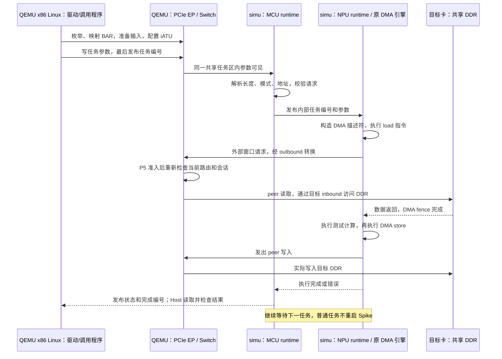

# 平台构建、启动与 Host/Device 开发使用教程

本教程是当前 QEMU 项目的统一使用入口。仅需克隆本仓库；开源依赖按文中下载安装，源码和文档随 Git，磁盘、密钥、日志、编译产物保存在本地。所有宿主命令在 QEMU 仓库根目录执行；标为“来宾”的命令在 QEMU 内的 Ubuntu 执行。

- [1. 环境与整个平台启动](#1-环境与整个平台启动)：构建、双卡/八卡回归、桌面、双终端 Spike/QEMU、自定义 MCU/NPU。
- [2. Host 侧接口与固定配置流程](#2-host-侧接口与固定配置流程)：驱动、iATU、IPC、任务与 header-only lib。
- [3. MCU 编译与程序交付](#3-mcu-编译与程序交付)：实际工程、工具链、最小模板、装载约定。
- [4. 开发与回归入口](#4-开发与回归入口)。

模拟器不再以共享 DDR 的 MCU/NPU 调试 ready 标志作为启动或 Host 下发 FW 的前置条件；设备 ready 由 Host 与设备按实际 SCU/IPC 协议协商。

## 1. 环境与整个平台启动

### 1.1 准备环境

推荐 **Ubuntu 22.04 x86-64**。已发布 Spike 依赖 Boost Regex 1.74、ICU 70 和 OpenMP，这与 Ubuntu 22.04 的软件包匹配。其他发行版需自行解决相同 SONAME 的动态库，不能直接把 ICU 其他大版本软链接为 ICU 70。

```bash
sudo apt update
sudo apt install -y \
  git build-essential ninja-build pkg-config \
  libglib2.0-dev libpixman-1-dev zlib1g-dev libfdt-dev libslirp-dev \
  python3 python3-venv python3-pip curl ca-certificates \
  libboost-regex1.74.0 libicu70 libgomp1 libstdc++6
```

**当前仓库 QEMU 构建要求 Python >= 3.12**，Ubuntu 22.04 默认 Python 3.10 不够。已有 Python 3.12+ 可直接使用；否则可用 uv 安装独立 Python，不替换系统 Python：

```bash
curl -LsSf https://astral.sh/uv/install.sh | sh
export PATH="$HOME/.local/bin:$PATH"
uv python install 3.12
```

以下构建命令使用 `uv python find 3.12` 获取路径。若使用已有 Python，把 `--python=...` 改为它的实际路径即可。预编译 Linux runner 使用系统 `python3` 即可，3.10 可以运行。

### 1.2 克隆与构建

```bash
git clone --branch pcie_qemu https://github.com/YoungLee1995/qemu.git
cd qemu

ls -l zc_simulator/simu/current
ldd zc_simulator/simu/current/bin/spike
python3 zc_simulator/p5/run_linux.py --runtime prebuilt --prepare-only
```

`ldd` 不应出现 `not found`；最后一条应成功退出并打印证据目录。运行包已在 Git 中，无需另行下载压缩包。请使用保留软链接与执行权限的 Linux Git 工作区。

首次配置/子模块初始化可能联网。`--prepare-only` 这里只验证包，不编译 simu、不启动 QEMU。

本教程的 x86 QEMU 使用仓库提供的 BIOS/ROM，不需要先运行 `git submodule update --init --recursive` 下载全部固件源码。构建所需的 Meson 子项目由配置流程按需获取；只有需要自行重编固件时才初始化相应的 `roms/` 子模块。

#### 构建 QEMU

仍在刚克隆的 `qemu` 仓库根目录：

```bash
mkdir -p build
cd build
../configure \
  --python="$(uv python find 3.12)" \
  --target-list=x86_64-softmmu \
  --disable-docs \
  --disable-werror
cd ..

ninja -C build -j4 qemu-system-x86_64
./build/qemu-system-x86_64 --version
```

不需要 `sudo make install`。脚本直接使用本仓库 `build/qemu-system-x86_64`，不能用系统安装的普通 QEMU 替代，因为本项目增加了 PCIe endpoint。机器内存紧张时将 `-j4` 改为 `-j2`。

若提示 Python 包缺失，检查配置时的联网状态，查看 `build/config.log` 或 `build/meson-logs/meson-log.txt`；QEMU 会创建其构建 Python 环境。BIOS/ROM 使用仓库及正常构建提供的资源，无需重新编译整套固件子模块。

#### 自动运行整个平台：双卡与八卡

仍在 `qemu` 仓库根目录：

```bash
## 双卡：首次联调先跑这个
python3 zc_simulator/p5/run_linux.py --cards 2

## 八卡：覆盖 56 个有向卡对
python3 zc_simulator/p5/run_linux.py --cards 8
```

默认直接使用包内 Spike、firmware、MCU/NPU 镜像、管理服务、Linux 内核及来宾镜像，不再编译 simu 或 Host 驱动。`auto` 与 `prebuilt` 都固定使用仓库内发布包，不检查同级 simulator 仓库。

脚本自动启动 x86 Linux、加载驱动、启动各卡常驻 simu、提交任务并校验结果，结束后自动关机和回收。无需手动启动 Spike，无需 KVM，使用 TCG。它是自动测试入口，不停留在交互式 Linux shell。

**测试通过后不能直接用 `desktop/terminal.py` 登录**：本步骤不会创建 Ubuntu 桌面，也不会生成桌面连接记录 `desktop/state/active.json`。需要轻量交互 shell，按本章“默认镜像”小节分别启动后端和 QEMU；需要 Ubuntu 桌面/SSH，先按 [本教程的桌面准备流程](#1-环境与整个平台启动) 下载镜像、执行 `prepare.py`，再在终端 A 运行 `desktop/desktop.py --cards 8`，终端 B 才运行 `desktop/terminal.py`（两条脚本命令均需加 `python3 zc_simulator/` 前缀）。

终端检查项全部显示 `PASS`，最后打印：

```text
Evidence: .../zc_simulator/p5/evidence/linux-...
```

该目录 `results.json` 应有 `passed: true`；`linux.log` 应包含 `P5_BASE_PASS`、`P5_C_LIBRARY_PASS`、`P4_GUEST_EXIT=0`。双卡/八卡各卡普通任务期间都应保持单个 Spike 进程。


### 1.3 Linux Ubuntu/XFCE 桌面启动

### 新克隆后的准备流程

正式目录提供自己开发的源码和文档。QEMU、Ubuntu 镜像、ttyd、系统软件包均通过构建或下载获得，生成的系统盘、账号和日志保存在 `state/`，不需要原开发机的 evidence 文件。

#### 0. 已有环境先检查，不要重复初始化或启动

如果这台机器之前已经启动过桌面，先执行：

```sh
python3 zc_simulator/desktop/control.py status
```

若能连接并显示 `T100_DESKTOP_READY`，直接运行 `python3 zc_simulator/desktop/terminal.py`，无需再执行 `prepare.py` 或 `desktop.py`。首次克隆尚无 `active.json` 时，继续第 1 步。

若 `prepare.py` 或 `desktop.py` 报 `BlockingIOError: [Errno 11] Resource temporarily unavailable`（新版会提示“桌面数据目录正在使用”），表示另一个桌面/初始化进程持有同一个 `desktop.lock`。这不是缺少文件，也不是依赖安装失败。优先检查并连接已有桌面；正在初始化时等待它完成。

确需修改共享文件、重新执行初始化或重启时，在宿主终端执行：

```sh
python3 zc_simulator/desktop/control.py stop
```

等待原来的 `desktop.py` 退出后，再执行 `prepare.py` 和启动命令。**不要删除 `desktop.lock` 绕过锁**：锁由活进程持有，文件留在磁盘上本身不会造成占用。若状态检查失败，用 `lslocks -o PID,COMMAND,PATH` 查看锁占用者，结合其进程和日志排查，不要直接重复启动。

#### 1. 确认仓库与 QEMU 已就绪

所有宿主命令都在 **QEMU 仓库根目录**执行，也就是能看到 `zc_simulator/` 和 `build/` 的目录。仓库可以叫 `pcie_qemu`，不必改名为 `qemu`。终端 A、B 都必须进入这个目录；这些命令不是在 Ubuntu 来宾中运行。

按 [克隆后构建与运行简易指南](#1-环境与整个平台启动) 准备 Ubuntu 22.04 x86-64 环境、P5 运行依赖并构建本项目 QEMU。已有的 P5 发布包位于 `zc_simulator/simu/current`，它属于原项目交付内容。
如果双卡、八卡 `run_linux.py` 已通过，可以跳过 QEMU 构建，但仍要继续下面的 Ubuntu 镜像准备。自动测试结束就关机，不会创建 Ubuntu 桌面，也不会生成桌面连接记录。

```sh
pwd
test -x build/qemu-system-x86_64 && echo QEMU_OK
test -d zc_simulator/simu/current && echo BUNDLE_OK
```

#### 2. 安装镜像与 SSH 工具

下面以普通用户为例使用 `sudo`；若已是 root 且没有 sudo，去掉命令前的 `sudo`。

```sh
sudo apt update
sudo apt install -y qemu-utils genisoimage openssh-client openssl curl ca-certificates
```

#### 3. 下载 Ubuntu 镜像

首次使用下载 Ubuntu 官方 cloud image 与对应校验清单，保留官方文件名以校验；已有正确的基础镜像时不必重新下载。以下示例使用默认 `state/`，不要同时设置指向其他位置的 `ZC_DESKTOP_STATE`。

```sh
mkdir -p zc_simulator/desktop/state
cd zc_simulator/desktop/state
curl -fLO https://cloud-images.ubuntu.com/noble/current/SHA256SUMS
curl -fLO https://cloud-images.ubuntu.com/noble/current/noble-server-cloudimg-amd64.img
sha256sum --ignore-missing -c SHA256SUMS
mv noble-server-cloudimg-amd64.img ubuntu-24.04-base.qcow2
cd ../../..
```

官方 `current` 镜像会更新，建议在镜像下载前后核对清单，确保二者匹配。`prepare.py` 使用下载到数据目录中的官方清单校验镜像；清单不随源码提交。

#### 4. 初始化本地系统盘

在仓库根目录运行；此时不要有使用同一系统盘的 VM：

```sh
python3 zc_simulator/desktop/prepare.py
```

`prepare.py` 使用系统 OpenSSL 生成密码摘要，运行脚本可使用 Python 3.10+；QEMU 构建使用 Python 3.12+。初始化生成本地密钥、系统盘和 cloud-init；新环境的 Ubuntu 用户名为 **`t100`，固定密码为 `t100`**。首次 Ubuntu 启动需要联网安装 XFCE、xrdp、内核头文件，编译本目录的驱动源码和仓库 `p4/guest-cluster.c`。这些安装工作发生在下一步 Ubuntu 启动之后；`prepare.py` 完成不代表 Ubuntu 已经运行。

已有环境保留 `credentials.json` 中的旧密码，重复运行 `prepare.py` 不会修改已启动过的 Ubuntu 账号。要把旧环境也改成固定密码，在 t100 内执行：

```sh
printf 't100:t100\n' | sudo chpasswd
```

然后在外层容器的仓库根目录同步本地密码记录（使用自定义状态目录时保持相同 `ZC_DESKTOP_STATE`）：

```sh
python3 - <<'PY'
import json
import os
from pathlib import Path
state = Path(os.environ.get('ZC_DESKTOP_STATE', 'zc_simulator/desktop/state'))
credentials = state / 'credentials.json'
credentials.write_text(json.dumps({'user': 't100', 'password': 't100'}, indent=2) + '\n')
credentials.chmod(0o600)
PY
```

SSH 使用生成的密钥登录，无需输入密码；`sudo` 也无需密码。固定密码用于 Ubuntu 控制台和 RDP 登录，SSH 密码认证仍关闭。

全新系统盘实测首次安装约十多分钟，实际取决于下载速度和 TCG 性能。请等第 5 步的 `DESKTOP_READY`，不要只看到 SSH 登录成功就跳到设备测试。新版安装脚本会在配置证书组后重启 xrdp；旧系统盘若遇到 TLS 连接失败且 `/var/log/xrdp.log` 显示私钥 `Permission denied`，在 t100 内执行 `sudo systemctl restart xrdp` 后再连接。

桌面基础八卡测试程序会在初始化时编译，无需复制旧 evidence 中的二进制。文档提到的完整 `p5-guest-test-8` 属于历史测试产物，不是桌面启动所必需，也不会由这里的初始化脚本生成。

#### 5. 终端 A：启动 Ubuntu

```sh
python3 zc_simulator/desktop/desktop.py --cards 8
```

此命令启动 QEMU、Spike 后端和 fabric，并生成 `state/active.json`，输出中包含 `qemu_pid`、`work`、SSH/RDP 端口。它默认在终端 A 前台运行；不要等它退出后才执行下一步。可以另开终端，也可以关闭启动终端，虚拟机继续运行。Ctrl+Z 会被忽略；Ctrl+C 仍会终止启动器，正常关机请使用 `control.py stop`。它的串口写入日志，不会在终端 A 显示 Ubuntu 登录 shell。

启动器会自动轮询真实 SSH 会话、就绪标记、指定数量的驱动节点和 xrdp 服务。等待期间每 30 秒提示一次；全部通过后，终端 A 明确打印：

```text
DESKTOP_READY：Ubuntu 已就绪（SSH、8 个设备节点、xrdp）。
请在另一个宿主终端执行：
  python3 zc_simulator/desktop/terminal.py
可关闭当前终端，虚拟机继续运行。
```

看到这条提示后即可登录。仅打印 PID/端口的 JSON 不代表就绪。检查失败不会关闭 VM，启动器会继续等待；SSH 检查输出保存在本次 `work/readiness.log`。该提示是启动阶段检查结果，之后仍可用 `control.py status` 检查实时状态。若使用自定义 `ZC_DESKTOP_STATE`，登录终端也必须设置相同值。

#### 6. 终端 B：等待首次初始化完成

打开第二个宿主终端，进入同一个仓库根目录，执行：

```sh
python3 zc_simulator/desktop/control.py status
```

首次启动使用 TCG 并需要联网安装软件，耗时取决于机器和网络。刚启动时可能连接被拒绝、SSH 尚未就绪，或设备节点尚未生成；保持终端 A 运行，稍后重新执行状态检查。

完整就绪应看到 `T100_DESKTOP_READY`、xrdp 的 `active`，以及 `/dev/test_dma_0` 到 `/dev/test_dma_7`。`active.json` 出现仅表示启动记录已写入，不表示系统初始化完成。

若长时间未就绪，在终端 B 查看本次串口日志：

```sh
python3 - <<'PYLOG'
import json
import os
from pathlib import Path
state = Path(os.environ.get('ZC_DESKTOP_STATE', 'zc_simulator/desktop/state'))
active = json.loads((state / 'active.json').read_text())
print(Path(active['work']) / 'serial.log')
PYLOG
```

对打印出的路径运行 `tail -n 100 路径`；SSH 可连接后还可查看来宾初始化日志：

```sh
python3 zc_simulator/desktop/control.py ssh 'sudo tail -100 /var/log/t100-desktop-setup.log'
```

#### 7. 终端 B：进入可执行命令的 Ubuntu

```sh
python3 zc_simulator/desktop/terminal.py
```

该命令自动使用本地密钥、账号和转发端口连接 Ubuntu。看到 `t100@t100-eight-card:~$` 后，下面的命令才是在 **Ubuntu 来宾内**执行：

```sh
uname -m
lspci -nn -d 16c3:abcd
ls /dev/test_dma_*
sudo /opt/t100/guest-cluster
```

八卡测试应通过；`guest-cluster` 是八卡测试，本节单卡/双卡启动时不要用它作为验收。输入 `exit` 只断开 SSH，Ubuntu 和终端 A 仍继续运行。

#### 找不到 `/dev/test_dma_*` 或 `/opt/t100/guest-cluster`

这两者都在运行中的 t100 Ubuntu 内：前者是驱动生成的字符设备节点，后者是首次初始化编译安装的可执行文件，不是需要从 Git 下载的文件夹。先确认已通过 `terminal.py` 登录；若仍在 `root@容器ID:/workspace/...` 的外层终端，先执行上面的登录命令。仅运行 P5 自动回归不会准备这套常驻 Ubuntu。

在 t100 内检查：

```sh
whoami
hostname
lspci -nn -d 16c3:abcd
ls -l /dev/test_dma_* /opt/t100/guest-cluster
sudo systemctl status t100-desktop-setup --no-pager
sudo tail -n 100 /var/log/t100-desktop-setup.log
```

若初始化服务仍为 `active (running)`，等待完成；SSH 能登录并不代表软件和驱动已经安装完。服务成功结束后显示 `inactive (dead)` 也正常，要结合日志末尾的 `T100_DESKTOP_READY` 和上述文件确认。

- `lspci` 没有 `16c3:abcd`：检查是否进入正确的 VM，以及外层是否按本节使用 `desktop.py --cards 8` 启动；安装驱动不会凭空生成 PCIe 设备。
- PCIe 设备存在、但没有 `/dev/test_dma_*`：先执行 `sudo modprobe ssv_test_driver`；若提示模块不存在，查看初始化日志中安装内核头文件、编译驱动的错误。
- 只有 `/opt/t100/guest-cluster` 缺失、其他初始化步骤已经成功：可以按下方从共享源码重新编译，不需要下载二进制。

```sh
# 在 t100 内，确认共享源码存在后编译：
ls -l /mnt/hostshare/guest-cluster.c
sudo mkdir -p /opt/t100
sudo gcc -O2 -Wall /mnt/hostshare/guest-cluster.c -o /opt/t100/guest-cluster
```

共享目录未挂载时，先执行本指南“来宾内编译和运行 Host 示例”的挂载步骤。若已挂载但缺少源码，需在外层正常关闭 VM 后运行 `prepare.py` 同步共享文件，再启动 VM。

若首次初始化失败，先按日志解决来宾网络、软件源或内核头文件等错误，再重新执行安装脚本。下面命令仅在确认 `t100-desktop-setup` 已经停止时执行，避免与正在运行的安装进程冲突：

```sh
# 在 t100 内执行；成功时末尾打印 T100_DESKTOP_READY：
sudo /usr/local/sbin/t100-desktop-setup
```

不要通过手工创建 `/dev/test_dma_*` 或空的 ready 文件绕过初始化。若仍失败，请保留完整报错和初始化日志。

`terminal.py` 只连接已有 VM。若提示找不到 `active.json`，回到第 5 步；不要手工创建该文件，也不要复制别人的运行记录。若终端 A 已退出，检查其错误和 `work` 下的 `qemu.log`，解决后重新启动。

### 后续使用：重新启动、检查和关闭

已经运行时不需要重复启动。检查状态：

```sh
python3 zc_simulator/desktop/control.py status
```

正常关机（通过 QMP 发送 ACPI 电源按钮事件，不依赖 Ubuntu 的 SSH）：

```sh
python3 zc_simulator/desktop/control.py stop
```

命令提示“已发送”表示请求已提交，并不表示关机完成；等待终端 A 的启动进程退出后再操作磁盘。

**Ctrl+Z 和关闭启动终端都不会关机。** 新版启动器忽略 Ctrl+Z；关闭终端后，QEMU、Spike、fabric 和监督进程继续运行，后续启动提示写到本次 `work/supervisor.log`。重新打开终端后可以直接执行 `control.py status`、`terminal.py` 或 `control.py stop`，不要重复启动第二台 VM。

这只处理终端挂断和 Ctrl+Z；停止容器、重启宿主机或强杀进程仍会终止虚拟机。Ctrl+C 仍保留终止启动器的行为，需要正常关机时请使用上面的 `control.py stop`。

更新仅对下次运行的启动器生效。旧版进程按 Ctrl+Z 可能暂停或关机；已暂停时在原终端用 `jobs -l` 和 `fg %作业号` 恢复，再正常关机后启动新版。

关机后等待原启动进程退出（关闭过终端时可检查 `active.json` 中的 `stopped` 为 true）。下次使用不用重新下载镜像或执行 `prepare.py`，直接重新启动（终端 A 前台保持运行），再在终端 B 检查状态并执行 `terminal.py`：

```sh
python3 zc_simulator/desktop/desktop.py --cards 8
```

支持 `--cards 1/2/8`、`--memory 4G`、`--ssh-port 2222`、`--rdp-port 13389`。默认监听 127.0.0.1；Docker 宿主机需要直接访问时，使用 `--bind 容器IP`，容器 IP 可通过 `hostname -I` 查看。串口和 QMP socket 使用短临时目录，避免工作区路径过长。

### 图形桌面

先完成上述就绪检查；`desktop.py` 使用 `-display none`，不会在宿主自动弹出图形窗口，需要通过 RDP 连接 Ubuntu。

在 VS Code「端口 / PORTS」中转发 13389，用电脑上的远程桌面客户端连接其本地转发地址。xrdp 选择 Xorg，新环境用户名 **`t100`**、密码 **`t100`**。旧环境未修改密码时，以原有记录为准；查看：

```sh
cat zc_simulator/desktop/state/credentials.json
```

自定义数据目录时改用对应路径。桌面中可打开终端、`PCIe devices` 或 `Eight-card DMA and P2P test` 快捷方式。首次使用快捷方式可能需要允许启动。共享目录为数据目录中的 `share/`，来宾挂载在 `/mnt/hostshare/`。

### 可选：浏览器终端

先完成上述启动和就绪检查，再下载上游 ttyd（也可以自行从上游源码编译）：

```sh
mkdir -p zc_simulator/desktop/state/tools/local
curl -fL https://github.com/tsl0922/ttyd/releases/download/1.7.7/ttyd.x86_64 \
  -o zc_simulator/desktop/state/tools/local/ttyd
chmod +x zc_simulator/desktop/state/tools/local/ttyd
python3 zc_simulator/desktop/web_terminal.py
```

运行后浏览器打开 <http://127.0.0.1:7681>。VS Code 远程容器环境在「端口 / PORTS」中转发 7681，再打开本地转发地址。此服务保持前台运行，请另开宿主终端执行；它同样要求 Ubuntu VM 已经启动。

ttyd 项目与构建说明：<https://github.com/tsl0922/ttyd>。浏览器终端不是桌面或命令行启动的必需依赖；`terminal.py` 使用系统 SSH 客户端即可。

修改 `share/my-task.c` 等自定义任务源码后，可重新执行 `prepare.py` 同步共享文件；不要在 VM 运行期间重建它正在使用的 seed 和镜像，请先正常关闭。

### 常见问题

| 现象 | 处理 |
| --- | --- |
| `terminal.py` 找不到 `state/active.json` | 尚未运行 `desktop.py`，或两个终端的 `ZC_DESKTOP_STATE` 不一致；按首次流程第 5 步启动 |
| `desktop.py` 提示缺少 qcow2 / seed | 先下载基础镜像并执行 `prepare.py`，不是直接执行连接脚本 |
| SSH banner exchange 超时，QEMU 的 `ps` 状态为 `T` | 旧版进程可能被暂停；在原终端用 `jobs -l` 和 `fg %作业号` 恢复。新版 `desktop.py` 忽略 Ctrl+Z，关闭终端后也继续运行 |
| SSH connection refused / 超时 | 检查终端 A 是否仍运行；首次启动等待 SSH 就绪，再检查本次 `serial.log` 和 `qemu.log` |
| SSH 能登录，但驱动节点或桌面服务缺失 | 首次安装尚未完成或失败；检查 `/var/log/t100-desktop-setup.log` 与来宾网络 |
| 端口占用或磁盘被锁定 | 检查是否已有 VM 使用相同磁盘和端口；已有 VM 直接连接，不要重复启动 |
| P5 双卡/八卡测试通过，但无法连接 Ubuntu | 两套入口生命周期独立；自动测试不创建常驻 Ubuntu，仍需完成本文首次准备流程 |

本文的 `terminal.py` / `control.py` 用于 `desktop.py` 管理的 VM。若使用克隆指南中的 `cli/qemu.py --guest desktop` 分离启动方式，按该节提供的原生 SSH 命令连接；该入口不生成这里的 `active.json`。

### 1.4 两个终端分别启动 Spike 与 QEMU，指定 MCU/NPU

本节假定已完成 1.1～1.3 的宿主依赖安装、QEMU 构建、Ubuntu 镜像下载和 `desktop/prepare.py` 准备。下面以 **Ubuntu** 为交互环境：`--guest desktop` 从准备好的 Ubuntu 系统盘启动；`--guest console` 是独立的精简 Linux，`--guest test` 是执行后关机的自动测试，后两者都不是 Ubuntu。

所有启动命令在**外层开发容器的 QEMU 仓库根目录**执行。终端 A 运行后端，终端 B 运行 QEMU，终端 C 通过 SSH 进入 t100。先正常关闭占用同一 Ubuntu 磁盘/端口的旧 VM；`desktop.py` 管理的旧 VM 可用 `control.py stop` 关闭并等待退出。本节无需再次下载镜像或执行 `prepare.py`。

下列命令使用默认 `zc_simulator/desktop/state`。若准备时设置了 `ZC_DESKTOP_STATE`，本节 `cli/qemu.py` 必须显式指定 `--state /实际数据目录`，SSH 密钥路径也相应替换；该 CLI 不自动读取这个环境变量。每次启动选用新的 `--work` 输出目录，并保持两个终端的 `backends.json` 路径一致。

#### 1.4.1 镜像、die、卡与 hart 的对应关系

| 名称 | 在本项目中的含义 |
| --- | --- |
| `firmware.riscv` | Spike 的 dispatcher ELF，负责装载、派发程序和完成后导出结果；由 `--firmware` 指定，默认使用发布包 |
| `mcu.bin` | MCU 业务裸二进制，装载到 `0x40000000`，在 hart 1 执行；可以承载初始化/常驻控制程序，但不是 x86 QEMU 的 BIOS |
| `npu.bin` | NPU 可执行裸二进制，装载到 `0x4000000000`，在 hart 16 执行；不是任意数据文件、Python 脚本或尚未汇编的指令文本 |
| QEMU BIOS | x86 来宾的启动固件，来自仓库 `pc-bios/`；不接收 `mcu.bin` |
| 单 die 模型实例 | 一个 Spike 进程内的当前模型；MCU 和 NPU 是这个实例中的业务 hart，不是两张卡或两个 die |
| 单卡 | 一个 QEMU endpoint，连接一个独立 Spike 实例 |
| 双卡/八卡 | 2/8 个 endpoint，各自一个 Spike 实例，经 QEMU PCIe Switch 和 fabric 互访 |
| 一卡多 die | 当前交付没有这种拓扑或 die 内互联参数；不能用 `--cards 2` 假称“一卡双 die” |

因此，目前可操作的是单 die 单卡、多个单 die 实例组成多卡，以及不接 QEMU 的独立模型进程。`--cards 1/2/8` 控制实例/卡数量；`--cores both/mcu/npu` 控制每实例装载哪些业务 hart，不改变 die 拓扑。

`--mcu-bin` 可指定 BootROM case 的裸二进制；入口地址、ISA 和所访问的 SoC 寄存器仍须被当前模型支持。设备在配置 inbound/outbound 后进入 SCU/IPC 轮询；Host 按实际 IPC 协议确认就绪并下发 FW。模拟器不读取 DDR 调试 ready 标志作为放行条件。

#### 1.4.2 默认镜像：单卡 MCU+NPU，启动 Ubuntu

终端 A：

```bash
python3 zc_simulator/cli/spike.py --mode backend --cards 1 --cores both --work /tmp/zc-card1-backend
```

对应的原生 Spike 调用（每卡一份；这是**服务内部调用模板**，不是可粘贴执行的独立命令）：

```text
cd /tmp/zc-card1-backend/cardN
ZC_P1_MAILBOX_FD=<该卡实际继承的mailbox_FD> ZC_P1_PARENT_PID=<服务PID> ZC_P2_PCIE=1 \
  /绝对路径/qemu/zc_simulator/simu/current/bin/spike \
  --p1-ddr0-fd=<该卡实际继承的DDR0_FD> --p1-ddr1-fd=<该卡实际继承的DDR1_FD> \
  --isa=rv64imafdcv_zvl512b_zve32d_zfh_zvfh_zfbfmin_zvfbfmin_zba_zbb_zbs_zicond \
  --runtime-func /绝对路径/qemu/zc_simulator/simu/current/images/firmware.riscv -cfg ./firmware.cfg
```

此例 `N` 为 0～0，配置为 `both`。BIN 选择记录在每卡 `firmware.cfg`（生成规则见 1.4.6）。**backend 仍需服务接收 QEMU 通过 Unix socket 传来的 FD 并让子进程继承**；不能用文件路径或任意整数替换 FD，也不能在另一终端复制这条命令接入 QEMU。需要直接执行、加 `-d` 的独立原生命令见 1.4.7；它不连接 Ubuntu。

看到 `BACKENDS_READY /tmp/zc-card1-backend/backends.json` 后，保持终端 A 运行。

终端 B：

```bash
python3 zc_simulator/cli/qemu.py --backends /tmp/zc-card1-backend/backends.json --guest desktop --state zc_simulator/desktop/state --ssh-port 2222 --rdp-port 13389 --work /tmp/zc-card1-qemu
```

终端 B 显示 Ubuntu 串口启动信息并持续运行。登录、初始化就绪检查和关闭步骤见 **1.4.8**；在终端 C 通过 SSH 进入后，可执行：

```sh
uname -m
ls -l /dev/test_dma_*
cat /proc/interrupts
```

单卡初始化完成后应出现 `/dev/test_dma_0`。单卡不运行八卡的 `/opt/t100/guest-cluster`。如只需精简 BusyBox shell，可将终端 B 改为 `--guest console`，使用新的工作目录；出现 `ZC_CONSOLE_READY` 与 `/ #` 后，可用 `/bin/busybox ls /dev/test_dma_*` 检查，关机用：

```sh
/bin/busybox poweroff -f
```

QEMU 退出后，在终端 A 按 Ctrl+C 回收后端服务。每次启动使用新的 `--work` 路径，启动器拒绝覆盖已有目录，避免日志和配置串用。

#### 1.4.3 双卡/八卡：MCU+NPU

双卡，终端 A：

```bash
python3 zc_simulator/cli/spike.py --mode backend --cards 2 --cores both --work /tmp/zc-card2-backend
```

对应的原生 Spike 调用（每卡一份；这是**服务内部调用模板**，不是可粘贴执行的独立命令）：

```text
cd /tmp/zc-card2-backend/cardN
ZC_P1_MAILBOX_FD=<该卡实际继承的mailbox_FD> ZC_P1_PARENT_PID=<服务PID> ZC_P2_PCIE=1 \
  /绝对路径/qemu/zc_simulator/simu/current/bin/spike \
  --p1-ddr0-fd=<该卡实际继承的DDR0_FD> --p1-ddr1-fd=<该卡实际继承的DDR1_FD> \
  --isa=rv64imafdcv_zvl512b_zve32d_zfh_zvfh_zfbfmin_zvfbfmin_zba_zbb_zbs_zicond \
  --runtime-func /绝对路径/qemu/zc_simulator/simu/current/images/firmware.riscv -cfg ./firmware.cfg
```

此例 `N` 为 0～1，配置为 `both`。BIN 选择记录在每卡 `firmware.cfg`（生成规则见 1.4.6）。**backend 仍需服务接收 QEMU 通过 Unix socket 传来的 FD 并让子进程继承**；不能用文件路径或任意整数替换 FD，也不能在另一终端复制这条命令接入 QEMU。需要直接执行、加 `-d` 的独立原生命令见 1.4.7；它不连接 Ubuntu。

终端 B：

```bash
python3 zc_simulator/cli/qemu.py --backends /tmp/zc-card2-backend/backends.json --guest desktop --state zc_simulator/desktop/state --ssh-port 2222 --rdp-port 13389 --work /tmp/zc-card2-qemu
```

需要自动执行完整 Linux 联合测试、执行后关机时，把终端 B 换为：

```bash
python3 zc_simulator/cli/qemu.py --backends /tmp/zc-card2-backend/backends.json --guest test --work /tmp/zc-card2-test
```

成功必须看到 `P5_BASE_PASS cards=2`、三轮 `P5_ASYNC_ROUND`、`P5_C_LIBRARY_PASS` 和 `P4_GUEST_EXIT=0`，不能只看 QEMU 退出码。故障时保留终端输出及工作目录。

八卡同理，终端 A：

```bash
python3 zc_simulator/cli/spike.py --mode backend --cards 8 --cores both --work /tmp/zc-card8-backend
```

对应的原生 Spike 调用（每卡一份；这是**服务内部调用模板**，不是可粘贴执行的独立命令）：

```text
cd /tmp/zc-card8-backend/cardN
ZC_P1_MAILBOX_FD=<该卡实际继承的mailbox_FD> ZC_P1_PARENT_PID=<服务PID> ZC_P2_PCIE=1 \
  /绝对路径/qemu/zc_simulator/simu/current/bin/spike \
  --p1-ddr0-fd=<该卡实际继承的DDR0_FD> --p1-ddr1-fd=<该卡实际继承的DDR1_FD> \
  --isa=rv64imafdcv_zvl512b_zve32d_zfh_zvfh_zfbfmin_zvfbfmin_zba_zbb_zbs_zicond \
  --runtime-func /绝对路径/qemu/zc_simulator/simu/current/images/firmware.riscv -cfg ./firmware.cfg
```

此例 `N` 为 0～7，配置为 `both`。BIN 选择记录在每卡 `firmware.cfg`（生成规则见 1.4.6）。**backend 仍需服务接收 QEMU 通过 Unix socket 传来的 FD 并让子进程继承**；不能用文件路径或任意整数替换 FD，也不能在另一终端复制这条命令接入 QEMU。需要直接执行、加 `-d` 的独立原生命令见 1.4.7；它不连接 Ubuntu。

终端 B（Ubuntu）：

```bash
python3 zc_simulator/cli/qemu.py --backends /tmp/zc-card8-backend/backends.json --guest desktop --state zc_simulator/desktop/state --ssh-port 2222 --rdp-port 13389 --work /tmp/zc-card8-desktop
```

双卡/八卡 Ubuntu 的登录和就绪检查见 **1.4.8**。若需要自动测试，使用 `--guest test` 和新的工作目录；它仅支持 2/8 卡和 MCU+NPU。单卡或 MCU-only 可用 `desktop` 或精简 `console`。同一组服务同时只能连接一台 QEMU。

#### 1.4.4 指定自己的 MCU / NPU 文件

MCU 装载/入口地址可用 `--mcu-addr` 指定，支持十进制和 `0x` 十六进制；不传时仍为 `0x40000000`，backend 与 standalone 都支持。例如在下面的脚本命令中添加 `--mcu-addr 0x40010000`，生成的 cfg MCU 行为 `[1, 0x40010000, ./mcu.bin]`。直接运行原生 Spike 时，在 `firmware.cfg` 中修改这一行地址即可。BIN 必须按指定地址链接，且目标地址须是模型支持的可执行内存；此参数不重定位 BIN，也不改变模型内存映射。默认发布包 MCU 仍按原地址使用。

例如已经通过工具链生成 `/absolute/path/my-mcu.bin` 和 `/absolute/path/my-npu.bin`，终端 A 一条命令：

```bash
python3 zc_simulator/cli/spike.py --mode backend --cards 2 --cores both --mcu-bin /absolute/path/my-mcu.bin --npu-bin /absolute/path/my-npu.bin --work /tmp/zc-custom-backend
```

对应的原生 Spike 调用（每卡一份；这是**服务内部调用模板**，不是可粘贴执行的独立命令）：

```text
cd /tmp/zc-custom-backend/cardN
ZC_P1_MAILBOX_FD=<该卡实际继承的mailbox_FD> ZC_P1_PARENT_PID=<服务PID> ZC_P2_PCIE=1 \
  /绝对路径/qemu/zc_simulator/simu/current/bin/spike \
  --p1-ddr0-fd=<该卡实际继承的DDR0_FD> --p1-ddr1-fd=<该卡实际继承的DDR1_FD> \
  --isa=rv64imafdcv_zvl512b_zve32d_zfh_zvfh_zfbfmin_zvfbfmin_zba_zbb_zbs_zicond \
  --runtime-func /绝对路径/qemu/zc_simulator/simu/current/images/firmware.riscv -cfg ./firmware.cfg
```

此例 `N` 为 0～1，配置为 `both`。BIN 选择记录在每卡 `firmware.cfg`（生成规则见 1.4.6）。**backend 仍需服务接收 QEMU 通过 Unix socket 传来的 FD 并让子进程继承**；不能用文件路径或任意整数替换 FD，也不能在另一终端复制这条命令接入 QEMU。需要直接执行、加 `-d` 的独立原生命令见 1.4.7；它不连接 Ubuntu。

终端 B：

```bash
python3 zc_simulator/cli/qemu.py --backends /tmp/zc-custom-backend/backends.json --guest desktop --state zc_simulator/desktop/state --ssh-port 2222 --rdp-port 13389 --work /tmp/zc-custom-qemu
```

`/absolute/path/...` 是需要替换为自己文件的占位路径。省略某个 `--mcu-bin` 或 `--npu-bin` 时，仅对启用的核心使用发布包默认镜像。例如只替换 MCU、仍使用默认 NPU：

```bash
python3 zc_simulator/cli/spike.py --mode backend --cards 1 --cores both --mcu-bin /absolute/path/my-mcu.bin --work /tmp/zc-custom-mcu-default-npu
```

对应的原生 Spike 调用（每卡一份；这是**服务内部调用模板**，不是可粘贴执行的独立命令）：

```text
cd /tmp/zc-custom-mcu-default-npu/cardN
ZC_P1_MAILBOX_FD=<该卡实际继承的mailbox_FD> ZC_P1_PARENT_PID=<服务PID> ZC_P2_PCIE=1 \
  /绝对路径/qemu/zc_simulator/simu/current/bin/spike \
  --p1-ddr0-fd=<该卡实际继承的DDR0_FD> --p1-ddr1-fd=<该卡实际继承的DDR1_FD> \
  --isa=rv64imafdcv_zvl512b_zve32d_zfh_zvfh_zfbfmin_zvfbfmin_zba_zbb_zbs_zicond \
  --runtime-func /绝对路径/qemu/zc_simulator/simu/current/images/firmware.riscv -cfg ./firmware.cfg
```

此例 `N` 为 0～0，配置为 `both`。BIN 选择记录在每卡 `firmware.cfg`（生成规则见 1.4.6）。**backend 仍需服务接收 QEMU 通过 Unix socket 传来的 FD 并让子进程继承**；不能用文件路径或任意整数替换 FD，也不能在另一终端复制这条命令接入 QEMU。需要直接执行、加 `-d` 的独立原生命令见 1.4.7；它不连接 Ubuntu。

这里 `/absolute/path/my-mcu.bin` 是**必须已经存在的输入文件**，应换成自己编译得到的 MCU BIN 的真实绝对路径；`/tmp/zc-custom-mcu-default-npu` 是**启动器自动创建的输出目录**，不在 Git 中，运行前找不到是正常的，不能提前 `mkdir` 创建它。若上次失败已经留下同名目录，请使用一个新的 `--work` 路径，保留原目录排查。

这条命令在**外层开发容器的 QEMU 仓库根目录**执行，不在 `t100@t100-eight-card` 内执行。先用 `ls -l /实际路径/mcu.bin` 确认输入文件存在。运行成功后，终端 A 会保持运行并打印：

```text
BACKENDS_READY /tmp/zc-custom-mcu-default-npu/backends.json
```

然后在同一外层容器的终端 B、同一仓库根目录执行配套命令：

```bash
python3 zc_simulator/cli/qemu.py --backends /tmp/zc-custom-mcu-default-npu/backends.json --guest desktop --state zc_simulator/desktop/state --ssh-port 2222 --rdp-port 13389 --work /tmp/zc-custom-mcu-default-npu-qemu
```

不要继续使用前一个示例的 `/tmp/zc-custom-backend/backends.json`。两个终端必须处在同一外层容器/文件系统中；t100 来宾的 `/tmp` 与外层 `/tmp` 是不同目录。若命令报错而没有出现 `BACKENDS_READY`，请先处理终端 A 的完整错误，不要手工创建 `backends.json`。

启动器将选定 BIN 复制到每个实例的输入目录，自动生成 `firmware.cfg`、内容摘要及后端配置，不修改发布包。当前命令将相同镜像分别装入各卡独立内存；尚不提供一条命令为不同卡指定不同 BIN 的参数。使用参考任务测试时，镜像必须实现对应共享内存和任务 ABI；两镜像不能只因名字一样就混用。

**启动确认与设备就绪分开**：后端验证共享映射、启动 Spike 并确认进程存活后，就向 QEMU 确认传输会话建立。不再要求 `0x4100100010` / `0x4100100014` 为 1，也不要求自定义 BootROM 写这些地址。Host 下发 FW 前等待哪个 SCU/IPC 状态值、如何配置 inbound/outbound，由实际设备协议决定；当前参考 XOR runtime 不等于真实 BootROM 协议。

#### 1.4.5 只带 MCU，不带 NPU

终端 A（默认 MCU）：

```bash
python3 zc_simulator/cli/spike.py --mode backend --cards 1 --cores mcu --work /tmp/zc-mcu-only-backend
```

对应的原生 Spike 调用（每卡一份；这是**服务内部调用模板**，不是可粘贴执行的独立命令）：

```text
cd /tmp/zc-mcu-only-backend/cardN
ZC_P1_MAILBOX_FD=<该卡实际继承的mailbox_FD> ZC_P1_PARENT_PID=<服务PID> ZC_P2_PCIE=1 \
  /绝对路径/qemu/zc_simulator/simu/current/bin/spike \
  --p1-ddr0-fd=<该卡实际继承的DDR0_FD> --p1-ddr1-fd=<该卡实际继承的DDR1_FD> \
  --isa=rv64imafdcv_zvl512b_zve32d_zfh_zvfh_zfbfmin_zvfbfmin_zba_zbb_zbs_zicond \
  --runtime-func /绝对路径/qemu/zc_simulator/simu/current/images/firmware.riscv -cfg ./firmware.cfg
```

此例 `N` 为 0～0，配置为 `mcu`。BIN 选择记录在每卡 `firmware.cfg`（生成规则见 1.4.6）。**backend 仍需服务接收 QEMU 通过 Unix socket 传来的 FD 并让子进程继承**；不能用文件路径或任意整数替换 FD，也不能在另一终端复制这条命令接入 QEMU。需要直接执行、加 `-d` 的独立原生命令见 1.4.7；它不连接 Ubuntu。

或使用自己的 MCU 替换这条命令：

```bash
python3 zc_simulator/cli/spike.py --mode backend --cards 1 --cores mcu --mcu-bin /absolute/path/my-mcu.bin --work /tmp/zc-my-mcu-only-backend
```

对应的原生 Spike 调用（每卡一份；这是**服务内部调用模板**，不是可粘贴执行的独立命令）：

```text
cd /tmp/zc-my-mcu-only-backend/cardN
ZC_P1_MAILBOX_FD=<该卡实际继承的mailbox_FD> ZC_P1_PARENT_PID=<服务PID> ZC_P2_PCIE=1 \
  /绝对路径/qemu/zc_simulator/simu/current/bin/spike \
  --p1-ddr0-fd=<该卡实际继承的DDR0_FD> --p1-ddr1-fd=<该卡实际继承的DDR1_FD> \
  --isa=rv64imafdcv_zvl512b_zve32d_zfh_zvfh_zfbfmin_zvfbfmin_zba_zbb_zbs_zicond \
  --runtime-func /绝对路径/qemu/zc_simulator/simu/current/images/firmware.riscv -cfg ./firmware.cfg
```

此例 `N` 为 0～0，配置为 `mcu`。BIN 选择记录在每卡 `firmware.cfg`（生成规则见 1.4.6）。**backend 仍需服务接收 QEMU 通过 Unix socket 传来的 FD 并让子进程继承**；不能用文件路径或任意整数替换 FD，也不能在另一终端复制这条命令接入 QEMU。需要直接执行、加 `-d` 的独立原生命令见 1.4.7；它不连接 Ubuntu。

默认示例对应的终端 B：

```bash
python3 zc_simulator/cli/qemu.py --backends /tmp/zc-mcu-only-backend/backends.json --guest desktop --state zc_simulator/desktop/state --ssh-port 2222 --rdp-port 13389 --work /tmp/zc-mcu-only-qemu
```

使用自己镜像时，`--backends` 改为相应的 `zc-my-mcu-only-backend/backends.json`。双/八卡 MCU-only 只需将终端 A 的 `--cards` 改为 2 或 8，终端 B 从清单读取卡数，不重复指定。

此模式生成 `pc_num:1` 且仅包含 `[1, 0x40000000, ./mcu.bin]`，不会派发 NPU 业务程序；模型进程仍会创建固定 hart 对象，不表示硬件模型删掉 NPU。服务不再等待 MCU/NPU 的 DDR ready 标志；自定义 MCU 无须写这两个调试地址。Host 通过实际 SCU/IPC 协议判断设备是否就绪。

默认 P5 MCU 可以完成启动、设备就绪及其支持的控制路径，但它的常规 DMA/Tensor 任务会通知并等待 NPU。**MCU-only 不运行现成的 `guest-cluster`、`my-task` 或完整 P5 测试**；要做不依赖 NPU 的业务，需要 MCU 与 Host 实现对应协议。后端入口目前仍不接受 NPU-only；需要纯 NPU 执行时使用 standalone。

#### 1.4.6 两个终端的职责和实际原生命令

**独立的 QEMU ↔ Spike 后端交互日志**：更新源码后先执行 `ninja -C build -j4 qemu-system-x86_64`，正常结束旧实例并重新启动后端与 QEMU。`cli/qemu.py`、`desktop.py` 和 P5 Linux runner 默认按卡生成以下日志，无需额外参数：

| 位置 | 内容 |
| --- | --- |
| QEMU 工作目录 `qemu-spike-card0.log`（多卡依次编号） | QEMU 发起连接、send/receive、消息 type、request、session、epoch、字节数和错误详情；时间为 Unix 微秒 |
| 分离后端工作目录 `card0/qemu-spike-interaction.jsonl` | 服务端请求/回复、协议消息名称和方向、会话状态、Spike 启动 PID/执行日志名、复位及错误；时间为 Unix 纳秒 |
| `desktop.py` / P5 运行目录 `service0/qemu-spike-interaction.jsonl` | 同上，对应管理入口的卡 0 服务 |

例如前面的 MCU-only 配置，在外层容器查看：

```sh
tail -F /tmp/zc-mcu-only-qemu/qemu-spike-card0.log
# 另一个终端：
tail -F /tmp/zc-mcu-only-backend/card0/qemu-spike-interaction.jsonl
```

以 `card + session + epoch + request` 对照两侧记录；服务日志的 `spawn.log` 字段指向该次 Spike 输出文件。数字 type：1/2=HELLO/ACK，3/4=MEM_SETUP/READY，5/6=START/SOFTWARE_READY，7/8=QUIESCE/QUIESCED，9/10=RESET/ACK，12=STOPPED，13=ERROR，14/15=PING/PONG。QEMU 的 receive 行先记录收到的头部，只有后续无校验失败才表示接收被接受。连接失败也会写 QEMU 侧日志，此时服务端可能没有收到任何请求。

这些是连接、握手与生命周期的控制协议日志，包含心跳；不记录共享内存内每笔 MMIO/DMA 的完整数据，不是指令执行跟踪。`spike-*.log` 仍单独保存模型输出。长时间运行日志会增长，结束后可按需归档。直接运行原生 QEMU 时可在每个 endpoint 的 `-device zc-pcie-p1,...` 参数末尾添加 `interaction-log=/实际目录/qemu-spike-card0.log`；父目录必须存在。日志文件无法写入时 QEMU 会报警，不能视为记录成功。

**若 QEMU 反复打印 `P1 card 0 session failed: connect`**，表示连接该卡后端 Unix socket 失败，尚未进入固件执行/IPC ready 阶段；不是驱动安装失败。新版 QEMU 会同时打印 socket 路径和系统错误，需重编 QEMU 才能看到增强信息。

保持终端 A 运行，在启动 QEMU 的同一外层容器内检查（以下以 MCU-only 目录为例）：

```sh
cat /tmp/zc-mcu-only-backend/backends.json
tail -n 30 /tmp/zc-mcu-only-backend/card0/console.log
tail -n 30 /tmp/zc-mcu-only-backend/card0/service.jsonl
ps -eo pid,stat,args | rg 'cli/spike.py|tools/p1/service.py'
python3 - <<'PY'
import json
from pathlib import Path
plan = json.loads(Path('/tmp/zc-mcu-only-backend/backends.json').read_text())
listeners = Path('/proc/net/unix').read_text()
for i, card in enumerate(plan['cards']):
    path = Path(card['socket'])
    print('card', i, 'socket:', path, 'exists:', path.is_socket())
    print('kernel socket entries:', [line for line in listeners.splitlines()
                                     if line.split()[-1:] == [str(path)]])
PY
```

`backends.json` 是某次活跃服务的连接清单，不是可长期复用的配置。`spike.py` 退出后，其临时 `/tmp/zc-manual-*/card0.sock` 会失效；即使原来的 `backends.json` 还在，也不能再用它连接。服务已退出、关闭终端、进程被暂停或终端位于不同容器时，都需结合上述输出检查；代码仓库共享不代表容器的 `/tmp` 和进程也共享。不要用 `touch` 手工补 socket。

恢复时先在 Ubuntu 内正常关机并等待 QEMU 退出；若尚未进入系统，在启动 QEMU 的终端结束本次启动。停止原后端后，在同一外层容器用**新的** `--work` 路径启动后端，等 `BACKENDS_READY`，让 QEMU 指向该次新清单。若仍失败，保留终端 A/B 完整输出、上述日志和生成的 `qemu-command.json`，检查其中 `backend-socket=` 是否与清单相同。不要继续测试 Host/DMA。

本节每个 backend 示例旁的原生命令都保留必要的 FD 和环境变量，不能当作 standalone 命令执行。每卡 cfg 的共同字段为 `runtime_func:1`、四个输入/输出计数均为 0；`both` 使用 `pc_num:2` 及 `[1, 0x40000000, ./mcu.bin]`、`[16, 0x4000000000, ./npu.bin]`，`mcu` 则使用 `pc_num:1` 且仅保留 MCU 行。镜像由相应示例的 `--mcu-bin`/`--npu-bin` 选择，未指定时使用发布包默认镜像。配置文件只解决装载问题，不替代 FD 传递和握手。

终端 A 的 `spike.py --mode backend` 启动每卡服务并监听短路径 Unix socket。它此时未提前启动 Spike；终端 B 的 QEMU 创建共享 DDR、mailbox，并通过协议把 FD 交给服务，服务才用有效 FD 启动 Spike。这是分离终端启动，而不是把两个互不相关的进程碰巧同时运行。

例如 MCU-only 的 `--work /tmp/zc-mcu-only-backend`：日志在这个外层目录的 `card0/` 下，不在仓库的 `run/` 或 t100 来宾内。只执行终端 A 时尚无 Spike 进程，也不会生成 `spike-*.log`；`BACKENDS_READY` 仅表示服务已经监听。保持终端 A 运行，并执行上一节配套的终端 B 命令后，再在另一个外层终端查看：

```sh
ls -lh /tmp/zc-mcu-only-backend/card0/
cat /tmp/zc-mcu-only-backend/card0/service.jsonl
tail -n 100 /tmp/zc-mcu-only-backend/card0/console.log
# Spike 已启动且生成日志后：
tail -F /tmp/zc-mcu-only-backend/card0/spike-*.log
```

`console.log` 是 Python 后端服务的标准输出/错误；`service.jsonl` 记录握手、spawn 和退出事件；`spike-启动时间Z-run轮次.log` 才是 Spike 进程的标准输出/错误，例如 `spike-2026-11-03_07-00-00.123456789Z-run1.log`。时间为 UTC（北京时间加 8 小时），包含纳秒；同一卡可按文件名排序查看启动先后。`service.jsonl` 的 `spawn` 事件同时记录 `pid` 和 `log` 文件名，对应到同一条事件中的 session/epoch。旧日志保留原名称，更新代码并重新启动后端服务后，新启动的 Spike 使用时间命名。

日志为空不等于未运行，固件常驻轮询且没有输出时文件不会持续增长；先检查 `service.jsonl` 中的 spawn/退出事件。若 QEMU 启动后仍无 Spike 日志，检查终端 B 的错误及 `console.log`，确认 `--backends` 使用同一次运行生成的清单。只需独立运行模型而不连接 QEMU 时使用后面的 `--mode standalone`；依赖 Host 的固件不能因此独立完成任务。

每卡启动的实际命令记录在：

```text
终端A工作目录/cardN/command.json           # 服务进程 argv
终端A工作目录/cardN/console.log           # 后端服务标准输出/错误
终端A工作目录/cardN/backend.json           # 镜像、配置和摘要
终端A工作目录/cardN/firmware.cfg           # MCU/NPU 装载表
终端A工作目录/cardN/service.jsonl          # 握手与 Spike PID、退出信息
终端A工作目录/cardN/spike-启动时间Z-run轮次.log # Spike 输出（UTC 时间）
终端B工作目录/qemu-command.json            # 实际 QEMU argv
终端B工作目录/run-qemu.sh                  # 同一条原生 QEMU 命令（供查看/调试）
```

可以查看 `run-qemu.sh`，其中已展开所有根端口、Switch、endpoint、backend-socket、card-id 和 config-sha256 参数。不要在当前 QEMU 尚未关闭时再执行它，也不要随意编辑后端摘要或跨工作目录复用 socket。

Spike 的实际后端命令形如：

```text
spike --p1-ddr0-fd=<服务传入的FD> --p1-ddr1-fd=<服务传入的FD> --isa=<ISA> --runtime-func firmware.riscv -cfg firmware.cfg
```

还需要服务设置的 mailbox FD 等环境变量。这里的 FD 不是可任意填写的数字；因此不能用一条普通裸 `spike --runtime-func ...` 替代 QEMU 后端命令。启动器与服务负责这部分资源传递。

#### 1.4.7 独立启动 Spike：不接 QEMU

如果只验证 MCU/NPU 的编译、派发、计算和退出，不需要 PCIe Host，可单独执行以下一条命令。自定义 BIN 必须能独立运行，不依赖不存在的 Host 会话。

仅 MCU：

```bash
python3 zc_simulator/cli/spike.py --mode standalone --cards 1 --cores mcu --mcu-bin /absolute/path/my-mcu.bin --work /tmp/zc-core-mcu
```

对应的可直接执行原生命令（在外层仓库根目录开始，单独准备输入，不依赖上述脚本先运行；两种方式二选一）：

```bash
spike_repo=$(pwd)
mkdir -p /tmp/zc-core-mcu-native/card0
cp /absolute/path/my-mcu.bin /tmp/zc-core-mcu-native/card0/mcu.bin
cd /tmp/zc-core-mcu-native/card0
cat > firmware.cfg <<'CFG'
runtime_func:1
pc_num:1
[1, 0x40000000, ./mcu.bin]
ddr_input_num:0
ddr_output_num:0
l1buf_input_num:0
l1buf_output_num:0
CFG
"$spike_repo/zc_simulator/simu/current/bin/spike" \
  --isa=rv64imafdcv_zvl512b_zve32d_zfh_zvfh_zfbfmin_zvfbfmin_zba_zbb_zbs_zicond \
  --runtime-func "$spike_repo/zc_simulator/simu/current/images/firmware.riscv" -cfg ./firmware.cfg
```

MCU+NPU：

```bash
python3 zc_simulator/cli/spike.py --mode standalone --cards 1 --cores both --mcu-bin /absolute/path/my-mcu.bin --npu-bin /absolute/path/my-npu.bin --work /tmp/zc-core-both
```

对应的可直接执行原生命令（在外层仓库根目录开始，单独准备输入，不依赖上述脚本先运行；两种方式二选一）：

```bash
spike_repo=$(pwd)
mkdir -p /tmp/zc-core-both-native/card0
cp /absolute/path/my-mcu.bin /tmp/zc-core-both-native/card0/mcu.bin
cp /absolute/path/my-npu.bin /tmp/zc-core-both-native/card0/npu.bin
cd /tmp/zc-core-both-native/card0
cat > firmware.cfg <<'CFG'
runtime_func:1
pc_num:2
[1, 0x40000000, ./mcu.bin]
[16, 0x4000000000, ./npu.bin]
ddr_input_num:0
ddr_output_num:0
l1buf_input_num:0
l1buf_output_num:0
CFG
"$spike_repo/zc_simulator/simu/current/bin/spike" \
  --isa=rv64imafdcv_zvl512b_zve32d_zfh_zvfh_zfbfmin_zvfbfmin_zba_zbb_zbs_zicond \
  --runtime-func "$spike_repo/zc_simulator/simu/current/images/firmware.riscv" -cfg ./firmware.cfg
```

仅 NPU：

```bash
python3 zc_simulator/cli/spike.py --mode standalone --cards 1 --cores npu --npu-bin /absolute/path/my-npu.bin --work /tmp/zc-core-npu
```

对应的可直接执行原生命令（在外层仓库根目录开始，单独准备输入，不依赖上述脚本先运行；两种方式二选一）：

```bash
spike_repo=$(pwd)
mkdir -p /tmp/zc-core-npu-native/card0
cp /absolute/path/my-npu.bin /tmp/zc-core-npu-native/card0/npu.bin
cd /tmp/zc-core-npu-native/card0
cat > firmware.cfg <<'CFG'
runtime_func:1
pc_num:1
[16, 0x4000000000, ./npu.bin]
ddr_input_num:0
ddr_output_num:0
l1buf_input_num:0
l1buf_output_num:0
CFG
"$spike_repo/zc_simulator/simu/current/bin/spike" \
  --isa=rv64imafdcv_zvl512b_zve32d_zfh_zvfh_zfbfmin_zvfbfmin_zba_zbb_zbs_zicond \
  --runtime-func "$spike_repo/zc_simulator/simu/current/images/firmware.riscv" -cfg ./firmware.cfg
```

多个独立单 die 实例：将 `--cards 1` 改为 `--cards 2` 或 `--cards 8`。它们有独立输入目录和日志；**这些裸 Spike 进程之间没有 QEMU Switch、没有自动的跨 die 互访**。需要卡间互访时使用前面的 backend+QEMU 方式。

启动器生成的单实例实际原生命令也可以手动执行。先准备自己的 `firmware.cfg`（`-cfg` 指定文件，文件内 BIN 路径相对当前工作目录），例如 MCU+NPU：

```text
runtime_func:1
pc_num:2
[1, 0x40000000, ./mcu.bin]
[16, 0x4000000000, ./npu.bin]
ddr_input_num:0
ddr_output_num:0
l1buf_input_num:0
l1buf_output_num:0
```

在存放这三份文件的目录里执行这一条原生命令，`/绝对路径/qemu` 替换为克隆位置：

```bash
/绝对路径/qemu/zc_simulator/simu/current/bin/spike --isa=rv64imafdcv_zvl512b_zve32d_zfh_zvfh_zfbfmin_zvfbfmin_zba_zbb_zbs_zicond --runtime-func /绝对路径/qemu/zc_simulator/simu/current/images/firmware.riscv -cfg ./firmware.cfg
```

MCU-only 配置将 `pc_num` 改为 1 并删除 NPU 行；NPU-only 则删除 MCU 行。程序输入/输出数据的 cfg 语法、dispatcher 完成槽位见 [指定设备与 MCU/NPU 运行说明](#1-环境与整个平台启动)。参数化启动器目前生成零数据输入/输出配置；需要自定义数据映射时使用自己编写的 cfg 和上述原生命令。

常驻轮询程序不会自然退出，可 Ctrl+C 停止。需要正常完成的独立程序应按 dispatcher ABI 写退出槽位：MCU0 为 `0x7c000010`、NPU0 为 `0x7c000018`，写 0 并 fence，待所有配置核心完成后导出数据并退出；不能把超时杀进程或只出现 PID 当成执行成功。

#### Spike 交互调试与单步（首次使用）

发布包 Spike 支持原生 `-d` 交互调试。工具链同事可以直接执行原生命令，在 `spike` 后加 `-d`，不强制使用 Python 启动器。以下是**不连接 QEMU 的独立调试**，不适用于必须有 Host 会话才能推进的 PCIe/IPC 业务。

若已有 MCU BIN，也可在外层仓库根目录用启动器自动准备 cfg 并进入交互调试：

```bash
python3 zc_simulator/cli/spike.py --mode standalone --cards 1 --cores mcu --mcu-bin /实际路径/mcu.bin -d --work /tmp/zc-mcu-debug
```

对应的可直接执行原生命令（在外层仓库根目录开始，单独准备输入，不依赖上述脚本先运行；两种方式二选一）：

```bash
spike_repo=$(pwd)
mkdir -p /tmp/zc-mcu-debug-native/card0
cp /实际路径/mcu.bin /tmp/zc-mcu-debug-native/card0/mcu.bin
cd /tmp/zc-mcu-debug-native/card0
cat > firmware.cfg <<'CFG'
runtime_func:1
pc_num:1
[1, 0x40000000, ./mcu.bin]
ddr_input_num:0
ddr_output_num:0
l1buf_input_num:0
l1buf_output_num:0
CFG
"$spike_repo/zc_simulator/simu/current/bin/spike" -d \
  --isa=rv64imafdcv_zvl512b_zve32d_zfh_zvfh_zfbfmin_zvfbfmin_zba_zbb_zbs_zicond \
  --runtime-func "$spike_repo/zc_simulator/simu/current/images/firmware.riscv" -cfg ./firmware.cfg
```

`-d`（同 `--debug`）会把当前终端交给 Spike，显示原生命令和 `(spike)`，调试输出不会重定向到 `console.log`。`--work` 应为尚不存在的新目录。该参数只支持单实例 standalone；backend 模式不能直接使用，避免调试暂停破坏 QEMU 的启动握手。

每次 standalone 启动还生成可直接运行的 `card0/run-spike.sh`（以及 `command.json`），里面展开了完整 Spike 路径和参数。先退出当前实例，再运行此脚本可复现；需要切换调试时可在脚本的 Spike 命令中加入或移除 `-d`。

**直接使用原生命令**：以前面 MCU-only 的工作目录为例，先正常关闭连接它的 Ubuntu/QEMU，再停止终端 A 的后端。保留生成的 `card0/mcu.bin` 和 `firmware.cfg`，在外层仓库根目录执行：

```bash
spike_repo=$(pwd)
cd /tmp/zc-mcu-only-backend/card0
"$spike_repo/zc_simulator/simu/current/bin/spike" -d \
  --isa=rv64imafdcv_zvl512b_zve32d_zfh_zvfh_zfbfmin_zvfbfmin_zba_zbb_zbs_zicond \
  --runtime-func "$spike_repo/zc_simulator/simu/current/images/firmware.riscv" \
  -cfg firmware.cfg
```

这里复用已生成的输入文件，工作目录必须包含 cfg 引用的 BIN。看到 `(spike)` 后输入 `help` 查看当前版本真实支持的命令：

| 命令 | 含义 |
| --- | --- |
| `help` | 显示命令帮助 |
| `r 1` 或直接按回车 | 推进一步并打印执行指令 |
| `r 10` | 推进指定数量并显示执行指令 |
| `rs 100` | 推进指定数量，不逐条打印 |
| `pc 1` | MCU-only 配置中查看 MCU 核的 PC |
| `reg 1` / `reg 1 a0` | 查看该核寄存器或 a0 |
| `mem 1 40000000` | 按十六进制地址查看该核可见内存 |
| `r` | 持续执行；按 Ctrl+C 回到调试提示符 |
| `q` | 退出整个 Spike 进程 |

这是指令级调试，不是 C 源码级 GDB。刚进入时先执行启动/dispatcher；MCU 业务 BIN 随后才装载并派发。**推进命令由多核调度器执行，不代表每输入一次 `r 1` 都恰好执行 MCU 的一条指令**；输出中的 `core` 可确认实际运行的核，配合 `pc`/`reg` 检查。调试命令的 core 参数是模型处理器索引，多核配置不要把 hartid 16 直接当成索引 16；上表的 core 1 已在 MCU-only 配置实测。

若要边运行 Ubuntu Host 边调试后端 Spike，当前入口还需要实现调试终端与后端启动/握手超时的配合；上述独立 `-d` 命令不能替代它。

#### 1.4.8 Ubuntu 登录、就绪检查、运行与关闭（所有上述配置通用）

本节接续 1.4.2～1.4.5：Ubuntu 镜像和 `prepare.py` 已准备完毕，终端 A 的后端正在运行，终端 B 已用 `--guest desktop` 启动 QEMU。无需再启动 `desktop.py`，也不要让两台 QEMU 同时使用同一系统盘。

**以刚才的单卡 MCU-only 为例**，完整配对如下；若已执行，直接继续终端 C，不要重复启动：

```bash
# 终端 A：外层容器、QEMU 仓库根目录
python3 zc_simulator/cli/spike.py --mode backend --cards 1 --cores mcu --work /tmp/zc-mcu-only-backend
```

对应的原生 Spike 调用（每卡一份；这是**服务内部调用模板**，不是可粘贴执行的独立命令）：

```text
cd /tmp/zc-mcu-only-backend/cardN
ZC_P1_MAILBOX_FD=<该卡实际继承的mailbox_FD> ZC_P1_PARENT_PID=<服务PID> ZC_P2_PCIE=1 \
  /绝对路径/qemu/zc_simulator/simu/current/bin/spike \
  --p1-ddr0-fd=<该卡实际继承的DDR0_FD> --p1-ddr1-fd=<该卡实际继承的DDR1_FD> \
  --isa=rv64imafdcv_zvl512b_zve32d_zfh_zvfh_zfbfmin_zvfbfmin_zba_zbb_zbs_zicond \
  --runtime-func /绝对路径/qemu/zc_simulator/simu/current/images/firmware.riscv -cfg ./firmware.cfg
```

此例 `N` 为 0～0，配置为 `mcu`。BIN 选择记录在每卡 `firmware.cfg`（生成规则见 1.4.6）。**backend 仍需服务接收 QEMU 通过 Unix socket 传来的 FD 并让子进程继承**；不能用文件路径或任意整数替换 FD，也不能在另一终端复制这条命令接入 QEMU。需要直接执行、加 `-d` 的独立原生命令见 1.4.7；它不连接 Ubuntu。

终端 A 打印 `BACKENDS_READY` 后：

```bash
# 终端 B：外层容器、同一仓库根目录
python3 zc_simulator/cli/qemu.py --backends /tmp/zc-mcu-only-backend/backends.json --guest desktop --state zc_simulator/desktop/state --ssh-port 2222 --rdp-port 13389 --work /tmp/zc-mcu-only-qemu
```

终端 A/B 都保持运行。此分离入口将串口输出直接显示在终端 B；它没有 `desktop.py` 的自动 `DESKTOP_READY` 提示，不生成桌面 `active.json`，也没有该监督器的终端断开保护。请保留两个终端，避免 Ctrl+Z、Ctrl+C 或关闭启动终端；需要无人值守时先在 tmux 等持久会话中启动。不要用 `desktop/terminal.py`、`control.py status/stop` 或旧的 `active.json` 连接/管理本实例。

**终端 C：登录 Ubuntu。** 在同一外层容器的仓库根目录执行：

```bash
ssh -i zc_simulator/desktop/state/ssh_key -p 2222 \
  -o IdentitiesOnly=yes -o StrictHostKeyChecking=accept-new \
  -o UserKnownHostsFile=zc_simulator/desktop/state/known_hosts \
  -o ConnectTimeout=10 t100@127.0.0.1
```

初次启动 SSH 尚未可用时，等待后重试；出现 `t100@t100-eight-card:~$` 才进入 Ubuntu。hostname 是准备镜像时设置的固定名称，不表示这次一定启动了八卡。`--state`、`--ssh-port` 如有修改，SSH 密钥、known_hosts 路径和端口需同步修改。

**在 t100 内等待驱动、测试程序和桌面服务全部就绪。** `prepare.py` 仅创建磁盘与初始化输入；第一次启动仍需要联网安装软件。先看安装进度：

```sh
sudo systemctl status t100-desktop-setup --no-pager -l
sudo tail -n 50 /var/log/t100-desktop-setup.log
```

可以在 Ubuntu 的 Bash 中运行下面的就绪检查。`expected_cards` 按终端 A 的 `--cards` 填 1、2 或 8；这里为单卡。最多等 20 分钟，不会创建或伪造任何设备/标记：

```bash
expected_cards=1
wait_deadline=$((SECONDS + 1200))
while true; do
    device_count=$(find /dev -maxdepth 1 -type c -name 'test_dma_*' | wc -l)
    if test -e /var/lib/t100-desktop-ready &&
       test -x /opt/t100/guest-cluster &&
       test "$device_count" -eq "$expected_cards" &&
       systemctl is-active --quiet xrdp; then
        echo "UBUNTU_READY cards=$device_count"
        break
    fi
    if test "$SECONDS" -ge "$wait_deadline"; then
        echo '等待超时，请检查 /var/log/t100-desktop-setup.log；尚未确认就绪'
        break
    fi
    echo "等待初始化：当前设备节点 $device_count/$expected_cards"
    sleep 10
done
```

只有打印 `UBUNTU_READY` 才继续。若超时或安装失败，按 1.3 的“找不到 `/dev/test_dma_*` 或 `/opt/t100/guest-cluster`”小节排查，不要继续下发任务。该检查表示 Ubuntu 软件与驱动就绪，**设备业务是否 ready 仍由 Host 按固件的实际 SCU/IPC 协议判断**。

**确认配置后运行对应任务：**

```sh
uname -m
lspci -nn -d 16c3:abcd
ls -l /dev/test_dma_*
```

节点数量应等于 `--cards`。只有八卡且使用默认参考 MCU+NPU 协议时，才运行 `sudo /opt/t100/guest-cluster`；参考 `my-task` 也要求兼容的 MCU+NPU。MCU-only 或自定义 BootROM 请使用自己固件协议对应的 Host 程序，不能用默认 XOR/NPU 测试作为验收。

需要图形桌面时，复用 1.3 的 RDP 连接方式，目标为本次 `--rdp-port`（默认 13389），账号/密码来自本次 `--state` 下的 `credentials.json`。从其他电脑访问仍需端口转发；SSH 命令只提供终端。

**关闭与再次测试：** 在 t100 内执行：

```sh
sudo poweroff
```

等待终端 B 的 QEMU 正常退出，再在终端 A 按 Ctrl+C 回收后端。输入 `exit` 只断开终端 C 的 SSH，不会关机。再次启动或换 BIN 时，给终端 A/B 使用新的 `--work` 目录，并同步新的 `backends.json` 路径；Ubuntu 磁盘继续复用，无需重复准备。此手动分离入口不支持 1.5 的运行中 `device_reload.py` 控制器；需要那项能力时使用 1.3 的 `desktop.py` 管理入口。


### 1.5 保持 t100 运行，更换某卡 MCU/NPU 并重启 Spike

**普通 Host 访问、连续提交任务和更换输入数据都复用已经运行的 Spike，不需要执行本节操作。** 本节仅用于替换设备端可执行程序 `mcu.bin` / `npu.bin`，需要让新程序从启动入口重新执行时。Host 向运行中的固件发送 FW/任务数据是否需要复位，由实际固件的 IPC 协议决定，不能一概当成更换 Spike 启动镜像。

此功能用于 `desktop.py` 管理的 Ubuntu，**不重启 Ubuntu/QEMU，不重启其他卡的 Spike**。暂不接入 `cli/qemu.py --guest desktop` 分离模式；也不支持只恢复某个 NPU hart。实现由 `device_reload.py`（来宾请求）、`reload_controller.py`（外层监督）、`reload_guest.py`（驱动/FLR/等待）和 service 的 RESET 更新组成。

#### 首次启用新版控制器

宿主仓库根目录执行：

```sh
ninja -C build -j4 qemu-system-x86_64
# 若旧 VM 正在运行，先正常关机并等待原启动器退出：
python3 zc_simulator/desktop/control.py stop
# 只在 VM 停止后同步新工具到共享目录：
python3 zc_simulator/desktop/prepare.py
python3 zc_simulator/desktop/desktop.py --cards 8
```

已有 VM 必须启动一次新版；此后的换 BIN 不需要重启 t100。首次 prepare/启动仍按本章前面的镜像准备步骤执行。QEMU 的固件私有 DDR ready 检查也已移除；仅更新 Python 文件而使用旧 QEMU 会使新 BootROM 无法就绪。

#### 在 t100 内提交替换请求

先结束所有使用设备的 Host 测试/任务程序，并等待任务、DMA 和 peer 访问完成。更换期间保持这些程序停止，不要让另一个终端同时启动新的任务。控制器拒绝仍打开 `/dev/test_dma_*`、BAR 资源或保留 mmap 的进程，以及未完成的参考任务或活动 HDMA；它不会替你强杀业务程序。检查覆盖参考协议，无法识别任意私有固件的任务状态，因此新固件仍须自行保证 idle。卡号按 PCI BDF 排序，从 0 开始。

把新镜像放到 t100 内，例如 `~/firmware/mcu.bin`、`~/firmware/npu.bin`，执行：

```sh
sudo python3 /mnt/hostshare/device_reload.py --card 0 --mcu-bin /home/t100/firmware/mcu.bin --npu-bin /home/t100/firmware/npu.bin
```

仅替换一份，另一份沿用该卡上次选择的镜像：

```sh
sudo python3 /mnt/hostshare/device_reload.py --card 0 --npu-bin /home/t100/firmware/npu.bin
```

这里会重启该卡整个 Spike（MCU+NPU），不是保留 MCU 的单核热加载。输入是对应链接地址的裸 BIN：MCU `0x40000000`，NPU `0x4000000000`。默认仍使用已有 dispatcher。发布包不被覆盖。新输入保存在本次运行的 `reloads/请求ID/`，独立校验摘要在复位后启动前检查。

返回 `ok: true`、`transport_ready: true` 表示新后端传输会话恢复；**没有指定 IPC 参数时不宣称设备业务 ready**，结果中的 `ipc_checked` 为 false。Host 应按 BootROM 的实际 SCU/IPC 协议等待，再发送 FW。

#### 同时等待实际 IPC ready

如果 BootROM 的 ready 状态通过 BAR4 映射，在上面命令添加以下参数（数值必须来自自己的固件协议）：

```text
--ipc-offset BAR4内状态寄存器字节偏移 --ipc-mask 掩码 --ipc-value 就绪值 --timeout 120
```

三个 IPC 参数必须同时给出，支持 `0x` 十六进制数；状态寄存器必须 32 位对齐。控制器在 transport 恢复后按单调时钟轮询该寄存器，匹配 `(status & mask) == value` 才返回成功。不会写入或伪造 ready，也没有内置 SCU 魔数；寄存器必须已有模型支持并可通过正确窗口读取。当前仅支持 BAR4 状态读取。

#### 生命周期、失败与后续任务

1. 控制器串行处理请求，验证卡号/文件/IPC 参数，并将 BIN 复制为本次输入快照。
2. 通过来宾检查所有卡的 Host 使用者及参考任务/HDMA 状态；有占用时拒绝，不重启 Spike。
3. 暂存目标卡新配置，通过 Linux PCI sysfs reset 触发该函数 FLR；内核保存/恢复 PCI 配置。QEMU 阻断旧会话、取消该卡 DMA 和窗口状态，service QUIESCE 回收旧 Spike。
4. RESET 阶段安装新配置与镜像摘要，清空参考任务区，再启动新 Spike，恢复传输握手。原 service 身份摘要保留，新输入摘要另行检查并写入 `applied-config.json` 和 `service.jsonl`。
5. Host 按实际 IPC 判断就绪。FLR 会清空该卡 iATU、DMA 和中断状态，后续 Host 必须重新初始化这些设备配置；保持 QEMU/Ubuntu 不代表保留设备寄存器。驱动保持绑定，旧任务 ID/完成/缓冲内容不可继续使用。

每份请求及结果位于宿主 `state/share/reload/requests/请求ID/`，来宾对应 `/mnt/hostshare/reload/requests/请求ID/`。成功/失败均保留记录。新会话启动时会拒绝旧请求。失败输出 `replacement_may_be_active`：复位请求可能已提交时不会声称回滚；IPC 超时也不会自动杀死新程序，应检查服务日志再重试。若残留 `reload-config.json`，控制器拒绝覆盖，先排查服务/reset 故障。控制命令超时退出不等于后台请求取消。

仅允许可信的 t100/共享目录使用者提交请求，需要 `sudo` 写共享请求目录。运行中不支持任意新 Host 客户端的强制互斥或任意固件自动排空；所有测试者应遵守上述停止任务约定。`control.py stop` 仍用于关闭整个平台。

## 2. Host 侧接口与固定配置流程

### Host 代码应复用哪些固定流程

| 用途 | 仓库内源码/头文件 | 使用方法与边界 |
| --- | --- | --- |
| PCI 枚举、驱动绑定、DMA buffer、mmap | `desktop/share/driver/ssv_test_driver.c` | 来宾内核模块；不是 MCU 库。通过驱动导出资源，不硬编码 Host 物理地址 |
| 卡枚举、BAR 映射、iATU、任务提交/完成 | `p4/guest-cluster.c` | 参考实现；`desktop/share/my-task.c` 展示如何复用这些函数。尚未封装成独立 SDK `.so`/`.a` |
| iATU 配置与 IPC 有限等待 | `tools/p5/zc_host.h` | header-only：`zc_host_configure_atu`、`zc_host_wait_ipc`；IPC 地址/掩码/ready 值由实际 BootROM 协议传入，不内置 DDR ready |
| HDMA 异步排队 | `tools/p5/zc_comm.h` | header-only C 接口，`zc_queue_init / zc_submit / zc_progress / zc_queue_reset`；不负责 PCI 枚举或 iATU 初始化 |
| Host 文件/IPC 命令示例 | `host-demo/ssv_test_app.c` | BAR/IPC 访问、文件传输参考；其地址和 magic 是现有 demo 协议，不能推断为所有 BootROM 的协议 |
| MCU/NPU 参考任务实现 | `tools/p5/runtime/runtime.c` | 与参考 Host 任务协议配套；自己的 BootROM/FW 应按实际 SCU/IPC 协议对接 |

以下为 Host 固定顺序：枚举选卡 → 驱动分配 coherent buffer → 映射实际 BAR → 确认传输会话 → 按设备协议轮询 SCU/IPC ready → 配置/使用匹配的 inbound/outbound 窗口 → 发布数据、内存屏障、通知任务/FW → 轮询完成/错误和超时 → 释放资源。若 BootROM 自行配置窗口，Host 应使用其约定，不能用参考测试再次覆盖。**不要读写 `0x4100100010/14` 来代替业务 ready。**

`SOFTWARE_READY` 是兼容旧协议的消息名称；现在只确认 Spike 进程已启动和共享内存传输已建立。BAR0 `+8`、桌面的 `DESKTOP_READY`、SCU/IPC 业务 ready 各有含义：桌面提示仅确认 SSH/驱动节点/xrdp，不确认 BootROM/FW 状态。当前仓库没有承诺任意 T100 BootROM 的 SCU 寄存器语义已完整实现，实际 case 的寄存器地址、ready 值及 FW 通知流程应与设备代码一致。

### 使用固定配置流程 lib：`zc_host.h`

这是可直接 `#include` 的 C 头文件库，不需要链接 `.a`/`.so`。Host 编译添加 `-D_POSIX_C_SOURCE=200809L -I zc_simulator/tools/p5`。桌面 `prepare.py` 会把 `zc_host.h` 和 `zc_comm.h` 一并复制到 `/mnt/hostshare/`；已经运行的 VM 可自行复制两个头文件，或正常关机后重新 prepare，再启动。

```c
#include "zc_host.h"
/* 示意片段，指针/地址必须来自已完成的驱动映射和真实协议。 */
int rc = zc_host_wait_ipc(ipc_status_reg, ready_mask, ready_value, 30000);
if (rc != 0) {
    /* -ETIMEDOUT / -EINVAL 等错误，禁止当作 ready 继续下载 FW。 */
    return rc;
}
/* 仅当 Host 负责窗口配置时调用；BootROM 已配置的窗口不要覆盖。 */
rc = zc_host_configure_atu(selected_atu_region, window_base, target_addr, bytes);
```

`selected_atu_region` 指向选定 iATU 区域寄存器，而非 BAR 起点；当前参考 outbound 区域为 BAR0 `+0x300000`，参考 inbound 区域为 BAR0 `+0x300100`，必须按实际 case 选择。接口按当前模型 MEM 窗口布局写寄存器，不负责分配区域或协调并发。跨 4 GiB 边界的窗口返回 `-EINVAL`，应拆成多个窗口。`zc_host_wait_ipc` 使用单调时钟和毫秒超时轮询指定寄存器，不会替 Host 决定任何 ready 魔数。调用前仍需枚举、绑定驱动、映射 BAR，见下面现有参考代码。

### 使用 header-only HDMA 队列

Host 构建时添加 `-I zc_simulator/tools/p5`，代码包含 `#include "zc_comm.h"`；无需链接额外 `.a`/`.so`。运行在来宾时先把头文件与源码复制进去再编译。

```c
#include "zc_comm.h"
/* hdma_regs 是驱动映射且已配置的 HDMA 寄存器基址。
 * src/dst 是该 DMA 引擎可访问的 IOVA/设备地址，不是 C 指针。
 */
struct zc_queue queue;
struct zc_request *request;
zc_queue_init(&queue, hdma_regs);
int rc = zc_submit(&queue, src, dst, bytes, &request);
if (rc == 0) {
    /* 实际程序必须设置截止时间；每次调用推进硬件/完成状态。 */
    zc_progress(&queue);
}
/* 持续 progress 到 request->state 为 ZC_COMPLETE 或 ZC_ABORT。
 * 超时走 reset/恢复；不能当作完成后直接复用仍在 DMA 的 buffer。
 */
```

队列深度为 8；满返回 `ZC_FULL`，参数非法返回 `ZC_ABORT`。每个硬件队列只能有一个拥有者；buffer 必须保持有效直到完成或确认取消。同一设备不能同时跑参考任务和另一个直接操作相同 HDMA 寄存器的程序。该接口提供原样 DMA 搬运；参考 `submit/finish` 任务还包含 XOR/Tensor 计算，二者不能混用语义。

### 请求在 Host、QEMU、设备之间的路径



图示为 mode 1 的 NPU 输入/NPU 输出路径。mode 2–4 可将某一侧换成 MCU 驱动的 HDMA。普通任务服务目前轮询共享任务标志；HDMA 支持本地中断。**常驻等待不等于已经实现 WFI/零 CPU 占用休眠。**

### 参考任务接口与地址约定

现成对接模板是 [guest-cluster.c](p4/guest-cluster.c) 的初始化、`submit()` 和 `finish()`。默认 runner 使用发布包中的测试二进制；修改示例源码后必须显式执行 `python3 zc_simulator/p5/run_linux.py --runtime source --cards 2`，才会生成 `p4-base.c` 并重新编译。`guest-communication.c` 在基础任务测试后追加通信队列测试。

Host 侧顺序：

1. 使用适配驱动绑定设备；通过 sysfs 获取实际 BAR，不硬编码 Linux 分配的总线地址。
2. 映射任务服务区、payload 区和 coherent buffer；等待 BAR0 `+8` 为 1（仅表示后端传输会话建立）；实际固件下发前的设备就绪由 SCU/IPC 判断。
3. 配置目标卡 inbound，将 peer payload 总线地址映射到其本地 DDR；配置源卡 outbound，将设备外部窗口映射到目标 peer 地址。
4. 准备数据和参数，执行内存屏障，最后写新的非零任务编号。
5. 等待完成编号相等后读取状态；成功才使用输出，错误或超时不得当作成功。
6. 使用下一任务编号继续提交。当前每卡 runtime 任务入口同时只承载一个执行中的任务，不覆盖尚未完成的参数。

服务区基址为 **本卡 BAR4 + `0x10000000`**。下表均是相对服务区基址的字节偏移，使用 32 位对齐访问：

| 偏移 | 字段 | Host 用法 |
| --- | --- | --- |
| `0x100` | 任务编号 | 参数全部写完并屏障后，最后写入；非零、递增 |
| `0x104` | mode | 1–4 为外部搬运四组合；5 为 P5 本地任务 |
| `0x108` | 输入长度 | 当前 1…65536 字节；Tensor 固定输入长度 `0x9200` |
| `0x10c/0x110` | src 低/高 32 位 | Host IOVA 或 peer 总线地址；mode 5 使用本地 DDR 地址 |
| `0x114/0x118` | dst 低/高 32 位 | Host IOVA 或 peer 总线地址；mode 5 使用本地 DDR 地址 |
| `0x11c` | Tensor 开关 | 0：XOR 测试；1：现有 Tensor 程序 |
| `0x180` 起 | Tensor 参数 | 固定 128 字节；仅 Tensor 任务使用 |
| `0x02c` | 最终完成编号 | 等于本次任务编号后读取状态/结果 |
| `0x020` | 任务状态 | 0 成功；非零为错误，见下文 |

服务区在 simu 内对应 DDR1 `0x4100100000`。Host 使用 BAR 总线窗口，runtime 使用设备本地地址；两者访问同一 backing。

| mode | 输入搬运 | 输出搬运 | 可验证的任务 |
| --- | --- | --- | --- |
| 1 | NPU DMA load | NPU DMA store | 完整内部 DMA 指令链路；最贴近本次需求 |
| 2 | MCU HDMA read | MCU HDMA write | 设备侧驱动控制 HDMA，NPU 处理本地数据 |
| 3 | MCU HDMA read | NPU DMA store | HDMA 输入、内部指令输出 |
| 4 | NPU DMA load | MCU HDMA write | 内部指令输入、HDMA 输出 |
| 5 | 本地 DDR 输入 | 本地 DDR 输出 | P5 文件上传后运行预置程序 |

以卡 A 执行、卡 B 提供输入和接收输出为例，现有测试这样调用：

```c
/* 前提：已沿用示例完成枚举、映射、目标 inbound 和数据准备。
 * peer(B) = B 的实际 BAR4 基址 + 0x20000000。
 */
atu(A, peer(B));
submit(A, 1, peer(B), peer(B) + 0x10000, N);
finish(A);
/* 检查 B 的输出窗口。默认测试输出应为输入逐字节 XOR 0x5a。 */
```

`atu()`、`submit()`、`finish()` 是示例内部函数，不是内核 ioctl 名称。当前 mode 1–4 用于验证“外部读 → NPU 处理 → 外部写”；默认处理是 XOR `0x5a`，也可走已有固定 Tensor 测试。**不能把此示例直接当成无变换的 memcpy 命令。** 纯复制可使用本章的 `zc_comm.h` HDMA 通信接口；若业务要求由 NPU 内部指令执行纯复制，需要将相应 NPU 测试处理替换为复制逻辑。

错误状态：1 参数错误，2 HDMA 输入失败，3 HDMA 输出失败，4 NPU 输入 DMA 错误，5 NPU 输出 DMA 错误，6 mode 5 本地地址非法。明确交易失败可在同进程清错后重试；断连/复位/超时导致会话失效时走平台恢复流程。跨页失败可能保留已完成前缀，不提供原子回滚，不应自动重放非幂等任务。


### 来宾内编译和运行 Host 示例

#### 1. 确认设备和共享目录

```sh
whoami
uname -m
lspci -nn -d 16c3:abcd
ls -l /dev/test_dma_*
mountpoint /mnt/hostshare
ls /mnt/hostshare
```

预期用户是 `t100`，架构是 `x86_64`；八卡启动时有 8 个 `16c3:abcd` 设备和 8 个 `/dev/test_dma_N` 节点。1/2 卡启动时数量相应减少。

如果设备在、驱动节点不在：

```sh
sudo modprobe ssv_test_driver
ls -l /dev/test_dma_*
```

如果共享目录未挂载：

```sh
sudo mkdir -p /mnt/hostshare
sudo mount -t 9p -o trans=virtio,version=9p2000.L hostshare /mnt/hostshare
```

#### 2. 执行已有八卡基础测试

先结束其他 DMA、P2P 或 Host demo 测试，再执行：

```sh
sudo /opt/t100/guest-cluster
echo "exit_code=$?"
```

该命令使用当前发布的 MCU/NPU runtime，验证基础 Host DMA 与卡间访问。退出码应为 0；若输出 FAIL 或退出码非零，保留完整日志再排查。要保存日志，使用 Bash 的 `pipefail` 保留测试程序的失败状态：

```sh
set -o pipefail
sudo /opt/t100/guest-cluster 2>&1 | tee ~/guest-cluster.log
echo "exit_code=$?"
```

基础八卡程序应配合 `--cards 8` 启动的 VM 使用。

#### 3. 编译并运行自己的 Host 任务

把共享源码复制到自己的可写目录：

```sh
mkdir -p ~/task-dev
cp /mnt/hostshare/my-task.c /mnt/hostshare/guest-cluster.c ~/task-dev/
cd ~/task-dev
gcc -O2 -Wall my-task.c -o my-task
sudo ./my-task 0 4096 7 2
```

成功标志为 `MY_TASK_PASS card=0 bytes=4096 mode=2`。这会向卡 0 提交 4096 字节数据，设备按现有 XOR `0x5a` 算法处理后回传，Host 校验结果。

参数顺序为 `卡号 字节数 seed DMA模式`：

| 参数 | 范围 / 含义 |
| --- | --- |
| 卡号 | 八卡 VM 为 0–7，按 PCI BDF 排序 |
| 字节数 | 1–65535 |
| seed | 0–255，控制输入数据 |
| DMA模式 | 1=NPU/NPU，2=HDMA/HDMA，3=HDMA/NPU，4=NPU/HDMA；依次表示输入/输出引擎 |

继续尝试卡 7，或顺序执行四种模式：

```sh
sudo ./my-task 7 4096 7 2
for mode in 1 2 3 4; do
    sudo ./my-task 0 4096 7 "$mode" || break
done
```

用 `nano my-task.c` 修改输入生成和结果校验，再重新运行 `gcc`。新增设备算法需要修改 MCU/NPU runtime；只修改 Host 程序不会改变设备算法。更多接口说明见共享目录的 `CUSTOM_TASK.md`。

#### 连续发送多笔请求：无需重启 Spike

使用上述默认参考 MCU/NPU，在 t100 的 `~/task-dev` 中连续提交五笔不同输入：

```sh
cd ~/task-dev
for seed in 1 2 3 4 5; do
    sudo ./my-task 0 4096 "$seed" 2 || break
done
```

应看到五次 `MY_TASK_PASS`，`MY_TASK_SUBMIT` 的任务 ID 依次递增。循环中只重新运行 Host 客户端；同一卡的 MCU/NPU 和 Spike 进程持续运行。`my-task` 每次读取上次完成 ID，再提交下一个 ID，所以单次 Host 程序退出不会要求设备重启。此例不要与其他参考测试同时运行。

在同一个 Host 进程中也可以循环调用 `submit()` → `finish()`：等待本笔完成，更新输入/输出缓冲，再提交下一笔。默认 MCU/NPU runtime 完成任务后继续轮询，`guest-cluster.c` 已经这样连续执行多笔任务。八卡 Linux 回归会完成 32 笔 Host 任务、224 笔 peer 任务及后续异步通信测试，并检查每卡只启动一次 Spike（`cardN_one_persistent_spike PASS`）。

参考固件每卡只有一个任务邮箱，同一卡应等上一笔完成后再提交；多卡可各自提交后分别等待。`zc_comm.h` 的 HDMA 队列用于排队传输，不能据此向同一卡固件邮箱同时覆盖写入多笔任务。替换自定义 BootROM 后，Host 应使用它的 SCU/IPC 协议；固件需要持续处理后续请求，不能在首笔完成后退出。以上 `my-task` 命令仅适用于参考固件协议。

#### 4. 进入原版 Host PCIe demo

先检查是否已安装：

```sh
ls -l /opt/t100/run-host-demo /opt/t100/ssv_test_app.bin
```

若不存在，保留当前 Ubuntu 终端，在**外层开发容器的另一个终端**执行一次：

```sh
# 在实际克隆的 QEMU 仓库根目录执行
python3 zc_simulator/desktop/host_demo.py
```

该入口同步本仓库 `zc_simulator/host-demo/ssv_test_app.c`，在 Ubuntu 中编译、安装并执行设备检查。路径按实际克隆位置调整；使用自定义 `ZC_DESKTOP_STATE` 时保持与 VM 启动配置一致。

回到 `t100@t100-eight-card:~$` 后：

```sh
sudo /opt/t100/run-host-demo list-devices
sudo /opt/t100/run-host-demo
```

第二条进入 `ssv_test>` 提示符。在这个提示符下依次输入，勿复制提示符本身：

```text
help
list-devices
set-device ep1
list-devices
set-device ep0
quit
```

预期八卡均显示 `[active]`，当前卡有 `<<< current`。`epN` 对应应用发现的驱动 minor；查看 BDF 可确认实际目标。包装器会临时配置大页，退出时恢复。不要跳过包装器直接运行应用，否则可能遇到 `mmap hugepage: Cannot allocate memory`。

#### 5. 试验文件传输命令

这部分用于排查原版 Host 协议，**本次实测尚未通过文件往返**，不能作为工具链验收步骤。`file-load` 打印成功不代表设备已处理完成。

先在 Ubuntu shell 创建输入文件：

```sh
printf '0123456789abcdef0123456789abcdef' > ~/payload.bin
sudo /opt/t100/run-host-demo
```

在 `ssv_test>` 下输入，文件路径中的用户目录必须写完整路径：

```text
set-device ep0
file-load /home/t100/payload.bin
get-result
```

`get-result` 会持续等待，成功时应打印 `Result #...`、magic、长度和数据；如果一直停在 `Waiting for result`，按 `Ctrl+C` 结束应用。原程序不会把 `~` 展开为用户目录，也不会在等待期间响应 `quit`。排查时应记录输入文件、当前 BDF、CRC 和设备日志。

`fw-load` / `img-load` 接收的是协议规定、带头部的固件/镜像文件；刚通过 `objcopy` 导出的裸 `mcu.bin` 不能直接当作这两条命令的输入。这些命令也不能替代 simulator 启动时装载 MCU 的流程。

#### 6. 退出或关机

在 `ssv_test>` 中用 `quit` 返回 Ubuntu shell；在 Ubuntu shell 中：

```sh
exit
```

`exit` 只断开当前终端，VM 继续运行。需要关闭 VM 时在 Ubuntu 执行 `sudo poweroff`；之后要从外层容器重新启动 desktop。

本教程操作沿用当前 P5 runtime。原版 demo 的编译与运行证据、失败边界见 [接入实测](desktop/DEMO_VALIDATION.md)。

## 3. MCU 编译与程序交付

### 先确认镜像类型

这里的 `mcu.bin` 是 simulator 的 RISC-V 裸机 MCU 镜像，运行在设备侧 hart 1，默认链接地址是 `0x40000000`。它不是 Ubuntu 的 x86-64 程序，也不是 Host demo 的 `.bin` 后缀 ELF。Host demo 应编译成 Linux ELF；MCU demo 才通过 `objcopy -O binary` 生成裸二进制。

当前 P5 参考 runtime 源码已随 QEMU 放在 `zc_simulator/tools/p5/runtime/`，其启动和链接文件来自同仓库 `zc_simulator/p2/runtime/`。无需克隆其他项目。

以下命令在 QEMU 仓库根目录、外层开发容器执行（不在 Ubuntu 来宾中）：

```sh
export RISCV_PREFIX=riscv64-unknown-elf-
"${RISCV_PREFIX}gcc" --version
make -B -C zc_simulator/tools/p5/runtime RISCV_PREFIX="$RISCV_PREFIX" mcu.bin
file zc_simulator/tools/p5/runtime/mcu.elf zc_simulator/tools/p5/runtime/mcu.bin
"${RISCV_PREFIX}readelf" -h zc_simulator/tools/p5/runtime/mcu.elf
```

交叉编译器由工具链组提供或从其上游安装，需支持 `rv64gcv`；可把前缀改为实际编译器路径。构建 MCU 不会替换运行包。若修改了集成 runtime 或来宾测试，使用 `python3 zc_simulator/p5/run_linux.py --runtime source --cards 2` 从本仓库源码重建并发布；此命令复用包内 Spike、firmware、内核和适配驱动，不编译模型本身。

工具链兼容性：本次实测 GCC 14.2.1 的 RISC-V 裸机工具链可编译参考 MCU 和下方最小模板；Ubuntu 22.04 软件源的 GCC 10.2/binutils 2.35.1 在本环境链接时出现 `Mis-matched ISA version`，不能仅凭编译器名称或能接受 `-march=rv64gcv` 就判断可用。遇到此错误请使用工具链组验证过的完整 GCC/binutils 配套版本，不要用忽略链接错误或手改 ELF 属性的方式生成 BIN。运行发布包无需安装交叉编译器，此依赖仅用于自行编译 MCU/NPU。

### 推荐的工具链交付目录

**`my-mcu/` 是建议给工具链同事的新工程起的示例名称，当前仓库没有这个目录。** 本项目实际用于桌面/P5 的 MCU 工程是 `zc_simulator/tools/p5/runtime/`，不是下面最小模板。对应文件如下（路径均相对 QEMU 仓库根目录）：

| 示例角色 | 当前项目实际文件 |
| --- | --- |
| Makefile | `zc_simulator/tools/p5/runtime/Makefile` |
| MCU 业务入口 | `zc_simulator/tools/p5/runtime/runtime.c`，构建时定义 `MCU` |
| 启动代码 | `zc_simulator/p2/runtime/start.S` |
| 链接脚本 | `zc_simulator/p2/runtime/link.ld` |

现有 P5 工程通过 Makefile 引用仓库内公共启动/链接文件，并非一个可以单独拷走的 `my-mcu/` 自包含目录；克隆本 QEMU 仓库后，在根目录执行本教程开头的 `make -C zc_simulator/tools/p5/runtime ... mcu.bin` 即可构建。生成的 `mcu.elf` 和 `mcu.bin` 位于该 runtime 目录内。

若只想运行教程下面的最小模板，按后续命令自行创建 `zc_simulator/desktop/state/mcu-dev/` 并保存四份文件；它不是现有 P5 MCU 工程，也不是新克隆自带的源码目录。

工具链同事应提交或提供一个自包含目录，至少包含：

```text
my-mcu/
  Makefile
  start.S              # _start、栈、必要的中断入口
  link.ld              # 输出地址由 LOAD_BASE 传入
  main.c               # PCIe/IPC 专用入口
  include/             # simulator 可用的寄存器和 ABI 头文件
  lib/                 # 与编译器和 simulator 匹配的库（如需要）
```

下面给出一套可以直接构建的最小工程。它只用于验证编译、链接和启动约定，**不实现 PCIe/IPC 任务协议**，不能代替现有 runtime 跑桌面测试。先创建可写目录：

```sh
mkdir -p zc_simulator/desktop/state/mcu-dev
cd zc_simulator/desktop/state/mcu-dev
```

用编辑器分别创建下面四个文件。Makefile 命令行开头使用 Tab；复制后若遇到 `missing separator`，检查缩进。

`Makefile`：

```make
PREFIX ?= riscv64-unknown-elf-
CC := $(PREFIX)gcc
OBJCOPY := $(PREFIX)objcopy
CFLAGS := -O2 -g -march=rv64gcv -mabi=lp64d -mcmodel=medany \
          -msmall-data-limit=0 -ffreestanding -fno-builtin \
          -fno-stack-protector -nostdlib -nostartfiles

mcu.bin: mcu.elf
	$(OBJCOPY) -O binary $< $@

mcu.elf: start.S main.c link.ld
	$(CC) $(CFLAGS) -DMCU \
	  -Wl,-T,link.ld -Wl,--defsym=LOAD_BASE=0x40000000 \
	  -Wl,--build-id=none -o $@ start.S main.c
```

`link.ld`：

```ld
OUTPUT_ARCH(riscv)
ENTRY(_start)
SECTIONS {
  . = LOAD_BASE;
  .text : { KEEP(*(.text.start)) *(.text*) }
  .rodata : { *(.rodata*) *(.srodata*) }
  .data : { *(.data*) *(.sdata*) }
  . = ALIGN(16);
  .bss (NOLOAD) : {
    __bss_start = .;
    *(.bss*) *(.sbss*) *(COMMON)
    . = ALIGN(16);
    __bss_end = .;
  }
  .stack (NOLOAD) : {
    . = ALIGN(16);
    . += 16384;
    __stack_top = .;
  }
}
```

`start.S`：

```asm
.section .text.start,"ax"
.global _start
_start:
  csrw mie, zero
  csrci mstatus, 8
  li t0, 0x6600
  csrs mstatus, t0
  la sp, __stack_top
  la t0, __bss_start
  la t1, __bss_end
1:
  bgeu t0, t1, 2f
  sd zero, 0(t0)
  addi t0, t0, 8
  j 1b
2:
  call main
3:
  j 3b
```

`main.c`：

```c
#include <stdint.h>
volatile uint32_t mcu_started;

int main(void)
{
    mcu_started = 0x4d435531;
    for (;;) {
        __asm__ volatile ("nop");
    }
}
```

此例关闭中断，设置 16 KiB 栈，清零 BSS 后进入 C 代码。初始化数据与代码一起装载，无须从另一 ROM 地址搬运；没有配置 trap handler、定时器或 ECLIC。外部库若依赖 gp、TLS、构造函数、堆或其他启动流程，还需对应实现。仓库 P5 `start.S` 是专用启动代码，不含通用 BSS 清零逻辑，不能不检查就当作任意业务程序的 CRT 使用。

编译并检查：

```sh
export RISCV_PREFIX=riscv64-unknown-elf-
make PREFIX="$RISCV_PREFIX"
file mcu.elf mcu.bin
"${RISCV_PREFIX}readelf" -h mcu.elf
"${RISCV_PREFIX}readelf" -S mcu.elf
"${RISCV_PREFIX}objdump" -d mcu.elf | sed -n '1,80p'
"${RISCV_PREFIX}nm" -n mcu.elf
sha256sum mcu.elf mcu.bin
```

确认 `_start`、ELF 入口和 `.text` 起点均为 `0x40000000`，`mcu.bin` 非空，ELF 为 RISC-V 64 位。参数沿用当前参考 runtime 的 `rv64gcv/lp64d`；其他 ISA/ABI 组合需要另行验证。`.bss` 和栈不会作为数据写入裸 BIN，因此必须由启动代码和装载内存提供可用空间。不要用 x86 `gcc` 生成 MCU ELF，也不要把 `mcu.elf` 直接改名为 `mcu.bin`。

将 `main.c` 换成工具链的 PCIe/IPC 入口后，把所有新增 `.c`/`.S` 文件列入 ELF 依赖和链接命令，用 `-I` 指定真实头文件目录。当前使用 `-nostdlib`，`printf`、`memcpy`、`malloc` 等不会自动获得实现；应提供所需的裸机实现或匹配库。C++ 代码还需处理运行时、异常及构造函数约定。遇到 `undefined reference` 应补齐真实实现，不能忽略链接错误。

### 编译产物如何交给 simulator

使用第 1.4 节的 cfg/启动器选择 MCU-only、NPU-only 或同时启动。自定义 BootROM 通过 SCU/IPC 与 Host 握手，模拟器不要求其写 DDR 调试 ready。

`desktop.py` 固定从 `simu/current` 发布包复制镜像，自身不提供 `--mcu-bin`；选择自定义镜像请用 `cli/spike.py` 配合 `cli/qemu.py --guest desktop`。上面的构建命令**不会自动切换桌面固件**。不要直接覆盖 `simu/current/images/mcu.bin`：发布包的 `manifest.json` 校验镜像 SHA-256，直接替换会导致启动校验失败。

设备侧装载配置约定如下，供对接 simulator 装载流程使用；这段配置本身不是启动命令：

```text
runtime_func:1
pc_num:2
[1, 0x40000000, ./mcu.bin]
[16, 0x4000000000, ./npu.bin]
ddr_input_num:0
ddr_output_num:0
l1buf_input_num:0
l1buf_output_num:0
```

当前每次桌面运行的 `inputs/firmware.cfg` 由 `BundlePlatform.prepare()` 自动生成，随后后端配置对输入镜像生成摘要；相对路径依据 backend 的 inputs 工作目录解析。只改 cfg、只拷贝 BIN 到共享目录、或在 Ubuntu 执行 `./mcu.bin` 都不会使 MCU 开始运行。也不能用 Host 的 `fw-load` 代替该启动装载流程。

新编译的 BIN 使用本教程第 1.4 节的 `cli/spike.py --mcu-bin ... --npu-bin ...` 直接选择，不必覆盖发布包或手改 manifest。先测单卡，再扩到 2/8 卡；检查后端日志和实际 SCU/IPC 行为。`control.py status` 中的 SSH/桌面就绪只证明 Ubuntu 可用，不代表自定义 BootROM/FW 的业务就绪。

### 重要的 ABI 和模型边界

裸 MCU 程序必须自己完成启动、栈、BSS、必要的中断和 IPC 轮询。本仓库 `zc_simulator/tools/p5/runtime/runtime.c` 的 MCU 入口处理文件 DMA、CRC、结果回传以及 P5 任务协议；把它替换成只初始化 PCIe 的程序会使这些现有任务失效，除非新程序实现同一 ABI。模拟器不再要求新程序写 DDR ready 调试标志。

旧芯片 BootROM demo（未纳入本仓库运行入口）是 BootROM 风格入口，会调用 efuse、AON/MCU 时钟复位、UART、UCIe、HSM、安全启动和大量未随目录提供的 SDK 头文件/库。当前实际编译会报 `soc.h: No such file or directory`。不能用空 stub 解决后就认为代码可在 simulator 运行。工具链同事需要提供完整匹配 SDK，或交付裁剪后的 PCIe/IPC 专用版本。

模型只实现文档和源码中声明的 PCIe、BAR、DMA、IPC 地址及 P5 运行时行为；真实芯片上的 efuse、安全 HSM、UART、上电复位和所有未建模寄存器不能假定可用。代码应明确关闭或隔离这些路径，并提供 simulator 专用配置。

### 建议的交付验收

工具链同事交付时请同时给出：编译器版本、完整 Makefile、所有源文件/头文件/库、`mcu.elf`、`mcu.bin`、链接地址和入口地址、`readelf` 输出，以及单卡启动日志。验证顺序为：编译可复现 → ELF 地址检查 → 单卡传输会话 → Host IPC/PCIe 就绪 → 2 卡互访 → 8 卡回归。任何一步失败都应保留日志和原始镜像，不能只报告 `mcu.bin` 已生成。

## 4. 开发与回归入口

### 三、本仓库交付的运行入口

| 功能 | 命令 |
| --- | --- |
| 协议、队列、包校验 | `python3 zc_simulator/p5/test_fabric.py` |
| Gen3/4/5 虚拟链路解析校准 | `python3 zc_simulator/p5/run_calibration.py` |
| 固定 Tensor 任务及回读 | `python3 zc_simulator/p5/run_tasks.py` |
| IRQ 与可恢复错误 | `python3 zc_simulator/p5/run_irq_errors.py` |
| fabric 断连和 FLR 恢复 | `python3 zc_simulator/p5/run_faults.py` |
| 两卡通信 | `python3 zc_simulator/p5/run_communication.py --cards 2` |
| 八卡通信 | `python3 zc_simulator/p5/run_communication.py --cards 8` |
| 两卡/八卡 Linux 驱动与通信 | `python3 zc_simulator/p5/run_linux.py --cards 2` 或 `--cards 8` |
| 上述 P5 交付检查全集 | `python3 zc_simulator/p5/run_all.py --skip-build` |

`run_all.py` 验证当前独立交付范围，不再调用需要历史工作区的 P0–P4 源码门禁，也不将这些历史门禁标为已通过。P0–P4 的能力已累积在 P5 运行包中；旧阶段脚本/报告保留用于研发追溯，不是新克隆的操作步骤。

所有证据保存在各入口打印的 `Evidence:` 目录。Linux 测试成功要求 `linux_exit`、`guest_all_tasks`、IOMMU、BAR、每卡常驻 Spike 检查均通过。协议模型的虚拟时间不是实机性能。

### 四、修改源码及重建

| 开发内容 | 仓库内位置 |
| --- | --- |
| QEMU endpoint、DMA、访问代理 | `hw/misc/zc-pcie-*` |
| Ubuntu 适配驱动 | `zc_simulator/desktop/share/driver/` |
| Host 命令行应用、原始驱动 | `zc_simulator/host-demo/` |
| MCU/NPU P5 runtime | `zc_simulator/tools/p5/runtime/` |
| 服务/协议 | `zc_simulator/tools/p1/` |
| fabric、软件通信和 C 头文件 | `zc_simulator/tools/p5/` |
| 基础来宾与通信测试 | `zc_simulator/p4/guest-cluster.c`、`zc_simulator/p5/guest-communication.c` |
| 固定 Tensor 回归输入 | `zc_simulator/p5/fixtures/tensor/` |

修改 QEMU 后重新执行 ninja。修改集成 runtime 或来宾测试后，安装支持 `rv64gcv` 的 RISC-V 裸机 GCC，并执行：

```bash
export PATH=/你的RISC-V工具链/bin:$PATH
python3 zc_simulator/p5/run_linux.py --runtime source --cards 2
```

Makefile 默认前缀为 `riscv64-unknown-elf-`。此模式只重建本仓库 MCU/NPU、来宾测试及 Python 服务副本，复用已发布的 Spike、firmware、Linux 内核和匹配的来宾驱动。它不会凭空重建完整 Spike 模型，也不要求外部源码库。生成新版本运行包并切换本地 `simu/current`；发布变更时需另行更新版本包和 Git 忽略白名单，不能只提交一个指向本地忽略目录的 current 链接。

默认 `run_linux.py` 不会重新编译你改过的来宾 C 或 MCU 源码。不要在后台仍使用某个运行包时修改包内文件。


### 六、故障定位

`linux_exit FAIL` 只表示 QEMU 非零退出。当前 runner 会打印退出码与 linux.log 尾部，完整日志在证据目录。依次检查：

- `error while loading shared libraries`：按简易指南安装对应 SONAME 的系统包。
- BIOS/ROM 不存在：确认 `pc-bios/` 完整，使用当前 runner 的显式 `-L` 参数。
- `zc-pcie-p1 is not a valid device`：当前 QEMU 未由此仓库构建或构建过旧。
- 后端传输会话未建立：检查同目录 `service*.log` 和 service 子目录中的 Spike 日志。
- 校验清单不匹配：恢复 Git 中完整运行包，不要在发布包内直接覆盖单个文件。

本次验证范围见 [独立交付验证记录](p5/records/独立QEMU交付验证记录.md)；原始工作区流程已归档到 [历史开发入口](p5/records/P0-P5历史工作区开发入口.md)，不作为新克隆依赖。

## 5. 本次调整的验证范围

当前源码的全新工作区构建、官方镜像首次安装驱动、八卡任务及桌面连接验证见 [全新桌面逐步验证记录（2026-11-03）](p5/records/全新桌面逐步验证记录-2026-11-03.md)。首次安装可能耗时十多分钟，SSH 能登录早于软件安装完成；请以本章的 `DESKTOP_READY` 为准。

- 默认发布包启动双卡、八卡完整 Linux 回归通过，任务、异步通信、IOMMU/BAR 与每卡常驻 Spike 检查通过。
- 自定义 MCU 使用只有自旋指令的裸二进制，不写 MCU/NPU ready；单卡后端建立会话，Linux 出现设备节点并可正常关机。直接读取 Spike 的共享 DDR，`0x4100100010/14` 两个值均为 0，会话仍处于 READY。
- `zc_host.h` 已验证 iATU 参数拒绝、窗口寄存器配置、IPC 匹配和超时返回；service 源码及发布包副本均通过不允许读取 DDR 的启动回归测试，fabric 的 18 项测试通过。
- 以上证明模拟器的额外 DDR ready 门禁已去除，不等于任意真实 BootROM 的 SCU/IPC、inbound/outbound 和 FW 下载已验收；后者须使用实际 case 的协议与数据验证。

### 按卡重载验证记录

已在两卡 Ubuntu 实例中验证：新 MCU 写入独立测试标记并由 Host 等待成功；该标记测试只验证可配置寄存器轮询，不代表真实 SCU case 已验收。重载前后 Ubuntu boot ID、QEMU PID 和另一卡 Spike PID 均不变；持有 DMA buffer mmap 的 Host 进程存在时请求被拒绝且不产生新 Spike；释放映射、换回参考 MCU/NPU 后，两卡均再次通过 `MY_TASK_PASS`。新配置校验与篡改拒绝单测通过，重新构建 QEMU 后默认双卡和八卡 Linux 回归通过。
