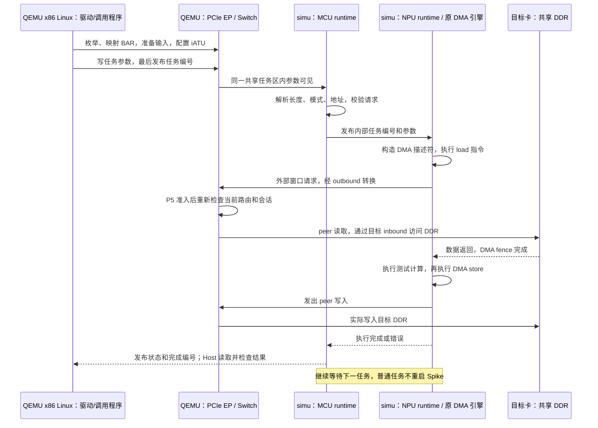

# 平台构建、启动与 Host/Device 开发使用教程

宿主命令在 QEMU 仓库根目录执行，来宾命令在 t100 Ubuntu 内执行。依赖按本文安装，运行数据保存在本地。

- [1. 环境与整个平台启动](#1-环境与整个平台启动)：构建、双卡/八卡回归、桌面、双终端 Spike/QEMU、自定义 MCU/NPU。
- [2. Host 侧接口与固定配置流程](#2-host-侧接口与固定配置流程)：驱动、iATU、IPC、任务与 header-only lib。
- [3. MCU 编译与程序交付](#3-mcu-编译与程序交付)：实际工程、工具链、最小模板、装载约定。
- [4. 开发与回归入口](#4-开发与回归入口)。
- [5. 验证记录](#5-验证记录)。

设备 ready 由 Host 按 SCU/IPC 协议判断。

## 1. 环境与整个平台启动

### 1.1 准备环境

推荐 **Ubuntu 22.04 x86-64**，与发布包的 Boost 1.74、ICU 70 和 OpenMP 依赖匹配。

```bash
sudo apt update
sudo apt install -y \
  git build-essential ninja-build pkg-config \
  libglib2.0-dev libpixman-1-dev zlib1g-dev libfdt-dev libslirp-dev \
  python3 python3-venv python3-pip curl ca-certificates \
  libboost-regex1.74.0 libicu70 libgomp1 libstdc++6
```

QEMU 构建要求 **Python 3.12+**。Ubuntu 22.04 可用 uv 安装：

```bash
curl -LsSf https://astral.sh/uv/install.sh | sh
export PATH="$HOME/.local/bin:$PATH"
uv python install 3.12
```

构建时使用 `uv python find 3.12`，或指定已有 Python 3.12+ 路径；运行脚本支持 Python 3.10+。

### 1.2 克隆与构建

```bash
git clone --branch pcie_qemu https://github.com/YoungLee1995/qemu.git
cd qemu

ls -l zc_simulator/simu/current
ldd zc_simulator/simu/current/bin/spike
python3 zc_simulator/p5/run_linux.py --runtime prebuilt --prepare-only
```

`ldd` 应无 `not found`，`--prepare-only` 成功退出并打印证据目录。

BIOS/ROM 使用仓库 `pc-bios/`；Meson 构建依赖按需联网获取。

#### 构建 QEMU

仍在刚克隆的 `qemu` 仓库根目录：

```bash
mkdir -p build
cd build
../configure \
  --python="$(uv python find 3.12)" \
  --target-list=x86_64-softmmu \
  --disable-docs \
  --disable-werror
cd ..

ninja -C build -j4 qemu-system-x86_64
./build/qemu-system-x86_64 --version
```

运行入口使用 `build/qemu-system-x86_64`。内存不足时将 `-j4` 改为 `-j2`。

配置失败时查看 `build/config.log` 和 `build/meson-logs/meson-log.txt`，并检查网络。

#### 自动运行整个平台：双卡与八卡

仍在 `qemu` 仓库根目录：

```bash
## 双卡：首次联调先跑这个
python3 zc_simulator/p5/run_linux.py --cards 2

## 八卡：覆盖 56 个有向卡对
python3 zc_simulator/p5/run_linux.py --cards 8
```

默认使用仓库发布包；`auto` 与 `prebuilt` 行为相同。

脚本用 TCG 启动 Linux、加载驱动、执行各卡任务并校验，完成后关机。

需要常驻 Ubuntu、SSH 或桌面时，继续 1.3；需要分终端启动时见 1.4。

终端检查项全部显示 `PASS`，最后打印：

```text
Evidence: .../zc_simulator/p5/evidence/linux-...
```

`results.json` 应有 `passed: true`；`linux.log` 应包含 `P5_BASE_PASS`、`P5_C_LIBRARY_PASS`、`P4_GUEST_EXIT=0`。

### 1.3 Linux Ubuntu/XFCE 桌面启动

### 新克隆后的准备流程

#### 0. 已有环境先检查，不要重复初始化或启动

如果这台机器之前已经启动过桌面，先执行：

```sh
python3 zc_simulator/desktop/control.py status
```

显示 `T100_DESKTOP_READY` 时，直接运行 `python3 zc_simulator/desktop/terminal.py` 登录；首次使用继续第 1 步。

`Resource temporarily unavailable` 或“桌面数据目录正在使用”表示 `desktop.lock` 被占用。检查已有桌面；初始化中则等待完成。

确需修改共享文件、重新执行初始化或重启时，在宿主终端执行：

```sh
python3 zc_simulator/desktop/control.py stop
```

等待 `desktop.py` 退出再 prepare/启动。锁占用可用 `lslocks -o PID,COMMAND,PATH` 查看；保留锁文件。

#### 1. 确认仓库与 QEMU 已就绪

在包含 `zc_simulator/` 和 `build/` 的仓库根目录执行：

先完成 1.1～1.2 的依赖安装和 QEMU 构建。

```sh
pwd
test -x build/qemu-system-x86_64 && echo QEMU_OK
test -d zc_simulator/simu/current && echo BUNDLE_OK
```

#### 2. 安装镜像与 SSH 工具

root 用户可去掉 `sudo`。

```sh
sudo apt update
sudo apt install -y qemu-utils genisoimage openssh-client openssl curl ca-certificates
```

#### 3. 下载 Ubuntu 镜像

下载官方镜像与校验清单，以下使用默认 `state/`：

```sh
mkdir -p zc_simulator/desktop/state
cd zc_simulator/desktop/state
curl -fLO https://cloud-images.ubuntu.com/noble/current/SHA256SUMS
curl -fLO https://cloud-images.ubuntu.com/noble/current/noble-server-cloudimg-amd64.img
sha256sum --ignore-missing -c SHA256SUMS
mv noble-server-cloudimg-amd64.img ubuntu-24.04-base.qcow2
cd ../../..
```

校验通过后再重命名；`prepare.py` 会使用同目录官方清单再次校验。

#### 4. 初始化本地系统盘

在仓库根目录运行；此时不要有使用同一系统盘的 VM：

```sh
python3 zc_simulator/desktop/prepare.py
```

`prepare.py` 创建系统盘、密钥和 cloud-init。新环境账号/密码为 **`t100` / `t100`**；首次启动联网安装桌面、内核头文件并编译驱动和 `guest-cluster`。

已有环境保留旧密码。修改时先在 t100 内执行：

```sh
printf 't100:t100\n' | sudo chpasswd
```

然后在外层容器的仓库根目录同步本地密码记录（使用自定义状态目录时保持相同 `ZC_DESKTOP_STATE`）：

```sh
python3 - <<'PY'
import json
import os
from pathlib import Path
state = Path(os.environ.get('ZC_DESKTOP_STATE', 'zc_simulator/desktop/state'))
credentials = state / 'credentials.json'
credentials.write_text(json.dumps({'user': 't100', 'password': 't100'}, indent=2) + '\n')
credentials.chmod(0o600)
PY
```

SSH 使用生成的密钥登录，无需输入密码；`sudo` 也无需密码。固定密码用于 Ubuntu 控制台和 RDP 登录，SSH 密码认证仍关闭。

首次安装通常十多分钟，以 `DESKTOP_READY` 为准。RDP 日志若报私钥 `Permission denied`，在 t100 执行 `sudo systemctl restart xrdp`。

#### 5. 终端 A：启动 Ubuntu

```sh
python3 zc_simulator/desktop/desktop.py --cards 8
```

启动 QEMU、Spike 后端与 fabric，生成 `state/active.json` 并输出 PID、日志目录和端口。关闭终端或 Ctrl+Z 后继续运行；正常关机用 `control.py stop`，Ctrl+C 会终止启动器。

启动器每 30 秒报告等待状态，SSH、驱动节点和 xrdp 就绪后打印：

```text
DESKTOP_READY：Ubuntu 已就绪（SSH、8 个设备节点、xrdp）。
请在另一个宿主终端执行：
  python3 zc_simulator/desktop/terminal.py
可关闭当前终端，虚拟机继续运行。
```

看到 `DESKTOP_READY` 后登录；等待详情见本次 `work/readiness.log`。自定义 `ZC_DESKTOP_STATE` 时，各终端保持一致。

#### 6. 终端 B：等待首次初始化完成

打开第二个宿主终端，进入同一个仓库根目录，执行：

```sh
python3 zc_simulator/desktop/control.py status
```

启动期间 SSH 可能拒绝连接或超时，稍后重试。

就绪标志：`T100_DESKTOP_READY`、xrdp `active`、与卡数一致的 `/dev/test_dma_*`。

若长时间未就绪，在终端 B 查看本次串口日志：

```sh
python3 - <<'PYLOG'
import json
import os
from pathlib import Path
state = Path(os.environ.get('ZC_DESKTOP_STATE', 'zc_simulator/desktop/state'))
active = json.loads((state / 'active.json').read_text())
print(Path(active['work']) / 'serial.log')
PYLOG
```

对打印出的路径运行 `tail -n 100 路径`；SSH 可连接后还可查看来宾初始化日志：

```sh
python3 zc_simulator/desktop/control.py ssh 'sudo tail -100 /var/log/t100-desktop-setup.log'
```

#### 7. 终端 B：进入可执行命令的 Ubuntu

```sh
python3 zc_simulator/desktop/terminal.py
```

看到 `t100@...` 后，在 **Ubuntu 内**执行：

```sh
uname -m
lspci -nn -d 16c3:abcd
ls /dev/test_dma_*
sudo /opt/t100/guest-cluster
```

`guest-cluster` 配合八卡配置使用。`exit` 断开 SSH，Ubuntu 继续运行。

#### 找不到 `/dev/test_dma_*` 或 `/opt/t100/guest-cluster`

先通过 `terminal.py` 登录 t100，再检查驱动和初始化：

在 t100 内检查：

```sh
whoami
hostname
lspci -nn -d 16c3:abcd
ls -l /dev/test_dma_* /opt/t100/guest-cluster
sudo systemctl status t100-desktop-setup --no-pager
sudo tail -n 100 /var/log/t100-desktop-setup.log
```

安装服务运行中则等待；完成后检查日志中的 `T100_DESKTOP_READY` 及设备节点。

- `lspci` 没有 `16c3:abcd`：检查是否进入正确的 VM，以及外层是否按本节使用 `desktop.py --cards 8` 启动；安装驱动不会凭空生成 PCIe 设备。
- PCIe 设备存在、但没有 `/dev/test_dma_*`：先执行 `sudo modprobe ssv_test_driver`；若提示模块不存在，查看初始化日志中安装内核头文件、编译驱动的错误。
- 只有 `/opt/t100/guest-cluster` 缺失、其他初始化步骤已经成功：可以按下方从共享源码重新编译，不需要下载二进制。

```sh
# 在 t100 内，确认共享源码存在后编译：
ls -l /mnt/hostshare/guest-cluster.c
sudo mkdir -p /opt/t100
sudo gcc -O2 -Wall /mnt/hostshare/guest-cluster.c -o /opt/t100/guest-cluster
```

共享目录挂载见第 2 章；源码缺失时，关机后执行 `prepare.py` 同步。

修复初始化日志中的网络、软件源或编译错误。确认安装服务停止后，可重跑：

```sh
# 在 t100 内执行；成功时末尾打印 T100_DESKTOP_READY：
sudo /usr/local/sbin/t100-desktop-setup
```

失败时保留初始化日志。

缺少 `active.json` 时先启动 `desktop.py`；启动失败查看本次 `qemu.log`。

### 后续使用：重新启动、检查和关闭

已经运行时不需要重复启动。检查状态：

```sh
python3 zc_simulator/desktop/control.py status
```

正常关机（通过 QMP 发送 ACPI 电源按钮事件，不依赖 Ubuntu 的 SSH）：

```sh
python3 zc_simulator/desktop/control.py stop
```

命令提示“已发送”表示请求已提交，并不表示关机完成；等待终端 A 的启动进程退出后再操作磁盘。

关闭终端后提示写入 `work/supervisor.log`；重开终端可执行 `status`、`terminal.py` 或 `stop`。

旧版进程被 Ctrl+Z 暂停时，用 `jobs -l`、`fg %作业号` 恢复后正常关机。

等旧启动器退出（`active.json` 的 `stopped` 为 true），下次直接启动：

```sh
python3 zc_simulator/desktop/desktop.py --cards 8
```

参数：`--cards 1/2/8`、`--memory 4G`、`--ssh-port 2222`、`--rdp-port 13389`。默认监听 127.0.0.1；跨容器访问可用 `--bind 容器IP`，IP 用 `hostname -I` 查看。

### 图形桌面

就绪后通过 RDP 连接图形桌面：

VS Code「端口 / PORTS」转发 13389，远程桌面客户端连接转发地址。xrdp 选择 Xorg，账号/密码 **`t100` / `t100`**；旧密码查看：

```sh
cat zc_simulator/desktop/state/credentials.json
```

共享目录为宿主 `state/share/`、来宾 `/mnt/hostshare/`。桌面快捷方式可打开设备列表和八卡测试。

### 可选：浏览器终端

先完成上述启动和就绪检查，再下载上游 ttyd（也可以自行从上游源码编译）：

```sh
mkdir -p zc_simulator/desktop/state/tools/local
curl -fL https://github.com/tsl0922/ttyd/releases/download/1.7.7/ttyd.x86_64 \
  -o zc_simulator/desktop/state/tools/local/ttyd
chmod +x zc_simulator/desktop/state/tools/local/ttyd
python3 zc_simulator/desktop/web_terminal.py
```

浏览器打开 <http://127.0.0.1:7681>；VS Code 远程环境先转发 7681。

ttyd 上游：<https://github.com/tsl0922/ttyd>。

修改共享任务后，关机并重新运行 `prepare.py` 同步。

### 常见问题

| 现象 | 处理 |
| --- | --- |
| `terminal.py` 找不到 `state/active.json` | 尚未运行 `desktop.py`，或两个终端的 `ZC_DESKTOP_STATE` 不一致；按首次流程第 5 步启动 |
| `desktop.py` 提示缺少 qcow2 / seed | 先下载基础镜像并执行 `prepare.py`，不是直接执行连接脚本 |
| SSH banner exchange 超时，QEMU 的 `ps` 状态为 `T` | 旧版进程可能被暂停；在原终端用 `jobs -l` 和 `fg %作业号` 恢复。新版 `desktop.py` 忽略 Ctrl+Z，关闭终端后也继续运行 |
| SSH connection refused / 超时 | 检查终端 A 是否仍运行；首次启动等待 SSH 就绪，再检查本次 `serial.log` 和 `qemu.log` |
| SSH 能登录，但驱动节点或桌面服务缺失 | 首次安装尚未完成或失败；检查 `/var/log/t100-desktop-setup.log` 与来宾网络 |
| 端口占用或磁盘被锁定 | 检查是否已有 VM 使用相同磁盘和端口；已有 VM 直接连接，不要重复启动 |
| P5 双卡/八卡测试通过，但无法连接 Ubuntu | 两套入口生命周期独立；自动测试不创建常驻 Ubuntu，仍需完成本文首次准备流程 |

`terminal.py` / `control.py` 管理 `desktop.py` 实例；分离启动的 SSH 和关机见 1.4.8。

### 1.4 两个终端分别启动 Spike 与 QEMU，指定 MCU/NPU

本节使用 Python 启动器管理后端。需要直接使用 Spike ELF 和原生 QEMU 命令互联时，见独立的 **1.6 节**。

前置：完成 1.1～1.3 的构建、镜像下载和 prepare。`--guest desktop` 启动 Ubuntu，`console` 启动 BusyBox，`test` 执行自动测试后关机。

在外层容器的仓库根目录执行：终端 A 启动后端，B 启动 QEMU，C 登录 t100。先关闭占用同一磁盘/端口的旧 VM。

默认数据目录 `zc_simulator/desktop/state`。自定义时显式传入 `--state`，同步修改 SSH 密钥路径。每次使用新的 `--work`，两端指向同次运行的 `backends.json`。

#### 1.4.1 镜像、die、卡与 hart 的对应关系

| 名称 | 在本项目中的含义 |
| --- | --- |
| `firmware.riscv` | Spike 的 dispatcher ELF，负责装载、派发程序和完成后导出结果；由 `--firmware` 指定，默认使用发布包 |
| `mcu.bin` | MCU 业务裸二进制，装载到 `0x40000000`，在 hart 1 执行；可以承载初始化/常驻控制程序，但不是 x86 QEMU 的 BIOS |
| `npu.bin` | NPU 可执行裸二进制，装载到 `0x4000000000`，在 hart 16 执行；不是任意数据文件、Python 脚本或尚未汇编的指令文本 |
| QEMU BIOS | x86 来宾的启动固件，来自仓库 `pc-bios/`；不接收 `mcu.bin` |
| 单 die 模型实例 | 一个 Spike 进程内的当前模型；MCU 和 NPU 是这个实例中的业务 hart，不是两张卡或两个 die |
| 单卡 | 一个 QEMU endpoint，连接一个独立 Spike 实例 |
| 双卡/八卡 | 2/8 个 endpoint，各自一个 Spike 实例，经 QEMU PCIe Switch 和 fabric 互访 |
| 一卡多 die | 当前交付没有这种拓扑或 die 内互联参数；不能用 `--cards 2` 假称“一卡双 die” |

`--cards 1/2/8` 控制卡数，`--cores both/mcu/npu` 选择每卡装载的业务核心。

`--mcu-bin` 选择 BootROM 裸 BIN，ISA、链接地址和寄存器应与模型匹配；Host 按设备 SCU/IPC 协议判断就绪。

#### 1.4.2 默认镜像：单卡 MCU+NPU，启动 Ubuntu

终端 A：

```bash
python3 zc_simulator/cli/spike.py --mode backend --cards 1 --cores both --work /tmp/zc-card1-backend
```

原生调用模板（FD 由服务传入，直接启动见 1.6）：

```text
cd /tmp/zc-card1-backend/cardN
ZC_P1_MAILBOX_FD=<该卡实际继承的mailbox_FD> ZC_P1_PARENT_PID=<服务PID> ZC_P2_PCIE=1 \
  /绝对路径/qemu/zc_simulator/simu/current/bin/spike \
  --p1-ddr0-fd=<该卡实际继承的DDR0_FD> --p1-ddr1-fd=<该卡实际继承的DDR1_FD> \
  --isa=rv64imafdcv_zvl512b_zve32d_zfh_zvfh_zfbfmin_zvfbfmin_zba_zbb_zbs_zicond \
  --runtime-func /绝对路径/qemu/zc_simulator/simu/current/images/firmware.riscv -cfg ./firmware.cfg
```

`N` 为 0～0，装载 `both`；每卡镜像配置见 `cardN/firmware.cfg`。

看到 `BACKENDS_READY /tmp/zc-card1-backend/backends.json` 后，保持终端 A 运行。

终端 B：

```bash
python3 zc_simulator/cli/qemu.py --backends /tmp/zc-card1-backend/backends.json --guest desktop --state zc_simulator/desktop/state --ssh-port 2222 --rdp-port 13389 --work /tmp/zc-card1-qemu
```

终端 B 显示 Ubuntu 串口启动信息并持续运行。登录、初始化就绪检查和关闭步骤见 **1.4.8**；在终端 C 通过 SSH 进入后，可执行：

```sh
uname -m
ls -l /dev/test_dma_*
cat /proc/interrupts
```

单卡应出现 `/dev/test_dma_0`。精简 shell 可选 `--guest console`，看到 `ZC_CONSOLE_READY` 后操作，关机执行：

```sh
/bin/busybox poweroff -f
```

QEMU 退出后，在终端 A 按 Ctrl+C 回收后端；下次使用新的 `--work`。

#### 1.4.3 双卡/八卡：MCU+NPU

双卡，终端 A：

```bash
python3 zc_simulator/cli/spike.py --mode backend --cards 2 --cores both --work /tmp/zc-card2-backend
```

原生调用模板（FD 由服务传入，直接启动见 1.6）：

```text
cd /tmp/zc-card2-backend/cardN
ZC_P1_MAILBOX_FD=<该卡实际继承的mailbox_FD> ZC_P1_PARENT_PID=<服务PID> ZC_P2_PCIE=1 \
  /绝对路径/qemu/zc_simulator/simu/current/bin/spike \
  --p1-ddr0-fd=<该卡实际继承的DDR0_FD> --p1-ddr1-fd=<该卡实际继承的DDR1_FD> \
  --isa=rv64imafdcv_zvl512b_zve32d_zfh_zvfh_zfbfmin_zvfbfmin_zba_zbb_zbs_zicond \
  --runtime-func /绝对路径/qemu/zc_simulator/simu/current/images/firmware.riscv -cfg ./firmware.cfg
```

`N` 为 0～1，装载 `both`；每卡镜像配置见 `cardN/firmware.cfg`。

终端 B：

```bash
python3 zc_simulator/cli/qemu.py --backends /tmp/zc-card2-backend/backends.json --guest desktop --state zc_simulator/desktop/state --ssh-port 2222 --rdp-port 13389 --work /tmp/zc-card2-qemu
```

需要自动执行完整 Linux 联合测试、执行后关机时，把终端 B 换为：

```bash
python3 zc_simulator/cli/qemu.py --backends /tmp/zc-card2-backend/backends.json --guest test --work /tmp/zc-card2-test
```

成功标志：`P5_BASE_PASS cards=2`、三轮 `P5_ASYNC_ROUND`、`P5_C_LIBRARY_PASS`、`P4_GUEST_EXIT=0`。

八卡同理，终端 A：

```bash
python3 zc_simulator/cli/spike.py --mode backend --cards 8 --cores both --work /tmp/zc-card8-backend
```

原生调用模板（FD 由服务传入，直接启动见 1.6）：

```text
cd /tmp/zc-card8-backend/cardN
ZC_P1_MAILBOX_FD=<该卡实际继承的mailbox_FD> ZC_P1_PARENT_PID=<服务PID> ZC_P2_PCIE=1 \
  /绝对路径/qemu/zc_simulator/simu/current/bin/spike \
  --p1-ddr0-fd=<该卡实际继承的DDR0_FD> --p1-ddr1-fd=<该卡实际继承的DDR1_FD> \
  --isa=rv64imafdcv_zvl512b_zve32d_zfh_zvfh_zfbfmin_zvfbfmin_zba_zbb_zbs_zicond \
  --runtime-func /绝对路径/qemu/zc_simulator/simu/current/images/firmware.riscv -cfg ./firmware.cfg
```

`N` 为 0～7，装载 `both`；每卡镜像配置见 `cardN/firmware.cfg`。

终端 B（Ubuntu）：

```bash
python3 zc_simulator/cli/qemu.py --backends /tmp/zc-card8-backend/backends.json --guest desktop --state zc_simulator/desktop/state --ssh-port 2222 --rdp-port 13389 --work /tmp/zc-card8-desktop
```

登录见 1.4.8。`--guest test` 支持 2/8 卡 MCU+NPU；同组后端连接一台 QEMU。

#### 1.4.4 指定自己的 MCU / NPU 文件

`--mcu-addr` 指定 MCU 装载/入口地址，支持十进制或十六进制，默认 `0x40000000`。BIN 应按该地址链接；原生命令在 cfg 中设置地址。

例如已经通过工具链生成 `/absolute/path/my-mcu.bin` 和 `/absolute/path/my-npu.bin`，终端 A 一条命令：

```bash
python3 zc_simulator/cli/spike.py --mode backend --cards 2 --cores both --mcu-bin /absolute/path/my-mcu.bin --npu-bin /absolute/path/my-npu.bin --work /tmp/zc-custom-backend
```

原生调用模板（FD 由服务传入，直接启动见 1.6）：

```text
cd /tmp/zc-custom-backend/cardN
ZC_P1_MAILBOX_FD=<该卡实际继承的mailbox_FD> ZC_P1_PARENT_PID=<服务PID> ZC_P2_PCIE=1 \
  /绝对路径/qemu/zc_simulator/simu/current/bin/spike \
  --p1-ddr0-fd=<该卡实际继承的DDR0_FD> --p1-ddr1-fd=<该卡实际继承的DDR1_FD> \
  --isa=rv64imafdcv_zvl512b_zve32d_zfh_zvfh_zfbfmin_zvfbfmin_zba_zbb_zbs_zicond \
  --runtime-func /绝对路径/qemu/zc_simulator/simu/current/images/firmware.riscv -cfg ./firmware.cfg
```

`N` 为 0～1，装载 `both`；每卡镜像配置见 `cardN/firmware.cfg`。

终端 B：

```bash
python3 zc_simulator/cli/qemu.py --backends /tmp/zc-custom-backend/backends.json --guest desktop --state zc_simulator/desktop/state --ssh-port 2222 --rdp-port 13389 --work /tmp/zc-custom-qemu
```

将 `/absolute/path/...` 换成实际 BIN 路径。省略镜像参数时，启用的核心使用默认镜像。例如仅替换 MCU：

```bash
python3 zc_simulator/cli/spike.py --mode backend --cards 1 --cores both --mcu-bin /absolute/path/my-mcu.bin --work /tmp/zc-custom-mcu-default-npu
```

原生调用模板（FD 由服务传入，直接启动见 1.6）：

```text
cd /tmp/zc-custom-mcu-default-npu/cardN
ZC_P1_MAILBOX_FD=<该卡实际继承的mailbox_FD> ZC_P1_PARENT_PID=<服务PID> ZC_P2_PCIE=1 \
  /绝对路径/qemu/zc_simulator/simu/current/bin/spike \
  --p1-ddr0-fd=<该卡实际继承的DDR0_FD> --p1-ddr1-fd=<该卡实际继承的DDR1_FD> \
  --isa=rv64imafdcv_zvl512b_zve32d_zfh_zvfh_zfbfmin_zvfbfmin_zba_zbb_zbs_zicond \
  --runtime-func /绝对路径/qemu/zc_simulator/simu/current/images/firmware.riscv -cfg ./firmware.cfg
```

`N` 为 0～0，装载 `both`；每卡镜像配置见 `cardN/firmware.cfg`。

`--mcu-bin` 是已有输入文件；`--work` 是启动器创建的输出目录，运行前保持不存在。

确认输入 BIN 存在，运行后等待：

```text
BACKENDS_READY /tmp/zc-custom-mcu-default-npu/backends.json
```

然后在同一外层容器的终端 B、同一仓库根目录执行配套命令：

```bash
python3 zc_simulator/cli/qemu.py --backends /tmp/zc-custom-mcu-default-npu/backends.json --guest desktop --state zc_simulator/desktop/state --ssh-port 2222 --rdp-port 13389 --work /tmp/zc-custom-mcu-default-npu-qemu
```

终端 B 使用刚生成的清单；若未打印 `BACKENDS_READY`，先处理终端 A 的错误。

启动器将镜像复制到每卡目录并生成 cfg 和摘要；各卡使用同一组选定镜像。

传输建立后，Host 按固件 SCU/IPC 协议等待业务 ready。

#### 1.4.5 只带 MCU，不带 NPU

终端 A（默认 MCU）：

```bash
python3 zc_simulator/cli/spike.py --mode backend --cards 1 --cores mcu --work /tmp/zc-mcu-only-backend
```

原生调用模板（FD 由服务传入，直接启动见 1.6）：

```text
cd /tmp/zc-mcu-only-backend/cardN
ZC_P1_MAILBOX_FD=<该卡实际继承的mailbox_FD> ZC_P1_PARENT_PID=<服务PID> ZC_P2_PCIE=1 \
  /绝对路径/qemu/zc_simulator/simu/current/bin/spike \
  --p1-ddr0-fd=<该卡实际继承的DDR0_FD> --p1-ddr1-fd=<该卡实际继承的DDR1_FD> \
  --isa=rv64imafdcv_zvl512b_zve32d_zfh_zvfh_zfbfmin_zvfbfmin_zba_zbb_zbs_zicond \
  --runtime-func /绝对路径/qemu/zc_simulator/simu/current/images/firmware.riscv -cfg ./firmware.cfg
```

`N` 为 0～0，装载 `mcu`；每卡镜像配置见 `cardN/firmware.cfg`。

或使用自己的 MCU 替换这条命令：

```bash
python3 zc_simulator/cli/spike.py --mode backend --cards 1 --cores mcu --mcu-bin /absolute/path/my-mcu.bin --work /tmp/zc-my-mcu-only-backend
```

原生调用模板（FD 由服务传入，直接启动见 1.6）：

```text
cd /tmp/zc-my-mcu-only-backend/cardN
ZC_P1_MAILBOX_FD=<该卡实际继承的mailbox_FD> ZC_P1_PARENT_PID=<服务PID> ZC_P2_PCIE=1 \
  /绝对路径/qemu/zc_simulator/simu/current/bin/spike \
  --p1-ddr0-fd=<该卡实际继承的DDR0_FD> --p1-ddr1-fd=<该卡实际继承的DDR1_FD> \
  --isa=rv64imafdcv_zvl512b_zve32d_zfh_zvfh_zfbfmin_zvfbfmin_zba_zbb_zbs_zicond \
  --runtime-func /绝对路径/qemu/zc_simulator/simu/current/images/firmware.riscv -cfg ./firmware.cfg
```

`N` 为 0～0，装载 `mcu`；每卡镜像配置见 `cardN/firmware.cfg`。

默认示例对应的终端 B：

```bash
python3 zc_simulator/cli/qemu.py --backends /tmp/zc-mcu-only-backend/backends.json --guest desktop --state zc_simulator/desktop/state --ssh-port 2222 --rdp-port 13389 --work /tmp/zc-mcu-only-qemu
```

使用自己镜像时，`--backends` 改为相应的 `zc-my-mcu-only-backend/backends.json`。双/八卡 MCU-only 只需将终端 A 的 `--cards` 改为 2 或 8，终端 B 从清单读取卡数，不重复指定。

MCU-only 的 cfg 为 `pc_num:1`，仅含 `[1, 0x40000000, ./mcu.bin]`。

默认 DMA/Tensor 任务需要 MCU+NPU。MCU-only 使用匹配的 Host/MCU 协议；NPU-only 使用 standalone。

#### 1.4.6 两个终端的职责和实际原生命令

**独立的 QEMU ↔ Spike 后端交互日志**：更新源码后先执行 `ninja -C build -j4 qemu-system-x86_64`，正常结束旧实例并重新启动后端与 QEMU。`cli/qemu.py`、`desktop.py` 和 P5 Linux runner 默认按卡生成以下日志，无需额外参数：

| 位置 | 内容 |
| --- | --- |
| QEMU 工作目录 `qemu-spike-card0.log`（多卡依次编号） | QEMU 发起连接、send/receive、消息 type、request、session、epoch、字节数和错误详情；时间为 Unix 微秒 |
| 分离后端工作目录 `card0/qemu-spike-interaction.jsonl` | 服务端请求/回复、协议消息名称和方向、会话状态、Spike 启动 PID/执行日志名、复位及错误；时间为 Unix 纳秒 |
| `desktop.py` / P5 运行目录 `service0/qemu-spike-interaction.jsonl` | 同上，对应管理入口的卡 0 服务 |

例如前面的 MCU-only 配置，在外层容器查看：

```sh
tail -F /tmp/zc-mcu-only-qemu/qemu-spike-card0.log
# 另一个终端：
tail -F /tmp/zc-mcu-only-backend/card0/qemu-spike-interaction.jsonl
```

按 `card + session + epoch + request` 对照两侧日志，`spawn.log` 指向模型输出。type：1/2 HELLO/ACK，3/4 MEM_SETUP/READY，5/6 START/READY，7/8 QUIESCE/ACK，9/10 RESET/ACK，12 STOPPED，13 ERROR，14/15 PING/PONG。

日志记录连接、握手、心跳和生命周期。原生 QEMU 可在 endpoint 参数加 `interaction-log=/实际目录/文件.log`，父目录须存在。

`session failed: connect` 表示后端 socket 连接失败。查看 QEMU 输出的路径和系统错误：

保持终端 A 运行，在启动 QEMU 的同一外层容器内检查（以下以 MCU-only 目录为例）：

```sh
cat /tmp/zc-mcu-only-backend/backends.json
tail -n 30 /tmp/zc-mcu-only-backend/card0/console.log
tail -n 30 /tmp/zc-mcu-only-backend/card0/service.jsonl
ps -eo pid,stat,args | rg 'cli/spike.py|tools/p1/service.py'
python3 - <<'PY'
import json
from pathlib import Path
plan = json.loads(Path('/tmp/zc-mcu-only-backend/backends.json').read_text())
listeners = Path('/proc/net/unix').read_text()
for i, card in enumerate(plan['cards']):
    path = Path(card['socket'])
    print('card', i, 'socket:', path, 'exists:', path.is_socket())
    print('kernel socket entries:', [line for line in listeners.splitlines()
                                     if line.split()[-1:] == [str(path)]])
PY
```

`backends.json` 对应当前活跃服务；后端退出后需重新生成，两端应在同一容器运行。

恢复：关闭 QEMU 和后端 → 新 `--work` 启动后端 → 等待 `BACKENDS_READY` → QEMU 使用新清单。

cfg 公共字段为 `runtime_func:1`，输入/输出计数为 0。`both` 含 MCU/NPU 两行，`mcu` 仅含 MCU；见各示例。

连接流程：后端监听 → QEMU 传递共享 DDR/mailbox FD → 服务启动 Spike。

MCU-only 的日志位于外层 `/tmp/zc-mcu-only-backend/card0/`。QEMU 接入后生成模型日志：

```sh
ls -lh /tmp/zc-mcu-only-backend/card0/
cat /tmp/zc-mcu-only-backend/card0/service.jsonl
tail -n 100 /tmp/zc-mcu-only-backend/card0/console.log
# Spike 已启动且生成日志后：
tail -F /tmp/zc-mcu-only-backend/card0/spike-*.log
```

`console.log` 为服务输出，`service.jsonl` 记录握手和模型 PID，`spike-时间Z-run轮次.log` 为模型输出。文件名使用 UTC 时间（北京时间加 8 小时），可按名称排序。

模型无输出时日志可为空；检查 `service.jsonl` 的 spawn/exit 及 `console.log`。

每卡启动的实际命令记录在：

```text
终端A工作目录/cardN/command.json           # 服务进程 argv
终端A工作目录/cardN/console.log           # 后端服务标准输出/错误
终端A工作目录/cardN/backend.json           # 镜像、配置和摘要
终端A工作目录/cardN/firmware.cfg           # MCU/NPU 装载表
终端A工作目录/cardN/service.jsonl          # 握手与 Spike PID、退出信息
终端A工作目录/cardN/spike-启动时间Z-run轮次.log # Spike 输出（UTC 时间）
终端B工作目录/qemu-command.json            # 实际 QEMU argv
终端B工作目录/run-qemu.sh                  # 同一条原生 QEMU 命令（供查看/调试）
```

`run-qemu.sh` 保存本次完整 QEMU 命令；复现前先关闭旧 QEMU，并保持对应服务存活。

Spike 的实际后端命令形如：

```text
spike --p1-ddr0-fd=<服务传入的FD> --p1-ddr1-fd=<服务传入的FD> --isa=<ISA> --runtime-func firmware.riscv -cfg firmware.cfg
```

模板中的 FD 和 mailbox 环境变量由服务设置；直接原生命令互联见 1.6。

#### 1.4.7 独立启动 Spike：不接 QEMU

独立验证 MCU/NPU 时，选择可独立运行的 BIN：

仅 MCU：

```bash
python3 zc_simulator/cli/spike.py --mode standalone --cards 1 --cores mcu --mcu-bin /absolute/path/my-mcu.bin --work /tmp/zc-core-mcu
```

原生命令（二选一，从仓库根目录开始）：

```bash
spike_repo=$(pwd)
mkdir -p /tmp/zc-core-mcu-native/card0
cp /absolute/path/my-mcu.bin /tmp/zc-core-mcu-native/card0/mcu.bin
cd /tmp/zc-core-mcu-native/card0
cat > firmware.cfg <<'CFG'
runtime_func:1
pc_num:1
[1, 0x40000000, ./mcu.bin]
ddr_input_num:0
ddr_output_num:0
l1buf_input_num:0
l1buf_output_num:0
CFG
"$spike_repo/zc_simulator/simu/current/bin/spike" \
  --isa=rv64imafdcv_zvl512b_zve32d_zfh_zvfh_zfbfmin_zvfbfmin_zba_zbb_zbs_zicond \
  --runtime-func "$spike_repo/zc_simulator/simu/current/images/firmware.riscv" -cfg ./firmware.cfg
```

MCU+NPU：

```bash
python3 zc_simulator/cli/spike.py --mode standalone --cards 1 --cores both --mcu-bin /absolute/path/my-mcu.bin --npu-bin /absolute/path/my-npu.bin --work /tmp/zc-core-both
```

原生命令（二选一，从仓库根目录开始）：

```bash
spike_repo=$(pwd)
mkdir -p /tmp/zc-core-both-native/card0
cp /absolute/path/my-mcu.bin /tmp/zc-core-both-native/card0/mcu.bin
cp /absolute/path/my-npu.bin /tmp/zc-core-both-native/card0/npu.bin
cd /tmp/zc-core-both-native/card0
cat > firmware.cfg <<'CFG'
runtime_func:1
pc_num:2
[1, 0x40000000, ./mcu.bin]
[16, 0x4000000000, ./npu.bin]
ddr_input_num:0
ddr_output_num:0
l1buf_input_num:0
l1buf_output_num:0
CFG
"$spike_repo/zc_simulator/simu/current/bin/spike" \
  --isa=rv64imafdcv_zvl512b_zve32d_zfh_zvfh_zfbfmin_zvfbfmin_zba_zbb_zbs_zicond \
  --runtime-func "$spike_repo/zc_simulator/simu/current/images/firmware.riscv" -cfg ./firmware.cfg
```

仅 NPU：

```bash
python3 zc_simulator/cli/spike.py --mode standalone --cards 1 --cores npu --npu-bin /absolute/path/my-npu.bin --work /tmp/zc-core-npu
```

原生命令（二选一，从仓库根目录开始）：

```bash
spike_repo=$(pwd)
mkdir -p /tmp/zc-core-npu-native/card0
cp /absolute/path/my-npu.bin /tmp/zc-core-npu-native/card0/npu.bin
cd /tmp/zc-core-npu-native/card0
cat > firmware.cfg <<'CFG'
runtime_func:1
pc_num:1
[16, 0x4000000000, ./npu.bin]
ddr_input_num:0
ddr_output_num:0
l1buf_input_num:0
l1buf_output_num:0
CFG
"$spike_repo/zc_simulator/simu/current/bin/spike" \
  --isa=rv64imafdcv_zvl512b_zve32d_zfh_zvfh_zfbfmin_zvfbfmin_zba_zbb_zbs_zicond \
  --runtime-func "$spike_repo/zc_simulator/simu/current/images/firmware.riscv" -cfg ./firmware.cfg
```

多个独立实例可改用 `--cards 2/8`；卡间互访使用 backend+QEMU。

cfg 中的 BIN 路径相对执行目录解析；数据映射使用自定义 cfg。

常驻程序用 Ctrl+C 停止。独立程序正常结束时，按 dispatcher ABI 向 MCU0 `0x7c000010` / NPU0 `0x7c000018` 写 0 并 fence。

#### Spike 交互调试与单步（首次使用）

在 Spike 命令中添加 `-d` 进入独立单步调试：

若已有 MCU BIN，也可在外层仓库根目录用启动器自动准备 cfg 并进入交互调试：

```bash
python3 zc_simulator/cli/spike.py --mode standalone --cards 1 --cores mcu --mcu-bin /实际路径/mcu.bin -d --work /tmp/zc-mcu-debug
```

原生命令（二选一，从仓库根目录开始）：

```bash
spike_repo=$(pwd)
mkdir -p /tmp/zc-mcu-debug-native/card0
cp /实际路径/mcu.bin /tmp/zc-mcu-debug-native/card0/mcu.bin
cd /tmp/zc-mcu-debug-native/card0
cat > firmware.cfg <<'CFG'
runtime_func:1
pc_num:1
[1, 0x40000000, ./mcu.bin]
ddr_input_num:0
ddr_output_num:0
l1buf_input_num:0
l1buf_output_num:0
CFG
"$spike_repo/zc_simulator/simu/current/bin/spike" -d \
  --isa=rv64imafdcv_zvl512b_zve32d_zfh_zvfh_zfbfmin_zvfbfmin_zba_zbb_zbs_zicond \
  --runtime-func "$spike_repo/zc_simulator/simu/current/images/firmware.riscv" -cfg ./firmware.cfg
```

standalone `-d/--debug` 将当前终端交给 Spike，仅支持单实例；backend 调试见下文。`--work` 使用新目录。

standalone 生成 `card0/run-spike.sh` 和 `command.json`，可在旧实例退出后复现。

也可复用已有 cfg/BIN，在旧后端关闭后执行：

```bash
spike_repo=$(pwd)
cd /tmp/zc-mcu-only-backend/card0
"$spike_repo/zc_simulator/simu/current/bin/spike" -d \
  --isa=rv64imafdcv_zvl512b_zve32d_zfh_zvfh_zfbfmin_zvfbfmin_zba_zbb_zbs_zicond \
  --runtime-func "$spike_repo/zc_simulator/simu/current/images/firmware.riscv" \
  -cfg firmware.cfg
```

看到 `(spike)` 后输入 `help`，常用命令：

| 命令 | 含义 |
| --- | --- |
| `help` | 显示命令帮助 |
| `r 1` 或直接按回车 | 推进一步并打印执行指令 |
| `r 10` | 推进指定数量并显示执行指令 |
| `rs 100` | 推进指定数量，不逐条打印 |
| `pc 1` | MCU-only 配置中查看 MCU 核的 PC |
| `reg 1` / `reg 1 a0` | 查看该核寄存器或 a0 |
| `mem 1 40000000` | 按十六进制地址查看该核可见内存 |
| `r` | 持续执行；按 Ctrl+C 回到调试提示符 |
| `q` | 退出整个 Spike 进程 |

调试从 dispatcher 开始，随后装载 MCU BIN。`r 1` 推进多核调度的一步；观察 `core`、PC 和寄存器确认执行核。调试命令使用处理器索引，MCU-only 的 MCU 为索引 1。

**联机单步：** 完成 Ubuntu 准备并关闭旧实例后，在同一容器依次执行：

终端 A：启动带调试功能的单卡 MCU 后端（使用默认 MCU BIN）：

```bash
python3 zc_simulator/cli/spike.py --mode backend --cards 1 --cores mcu -d --work /tmp/zc-mcu-debug-backend
```

自定义 MCU 时给该命令增加 `--mcu-bin /实际路径/mcu.bin`；需要 MCU+NPU 时改为 `--cores both`，可增加 `--npu-bin /实际路径/npu.bin`。多卡可用 `--cards 2` 或 `--cards 8`，每卡具有独立调试终端。

原生调用模板（FD 由服务传入）：

```text
cd /tmp/zc-mcu-debug-backend/cardN
ZC_P1_MAILBOX_FD=<该卡实际继承的mailbox_FD> ZC_P1_PARENT_PID=<服务PID> ZC_P2_PCIE=1 \
  /绝对路径/qemu/zc_simulator/simu/current/bin/spike -d \
  --p1-ddr0-fd=<该卡实际继承的DDR0_FD> --p1-ddr1-fd=<该卡实际继承的DDR1_FD> \
  --isa=rv64imafdcv_zvl512b_zve32d_zfh_zvfh_zfbfmin_zvfbfmin_zba_zbb_zbs_zicond \
  --runtime-func /绝对路径/qemu/zc_simulator/simu/current/images/firmware.riscv -cfg ./firmware.cfg
```

服务接收 QEMU 的共享内存 FD，并用 PTY 提供交互终端。

终端 A 打印 `BACKENDS_READY` 后，终端 B 启动已准备好的 Ubuntu：

```bash
python3 zc_simulator/cli/qemu.py --backends /tmp/zc-mcu-debug-backend/backends.json --guest desktop --state zc_simulator/desktop/state --ssh-port 2222 --rdp-port 13389 --work /tmp/zc-mcu-debug-qemu
```

终端 C：连接第 0 卡的真实 Spike 交互终端：

```bash
python3 zc_simulator/cli/debug.py --backends /tmp/zc-mcu-debug-backend/backends.json --card 0
```

QEMU 启动并创建模型后，终端 C 显示 `(spike)`。使用 `pc 1`、`r 1`、`reg 1`；`rs` 连续运行，Ctrl+C 暂停。

- **Ctrl+C**：打断正在执行的 Spike，返回 `(spike)`，不停止 QEMU。
- **Ctrl+]**：仅断开调试终端；保持当前运行或暂停状态。再次执行终端 C 的命令即可重连，并回放最近的终端输出。关闭终端 C 也不会停止后端。
- **`q`**：退出 Spike 进程，设备会话会受影响；不要把它当成断开调试终端。
- 同一卡同时只允许一个调试连接；多卡时在另一终端指定 `--card 1` 等。终端 A/B 的生命周期规则仍按 1.4.8 节处理，调试终端的断开保护不代表可以关闭 A/B。

另开终端按 1.4.8 登录 Ubuntu。暂停期间心跳保持，Host 任务、DMA 或 IPC 等待仍可能超时。

调试输入回显、提示符、单步结果与固件输出统一保存在终端 A 工作目录的 `cardN/spike-时间戳-runN.log`。传输记录仍分别位于终端 A 的 `cardN/qemu-spike-interaction.jsonl` 和终端 B 的 `qemu-spike-cardN.log`。

#### 1.4.8 Ubuntu 登录、就绪检查、运行与关闭（所有上述配置通用）

先按 1.4.2～1.4.5 启动后端与 QEMU。终端 A/B 保持运行；无人值守使用 tmux。

**终端 C：登录 Ubuntu。** 在同一外层容器的仓库根目录执行：

```bash
ssh -i zc_simulator/desktop/state/ssh_key -p 2222 \
  -o IdentitiesOnly=yes -o StrictHostKeyChecking=accept-new \
  -o UserKnownHostsFile=zc_simulator/desktop/state/known_hosts \
  -o ConnectTimeout=10 t100@127.0.0.1
```

SSH 尚未就绪时稍后重试。自定义 `--state`、`--ssh-port` 时同步修改路径和端口。

**首次启动在 t100 内查看安装进度：**

```sh
sudo systemctl status t100-desktop-setup --no-pager -l
sudo tail -n 50 /var/log/t100-desktop-setup.log
```

在 Ubuntu Bash 中等待就绪，`expected_cards` 填本次卡数：

```bash
expected_cards=1
wait_deadline=$((SECONDS + 1200))
while true; do
    device_count=$(find /dev -maxdepth 1 -type c -name 'test_dma_*' | wc -l)
    if test -e /var/lib/t100-desktop-ready &&
       test -x /opt/t100/guest-cluster &&
       test "$device_count" -eq "$expected_cards" &&
       systemctl is-active --quiet xrdp; then
        echo "UBUNTU_READY cards=$device_count"
        break
    fi
    if test "$SECONDS" -ge "$wait_deadline"; then
        echo '等待超时，请检查 /var/log/t100-desktop-setup.log；尚未确认就绪'
        break
    fi
    echo "等待初始化：当前设备节点 $device_count/$expected_cards"
    sleep 10
done
```

打印 `UBUNTU_READY` 后继续；超时按 1.3 初始化故障处理。业务 ready 由 SCU/IPC 判断。

**确认配置后运行对应任务：**

```sh
uname -m
lspci -nn -d 16c3:abcd
ls -l /dev/test_dma_*
```

节点数应等于 `--cards`。默认 MCU+NPU 可运行参考任务；八卡配置可运行 `sudo /opt/t100/guest-cluster`。自定义固件使用匹配的 Host 程序。

RDP 连接见 1.3，使用本次 `--rdp-port` 和数据目录中的账号。

**关闭与再次测试：** 在 t100 内执行：

```sh
sudo poweroff
```

QEMU 退出后在终端 A 按 Ctrl+C。再次测试使用新 `--work` 和清单，复用 Ubuntu 磁盘。运行中换镜像使用 1.5 的桌面管理入口。

### 1.5 保持 t100 运行，更换某卡 MCU/NPU 并重启 Spike

本节用于更换 `mcu.bin` / `npu.bin` 并重启目标卡 Spike；连续任务和输入数据更新复用现有进程。

适用 `desktop.py` 管理的 Ubuntu，保留 QEMU、Ubuntu 和其他卡进程。

#### 首次启用新版控制器

宿主仓库根目录执行：

```sh
ninja -C build -j4 qemu-system-x86_64
# 若旧 VM 正在运行，先正常关机并等待原启动器退出：
python3 zc_simulator/desktop/control.py stop
# 只在 VM 停止后同步新工具到共享目录：
python3 zc_simulator/desktop/prepare.py
python3 zc_simulator/desktop/desktop.py --cards 8
```

旧环境关机后重新 prepare/启动一次，后续可运行中换 BIN。

#### 在 t100 内提交替换请求

停止所有 Host 设备使用者，等待任务、DMA 和 peer 访问结束。控制器检查打开的设备/BAR/mmap 和参考任务状态；私有固件由业务自行确认 idle。卡号按 BDF 排序，从 0 开始。

把新镜像放到 t100 内，例如 `~/firmware/mcu.bin`、`~/firmware/npu.bin`，执行：

```sh
sudo python3 /mnt/hostshare/device_reload.py --card 0 --mcu-bin /home/t100/firmware/mcu.bin --npu-bin /home/t100/firmware/npu.bin
```

仅替换一份，另一份沿用该卡上次选择的镜像：

```sh
sudo python3 /mnt/hostshare/device_reload.py --card 0 --npu-bin /home/t100/firmware/npu.bin
```

操作重启目标卡 MCU+NPU。裸 BIN 链接地址：MCU `0x40000000`、NPU `0x4000000000`。新镜像和摘要保存在本次 `reloads/请求ID/`。

`ok: true`、`transport_ready: true` 表示会话恢复；指定 IPC 参数后才检查业务 ready。

#### 同时等待实际 IPC ready

如果 BootROM 的 ready 状态通过 BAR4 映射，在上面命令添加以下参数（数值必须来自自己的固件协议）：

```text
--ipc-offset BAR4内状态寄存器字节偏移 --ipc-mask 掩码 --ipc-value 就绪值 --timeout 120
```

三个 IPC 参数同时提供，支持十六进制；32 位 BAR4 寄存器满足 `(status & mask) == value` 后成功。

#### 生命周期、失败与后续任务

1. 控制器串行处理请求，验证卡号/文件/IPC 参数，并将 BIN 复制为本次输入快照。
2. 通过来宾检查所有卡的 Host 使用者及参考任务/HDMA 状态；有占用时拒绝，不重启 Spike。
3. 暂存目标卡新配置，通过 Linux PCI sysfs reset 触发该函数 FLR；内核保存/恢复 PCI 配置。QEMU 阻断旧会话、取消该卡 DMA 和窗口状态，service QUIESCE 回收旧 Spike。
4. RESET 阶段安装新配置与镜像摘要，清空参考任务区，再启动新 Spike，恢复传输握手。原 service 身份摘要保留，新输入摘要另行检查并写入 `applied-config.json` 和 `service.jsonl`。
5. Host 按 IPC 等待就绪，再重新配置 iATU、DMA 和中断，使用新任务 ID 与缓冲。

请求/结果：宿主 `state/share/reload/requests/请求ID/`，来宾 `/mnt/hostshare/reload/requests/请求ID/`。失败时检查 `replacement_may_be_active` 和服务日志；IPC 超时后新程序可能继续运行，命令超时后后台请求也可能继续。

通过 `sudo` 提交重载请求；`control.py stop` 关闭整个平台。

### 1.6 原生 Spike 命令与原生 QEMU 命令互联

#### 开始前：关闭已有 t100、QEMU 和 Spike

先停止 Host 下发任务。以下外层命令在旧实例所在容器的 QEMU 仓库根目录执行。

**第一步，正常关闭 t100/QEMU，按旧实例的启动方式选择一种：**

- `desktop.py` 启动的实例：在外层执行，等待 QEMU 退出。

  ```bash
  python3 zc_simulator/desktop/control.py stop
  ```

  自定义数据目录需设置与启动时相同的 `ZC_DESKTOP_STATE`。

- 旧实例由 `cli/qemu.py` 或原生 QEMU 命令启动：在已经登录的 `t100@...` 终端内执行：

  ```bash
  sudo poweroff
  ```

  若尚未登录，在外层终端执行下面的 SSH 关机命令；密钥、known_hosts 和端口应与**旧实例**实际配置一致，以下为默认值：

  ```bash
  ssh -i zc_simulator/desktop/state/ssh_key \
    -o IdentitiesOnly=yes \
    -o StrictHostKeyChecking=accept-new \
    -o UserKnownHostsFile=zc_simulator/desktop/state/known_hosts \
    -p 2222 t100@127.0.0.1 'sudo poweroff'
  ```

  等待 QEMU 启动终端返回。

**第二步，在 QEMU 退出后停止旧 Spike 后端：**

- `desktop.py` 管理的后端会随其退出被回收。
- `cli/spike.py --mode backend` 启动的后端，在它的原启动终端按 **Ctrl+C**，等待启动器和模型子进程退出。
- 本节原生 `spike --pcie-socket ...` 启动的实例，QEMU 断开后会回收模型子进程，但监听父进程继续等待；在 Spike 原启动终端按 **Ctrl+C** 退出监听。
- 独立运行的原生 Spike 也需在原启动终端按 **Ctrl+C**；若进入 `(spike)` 调试提示符，输入 `q` 退出。调试连接器的 Ctrl+] 只断开终端，不会停止模型。

**第三步，确认进程、端口和磁盘已释放：**

```bash
# 在外层容器执行，检查旧启动器、QEMU、服务和 Spike
ps -eo pid,ppid,stat,args | rg '[q]emu-system-|[s]pike|[z]c_simulator/(desktop/desktop|cli/qemu|cli/spike|tools/p1/service)\.py'
# 默认端口应不再被旧实例监听；若旧实例用了其他端口，按实际值替换
ss -ltnp '( sport = :2222 or sport = :13389 )'
# 显示仍占用默认系统盘的进程；无输出表示此检查未发现占用
fuser zc_simulator/desktop/state/ubuntu-24.04-desktop.qcow2
```

残留进程按 PID 和完整命令核对后，用 `kill -TERM 实际PID` 停止。`STAT` 含 `T` 时先 `kill -CONT 实际PID` 恢复。优先正常关机，强制终止 QEMU 可能丢失未落盘数据。

本节启动单卡、单 die 的 Spike 与 Ubuntu，随后在 Ubuntu 内通过 PCIe BAR 下发 MCU/NPU 任务。需先完成 QEMU 构建、Ubuntu 镜像下载、`prepare.py` 和首次驱动安装。

#### 1.6.1 确认原生支持并准备 MCU/NPU

先进入 QEMU 仓库根目录（应包含 `build/` 和 `zc_simulator/`）：

```bash
cd /workspace/GIT/pcie_qemu/qemu  # 按实际克隆位置修改
```

在同一容器执行以下命令，创建工作目录 `/tmp/zc-native-demo`。重复实验可换新目录，并同步修改两个终端的 `native_work`。

在 QEMU 仓库根目录：

```bash
zc_simulator/simu/current/bin/spike --help 2>&1 | rg -- '--pcie-'
mkdir /tmp/zc-native-demo
cp zc_simulator/simu/current/images/mcu.bin /tmp/zc-native-demo/mcu.bin
cp zc_simulator/simu/current/images/npu.bin /tmp/zc-native-demo/npu.bin
cat > /tmp/zc-native-demo/firmware.cfg <<'CFG'
runtime_func:1
pc_num:2
[1, 0x40000000, ./mcu.bin]
[16, 0x4000000000, ./npu.bin]
ddr_input_num:0
ddr_output_num:0
l1buf_input_num:0
l1buf_output_num:0
CFG
cp zc_simulator/native/host-test.c zc_simulator/desktop/state/share/native-host-test.c
cp zc_simulator/native/pcie-mmio.py zc_simulator/desktop/state/share/pcie-mmio.py
```

帮助中应显示 `--pcie-*` 参数；若缺失，请更新仓库运行包。

自定义镜像覆盖工作目录的 MCU/NPU BIN，cfg 地址与链接地址一致。仅 MCU 时改 `pc_num:1` 并删除 NPU 行。下文 Host 校验使用默认 MCU+NPU；自定义固件使用匹配的 SCU/IPC Host 程序。

#### 1.6.2 终端 A：原生启动 Spike，监听 QEMU

从 QEMU 仓库根目录开始：

```bash
cd /workspace/GIT/pcie_qemu/qemu  # 按实际 QEMU 仓库位置修改
spike_repo=$(pwd)
native_work=/tmp/zc-native-demo
native_digest=$(sha256sum "$native_work/firmware.cfg" | cut -d ' ' -f1)
cd "$native_work"
"$spike_repo/zc_simulator/simu/current/bin/spike" \
  --pcie-socket "$native_work/card0.sock" \
  --pcie-config-sha256 "$native_digest" \
  --pcie-card 0 \
  --pcie-log "$native_work/spike-qemu-interaction.log" \
  --isa=rv64imafdcv_zvl512b_zve32d_zfh_zvfh_zfbfmin_zvfbfmin_zba_zbb_zbs_zicond \
  --runtime-func "$spike_repo/zc_simulator/simu/current/images/firmware.riscv" \
  -cfg "$native_work/firmware.cfg" \
  > "$native_work/spike-console.log" 2>&1
```

保持终端 A 运行。另开终端执行 `cat /tmp/zc-native-demo/spike-console.log`，看到 `SPIKE_WAIT_QEMU` 表示监听成功；QEMU 接入后自动启动模型。

**查看 MCU/NPU 日志：** 在另一个外层终端执行：

```bash
tail -F /tmp/zc-native-demo/spike-console.log
```

该文件包含监听/连接提示、dispatcher 装载派发信息，以及模型和固件输出。需要逐指令跟踪时，在上面的 Spike 命令中、`--runtime-func` 前增加：

```text
-l --log /tmp/zc-native-demo/spike-instructions.log
```

重启 Spike 后查看：

```bash
tail -F /tmp/zc-native-demo/spike-instructions.log
```

记录中的 `core`、PC 和反汇编用于定位 MCU/NPU 执行位置；`core` 是处理器索引，结合派发日志中的 hart 映射核对。指令跟踪会显著增加日志量和运行开销，按需开启；交互单步使用 1.4.7。

`--pcie-socket` 指定连接路径，`--pcie-config-sha256` 指定两端一致的配置摘要，`--pcie-card` 指定卡号。修改 cfg/BIN 后关闭旧实例并重启。

#### 1.6.3 终端 B：原生启动 QEMU 和 Ubuntu

另开终端，在同一容器的 QEMU 仓库根目录执行：

```bash
cd /workspace/GIT/pcie_qemu/qemu  # 按实际 QEMU 仓库位置修改
qemu_repo=$(pwd)
native_work=/tmp/zc-native-demo
native_state="$qemu_repo/zc_simulator/desktop/state"
native_digest=$(sha256sum "$native_work/firmware.cfg" | cut -d ' ' -f1)

flock -n "$native_state/desktop.lock" \
"$qemu_repo/build/qemu-system-x86_64" \
  -L "$qemu_repo/pc-bios" \
  -machine q35 -accel tcg -cpu max -m 4G -smp 4 \
  -nodefaults -display none -serial stdio -monitor none -no-reboot \
  -global q35-pcihost.pci-hole64-size=512G \
  -device intel-iommu,intremap=on,caching-mode=on \
  -drive "file=$native_state/ubuntu-24.04-desktop.qcow2,format=qcow2,if=none,id=osdisk" \
  -device virtio-blk-pci,drive=osdisk,addr=4,iommu_platform=on,disable-legacy=on \
  -drive "file=$native_state/seed.iso,format=raw,media=cdrom,readonly=on" \
  -netdev user,id=net0,hostfwd=tcp:127.0.0.1:2222-:22,hostfwd=tcp:127.0.0.1:13389-:3389 \
  -device virtio-net-pci,netdev=net0,addr=5,romfile=,iommu_platform=on,disable-legacy=on \
  -fsdev "local,id=share,path=$native_state/share,security_model=none" \
  -device virtio-9p-pci,fsdev=share,mount_tag=hostshare,addr=6,iommu_platform=on,disable-legacy=on \
  -device pcie-root-port,id=rp,addr=2,chassis=1 \
  -device x3130-upstream,id=sw,bus=rp \
  -device xio3130-downstream,id=ds0,bus=sw,addr=1,chassis=2 \
  -device "zc-pcie-p1,id=ep0,bus=ds0,addr=0,p2=on,p2-trace=on,card-id=0,backend-socket=$native_work/card0.sock,config-sha256=$native_digest,interaction-log=$native_work/qemu-spike-card0.log" \
  > "$native_work/qemu-console.log" 2>&1
```

`flock` 锁定系统盘。QEMU 串口、告警和访问路径追踪写入 `qemu-console.log`，另开外层终端查看：

```bash
tail -F /tmp/zc-native-demo/qemu-console.log
```

Host 程序在 t100 的 SSH 终端启动时，其标准输出保存在该 SSH 终端；保存和调试方法见下文。

两端自动连接。`spike-console.log` 出现 `SPIKE_QEMU_CONNECTED` 表示传输握手完成；设备业务 ready 由 Host 按 SCU/IPC 协议判断。

也可先启动 QEMU；等待时打印 `session failed: connect`，Spike 启动后自动接入。持续失败时核对两端 socket、配置摘要和日志。

#### 连接与数据路径日志

相同的 socket 路径、卡号和配置身份使两端自动握手。数据经共享 DDR/mailbox 和 QEMU 访问代理流转；使用下面三类日志定位：

| 文件（外层 `/tmp/zc-native-demo/`） | 查看内容 |
| --- | --- |
| `spike-console.log` | 模型启动、固件派发及输出 |
| `spike-qemu-interaction.log` | Spike 侧握手、心跳、session/epoch/request、模型 PID 与回收 |
| `qemu-spike-card0.log` | QEMU 侧连接、协议收发类型/长度、会话身份及错误 |
| `qemu-console.log` | Ubuntu 串口、QEMU 告警、`p2_host` / `p3_route` 访问路径记录 |

**查看握手和会话：**

```bash
tail -F /tmp/zc-native-demo/spike-qemu-interaction.log \
        /tmp/zc-native-demo/qemu-spike-card0.log
```

两侧按 `card/session/epoch/request` 对照。type：1/2 HELLO/ACK，3/4 MEM_SETUP/READY，5/6 START/READY，14/15 PING/PONG。持续心跳用于确认会话存活。

**查看 DMA/访问代理的地址转换和转发结果：**

上面的 QEMU 命令已启用 `p2-trace=on`，记录随标准错误写入 `qemu-console.log`：

```bash
tail -F /tmp/zc-native-demo/qemu-console.log | \
  grep --line-buffered -E '"event":"(p2_host|p3_route)"'
```

| 字段 | 含义 |
| --- | --- |
| `engine` | 发起引擎，如 `hdma_read`、`hdma_write` 或 NPU 访问代理 |
| `device_addr` → `iova` | outbound 转换前设备地址 → 转换后总线地址，日志数值为十进制 |
| `length`、`write` | 本次访问长度、读写方向；write 为 true 表示设备向目标写入 |
| `path`、`peer_card` | Host/peer 路径及目标卡 |
| `memtx` | QEMU 内存事务返回状态，0 为成功 |
| `request`、`parent_id`、`channel` | 访问编号、上层关联编号和通道 |
| `session`、`epoch`、`mapping_version` | 会话及窗口配置版本 |

`p3_route` 在启用跨卡路由并发生 peer 访问时产生；单卡原生示例主要观察 `p2_host`。默认本地 DDR 任务只经 inbound/共享内存访问，可能没有 `p2_host` 行；应结合 BAR 读回和任务结果判断。Host 内存 DMA 示例见第 2 章。

开启 `p2-trace=on` 后，inbound BAR2/BAR4 的逐笔地址和 32 位数据写入 `qemu-spike-card0.log`，事件为 `bar_inbound`，示例见 1.6.5。DMA payload 全部字节仍未统一落盘。本模型按功能访问和共享内存建模，日志中没有序列化 PCIe TLP。检查具体数据时，用 1.6.5 的 BAR 读回和 Host 输入/结果校验；需要完整逐笔数据抓取时，再针对对应 MMIO/DMA 路径增加追踪点。

**保存和调试 Host 程序（t100 内）：**

```bash
# 以自有 Host 程序为例，替换源码和程序参数
cc -g -O0 /实际路径/host.c -o /tmp/host-debug
set -o pipefail
sudo /tmp/host-debug 2>&1 | tee /tmp/host-debug.log
# 需要断点/单步时（先安装 gdb）
sudo gdb --args /tmp/host-debug
```

Host 日志保存于 t100 的 `/tmp/host-debug.log`；复制到 `/mnt/hostshare/` 后可在外层 `state/share/` 查看。QEMU 日志用于定位设备模型和转发问题，Host 自身逻辑在 t100 内调试。

#### 1.6.4 终端 C：在 Ubuntu 中验证 Host → PCIe EP → Spike

从外层容器的 QEMU 仓库根目录登录。等待 Ubuntu SSH 服务启动后执行：

```bash
ssh -i zc_simulator/desktop/state/ssh_key \
  -o StrictHostKeyChecking=accept-new \
  -o UserKnownHostsFile=zc_simulator/desktop/state/known_hosts \
  -p 2222 t100@127.0.0.1
```

新准备环境的用户名/密码是 `t100`/`t100`；上述命令使用密钥。进入 `t100@...` 后：

```bash
lspci -Dnn -d 16c3:abcd
ls /dev/test_dma_*
gcc -O2 -Wall -Wextra /mnt/hostshare/native-host-test.c -o /tmp/native-host-test
sudo /tmp/native-host-test 0000:03:00.0
```

此单卡拓扑预期 BDF 为 `0000:03:00.0`，以 `lspci -Dnn` 实际输出为准。程序验证 BAR0 设备标识及传输状态，通过 BAR0 配置 inbound 窗口，通过 BAR4 写入 DDR0 输入和任务描述符，默认 MCU 将任务派发给 NPU，再通过 BAR4 读取计算结果。连续三笔任务都检查全部 1024 字节，成功输出：

```text
HOST_PCIE_TASK 1 PASS (1024 bytes, same Spike process)
HOST_PCIE_TASK 2 PASS (1024 bytes, same Spike process)
HOST_PCIE_TASK 3 PASS (1024 bytes, same Spike process)
```

测试使用默认 P5 runtime 的本地 DDR 任务和 32 位 BAR 访问。`npu.bin` 启动时装载，Host 写任务描述符提交后续请求，三笔任务复用同一 Spike 模型进程。

日志：`spike-console.log` 为模型输出，`spike-qemu-interaction.log` 为 Spike 会话记录，`qemu-spike-card0.log` 为 QEMU 会话记录。

#### 1.6.5 t100 内的读写、连续任务与故障检查

已启动环境先在**外层容器的 QEMU 仓库根目录**同步新增工具：

```bash
cp zc_simulator/native/pcie-mmio.py zc_simulator/desktop/state/share/pcie-mmio.py
```

以下命令在 **t100 Ubuntu 内**执行，BDF 按实际 `lspci -Dnn -d 16c3:abcd` 输出修改。先停止其他设备测试，避免同时改写窗口和任务区。

**读取设备状态：**

```bash
bdf=0000:03:00.0
sudo python3 /mnt/hostshare/pcie-mmio.py "$bdf" 0 0x0
sudo python3 /mnt/hostshare/pcie-mmio.py "$bdf" 0 0x8
sudo python3 /mnt/hostshare/pcie-mmio.py "$bdf" 0 0xc
sudo python3 /mnt/hostshare/pcie-mmio.py "$bdf" 0 0x14
```

| BAR0 偏移 | 含义 | 正常预期 |
| --- | --- | --- |
| `0x0` | 模型标识 | `0x5a435031` |
| `0x8` | 传输连接状态 | `1` |
| `0xc` | 模型错误码 | `0` |
| `0x14` | 会话 epoch | 复位后递增 |

`pcie-mmio.py BDF BAR 偏移 [写入值]` 使用 32 位对齐访问；省略值为读，提供值为写。IPC 寄存器的偏移和写入值按固件协议选择，注意读取清除、写 1 清除等寄存器副作用。

**最小测试：Host 写 64 字节设备 DDR，再逐字读回（独立于 MCU/NPU 任务）：**

逐条执行通用读写命令并对照日志，见独立文档 [最小内存读写逐步复现](最小内存读写逐步复现.md)。

先在**外层容器的 QEMU 仓库根目录**编译新 QEMU、同步测试源码：

```bash
ninja -C build -j4 qemu-system-x86_64
cp zc_simulator/native/ddr-roundtrip.c zc_simulator/desktop/state/share/ddr-roundtrip.c
```

正常关闭旧 QEMU 后，按 1.6.2/1.6.3 重启。endpoint 参数需同时包含 `p2-trace=on` 和 `interaction-log=...`，使新日志生效。

在 **t100 内**停止其他设备使用者，确认本次测试使用默认空闲 DDR0 页，然后执行：

```bash
bdf=0000:03:00.0
gcc -O2 -Wall -Wextra /mnt/hostshare/ddr-roundtrip.c -o /tmp/ddr-roundtrip
set -o pipefail
sudo /tmp/ddr-roundtrip "$bdf" 2>&1 | tee /mnt/hostshare/ddr-roundtrip-host.log
```

程序保存 inbound region 0，配置 BAR4 `+0x20000000` → 设备 DDR0 `0x20010000` 的 128 KiB 窗口；测试位置为 BAR4 `+0x20018000` → DDR0 `0x20028000`。每轮先写 16 个 32 位字，再读回校验，共三轮，结束后恢复原窗口。测试覆盖地址数据会被改写，自定义固件须确认此页空闲。

成功输出 `DDR_ROUNDTRIP_PASS rounds=3 bytes_per_round=64 mismatches=0`。每笔打印 Host PID、读写、BAR 偏移、设备地址、数据和校验结果；失败保留首个不匹配地址及对应两侧日志。此例直接访问设备内存，不需要运行默认计算任务，也不需要 NPU 处理输入。

在**外层容器**查看 QEMU 对应记录：

```bash
tail -F /tmp/zc-native-demo/qemu-spike-card0.log | \
  grep --line-buffered '"event":"bar_inbound"'
```

例如写 `0x12345678`：

```json
{"event":"bar_inbound","actor":"host_cpu_mmio","operation":"write","bar":4,"bar_offset":"0x20018000","device_addr":"0x20028000","size":4,"value":"0x12345678","result":"ok"}
```

真实记录还包含 `time_us/card/session/epoch/bus_addr/region/device_addr_valid`。读记录的 `value` 为实际返回数据；写记录为 Host 提交数据。`result=rejected` 表示窗口/目标/连接等检查失败；失败读通常返回 `0xffffffff`。`device_addr_valid=false` 表示尚未得到转换后的地址。

`actor=host_cpu_mmio` 标识来宾 CPU 的 BAR 访问路径；QEMU 此层看不到 Linux 进程 PID，具体进程由 Host 日志的 PID 对照。日志仅覆盖经 inbound 的 BAR2/BAR4 32 位访问，MCU/NPU 直接共享内存写入及 peer DMA 使用各自路径。通过比较同地址的 write/read，判断写入是否被接受、转换是否一致，以及读回前是否可能被设备程序覆盖。

实测记录：[DDR 读写数据追踪验证](p5/records/DDR读写数据追踪验证-2026-11-05.md)。

**连续提交任务：**

```bash
for round in 1 2 3 4 5; do
    echo "round=$round"
    sudo /tmp/native-host-test "$bdf" || break
done
```

每轮三笔，共 15 笔任务；模型持续运行。默认固件同一卡顺序提交，上一笔完成后再提交下一笔。

**检查完成状态与错误：**

```bash
# 默认参考 runtime：最终完成任务编号、任务状态
sudo python3 /mnt/hostshare/pcie-mmio.py "$bdf" 4 0x1000002c
sudo python3 /mnt/hostshare/pcie-mmio.py "$bdf" 4 0x10000020
# 驱动、系统错误
ls -l /dev/test_dma_*
sudo dmesg | tail -n 40
```

任务状态 `0` 为成功，其余状态码见第 2 章。任务超时先停止下发，结合外层 Spike 和 QEMU 日志检查；`BAR0+0x8=1` 只确认传输连接。

#### 1.6.6 保持 t100 运行，停止旧 Spike 并连接新 Spike

PCIe 操作在 t100 内发起；Spike 是**外层容器进程**。原生入口的停止和启动在外层终端进行，Ubuntu 保持运行。操作期间先停止所有 Host 任务与 DMA，并等待已提交操作完成。

1. **t100 终端**：结束 Host 测试，关闭程序的设备/BAR 映射。可检查：

   ```bash
   sudo fuser /dev/test_dma_* /sys/bus/pci/devices/0000:03:00.0/resource0 /sys/bus/pci/devices/0000:03:00.0/resource4
   ```

   确认相关业务进程退出；自定义固件按其协议确认 idle。

2. **外层 Spike 终端 A**：按 Ctrl+C，等待原生监听及模型退出。QEMU 保持运行并重试连接。

3. **外层终端 A**：从 1.6.2 的原生 Spike 命令重新启动，保持原来的 `--pcie-socket`、`--pcie-card` 和 `--pcie-config-sha256`。QEMU 自动连接新监听，日志出现 `SPIKE_QEMU_CONNECTED`。

4. **t100 终端**：检查连接并重新运行 Host 初始化/任务：

   ```bash
   sudo python3 /mnt/hostshare/pcie-mmio.py 0000:03:00.0 0 0x8
   sudo /tmp/native-host-test 0000:03:00.0
   ```

   默认测试会重新配置 inbound。自定义 Host 需重新配置窗口、DMA 和中断，并重新等待固件 IPC ready；新会话使用新的任务状态和数据。

**只在 t100 内操作换镜像：** 使用 1.3 的 `desktop.py` 启动平台后，按 1.5 执行 `/mnt/hostshare/device_reload.py`；该管理入口提供从来宾到外层的重载控制器。1.6 原生启动采用上面的两个终端流程。

#### 1.6.7 保持 t100 运行，更换 MCU/NPU BIN

**t100 内**将新镜像放入共享目录：

```bash
mkdir -p /mnt/hostshare/native-images
cp ~/firmware/mcu.bin /mnt/hostshare/native-images/mcu.bin
cp ~/firmware/npu.bin /mnt/hostshare/native-images/npu.bin
```

然后按 1.6.6 停止旧 Spike，在**外层容器的 QEMU 仓库根目录**更新本次运行输入：

```bash
native_work=/tmp/zc-native-demo
cp zc_simulator/desktop/state/share/native-images/mcu.bin "$native_work/mcu.bin"
cp zc_simulator/desktop/state/share/native-images/npu.bin "$native_work/npu.bin"
```

重新执行 1.6.2 的原生 Spike 命令。保持 `firmware.cfg` 的内容和路径不变，配置身份与运行中的 QEMU 一致。BIN 按原链接地址构建，镜像只在模型停止期间替换。

连接恢复后，在 t100 内按新固件 SCU/IPC 协议等待 ready，再发送请求。默认 `native-host-test` 用于兼容默认 P5 任务协议的固件。

#### 1.6.8 单 die 四个 NPU core 的装载配置

当前模型的 NPU hart 为 `16、17、18、19`，MCU hart 为 `1`。四个 NPU 同时运行时，在 cfg 中分别列出入口；MCU+四个 NPU 对应 `pc_num:5`。

下面是**自定义四核固件的配置模板**。先按工具链实际链接地址生成并准备 `npu0.bin`～`npu3.bin`，各核使用独立栈、数据区和任务状态；默认 P5 `npu.bin` 使用共同任务区，四份重复装载会争用同一邮箱。

```text
runtime_func:1
pc_num:5
[1, 0x40000000, ./mcu.bin]
[16, 0x4000000000, ./npu0.bin]
[17, 0x4000100000, ./npu1.bin]
[18, 0x4000200000, ./npu2.bin]
[19, 0x4000300000, ./npu3.bin]
ddr_input_num:0
ddr_output_num:0
l1buf_input_num:0
l1buf_output_num:0
```

地址按各 BIN 的实际链接地址修改；上述 1 MiB 间隔也需覆盖各自代码、数据和栈。MCU 和 Host 实现对应的四核任务分配协议。

在保持原 QEMU 运行时切换 cfg：先按 1.6.6 停止旧 Spike，保留原 `firmware.cfg`，将新配置保存为同目录的 `firmware-4core.cfg`，准备好其中引用的 BIN。在 **外层容器**执行：

```bash
cd /workspace/GIT/pcie_qemu/qemu  # 按实际仓库路径修改
spike_repo=$(pwd)
native_work=/tmp/zc-native-demo
# 与运行中 QEMU 保持原会话身份；新 cfg 由 -cfg 单独指定
native_digest=$(sha256sum "$native_work/firmware.cfg" | cut -d ' ' -f1)
cd "$native_work"
"$spike_repo/zc_simulator/simu/current/bin/spike" \
  --pcie-socket "$native_work/card0.sock" \
  --pcie-config-sha256 "$native_digest" --pcie-card 0 \
  --pcie-log "$native_work/spike-qemu-interaction.log" \
  --isa=rv64imafdcv_zvl512b_zve32d_zfh_zvfh_zfbfmin_zvfbfmin_zba_zbb_zbs_zicond \
  --runtime-func "$spike_repo/zc_simulator/simu/current/images/firmware.riscv" \
  -cfg "$native_work/firmware-4core.cfg" \
  > "$native_work/spike-4core-console.log" 2>&1
```

`--pcie-config-sha256` 是与 QEMU 约定的身份值，运行中保持一致；它不自动校验新 cfg/BIN 的内容。外层日志中确认 NPU0～NPU3 派发后，t100 使用配套四核 Host 软件提交任务。本节四核内容提供装载方法，四核任务协议需用自己的固件验证。

#### 1.6.9 关闭与源码重建

Ubuntu 内执行 `sudo poweroff`，等 QEMU 退出，再在终端 A 按 Ctrl+C 关闭 Spike 监听。保持 A/B 运行；无人值守使用 tmux。

重启 QEMU 或设备 reset 会重启模型；同会话多笔任务复用模型。联机调试使用 1.4.7 的 backend 调试入口。

普通使用直接执行仓库内的 `simu/current/bin/spike`。开发者使用已有模型源码重建时执行：

```bash
# QEMU 仓库根目录；源码路径按实际环境修改
python3 zc_simulator/native/apply_source.py /workspace/GIT/pcie_qemu/simulator/riscv-isa-sim
make -C /workspace/GIT/pcie_qemu/simulator/riscv-isa-sim/build -j4 spike
# 直接把终端 A 的可执行文件路径换为上面 build/spike，即可验证源码构建产物
```

安装器将扩展安装到模型的 `smart/spike_pcie.h` 并更新入口。发布新 ELF 时同步更新运行包 manifest 摘要。

验证结果见 [原生 Spike 与 QEMU 互联验证](p5/records/原生Spike与QEMU互联验证-2026-11-03.md)。

## 2. Host 侧接口与固定配置流程

### Host 代码应复用哪些固定流程

| 用途 | 仓库内源码/头文件 | 使用方法与边界 |
| --- | --- | --- |
| PCI 枚举、驱动绑定、DMA buffer、mmap | `desktop/share/driver/ssv_test_driver.c` | 来宾内核模块，导出实际 BAR 和 DMA 资源 |
| 卡枚举、BAR 映射、iATU、任务提交/完成 | `p4/guest-cluster.c` | `desktop/share/my-task.c` 展示复用方式 |
| iATU 配置与 IPC 等待 | `tools/p5/zc_host.h` | `zc_host_configure_atu`、`zc_host_wait_ipc`；IPC 参数由固件协议指定 |
| HDMA 异步排队 | `tools/p5/zc_comm.h` | `zc_queue_init / zc_submit / zc_progress / zc_queue_reset` |
| Host 文件/IPC 命令示例 | `host-demo/ssv_test_app.c` | 参考 demo 协议 |
| MCU/NPU 参考任务实现 | `tools/p5/runtime/runtime.c` | 与参考 Host 任务协议配套；自己的 BootROM/FW 应按实际 SCU/IPC 协议对接 |

Host 流程：枚举/绑定 → 映射 BAR 与 DMA buffer → 确认传输 → 等待 SCU/IPC ready → 配置或使用 BootROM 已配置的窗口 → 写数据/屏障/通知 → 等待结果 → 释放资源。

就绪层次：`SOFTWARE_READY` / BAR0 `+8` 为模型传输；`DESKTOP_READY` 为 Ubuntu 服务；固件业务 ready 由 SCU/IPC 决定。

### 使用固定配置流程 lib：`zc_host.h`

Host 编译添加 `-D_POSIX_C_SOURCE=200809L -I zc_simulator/tools/p5`。`prepare.py` 将 `zc_host.h`、`zc_comm.h` 同步到来宾 `/mnt/hostshare/`。

```c
#include "zc_host.h"
/* 示意片段，指针/地址必须来自已完成的驱动映射和真实协议。 */
int rc = zc_host_wait_ipc(ipc_status_reg, ready_mask, ready_value, 30000);
if (rc != 0) {
    /* -ETIMEDOUT / -EINVAL 等错误，禁止当作 ready 继续下载 FW。 */
    return rc;
}
/* 仅当 Host 负责窗口配置时调用；BootROM 已配置的窗口不要覆盖。 */
rc = zc_host_configure_atu(selected_atu_region, window_base, target_addr, bytes);
```

`selected_atu_region` 指向 iATU 区域寄存器：参考 outbound 为 BAR0 `+0x300000`，inbound 为 `+0x300100`。跨 4 GiB 的窗口返回 `-EINVAL`，需拆分。IPC 等待使用单调时钟和毫秒超时。

### 使用 header-only HDMA 队列

Host 构建时添加 `-I zc_simulator/tools/p5`，代码包含 `#include "zc_comm.h"`；无需链接额外 `.a`/`.so`。运行在来宾时先把头文件与源码复制进去再编译。

```c
#include "zc_comm.h"
/* hdma_regs 是驱动映射且已配置的 HDMA 寄存器基址。
 * src/dst 是该 DMA 引擎可访问的 IOVA/设备地址，不是 C 指针。
 */
struct zc_queue queue;
struct zc_request *request;
zc_queue_init(&queue, hdma_regs);
int rc = zc_submit(&queue, src, dst, bytes, &request);
if (rc == 0) {
    /* 实际程序必须设置截止时间；每次调用推进硬件/完成状态。 */
    zc_progress(&queue);
}
/* 持续 progress 到 request->state 为 ZC_COMPLETE 或 ZC_ABORT。
 * 超时走 reset/恢复；不能当作完成后直接复用仍在 DMA 的 buffer。
 */
```

队列深度 8；满返回 `ZC_FULL`，参数非法返回 `ZC_ABORT`。每队列单拥有者，buffer 保持有效至完成或取消；HDMA 通信队列与参考计算任务独占对应寄存器。

### 请求在 Host、QEMU、设备之间的路径



图示为 mode 1；mode 2–4 可将输入/输出侧换为 MCU HDMA。任务服务轮询等待，HDMA 支持本地中断。

### 参考任务接口与地址约定

参考 [guest-cluster.c](p4/guest-cluster.c) 的初始化、`submit()`、`finish()`。修改源码后用 `--runtime source` 重建测试；`guest-communication.c` 追加队列测试。

Host 侧顺序：

1. 使用适配驱动绑定设备；通过 sysfs 获取实际 BAR，不硬编码 Linux 分配的总线地址。
2. 映射任务服务区、payload 区和 coherent buffer；等待 BAR0 `+8` 为 1（仅表示后端传输会话建立）；实际固件下发前的设备就绪由 SCU/IPC 判断。
3. 配置目标卡 inbound，将 peer payload 总线地址映射到其本地 DDR；配置源卡 outbound，将设备外部窗口映射到目标 peer 地址。
4. 准备数据和参数，执行内存屏障，最后写新的非零任务编号。
5. 等待完成编号相等后读取状态；成功才使用输出，错误或超时不得当作成功。
6. 使用下一任务编号继续提交。当前每卡 runtime 任务入口同时只承载一个执行中的任务，不覆盖尚未完成的参数。

服务区基址为 **本卡 BAR4 + `0x10000000`**。下表均是相对服务区基址的字节偏移，使用 32 位对齐访问：

| 偏移 | 字段 | Host 用法 |
| --- | --- | --- |
| `0x100` | 任务编号 | 参数全部写完并屏障后，最后写入；非零、递增 |
| `0x104` | mode | 1–4 为外部搬运四组合；5 为 P5 本地任务 |
| `0x108` | 输入长度 | 当前 1…65536 字节；Tensor 固定输入长度 `0x9200` |
| `0x10c/0x110` | src 低/高 32 位 | Host IOVA 或 peer 总线地址；mode 5 使用本地 DDR 地址 |
| `0x114/0x118` | dst 低/高 32 位 | Host IOVA 或 peer 总线地址；mode 5 使用本地 DDR 地址 |
| `0x11c` | Tensor 开关 | 0：XOR 测试；1：现有 Tensor 程序 |
| `0x180` 起 | Tensor 参数 | 固定 128 字节；仅 Tensor 任务使用 |
| `0x02c` | 最终完成编号 | 等于本次任务编号后读取状态/结果 |
| `0x020` | 任务状态 | 0 成功；非零为错误，见下文 |

服务区在 simu 内对应 DDR1 `0x4100100000`。Host 使用 BAR 总线窗口，runtime 使用设备本地地址；两者访问同一 backing。

| mode | 输入搬运 | 输出搬运 | 可验证的任务 |
| --- | --- | --- | --- |
| 1 | NPU DMA load | NPU DMA store | 内部 DMA 指令链路 |
| 2 | MCU HDMA read | MCU HDMA write | 设备侧驱动控制 HDMA，NPU 处理本地数据 |
| 3 | MCU HDMA read | NPU DMA store | HDMA 输入、内部指令输出 |
| 4 | NPU DMA load | MCU HDMA write | 内部指令输入、HDMA 输出 |
| 5 | 本地 DDR 输入 | 本地 DDR 输出 | P5 文件上传后运行预置程序 |

以卡 A 执行、卡 B 提供输入和接收输出为例，现有测试这样调用：

```c
/* 前提：已沿用示例完成枚举、映射、目标 inbound 和数据准备。
 * peer(B) = B 的实际 BAR4 基址 + 0x20000000。
 */
atu(A, peer(B));
submit(A, 1, peer(B), peer(B) + 0x10000, N);
finish(A);
/* 检查 B 的输出窗口。默认测试输出应为输入逐字节 XOR 0x5a。 */
```

`atu()`、`submit()`、`finish()` 为示例函数。mode 1–4 默认计算 XOR `0x5a`；纯 DMA 搬运使用 `zc_comm.h`。

状态码：1 参数错误，2 HDMA 输入失败，3 HDMA 输出失败，4 NPU 输入 DMA 错误，5 NPU 输出 DMA 错误，6 本地地址非法。断连/复位/超时后恢复会话；失败可能已完成部分写入，非幂等任务须确认后重试。

### 来宾内编译和运行 Host 示例

#### 1. 确认设备和共享目录

```sh
whoami
uname -m
lspci -nn -d 16c3:abcd
ls -l /dev/test_dma_*
mountpoint /mnt/hostshare
ls /mnt/hostshare
```

预期用户是 `t100`，架构是 `x86_64`；八卡启动时有 8 个 `16c3:abcd` 设备和 8 个 `/dev/test_dma_N` 节点。1/2 卡启动时数量相应减少。

如果设备在、驱动节点不在：

```sh
sudo modprobe ssv_test_driver
ls -l /dev/test_dma_*
```

如果共享目录未挂载：

```sh
sudo mkdir -p /mnt/hostshare
sudo mount -t 9p -o trans=virtio,version=9p2000.L hostshare /mnt/hostshare
```

#### 2. 执行已有八卡基础测试

先结束其他 DMA、P2P 或 Host demo 测试，再执行：

```sh
sudo /opt/t100/guest-cluster
echo "exit_code=$?"
```

成功退出码为 0。保存日志时用 Bash `pipefail`：

```sh
set -o pipefail
sudo /opt/t100/guest-cluster 2>&1 | tee ~/guest-cluster.log
echo "exit_code=$?"
```

基础八卡程序应配合 `--cards 8` 启动的 VM 使用。

#### 3. 编译并运行自己的 Host 任务

把共享源码复制到自己的可写目录：

```sh
mkdir -p ~/task-dev
cp /mnt/hostshare/my-task.c /mnt/hostshare/guest-cluster.c ~/task-dev/
cd ~/task-dev
gcc -O2 -Wall my-task.c -o my-task
sudo ./my-task 0 4096 7 2
```

成功标志为 `MY_TASK_PASS card=0 bytes=4096 mode=2`。这会向卡 0 提交 4096 字节数据，设备按现有 XOR `0x5a` 算法处理后回传，Host 校验结果。

参数顺序为 `卡号 字节数 seed DMA模式`：

| 参数 | 范围 / 含义 |
| --- | --- |
| 卡号 | 八卡 VM 为 0–7，按 PCI BDF 排序 |
| 字节数 | 1–65535 |
| seed | 0–255，控制输入数据 |
| DMA模式 | 1=NPU/NPU，2=HDMA/HDMA，3=HDMA/NPU，4=NPU/HDMA；依次表示输入/输出引擎 |

继续尝试卡 7，或顺序执行四种模式：

```sh
sudo ./my-task 7 4096 7 2
for mode in 1 2 3 4; do
    sudo ./my-task 0 4096 7 "$mode" || break
done
```

修改 `my-task.c` 的输入/校验后重新编译；设备算法修改对应 MCU/NPU runtime。接口详见共享目录 `CUSTOM_TASK.md`。

#### 连续发送多笔请求：无需重启 Spike

使用上述默认参考 MCU/NPU，在 t100 的 `~/task-dev` 中连续提交五笔不同输入：

```sh
cd ~/task-dev
for seed in 1 2 3 4 5; do
    sudo ./my-task 0 4096 "$seed" 2 || break
done
```

应输出五次 `MY_TASK_PASS`，任务 ID 递增，设备 Spike 持续运行。

同一 Host 进程可循环 `submit()` → `finish()` → 更新缓冲区 → 下一笔。

参考固件每卡单任务邮箱，上一笔完成后再提交；多卡可分别提交等待。自定义固件使用自身 IPC 协议。

#### 4. 进入原版 Host PCIe demo

先检查是否已安装：

```sh
ls -l /opt/t100/run-host-demo /opt/t100/ssv_test_app.bin
```

若不存在，保留当前 Ubuntu 终端，在**外层开发容器的另一个终端**执行一次：

```sh
# 在实际克隆的 QEMU 仓库根目录执行
python3 zc_simulator/desktop/host_demo.py
```

该入口同步源码并在 Ubuntu 内编译安装；自定义 `ZC_DESKTOP_STATE` 时与启动配置保持一致。

回到 `t100@t100-eight-card:~$` 后：

```sh
sudo /opt/t100/run-host-demo list-devices
sudo /opt/t100/run-host-demo
```

第二条进入 `ssv_test>` 提示符。在这个提示符下依次输入，勿复制提示符本身：

```text
help
list-devices
set-device ep1
list-devices
set-device ep0
quit
```

八卡应显示 `[active]`，当前卡为 `<<< current`。通过 BDF 核对设备；`run-host-demo` 自动配置并恢复大页。

#### 5. 试验文件传输命令

此项为故障调试示例，文件往返尚未通过；验收使用前面的任务测试。

先在 Ubuntu shell 创建输入文件：

```sh
printf '0123456789abcdef0123456789abcdef' > ~/payload.bin
sudo /opt/t100/run-host-demo
```

在 `ssv_test>` 下输入，文件路径中的用户目录必须写完整路径：

```text
set-device ep0
file-load /home/t100/payload.bin
get-result
```

`get-result` 成功输出 `Result #...` 和数据；长时间等待用 Ctrl+C 结束。文件路径使用绝对路径，排查时保存 BDF、CRC 和设备日志。

`fw-load` / `img-load` 使用对应协议的带头部文件；裸 MCU BIN 通过启动 cfg 装载。

#### 6. 退出或关机

在 `ssv_test>` 中用 `quit` 返回 Ubuntu shell；在 Ubuntu shell 中：

```sh
exit
```

`exit` 只断开当前终端，VM 继续运行。需要关闭 VM 时在 Ubuntu 执行 `sudo poweroff`；之后要从外层容器重新启动 desktop。

本教程操作沿用当前 P5 runtime。原版 demo 的编译与运行证据、失败边界见 [接入实测](desktop/DEMO_VALIDATION.md)。

## 3. MCU 编译与程序交付

### 先确认镜像类型

`mcu.bin` 为设备 hart 1 的 RISC-V 裸机镜像，默认链接到 `0x40000000`；通过 `objcopy -O binary` 从 MCU ELF 导出。

参考工程：`zc_simulator/tools/p5/runtime/`；启动/链接文件：`zc_simulator/p2/runtime/`。

以下命令在 QEMU 仓库根目录、外层开发容器执行（不在 Ubuntu 来宾中）：

```sh
export RISCV_PREFIX=riscv64-unknown-elf-
"${RISCV_PREFIX}gcc" --version
make -B -C zc_simulator/tools/p5/runtime RISCV_PREFIX="$RISCV_PREFIX" mcu.bin
file zc_simulator/tools/p5/runtime/mcu.elf zc_simulator/tools/p5/runtime/mcu.bin
"${RISCV_PREFIX}readelf" -h zc_simulator/tools/p5/runtime/mcu.elf
```

交叉编译器需支持 `rv64gcv`，前缀按实际安装路径修改。集成 runtime 重建见第 4 章。

已验证 GCC 14.2.1。GCC 10.2/binutils 2.35.1 曾报 `Mis-matched ISA version`；遇到时使用匹配的 GCC/binutils 版本。

### 推荐的工具链交付目录

现有 MCU 工程为 `zc_simulator/tools/p5/runtime/`，对应文件如下：

| 示例角色 | 当前项目实际文件 |
| --- | --- |
| Makefile | `zc_simulator/tools/p5/runtime/Makefile` |
| MCU 业务入口 | `zc_simulator/tools/p5/runtime/runtime.c`，构建时定义 `MCU` |
| 启动代码 | `zc_simulator/p2/runtime/start.S` |
| 链接脚本 | `zc_simulator/p2/runtime/link.ld` |

在仓库根目录运行上述 make 命令，输出位于 runtime 目录。

最小模板目录使用 `zc_simulator/desktop/state/mcu-dev/`，按下文创建。

工具链同事应提交或提供一个自包含目录，至少包含：

```text
my-mcu/
  Makefile
  start.S              # _start、栈、必要的中断入口
  link.ld              # 输出地址由 LOAD_BASE 传入
  main.c               # PCIe/IPC 专用入口
  include/             # simulator 可用的寄存器和 ABI 头文件
  lib/                 # 与编译器和 simulator 匹配的库（如需要）
```

以下最小工程验证编译和启动；PCIe/IPC 业务使用参考 runtime 或自有实现。先创建目录：

```sh
mkdir -p zc_simulator/desktop/state/mcu-dev
cd zc_simulator/desktop/state/mcu-dev
```

用编辑器分别创建下面四个文件。Makefile 命令行开头使用 Tab；复制后若遇到 `missing separator`，检查缩进。

`Makefile`：

```make
PREFIX ?= riscv64-unknown-elf-
CC := $(PREFIX)gcc
OBJCOPY := $(PREFIX)objcopy
CFLAGS := -O2 -g -march=rv64gcv -mabi=lp64d -mcmodel=medany \
          -msmall-data-limit=0 -ffreestanding -fno-builtin \
          -fno-stack-protector -nostdlib -nostartfiles

mcu.bin: mcu.elf
	$(OBJCOPY) -O binary $< $@

mcu.elf: start.S main.c link.ld
	$(CC) $(CFLAGS) -DMCU \
	  -Wl,-T,link.ld -Wl,--defsym=LOAD_BASE=0x40000000 \
	  -Wl,--build-id=none -o $@ start.S main.c
```

`link.ld`：

```ld
OUTPUT_ARCH(riscv)
ENTRY(_start)
SECTIONS {
  . = LOAD_BASE;
  .text : { KEEP(*(.text.start)) *(.text*) }
  .rodata : { *(.rodata*) *(.srodata*) }
  .data : { *(.data*) *(.sdata*) }
  . = ALIGN(16);
  .bss (NOLOAD) : {
    __bss_start = .;
    *(.bss*) *(.sbss*) *(COMMON)
    . = ALIGN(16);
    __bss_end = .;
  }
  .stack (NOLOAD) : {
    . = ALIGN(16);
    . += 16384;
    __stack_top = .;
  }
}
```

`start.S`：

```asm
.section .text.start,"ax"
.global _start
_start:
  csrw mie, zero
  csrci mstatus, 8
  li t0, 0x6600
  csrs mstatus, t0
  la sp, __stack_top
  la t0, __bss_start
  la t1, __bss_end
1:
  bgeu t0, t1, 2f
  sd zero, 0(t0)
  addi t0, t0, 8
  j 1b
2:
  call main
3:
  j 3b
```

`main.c`：

```c
#include <stdint.h>
volatile uint32_t mcu_started;

int main(void)
{
    mcu_started = 0x4d435531;
    for (;;) {
        __asm__ volatile ("nop");
    }
}
```

该启动代码关闭中断、设置 16 KiB 栈并清零 BSS。使用中断、TLS、构造函数或堆时补齐相应启动逻辑。

编译并检查：

```sh
export RISCV_PREFIX=riscv64-unknown-elf-
make PREFIX="$RISCV_PREFIX"
file mcu.elf mcu.bin
"${RISCV_PREFIX}readelf" -h mcu.elf
"${RISCV_PREFIX}readelf" -S mcu.elf
"${RISCV_PREFIX}objdump" -d mcu.elf | sed -n '1,80p'
"${RISCV_PREFIX}nm" -n mcu.elf
sha256sum mcu.elf mcu.bin
```

检查 `_start`、ELF 入口和 `.text` 均为 `0x40000000`，ELF 为 RISC-V 64 位，BIN 非空。ISA/ABI 为 `rv64gcv/lp64d`；BSS 和栈由启动代码与运行内存提供。

替换 `main.c` 后，将新增源文件、头文件和库加入 Makefile。`-nostdlib` 下自行提供所需 C/C++ 运行时。

### 编译产物如何交给 simulator

使用第 1.4 节的 cfg/启动器选择 MCU-only、NPU-only 或同时启动。自定义 BootROM 通过 SCU/IPC 与 Host 握手，模拟器不要求其写 DDR 调试 ready。

自定义镜像使用 1.4 的 `--mcu-bin/--npu-bin` 或 1.6 的 cfg。`desktop.py` 使用发布包默认镜像。

设备侧装载配置约定如下，供对接 simulator 装载流程使用；这段配置本身不是启动命令：

```text
runtime_func:1
pc_num:2
[1, 0x40000000, ./mcu.bin]
[16, 0x4000000000, ./npu.bin]
ddr_input_num:0
ddr_output_num:0
l1buf_input_num:0
l1buf_output_num:0
```

cfg 的相对 BIN 路径按模型工作目录解析。

新 BIN 先测单卡 SCU/IPC 与任务，再扩至 2/8 卡。

### 重要的 ABI 和模型边界

MCU 自行完成启动、栈、BSS、中断和 IPC。参考 Host 测试要求 runtime 的对应 ABI。

旧芯片 BootROM 依赖完整 SDK；当前曾报缺少 `soc.h`，需提供匹配依赖或裁剪为 PCIe/IPC 版本。

固件访问的寄存器须由模型支持；SDK 中的 efuse、安全启动等路径按 simulator 配置裁剪。

### 建议的交付验收

交付：编译器版本、Makefile、源码/头文件/库、ELF/BIN、链接与入口地址、readelf 输出、单卡日志。验收：可复现编译 → ELF 地址 → 单卡 IPC/任务 → 双卡 → 八卡。

## 4. 开发与回归入口

### 回归命令

| 功能 | 命令 |
| --- | --- |
| 协议、队列、包校验 | `python3 zc_simulator/p5/test_fabric.py` |
| Gen3/4/5 虚拟链路解析校准 | `python3 zc_simulator/p5/run_calibration.py` |
| 固定 Tensor 任务及回读 | `python3 zc_simulator/p5/run_tasks.py` |
| IRQ 与可恢复错误 | `python3 zc_simulator/p5/run_irq_errors.py` |
| fabric 断连和 FLR 恢复 | `python3 zc_simulator/p5/run_faults.py` |
| 两卡通信 | `python3 zc_simulator/p5/run_communication.py --cards 2` |
| 八卡通信 | `python3 zc_simulator/p5/run_communication.py --cards 8` |
| 两卡/八卡 Linux 驱动与通信 | `python3 zc_simulator/p5/run_linux.py --cards 2` 或 `--cards 8` |
| 上述 P5 交付检查全集 | `python3 zc_simulator/p5/run_all.py --skip-build` |

所有证据保存在各入口打印的 `Evidence:` 目录。Linux 测试成功要求 `linux_exit`、`guest_all_tasks`、IOMMU、BAR、每卡常驻 Spike 检查均通过。协议模型的虚拟时间不是实机性能。

### 源码位置与重建

| 开发内容 | 仓库内位置 |
| --- | --- |
| QEMU endpoint、DMA、访问代理 | `hw/misc/zc-pcie-*` |
| Ubuntu 适配驱动 | `zc_simulator/desktop/share/driver/` |
| Host 命令行应用、原始驱动 | `zc_simulator/host-demo/` |
| MCU/NPU P5 runtime | `zc_simulator/tools/p5/runtime/` |
| 服务/协议 | `zc_simulator/tools/p1/` |
| fabric、软件通信和 C 头文件 | `zc_simulator/tools/p5/` |
| 基础来宾与通信测试 | `zc_simulator/p4/guest-cluster.c`、`zc_simulator/p5/guest-communication.c` |
| 固定 Tensor 回归输入 | `zc_simulator/p5/fixtures/tensor/` |

修改 QEMU 后重新执行 ninja。修改集成 runtime 或来宾测试后，安装支持 `rv64gcv` 的 RISC-V 裸机 GCC，并执行：

```bash
export PATH=/你的RISC-V工具链/bin:$PATH
python3 zc_simulator/p5/run_linux.py --runtime source --cards 2
```

`source` 重建 MCU/NPU、来宾程序与服务副本，复用发布包模型、内核和驱动，生成新运行包并切换 `current`。发布时提交完整新版本目录和链接。

修改运行载荷后显式使用 `--runtime source`；重建前停止使用旧包的实例。

### 故障定位

`linux_exit FAIL` 只表示 QEMU 非零退出。当前 runner 会打印退出码与 linux.log 尾部，完整日志在证据目录。依次检查：

- `error while loading shared libraries`：按简易指南安装对应 SONAME 的系统包。
- BIOS/ROM 不存在：确认 `pc-bios/` 完整，使用当前 runner 的显式 `-L` 参数。
- `zc-pcie-p1 is not a valid device`：当前 QEMU 未由此仓库构建或构建过旧。
- 后端传输会话未建立：检查同目录 `service*.log` 和 service 子目录中的 Spike 日志。
- 校验清单不匹配：恢复 Git 中完整运行包，不要在发布包内直接覆盖单个文件。

验证与历史记录见第 5 章。

## 5. 验证记录

- [全新克隆、构建、Ubuntu 初始化和八卡测试](p5/records/全新桌面逐步验证记录-2026-11-03.md)
- [独立 QEMU 交付验证](p5/records/独立QEMU交付验证记录.md)
- [原生 Spike 与 QEMU 互联验证](p5/records/原生Spike与QEMU互联验证-2026-11-03.md)
- [历史开发入口](p5/records/P0-P5历史工作区开发入口.md)
